# Bab 1 — Pengantar Sistem Operasi

Materi ini mengikuti **subbab 1.1–1.11** dalam *Operating System Concepts*, edisi ke-10, dan disesuaikan dengan slide **K1.pdf** serta kisi-kisi UTS dalam paket Sensei. Gambar dipilih ketika membantu menerangkan mekanisme. Urutannya mengikuti buku, bukan urutan 60 halaman slide.

**Fokus UTS pertemuan 1:** definisi dan tujuan sistem operasi (SO), *resource allocator*, dual-mode, *privileged instruction*, timer, multiprogramming vs multitasking, *boot loader*, dan hypervisor. Topik lain di bawah ini memberi landasan agar konsep tersebut mudah dihubungkan. Bab 1 terutama berisi mekanisme dan perbandingan; rumus numeriknya sedikit.

## 1.1 What Operating Systems Do — Apa yang dikerjakan SO?

Bayangkan penyunting dokumen, pemutar musik, dan peramban berjalan bersama. Ketiganya membutuhkan CPU, memori, penyimpanan, serta perangkat I/O. Jika tiap aplikasi mengendalikan semuanya sendiri, satu aplikasi dapat mengambil seluruh RAM atau merusak data aplikasi lain. SO membuat aturan dan layanan agar sumber daya yang sama dapat dipakai dengan tertib.

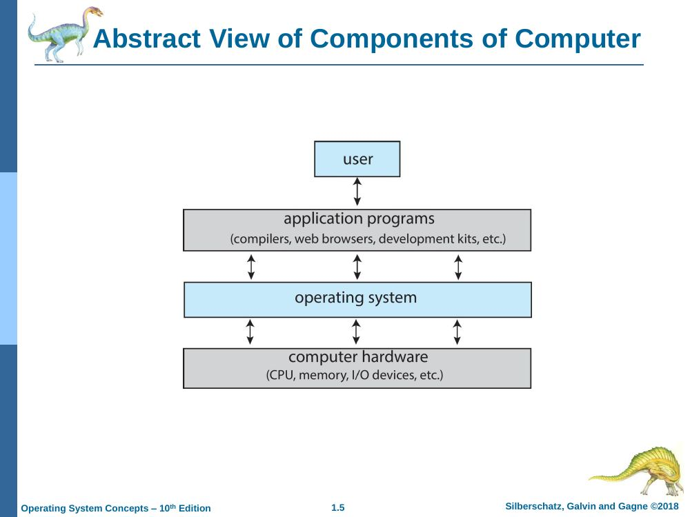

Diagram dibaca dari bawah: **perangkat keras → SO → aplikasi → pengguna**. Perangkat keras menyediakan sumber daya; aplikasi menentukan pekerjaan; SO mengatur akses ke perangkat. Saat Sensei menekan **Simpan**, aplikasi meminta layanan menulis berkas. SO memilih lokasi penyimpanan dan memakai driver untuk memerintah perangkat. Aplikasi tidak perlu memahami perintah fisik setiap model SSD.

### 1.1.1 User View — Sudut pandang pengguna

Pengguna laptop menginginkan kemudahan dan respons yang cepat. Server bersama harus membagi sumber daya di antara banyak pengguna. Ponsel perlu memperhatikan baterai. Perangkat tertanam mungkin tidak mempunyai layar atau pengguna yang berinteraksi langsung. Karena itu, tujuan praktis SO bergantung pada lingkungan. Menyebut SO hanya sebagai “tampilan grafis” melewatkan pekerjaan terpentingnya.

### 1.1.2 System View — Sudut pandang sistem

Ada dua peran utama SO. Sebagai **resource allocator**, SO memutuskan siapa memakai CPU, memori, dan I/O, kapan, dan berapa banyak. Saat proses A menunggu disk, CPU dapat diberikan kepada B. Sebagai **control program**, SO mengawasi eksekusi dan akses perangkat agar satu program tidak mengganggu program lain. Misalnya, aplikasi biasa tidak boleh menulis ke memori kernel. Pengalokasian menjawab perebutan sumber daya; pengendalian menjaga pemakaiannya sah dan tertib.

### 1.1.3 Defining Operating Systems — Apa saja yang disebut SO?

**Kernel** ialah inti yang mempunyai hak mengendalikan perangkat keras. **Program sistem** seperti shell membantu pemakaian komputer tetapi bukan bagian kernel. **Aplikasi** seperti peramban mengerjakan kebutuhan pengguna. Beberapa paket juga menyertakan *middleware*, yaitu layanan perantara untuk aplikasi. Tidak ada daftar komponen yang sama persis pada semua produk SO; “kernel” dan “seluruh program bawaan” bukan hal yang identik.

**Cek UTS:** bila diminta empat komponen dan dua fungsi SO, gambar susunan di atas lalu jelaskan *alokasi sumber daya* dan *pengendalian program* dengan satu contoh. Jawaban “SO penghubung pengguna dengan perangkat keras” saja belum menerangkan kedua fungsi.

## 1.2 Computer-System Organization — Bagaimana bagian komputer bekerja sama?

CPU menjalankan instruksi; memori utama menampung instruksi dan data aktif; **device controller** mengendalikan jenis perangkat tertentu, seperti disk atau USB. Komponen tersebut terhubung melalui jalur komunikasi sistem. **Device driver** ialah perangkat lunak SO yang memahami controller tertentu dan memberi antarmuka lebih seragam kepada bagian SO lain. CPU dan controller dapat bekerja dalam waktu yang bertumpang tindih, walau akses ke memori bersama perlu diatur.

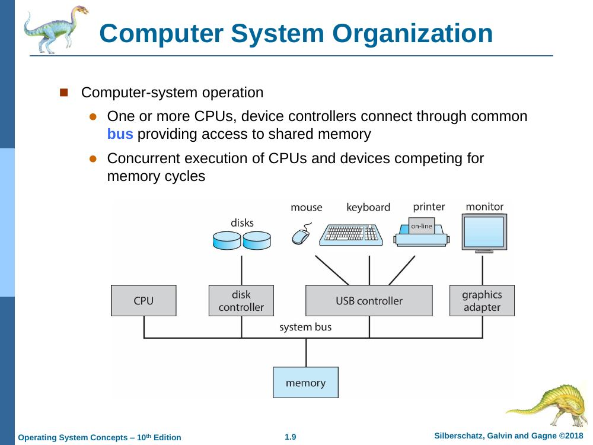

### 1.2.1 Interrupts — Bagaimana CPU mengetahui bahwa I/O selesai?

#### 1.2.1.1 Overview — Gambaran alur

Saat aplikasi meminta data, driver mengatur controller. Controller menjalankan operasi dan memakai buffer lokal sebagai penampung sementara. Setelah selesai, controller mengirim **interrupt** ke CPU. CPU menyimpan keadaan yang diperlukan, menjalankan penangan sesuai jenis interrupt, lalu dapat melanjutkan pekerjaan sebelumnya. CPU tidak perlu terus-menerus bertanya kepada perangkat apakah tugasnya selesai.

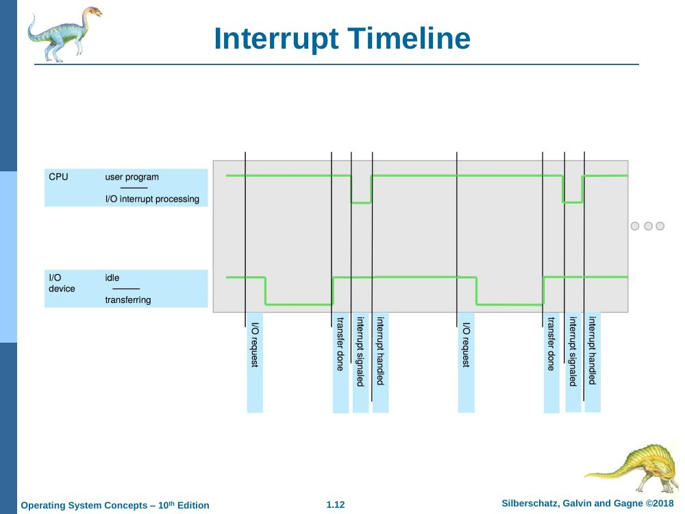

```text
Aplikasi meminta baca → driver mengatur controller → perangkat bekerja
          CPU dapat mengerjakan hal lain             ↓
                CPU ← interrupt saat operasi selesai
                         ↓
                penangan kernel memeriksa hasil/status
                         ↓
                aplikasi menerima data atau galat
```

**Interrupt vector** mengarahkan CPU ke penangan (*interrupt service routine*) yang sesuai. **Polling** berarti memeriksa sumber/status satu per satu; pemakaian istilahnya dapat berarti pemeriksaan sumber interrupt atau pemeriksaan perangkat berulang kali. **Exception/trap** muncul dari eksekusi instruksi, misalnya pembagian dengan nol. **System call** adalah permintaan layanan yang sengaja dibuat aplikasi. Ketiganya dapat membawa eksekusi ke kode SO, tetapi pemicunya berbeda: perangkat/timer berada di luar alur instruksi aplikasi, sedangkan exception dan system call terkait instruksi yang sedang dijalankan.

#### 1.2.1.2 Implementation — Bagaimana interrupt ditangani?

Secara sederhana, setelah satu instruksi selesai CPU memeriksa apakah ada permintaan interrupt. Jika ada, nomor interrupt dipakai untuk mencari alamat penangan pada *interrupt vector*. Penangan menyimpan register yang akan diubah, membaca penyebab kejadian, menangani perangkat atau galat, memulihkan keadaan, lalu kembali ke instruksi program yang tertunda. CPU dapat menerima beberapa jenis interrupt dengan tingkat prioritas berbeda. Sebagian interrupt bisa ditunda selama bagian kerja yang sangat peka, sedangkan kejadian kritis tertentu tidak boleh ditunda. Detail jalur listrik dan nomor interrupt bergantung pada arsitektur; yang penting untuk belajar adalah urutan **sinyal → cari penangan → simpan keadaan → tangani → pulihkan → lanjut**.

### 1.2.2 Storage Structure — Di mana data disimpan?

Register dan cache dekat dengan CPU. **RAM** menampung program aktif dan biasanya kehilangan isi ketika listrik mati. **Penyimpanan sekunder**, seperti SSD dan HDD, mempertahankan data serta menampung lebih banyak, tetapi umumnya lebih lambat diakses. Saat aplikasi dibuka, instruksinya dipindahkan dari penyimpanan ke RAM sebelum dieksekusi.

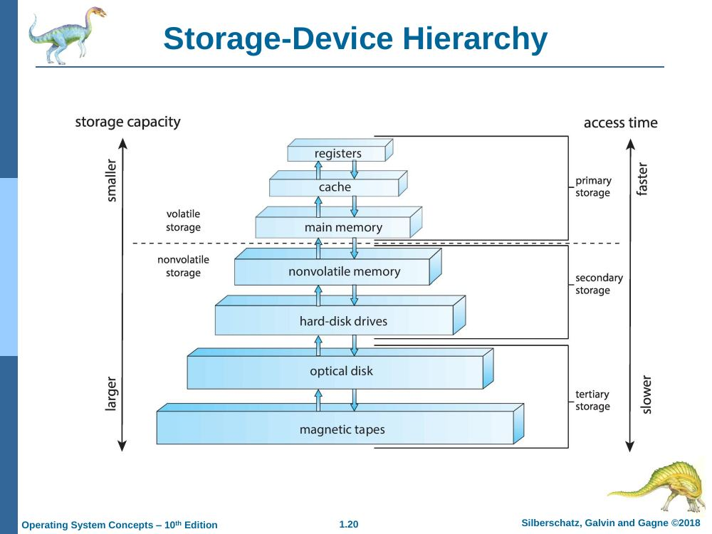

Semakin dekat ke CPU, media umumnya lebih cepat tetapi lebih kecil. **Cache** menyimpan salinan data agar akses ulang cepat; data asal tidak otomatis hilang. Bila beberapa salinan ada dan salah satunya berubah, sistem harus menjaga konsistensinya. Ini penting ketika beberapa inti CPU berbagi data.

**Satuan yang perlu diingat:** `1 byte = 8 bit`. *Word* adalah ukuran alami sebuah arsitektur, bukan selalu 8 byte. `kB = 10³ byte` dan `KiB = 2¹⁰ byte`; baca konvensi soal sebelum menghitung kapasitas.

### 1.2.3 I/O Structure — Siapa memindahkan data?

Controller menukar data dengan perangkat lewat buffer lokal. Pada transfer blok besar, **DMA (direct memory access)** memungkinkan controller memindahkan blok ke/dari RAM setelah CPU menyiapkan operasinya. CPU tidak perlu menyalin tiap byte dengan instruksinya sendiri, tetapi CPU tetap memulai operasi dan menangani hasil ketika interrupt datang. DMA tidak berarti CPU sama sekali tidak terlibat.

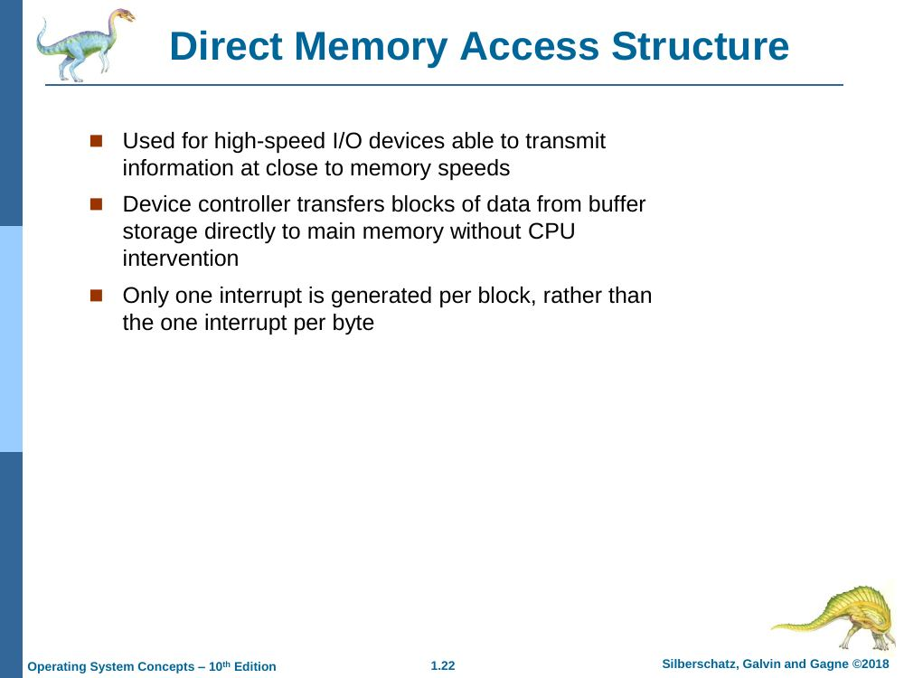

Pada **I/O sinkron**, pemanggil menunggu hasil sebelum melanjutkan alurnya. Pada **I/O asinkron**, pemanggil dapat melanjutkan pekerjaan dan menerima atau memeriksa hasil kemudian. Asinkron tidak berarti tanpa interrupt; interrupt justru salah satu cara memberi tahu penyelesaian.

## 1.3 Computer-System Architecture — Satu CPU, banyak CPU, atau banyak komputer?

### 1.3.1 Single-Processor Systems

Satu CPU serbaguna dengan satu inti hanya mengeksekusi satu alur instruksi pada satu saat. Pergantian cepat dapat membuat beberapa program tampak berjalan bersama. Controller keyboard atau disk mungkin mempunyai pemroses khusus, tetapi itu tidak menjadikan sistem multiprosesor serbaguna.

### 1.3.2 Multiprocessor Systems

Sistem multiprosesor memiliki lebih dari satu unit pemrosesan yang mampu bekerja **paralel**. Pada **symmetric multiprocessing (SMP)**, CPU setara dapat mengerjakan proses pengguna dan tugas kernel; rancangan asimetris membagi peran khusus. Satu chip bisa berisi beberapa *core*. Banyak core pada satu chip berbeda dari banyak chip fisik, tetapi keduanya menambah kemampuan eksekusi paralel.

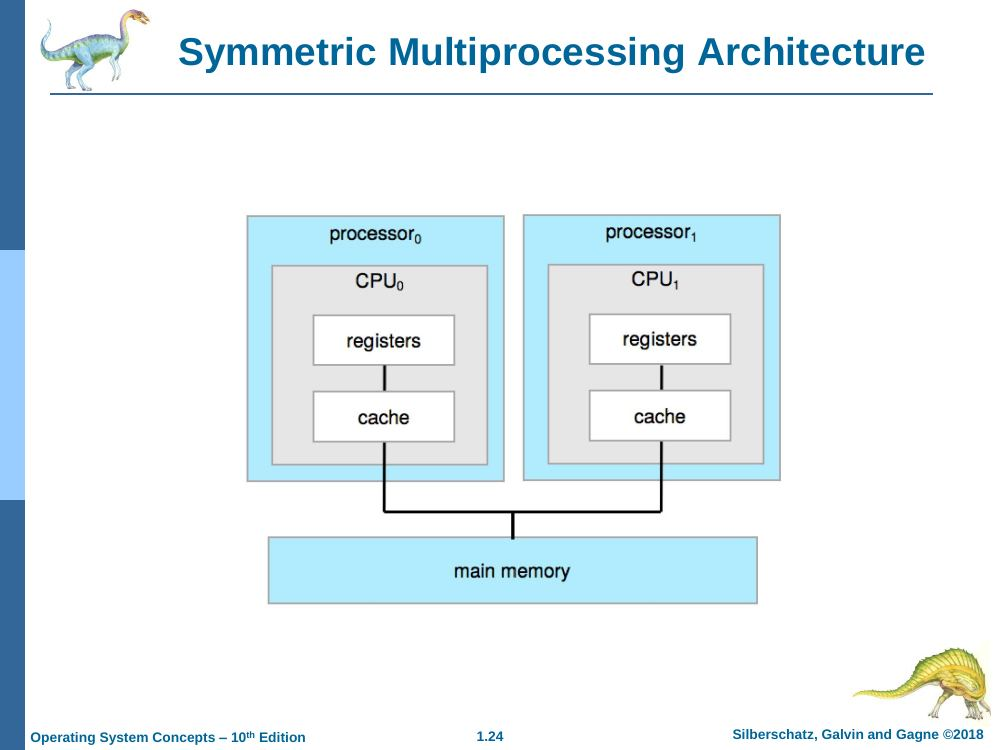

**Konkurensi** berarti beberapa pekerjaan maju dalam periode yang sama; **paralelisme** berarti dua atau lebih pekerjaan benar-benar dieksekusi pada saat yang sama. Satu inti bisa mendukung konkurensi lewat pergantian tugas; banyak inti dapat mendukung paralelisme. Menambah CPU juga tidak menjamin kinerja naik sesuai jumlahnya, sebab pekerjaan perlu koordinasi dan berbagi memori. Pada **NUMA**, sebagian memori lebih dekat ke kelompok CPU tertentu sehingga lokasi data ikut memengaruhi waktu akses.

### 1.3.3 Clustered Systems

**Cluster** adalah beberapa **komputer terpisah** yang bekerja sama melalui koneksi. Ini berbeda dari SMP yang menggabungkan CPU dalam satu sistem. Cluster dapat menjaga layanan tetap tersedia ketika satu simpul gagal atau membagi pekerjaan yang dapat dipecah. Bila memakai penyimpanan bersama, akses antarsimpul perlu dikoordinasikan.

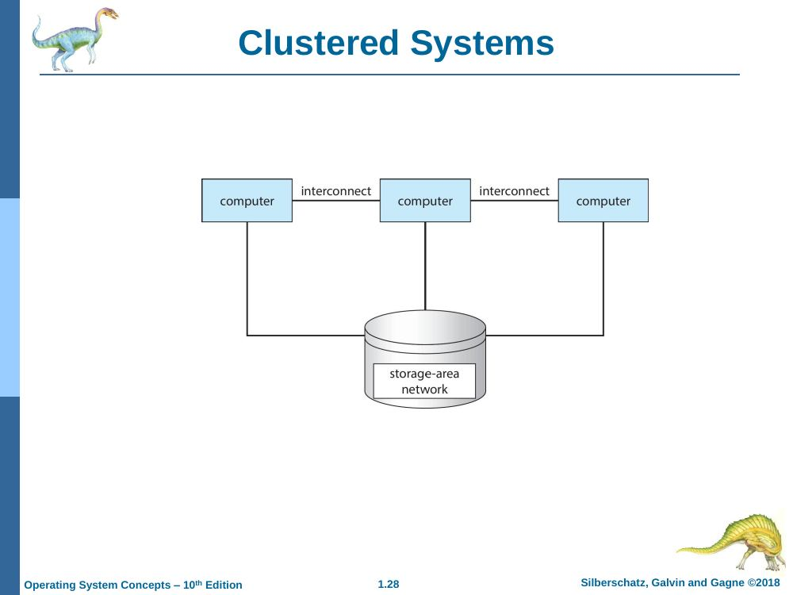

## 1.4 Operating-System Operations — Dari boot sampai kernel mengambil kendali

Ketika listrik dinyalakan, CPU belum menjalankan SO. Kode awal pada **firmware** melakukan *bootstrap*: menyiapkan perangkat penting, menemukan jalur pemuatan, dan memulai pemuatan kernel. **Boot loader** memuat kernel ke memori. Setelah kernel berjalan, layanan sistem dapat dimulai, lalu aplikasi pengguna dapat dijalankan. Implementasi firmware dan loader berbeda antarplatform, tetapi urutan konsepnya sama.

```text
Daya menyala → firmware/bootstrap → boot loader → kernel di RAM
                                                ↓
                                  layanan sistem → aplikasi
```

Pertanyaan “siapa menjalankan SO sebelum SO ada?” dijawab oleh firmware dan loader, bukan aplikasi yang sudah berjalan. Boot loader berbeda dari kernel; tugasnya menyiapkan dan memuat kernel.

### 1.4.1 Multiprogramming and Multitasking

Pada **multiprogramming**, beberapa pekerjaan berada di memori. Ketika A menunggu I/O, CPU dapat mengerjakan B, sehingga tidak menganggur. Pada **multitasking/time-sharing**, CPU berpindah cukup sering di antara pekerjaan agar pengguna bisa berinteraksi dengan semuanya secara responsif. Keduanya dapat diterapkan sekaligus; pembeda utamanya adalah tujuan yang ditonjolkan: pemanfaatan CPU versus respons interaktif.

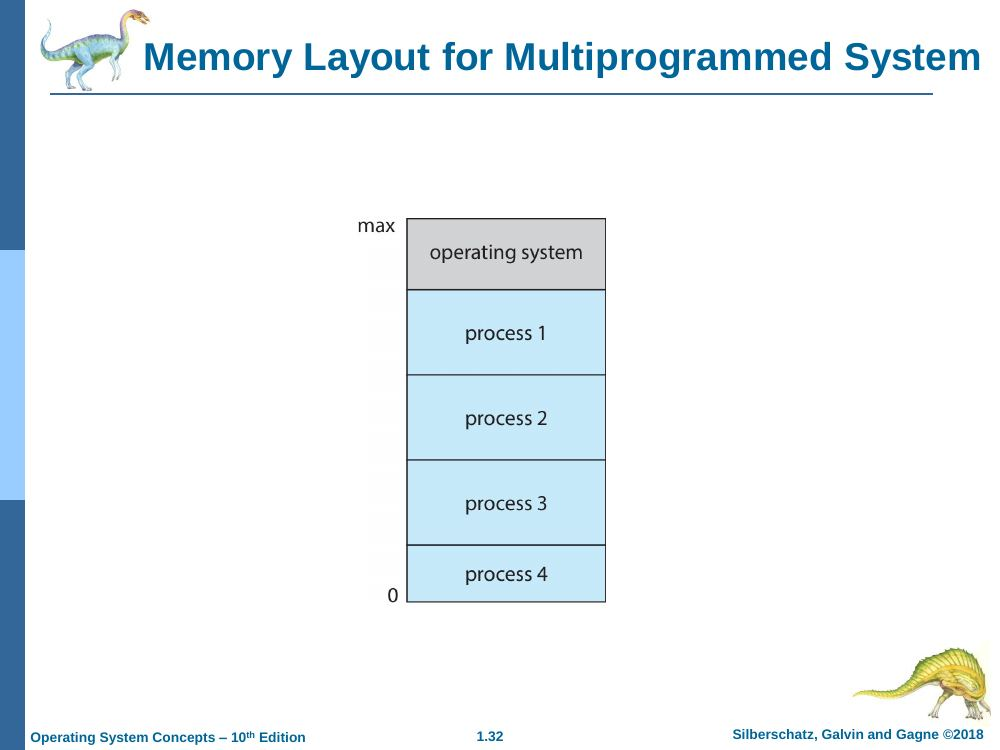

Contoh: peramban menunggu jaringan, lalu CPU menjalankan editor (**multiprogramming**). Ketika keduanya siap, SO memberi jatah CPU bergantian agar keduanya tetap responsif (**multitasking**). Pada satu inti, ini bukan bukti dua instruksi dieksekusi persis bersamaan.

### 1.4.2 Dual-Mode and Multimode Operation

Perangkat keras menyediakan penanda mode. Aplikasi berjalan dalam **user mode** yang dibatasi; kernel menjalankan pekerjaan dengan hak **kernel mode**. **Privileged instruction** hanya boleh dijalankan pada mode istimewa, misalnya pengaturan timer atau operasi perangkat keras tertentu. Jika aplikasi bebas mengubah perlindungan memori, kesalahannya dapat merusak seluruh sistem.

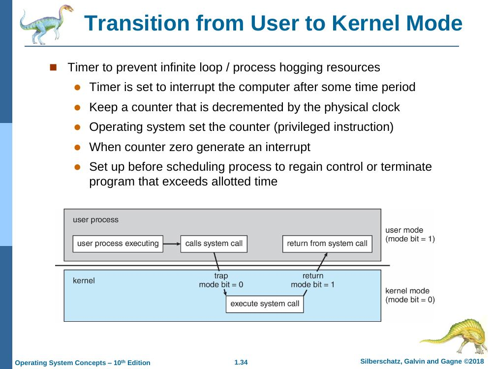

```text
USER MODE: aplikasi meminta layanan
    │ system call
    ▼
KERNEL MODE: periksa izin/parameter → kerjakan layanan → siapkan hasil
    │ kembali dari system call
    ▼
USER MODE: aplikasi melanjutkan instruksi

Interrupt atau exception juga dapat membawa CPU ke penangan kernel.
```

**Perpindahan mode tidak selalu berarti pergantian proses.** Proses yang meminta layanan dapat masuk kernel mode lalu kembali menjadi proses yang sama. Pergantian proses baru terjadi bila kernel memilih pekerjaan lain. Beberapa arsitektur mempunyai tingkat hak tambahan untuk virtualisasi.

### 1.4.3 Timer

Sebelum menyerahkan CPU ke aplikasi, kernel memasang **timer**. Ketika waktunya habis, timer memicu interrupt agar kernel memperoleh kendali kembali. Kernel dapat melanjutkan aplikasi yang sama atau menjadwalkan yang lain. Aplikasi tidak boleh bebas mematikan timer. Jika boleh, program `while (true)` dapat memonopoli CPU. Timer menjamin peluang bagi kernel untuk mengambil kendali, bukan membuat semua program otomatis selesai.

**Alur inti UTS:** `boot loader memuat kernel → beberapa pekerjaan berada di memori → timer dipasang → aplikasi berjalan dalam user mode → system call/interrupt/exception masuk ke kernel mode → kernel menangani kejadian dan mungkin memilih proses lain`.

## 1.5 Resource Management — Apa saja yang diatur SO?

Bagian ini adalah peta tugas. Kaitkan sumber daya dengan masalah yang muncul bila tidak dikelola; algoritme rinci dibahas pada bab-bab berikutnya.

### 1.5.1 Process Management

**Program** adalah instruksi pasif di penyimpanan. **Proses** adalah program yang sedang berjalan beserta keadaan dan sumber dayanya. SO membuat dan menghentikan proses, menentukan giliran CPU, menunda dan melanjutkan pekerjaan, serta menyediakan komunikasi dan sinkronisasi. Dua proses yang mengubah data sama tanpa aturan dapat menghasilkan nilai salah.

Satu program dapat melahirkan beberapa proses. Misalnya dua jendela aplikasi yang sama dapat mempunyai data kerja dan keadaan eksekusi berbeda. Jadi ketika SO menjadwalkan CPU, yang ditangani adalah pekerjaan aktif beserta keadaannya, bukan sekadar nama berkas program. Rincian keadaan proses dan perpindahannya dibahas dalam Bab 3.

### 1.5.2 Memory Management

SO mencatat wilayah memori yang dipakai, memilih apa yang masuk atau keluar, serta mengalokasikan dan membebaskan ruang. Instruksi dan data aktif harus tersedia di memori saat digunakan. Perlindungan memori mencegah aplikasi A bebas mengubah data B. **Mengalokasikan dan membebaskan RAM termasuk pengelolaan memori**, bukan pengelolaan berkas.

### 1.5.3 File-System Management

Sistem berkas memberi nama dan susunan logis bagi data: berkas dan direktori. SO membuat atau menghapusnya, mengatur akses, dan memetakan data logis ke penyimpanan. Pengguna bisa membuka `catatan.txt` tanpa tahu blok fisiknya berada di mana.

### 1.5.4 Mass-Storage Management

SO mengelola ruang kosong, alokasi blok, penjadwalan akses, dan pemasangan sistem berkas (*mount*). *Mount* membuat isi suatu sistem berkas dapat diakses pada tempat tertentu dalam susunan berkas. Itu berbeda dari menyalin seluruh isi disk ke RAM.

### 1.5.5 Cache Management

Cache menyimpan salinan data untuk akses ulang yang lebih cepat. **Cache hit** berarti data ditemukan; **cache miss** berarti perlu diambil dari lapisan yang lebih lambat. Karena kapasitasnya terbatas, sistem perlu memilih salinan mana yang diganti. Saat data memiliki beberapa salinan, perubahan harus dijaga konsistensinya.

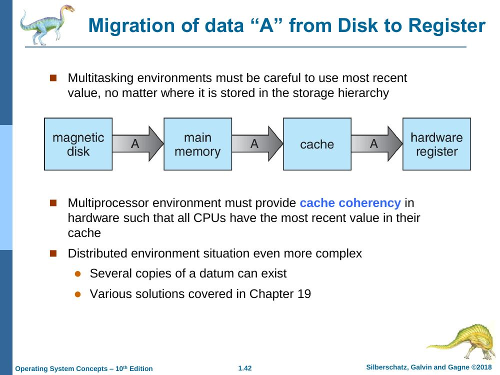

### 1.5.6 I/O System Management

SO menyembunyikan rincian perangkat dengan driver dan antarmuka umum. **Buffering** menampung data selama transfer atau saat kecepatan dua pihak berbeda. **Caching** mempercepat akses ulang. **Spooling** mengantre pekerjaan yang memakai perangkat secara bergiliran, seperti printer. Ketiganya dapat menyimpan sementara, tetapi tujuannya berlainan.

| Permintaan | Pengelolaan terdekat | Mengapa |
|---|---|---|
| Menjalankan aplikasi | Proses dan memori | Perlu dibuat, diberi ruang, dan dijadwalkan. |
| Membuat folder | Sistem berkas | Mengubah struktur nama data. |
| Membebaskan RAM aplikasi | Memori | Ruang dikembalikan untuk pekerjaan lain. |
| Mengantre dokumen pada printer | I/O dan spooling | Pekerjaan menunggu giliran perangkat. |

## 1.6 Security and Protection — Siapa boleh mengakses apa?

**Protection** menetapkan dan menegakkan hak akses terhadap sumber daya. **Security** melindungi sistem dari penyalahgunaan dan serangan, baik dari dalam maupun luar. Perlindungan adalah bagian dari keamanan, bukan sinonim yang sepenuhnya sama.

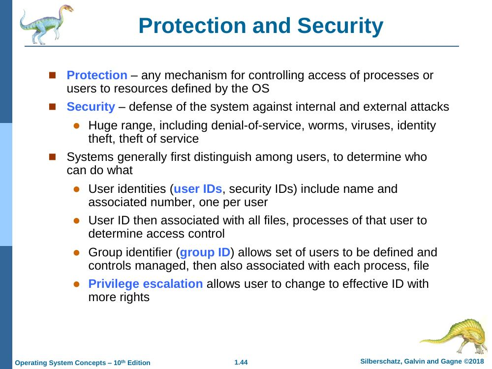

SO mengaitkan identitas pengguna dan kelompok dengan proses serta berkas; pada sistem mirip Unix istilahnya **UID** dan **GID**. Jika izin melarang, proses pengguna biasa tidak boleh membaca berkas pribadi orang lain. Dual-mode juga penting: pemeriksaan izin akan mudah dilewati bila aplikasi boleh menjalankan instruksi istimewa secara langsung.

## 1.7 Virtualization — Beberapa lingkungan pada satu mesin

**Virtualisasi** memungkinkan beberapa lingkungan komputasi memakai satu mesin fisik. **Hypervisor** atau **virtual machine manager (VMM)** membagi CPU, memori, dan I/O di antara **mesin virtual (VM)**. Tiap VM dapat memiliki SO tamu dan aplikasi sendiri. VMM dapat berjalan langsung di perangkat keras atau di atas SO host, bergantung rancangannya.

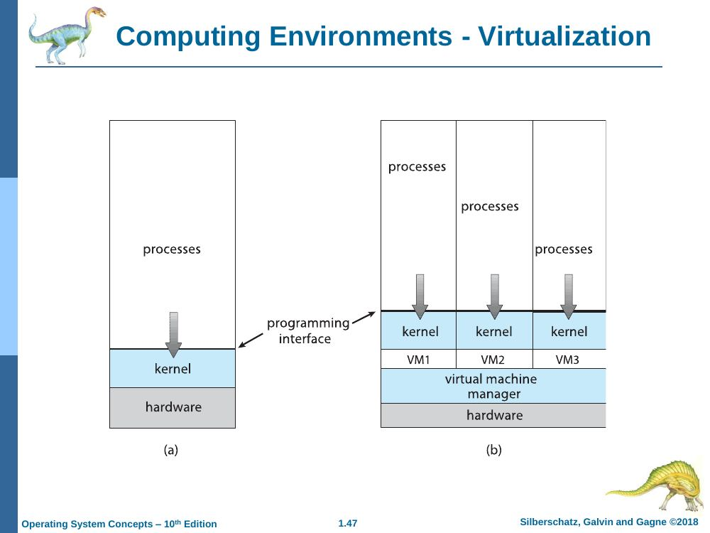

```text
 Aplikasi A                  Aplikasi B
 SO tamu A                   SO tamu B
       └────── hypervisor/VMM ──────┘
             perangkat keras fisik
```

**Emulasi** meniru arsitektur lain agar instruksi yang berbeda dapat dijalankan, sering dengan biaya kinerja lebih besar. **Interpretasi** mengeksekusi melalui penafsir perangkat lunak. Keduanya tidak otomatis sama dengan virtualisasi CPU berarsitektur sama. VM berguna untuk menguji SO, mengisolasi lingkungan percobaan, dan menjalankan beberapa layanan pada satu mesin fisik. Isolasi tetap bergantung pada hypervisor yang bekerja benar.

## 1.8 Distributed Systems — Kerja sama antar-komputer

Sistem terdistribusi menghubungkan **komputer terpisah** melalui jaringan. Tiap komputer punya sumber daya dan kemungkinan gagal sendiri. Jaringan memungkinkan pertukaran pesan, berbagi berkas, dan pembagian pekerjaan. **LAN** mencakup area lokal, **MAN** kota, **WAN** area luas, dan **PAN** area pribadi dekat; istilah itu menunjukkan cakupan jaringan, bukan jenis kernel.

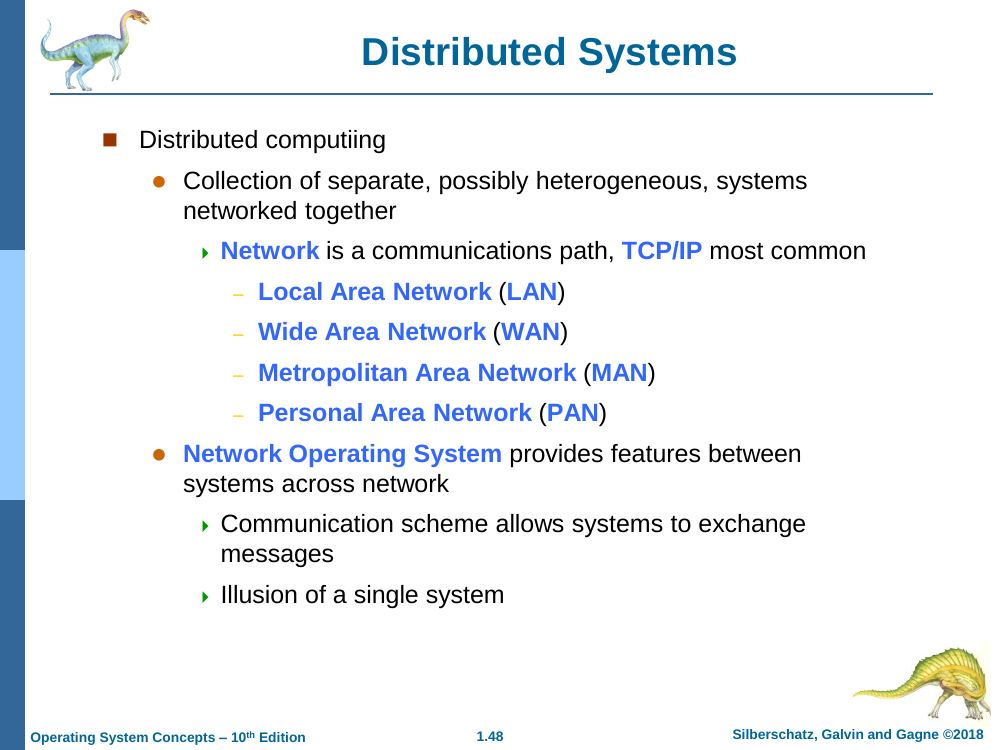

**Network OS** memungkinkan mesin mandiri berkomunikasi dan berbagi layanan. **Distributed OS** mencoba memberi kesan pengelolaan yang lebih terpadu. Koneksi jaringan saja belum berarti semua mesin menjalankan satu SO terdistribusi. Masalah khasnya ialah pesan dapat terlambat/hilang dan satu mesin bisa gagal sementara yang lain tetap bekerja.

## 1.9 Kernel Data Structures — Bagaimana kernel mencatat keadaan?

Kernel perlu mencatat proses siap, perangkat aktif, dan blok penyimpanan kosong. Struktur data dipilih menurut operasi yang sering dilakukan. Ini pengantar peran struktur data dalam SO, bukan tuntutan menghafal implementasi tertentu.

### 1.9.1 Lists, Stacks, and Queues

**Array** memungkinkan akses langsung melalui indeks. **Linked list** menghubungkan elemen dengan penunjuk; daftar ganda juga menunjuk ke elemen sebelumnya. **Stack** melayani yang terakhir masuk lebih dulu (*LIFO*), sedangkan **queue** biasanya melayani yang pertama masuk lebih dulu (*FIFO*). Antrean proses nyata bisa memakai aturan prioritas yang lebih rumit.

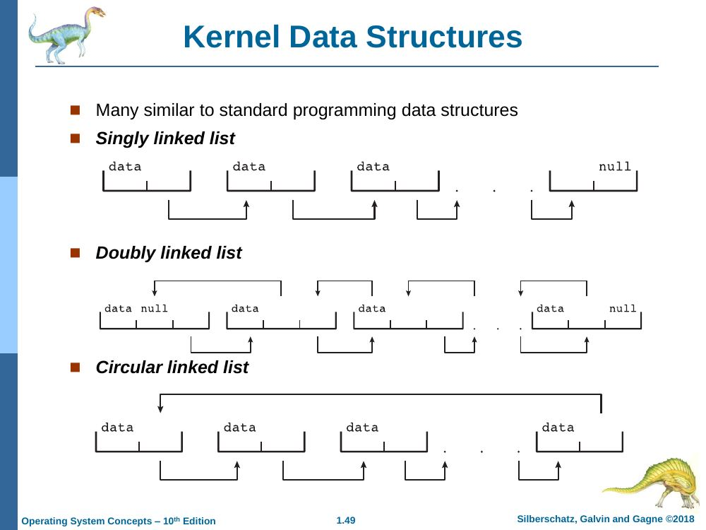

### 1.9.2 Trees

Pohon mengatur data secara bercabang. Pada *binary search tree*, aturan kiri dan kanan memudahkan pencarian. Jika seimbang, pencarian dapat berorde `O(log n)`; jika sangat timpang, dapat menjadi `O(n)`. Rincian analisis kompleksitas tidak menjadi pokok hitungan Bab 1.

### 1.9.3 Hash Functions and Maps

Fungsi hash memetakan kunci ke lokasi pencarian. Dua kunci bisa menuju lokasi sama (**collision**), sehingga perlu aturan penanganannya. Kernel dapat memakainya untuk menemukan objek berdasarkan identitas dengan cepat.

### 1.9.4 Bitmaps

**Bitmap** memakai satu bit untuk menandai satu objek, misalnya blok disk kosong atau terpakai. Jika ada `N` blok, penandanya perlu `N` bit, setara `⌈N/8⌉` byte sebelum tambahan penyimpanan lain. Untuk 16 blok, cukup 2 byte penanda. Arti `0` dan `1` harus mengikuti definisi contoh; tidak universal.

## 1.10 Computing Environments — Di mana SO dipakai?

### 1.10.1 Traditional Computing

PC dan server kini hampir selalu terhubung jaringan. Sistem **batch** memproses pekerjaan dengan input yang sudah disiapkan; sistem **interaktif** harus merespons pengguna. Teknik berbagi waktu CPU yang dahulu melayani banyak pengguna juga dipakai laptop modern ketika banyak aplikasi aktif.

### 1.10.2 Mobile Computing

Ponsel dan tablet mengutamakan portabilitas, sensor, koneksi nirkabel, dan penggunaan baterai. SO menyeimbangkan kelancaran aplikasi dengan daya. Perangkat mobile tidak otomatis sistem real-time; terlambat menampilkan chat berbeda dari gagal memenuhi tenggat pengendali mesin.

### 1.10.3 Client–Server Computing

**Client** meminta layanan, **server** menjawab. Browser yang meminta halaman ialah client, mesin yang menyediakannya server. Ini peran komunikasi, bukan ukuran atau harga komputer. Satu mesin dapat menjadi client untuk satu layanan dan server untuk yang lain.

Contoh alurnya: browser mengirim permintaan halaman, server memprosesnya lalu mengembalikan hasil. Keduanya mempunyai SO sendiri yang mengelola proses, memori, dan jaringan. Tidak ada satu CPU bersama seperti pada SMP; pertukaran data dilakukan lewat jaringan.

### 1.10.4 Peer-to-Peer Computing

Pada **peer-to-peer (P2P)**, simpul dapat meminta sekaligus menyediakan layanan. Tantangannya adalah menemukan peer dan menyesuaikan diri saat peer masuk atau keluar. Pada client–server, peran penyedia layanan biasanya lebih tetap.

Misalnya beberapa komputer saling menyediakan potongan berkas. Komputer A dapat mengambil potongan dari B sambil menyediakan potongan lain bagi C. Ini tidak berarti semua simpul harus identik kuatnya; ciri pembeda P2P adalah kemampuan tiap simpul mengambil *dan* menyediakan layanan.

### 1.10.5 Cloud Computing

Cloud menyediakan sumber daya melalui jaringan sesuai kebutuhan. **IaaS** menyediakan infrastruktur virtual, **PaaS** lingkungan menjalankan aplikasi, dan **SaaS** aplikasi siap pakai. Virtualisasi sering menjadi bahan dasarnya, tetapi cloud juga perlu jaringan dan pengelolaan layanan. Satu VM lokal saja belum berarti layanan cloud.

Bayangkan Sensei ingin menjalankan aplikasi web. Pada IaaS, Sensei mengurus SO tamu dan aplikasi di atas mesin virtual. Pada PaaS, penyedia menyiapkan lingkungan tempat aplikasi dijalankan sehingga Sensei lebih fokus pada aplikasinya. Pada SaaS, pengguna langsung memakai aplikasi yang sudah tersedia. Batas tanggung jawab ini lebih membantu daripada menghafal kepanjangan singkatan saja.

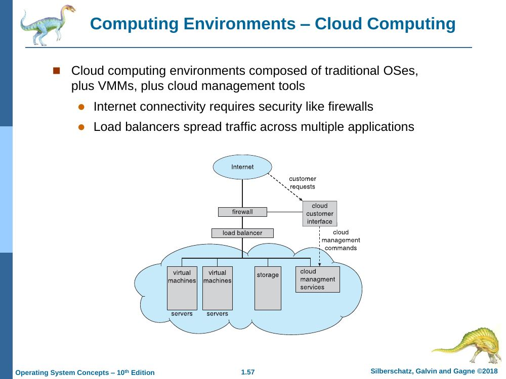

### 1.10.6 Real-Time Embedded Systems

Perangkat tertanam biasanya memiliki tugas khusus. Pada sistem **real-time**, jawaban benar yang datang sesudah batas waktu dapat dianggap gagal. Pengendali rem perlu bereaksi sebelum tenggat, bukan sekadar cepat secara rata-rata. Ada tenggat keras dan tenggat yang lebih toleran; cara menjadwalkannya dibahas pada materi real-time.

Bandingkan dua kejadian: pemutar musik terlambat sebentar dan suara tersendat; pengendali rem terlambat pada saat kendaraan harus berhenti. Keduanya tidak nyaman, tetapi akibat pelanggaran tenggat berbeda. Karena itu memilih SO atau penjadwal untuk perangkat tertanam dimulai dari pertanyaan **berapa batas waktu respons yang dapat diterima**, bukan hanya “CPU-nya cepat atau tidak?”.

## 1.11 Free and Open-Source Operating Systems — Belajar dari sumber terbuka

Kode sumber yang tersedia memungkinkan rancangan SO dipelajari dan diuji. **Perangkat lunak bebas** menekankan kebebasan pengguna sesuai lisensinya; **open source** menekankan keterbukaan sumber dan model pengembangan. “Gratis dipakai” tidak otomatis memberi hak mempelajari atau mengubah kode. Hak yang tepat harus dibaca dari lisensi proyek.

### 1.11.1 History — Dari berbagi kode ke lisensi

Berbagi kode sudah berlangsung sejak awal komputasi. Ketika perangkat lunak mulai dipasarkan terpisah, aturan pemakaian dan distribusi menjadi lebih penting. Sejarah ini menjelaskan mengapa melihat kode sumber merupakan hak yang perlu dinyatakan oleh lisensi, bukan akibat otomatis dari membeli atau mengunduh sebuah program.

### 1.11.2 Free Operating Systems — Kebebasan pengguna

Gerakan perangkat lunak bebas menekankan hak memakai, mempelajari, mengubah, dan menyebarkan perangkat lunak sesuai lisensinya. Kata *free* di sini terutama berbicara tentang kebebasan, bukan sekadar harga nol. Bagi pelajar SO, kode terbuka memungkinkan konsep penjadwalan atau memori dibandingkan dengan implementasi nyata.

### 1.11.3 GNU/Linux

**Linux** adalah kernel. Sebuah distribusi **GNU/Linux** menggabungkannya dengan pustaka, program sistem, alat pengelolaan, dan aplikasi lain. Inilah contoh konkret pembedaan pada 1.1.3: kernel bukan seluruh perangkat lunak yang pengguna temui ketika sebuah komputer selesai menyala.

### 1.11.4 BSD UNIX

**BSD** adalah keluarga sistem mirip Unix dengan tradisi kode sumber terbuka. Berbeda dari istilah “Linux” yang terutama menunjuk kernel, nama sebuah sistem BSD biasanya merujuk pada sistem dasar yang dikembangkan sebagai satu kesatuan. Untuk Bab 1, kenali BSD sebagai contoh SO yang implementasinya dapat dipelajari.

### 1.11.5 Solaris

Buku memasukkan **Solaris** sebagai contoh ekosistem SO berbasis Unix dan sejarah pembukaan sumbernya. Status lisensi suatu komponen dapat berbeda dari komponen lain dan dapat berubah dari waktu ke waktu. Karena itu jangan menyimpulkan semua program dalam satu produk mempunyai izin penggunaan yang sama.

### 1.11.6 Open-Source Systems as Learning Tools

Kode sumber paling membantu setelah model dasarnya dipahami. Konsep interrupt pada 1.2 memberi alasan mengapa kernel membutuhkan penangan; kode nyata memperlihatkan susunan penangan pada arsitektur tertentu. Mulai dari pertanyaan konsep, baru cari implementasinya.

## Peta hubungan konsep untuk UTS

| Bila soal menyebut… | Alur yang perlu dipikirkan | Jangan tertukar dengan… |
|---|---|---|
| Aplikasi menyimpan berkas | aplikasi → layanan SO → driver/controller → penyimpanan | aplikasi mengatur SSD langsung |
| Program menunggu disk | pekerjaan lain mendapat CPU | paralelisme pada satu inti |
| Program berulang tanpa akhir | timer mengembalikan kendali kernel | program harus rela berhenti sendiri |
| Aplikasi meminta layanan | system call → kernel mode → kembali | selalu berganti proses |
| Dua SO pada satu mesin | hypervisor membagi perangkat fisik | cluster beberapa komputer |
| Banyak CPU pada satu mesin | multiprosesor/SMP | multiprogramming pada satu CPU |

## Contoh soal dan pembahasan

Soal 1–3 **diadaptasi** dari UTS 2018/2019 dan 2019 dalam paket Sensei; redaksinya ditulis ulang. Soal 4–7 ialah **latihan baru** berdasarkan kisi-kisi UTS 2026, bukan soal ujian asli.

### Soal 1 — Empat komponen dan dua fungsi SO (adaptasi UTS 2019)

**Pertanyaan.** Gambarkan empat komponen komputer dan jelaskan dua fungsi SO.

**Pembahasan.** Gambar `pengguna → aplikasi → SO → perangkat keras`. CPU, memori, dan I/O termasuk perangkat keras. SO **mengalokasikan** sumber daya kepada pekerjaan yang perlu dan **mengendalikan** penggunaannya agar program tidak saling mengganggu. Contoh: penyunting meminta penulisan berkas; SO mengatur akses disk dan mencegah penyunting menimpa memori aplikasi lain. Jawaban “SO penghubung” saja belum menjelaskan kedua fungsi.

### Soal 2 — Fisik dan abstraksi (adaptasi UTS 2019)

**Pertanyaan.** Sebutkan tiga sumber daya perangkat keras utama dan contoh abstraksi yang memudahkan pemakaiannya.

**Pembahasan.** Sumber daya fisiknya **CPU, memori, I/O**. Contoh abstraksinya **proses/thread**, **ruang alamat proses**, dan **berkas** untuk penyimpanan. Tidak semua I/O identik dengan berkas, tetapi berkas contoh utama penyembunyian rincian penyimpanan. Soal asli berupa isian; jika pengajar memberi pilihan istilah, ikuti istilah yang diminta.

### Soal 3 — Berkas atau memori? (adaptasi UTS 2018)

**Pertanyaan.** Mana yang *bukan* pengelolaan berkas: membuat direktori, mengalokasikan dan membebaskan RAM, atau memetakan berkas ke penyimpanan sekunder?

**Pembahasan.** **Mengalokasikan dan membebaskan RAM** termasuk pengelolaan memori. Dua pilihan lain menyangkut sistem berkas. UTS lama juga menyebut *attach/detach devices*; maknanya perlu dibaca sesuai konteks pemasangan perangkat atau sistem berkas, sehingga pilihan RAM menjadi pembeda yang paling jelas.

### Soal 4 — Timer dan dual-mode (latihan dari kisi-kisi)

**Pertanyaan.** Aplikasi menjalankan `while (true)` lalu mencoba mematikan timer. Mengapa langkah kedua tidak boleh, dan bagaimana SO mengambil CPU kembali?

**Pembahasan.** Aplikasi berjalan di **user mode**; pengaturan timer merupakan operasi istimewa sehingga aplikasi tidak boleh melakukannya langsung. Kernel sudah menyiapkan timer. Ketika waktunya habis, interrupt membawa CPU ke penangan kernel, yang dapat memilih proses lain. Loop tersebut tidak harus selesai agar SO mendapat kendali.

### Soal 5 — Tiga pemicu masuk kernel (latihan dari kisi-kisi)

**Pertanyaan.** (a) Aplikasi meminta baca berkas. (b) Disk selesai mentransfer data. (c) Program membagi dengan nol. Sebutkan pemicu pada tiap kasus.

**Pembahasan.** (a) **System call**, permintaan sadar aplikasi. (b) **Interrupt perangkat**, pemberitahuan controller. (c) **Exception/trap**, akibat instruksi yang salah. Ketiganya dapat membawa CPU ke kode kernel, tetapi asal kejadiannya berbeda. Masuk kernel mode tidak selalu berarti berganti proses.

### Soal 6 — Multitasking bukan multiprosesor (latihan dari kisi-kisi)

**Pertanyaan.** Komputer satu inti menjalankan editor saat peramban menunggu jaringan. Keduanya lalu bergantian mendapat jatah CPU agar responsif. Apakah komputer ini harus punya dua CPU?

**Pembahasan.** Tidak. Memanfaatkan CPU saat proses lain menunggu adalah **multiprogramming**; pergantian jatah cepat untuk respons adalah **multitasking**. **Multiprosesor** membutuhkan lebih dari satu unit pemrosesan yang dapat bekerja paralel. Banyak aplikasi tampak aktif bukan bukti jumlah CPU.

### Soal 7 — Hypervisor atau cluster? (latihan dari kisi-kisi)

**Pertanyaan.** A: satu komputer fisik menjalankan dua SO tamu. B: dua komputer fisik bekerja sama menjaga satu layanan. Apa konsep terdekat untuk masing-masing?

**Pembahasan.** A adalah **virtualisasi**: hypervisor membagi satu mesin fisik untuk beberapa VM. B adalah **cluster**: beberapa komputer fisik terpisah bekerja sama. VM bisa dipakai di dalam sebuah cluster, jadi kedua istilah dapat muncul dalam satu rancangan tetapi menjelaskan lapisan berbeda.

## Uji pemahaman akhir

Ceritakan satu alur tanpa melihat catatan: komputer menyala; kernel dimuat; dua program aktif; salah satunya meminta data disk; controller selesai; timer berbunyi; sebuah VM juga berjalan. Tempatkan **boot loader, kernel, multiprogramming, system call, driver/controller, interrupt, timer, user/kernel mode, dan hypervisor** pada peristiwa yang tepat. Jika alurnya bisa dijelaskan, konsep utama Bab 1 sudah tersambung.

## Sumber dan batas cakupan

- Silberschatz, Galvin, dan Gagne, *Operating System Concepts*, edisi ke-10, Bab 1, subbab 1.1–1.11, dalam PDF referensi pada `OS.zip`.
- `K1.pdf`, 60 halaman slide kuliah. Gambar di atas berasal dari halaman PDF yang disebut pada teks gambar; angka kecil pada kaki slide kadang berbeda dari urutan PDF.
- `Kisi kisi.pdf`, bagian Pertemuan 1, serta contoh UTS 2018 dan 2019. Kisi-kisi memandu prioritas belajar, bukan jaminan seluruh soal ujian terbatas pada daftar itu.
- `Latihan Soal K1 - Pendahuluan Sistem Operasi.pdf` dipakai untuk melihat tingkat latihan dasar. Beberapa pilihannya menyederhanakan hal yang bergantung pada konteks; penjelasan di sini mengikuti mekanisme buku dan slide.

Penjelasan serta contoh di sini ditulis ulang untuk belajar. Materi ini tidak menyalin panjang isi buku atau semua slide. Dalam paket Sensei terdapat kisi-kisi, tetapi dokumen kontrak kuliah terpisah tidak ditemukan.
