# Bab 1 — Pengantar Sistem Operasi, slide demi slide

Materi ini mengikuti **60 halaman K1.pdf** dalam paket Sensei. Nomor di bawah adalah urutan halaman PDF; angka kecil pada kaki slide kadang berbeda. Gambar sengaja ditempatkan tepat sebelum pembahasannya agar bisa dibaca berurutan. Istilah bahasa Inggris dipertahankan saat lazim muncul dalam soal.

**Arah belajar UTS.** Kisi-kisi dalam paket menekankan definisi dan tujuan sistem operasi (SO), SO sebagai *resource allocator*, dual-mode, *privileged instruction*, timer, multiprogramming vs multitasking, boot loader, dan hypervisor. Seluruh slide tetap dibahas agar hubungan antarkonsep tidak terputus. Paket memuat kisi-kisi dan buku rujukan, tetapi tidak memuat dokumen yang bernama kontrak kuliah secara terpisah.

## Peta cepat

```text
Pengguna → aplikasi → sistem operasi → CPU / memori / perangkat I/O
                         ├─ membagi sumber daya
                         ├─ mengendalikan akses
                         └─ menyediakan layanan
```

### Slide 01 — Sampul bab

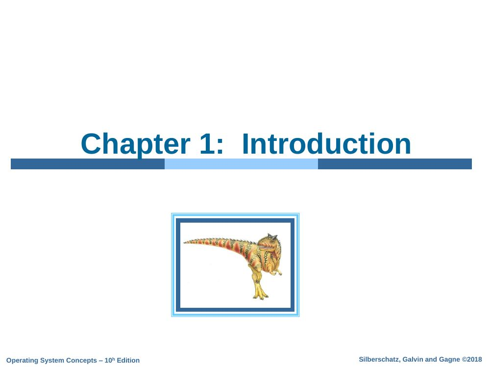

Ini adalah pengantar. Pertanyaan utama bab ini: apa yang dikerjakan SO, bagaimana komputer menjalankan I/O, dan mengapa aplikasi tidak boleh bebas mengendalikan seluruh perangkat keras?

### Slide 02 — Peta topik

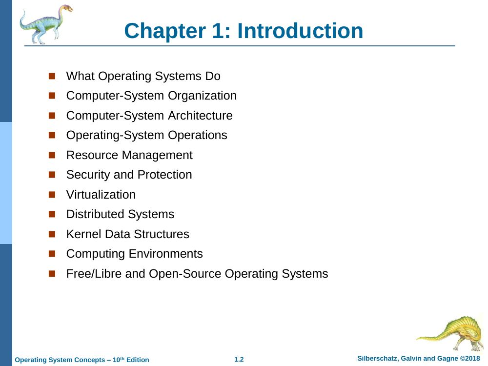

Urutan bab bergerak dari fungsi SO, susunan komputer, operasi SO, pengelolaan sumber daya, perlindungan, sampai virtualisasi dan lingkungan komputasi. Untuk UTS, hubungkan setiap istilah dengan masalah yang diselesaikannya; misalnya *timer* menyelesaikan masalah program yang memonopoli CPU.

### Slide 03 — Tujuan belajar

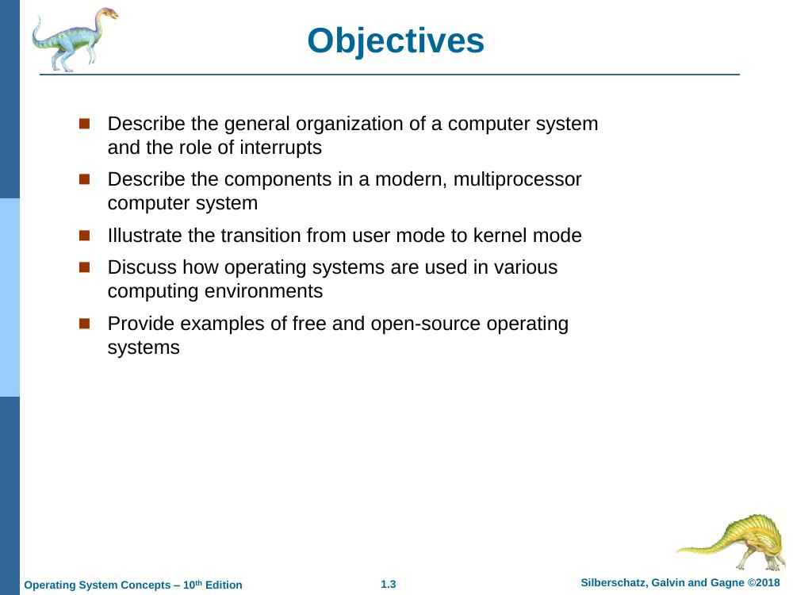

Setelah bab ini, Sensei seharusnya bisa menceritakan alur interupsi, membedakan multiprosesor dengan satu prosesor, menjelaskan perpindahan user mode ke kernel mode, serta memberi contoh lingkungan komputasi dan SO terbuka. Gunakan tujuan ini sebagai daftar cek, bukan bahan hafalan kata demi kata.

### Slide 04 — Empat komponen sistem komputer

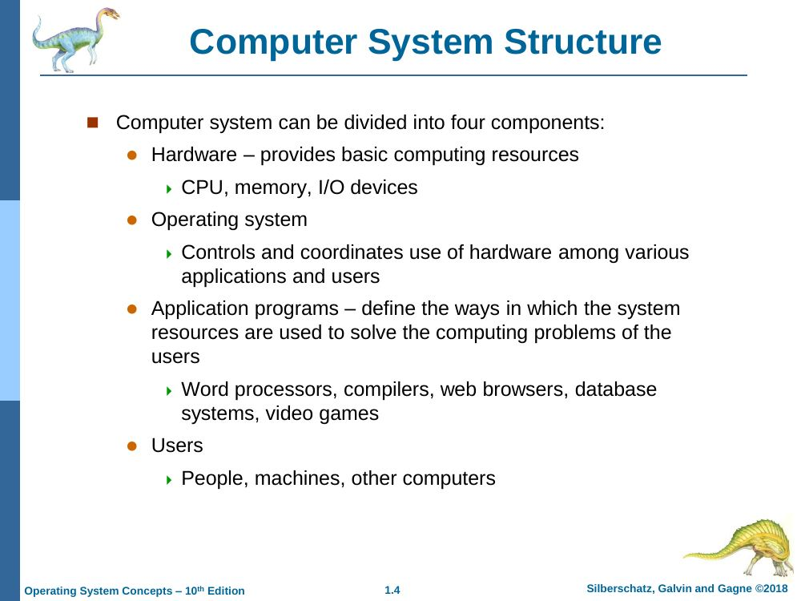

Empat komponennya adalah **pengguna, aplikasi, SO, dan perangkat keras**. Misalnya Sensei menekan tombol simpan: aplikasi pengolah kata meminta SO menulis berkas; SO memakai driver dan penyimpanan. CPU, memori, dan perangkat I/O adalah sumber daya fisik. Aplikasi menentukan pekerjaan yang diinginkan; SO mengatur cara sumber daya dipakai bersama.

### Slide 05 — Gambar empat lapisan


Baca diagram dari atas ke bawah: pengguna berinteraksi dengan aplikasi, aplikasi meminta layanan SO, lalu SO mengendalikan perangkat keras. Panah dua arah berarti hasil dan informasi galat kembali ke atas. **Catatan UTS:** bila diminta menggambar empat komponen, susun urutannya seperti gambar ini dan jelaskan dua fungsi SO: memudahkan penggunaan komputer dan mengalokasikan/mengendalikan sumber daya.

### Slide 06 — Apa yang dilakukan SO?

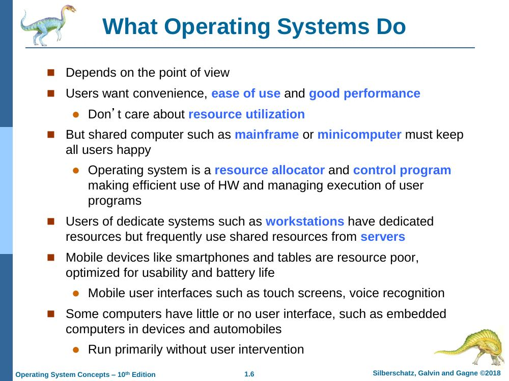

Jawabannya bergantung pada sudut pandang. Pengguna laptop mengejar kemudahan dan respons cepat; server bersama perlu membagi CPU dan memori secara adil; ponsel juga memperhatikan baterai; perangkat tertanam dapat bekerja tanpa antarmuka pengguna. Jadi *resource allocator* berarti SO memilih siapa memakai sumber daya dan kapan. *Control program* berarti SO mengawasi program agar operasi I/O dan penggunaan perangkat tidak saling merusak.

### Slide 07 — Mengapa definisi SO beragam?

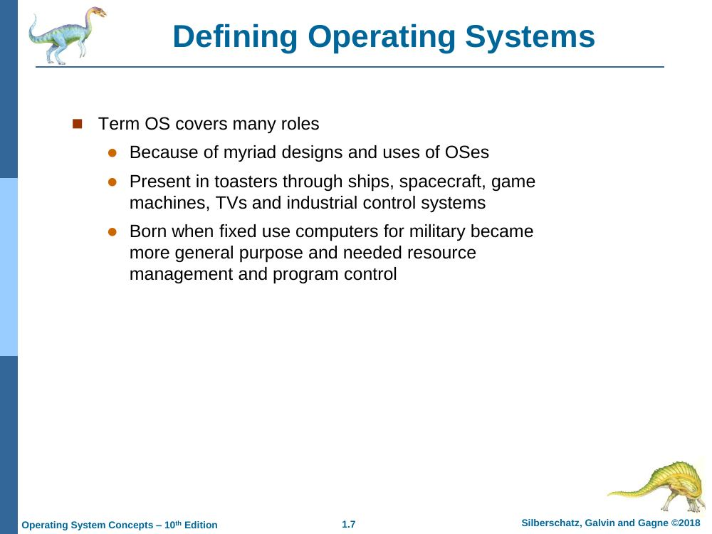

SO dipakai dari komputer umum sampai alat industri, sehingga paket perangkat lunaknya berbeda. Ketika satu komputer mulai dipakai untuk banyak pekerjaan, diperlukan pengatur program dan sumber daya. Jangan menyamakan "SO" dengan satu tampilan desktop saja.

### Slide 08 — Kernel, program sistem, aplikasi, middleware

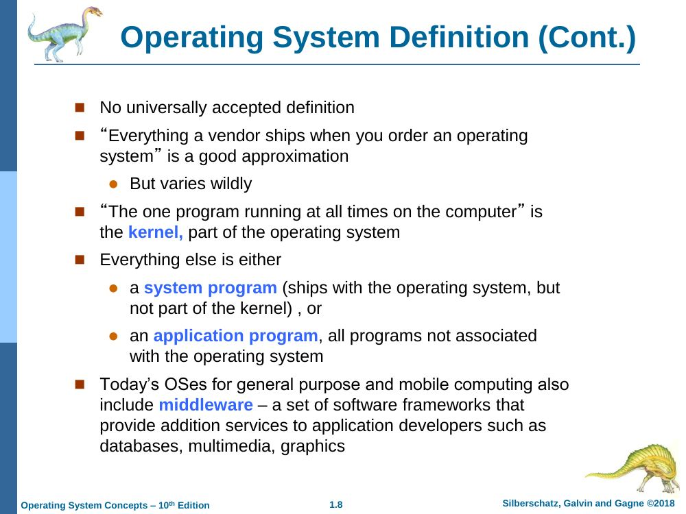

**Kernel** adalah bagian inti yang tetap berjalan dan memiliki hak mengendalikan perangkat keras. *System program* membantu operasi sistem tetapi berada di luar kernel, misalnya shell. Aplikasi mengerjakan kebutuhan pengguna, misalnya editor teks. *Middleware* adalah layanan/perangkat lunak perantara yang memudahkan pembuatan aplikasi. Batas paket SO bisa berbeda antarprodusen; pembedaan yang paling aman untuk soal adalah kernel ≠ seluruh aplikasi bawaan.

### Slide 09 — CPU, controller, bus, memori


Satu atau lebih CPU dan *device controller* terhubung ke memori bersama melalui jalur komunikasi (*bus*). Controller menangani jenis perangkat tertentu. CPU dan perangkat bisa bekerja dalam waktu yang bertumpang tindih, tetapi akses ke memori tetap harus diatur. Bayangkan CPU menghitung sementara controller disk memindahkan data.

### Slide 10 — Operasi I/O langkah demi langkah

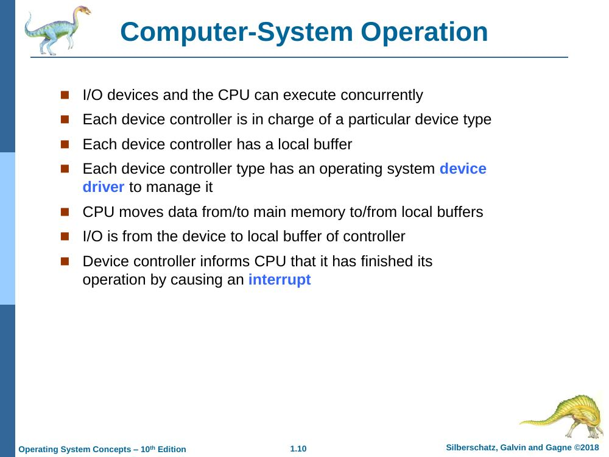

Saat aplikasi membaca data, driver SO memberi perintah kepada controller. Perangkat memindahkan data ke buffer lokal controller; kemudian data dipindahkan antara buffer dan memori utama. Setelah tugas selesai, controller memberi sinyal **interrupt** kepada CPU. *Driver* adalah perangkat lunak SO yang tahu cara berbicara dengan controller tertentu; *buffer* ialah penampung sementara.

### Slide 11 — Interrupt, trap, dan vector

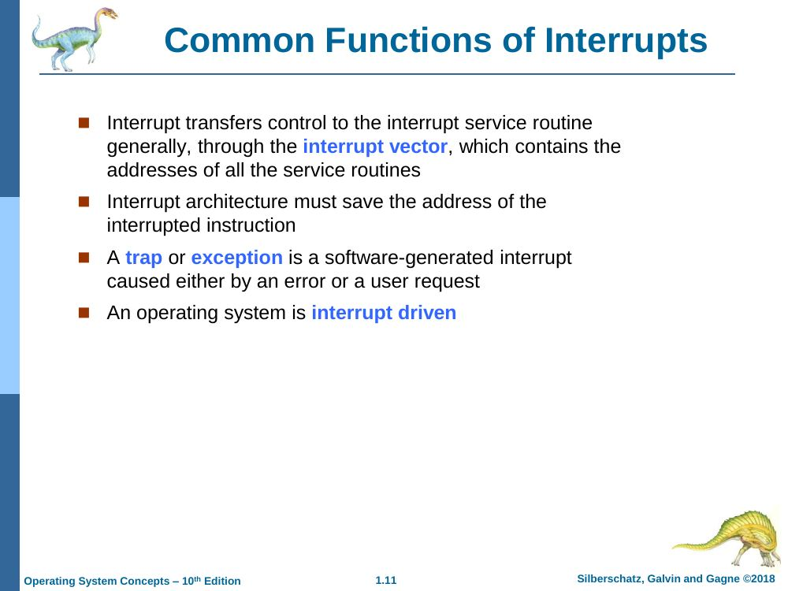

**Interrupt** menghentikan sementara alur biasa CPU agar penangan khusus (*interrupt service routine/ISR*) dijalankan. *Interrupt vector* memetakan jenis interupsi ke alamat penangan. CPU harus menyimpan lokasi instruksi yang akan dilanjutkan. *Trap/exception* muncul dari pelaksanaan instruksi, misalnya pembagian dengan nol atau permintaan layanan melalui system call. Bedakan sumber perangkat keras dari peristiwa yang dipicu perangkat lunak.

### Slide 12 — Garis waktu interupsi


Pada garis atas CPU menjalankan program pengguna, lalu sebentar menangani interupsi. Pada garis bawah perangkat I/O memindahkan data sendiri. Urutannya: permintaan I/O → perangkat bekerja → transfer selesai → sinyal interupsi → CPU menjalankan penangan → program dilanjutkan. Gambar ini menunjukkan mengapa CPU tidak harus terus-menerus menunggu satu perangkat.

### Slide 13 — Apa yang dilakukan saat interupsi?

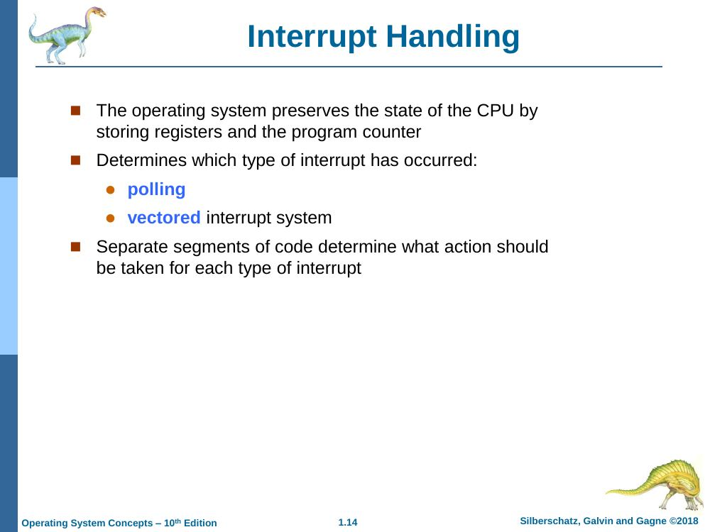

SO menyimpan keadaan CPU, termasuk register dan *program counter* (alamat instruksi berikutnya), lalu menentukan jenis interupsi. **Polling** memeriksa sumber satu demi satu; sistem *vectored* memakai pemetaan langsung ke penangan yang sesuai. Setelah penangan selesai, keadaan dipulihkan agar pekerjaan sebelumnya dapat lanjut.

### Slide 14 — Siklus I/O berbasis interupsi

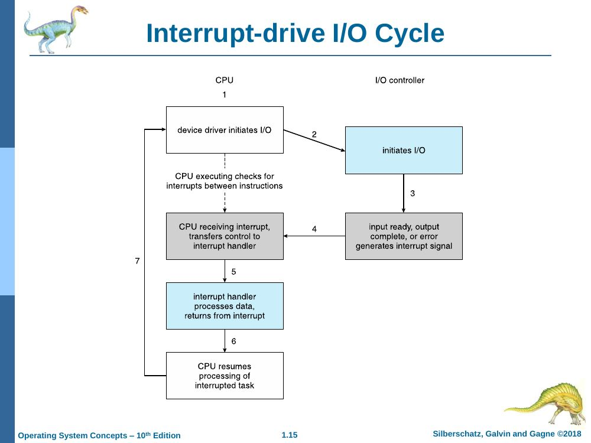

Ikuti nomor panah: driver memulai I/O; controller menjalankannya; perangkat selesai atau mengalami galat; controller mengirim interupsi; CPU beralih ke penangan; penangan membaca hasil; CPU melanjutkan pekerjaan. Jika ada galat, penangan juga menentukan cara melaporkannya. Intinya, interupsi adalah pemberitahuan selesai, bukan proses pemindahan seluruh data itu sendiri.

### Slide 15 — I/O menunggu vs tidak menunggu

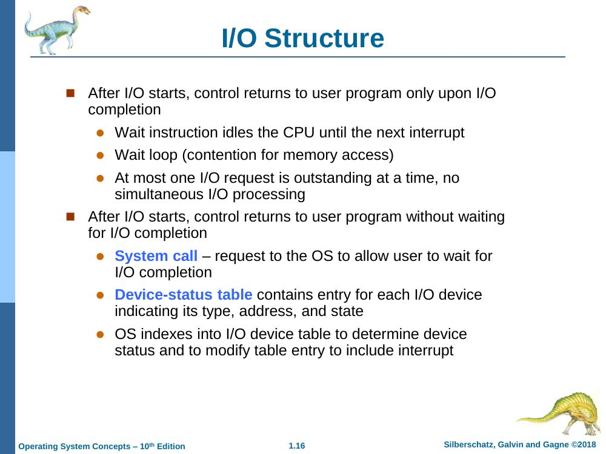

Pada I/O **sinkron**, alur pemanggil menunggu operasi selesai. Pada I/O **asinkron**, pemanggil dapat lanjut dan memeriksa/menunggu hasil kemudian. SO menyimpan keadaan tiap perangkat dalam tabel status, sehingga beberapa permintaan dapat dikelola. *Wait instruction* membuat CPU berhenti sampai interupsi, sedangkan *busy waiting* berulang kali memeriksa status dan memakai waktu CPU.

### Slide 16 — Jenis penyimpanan

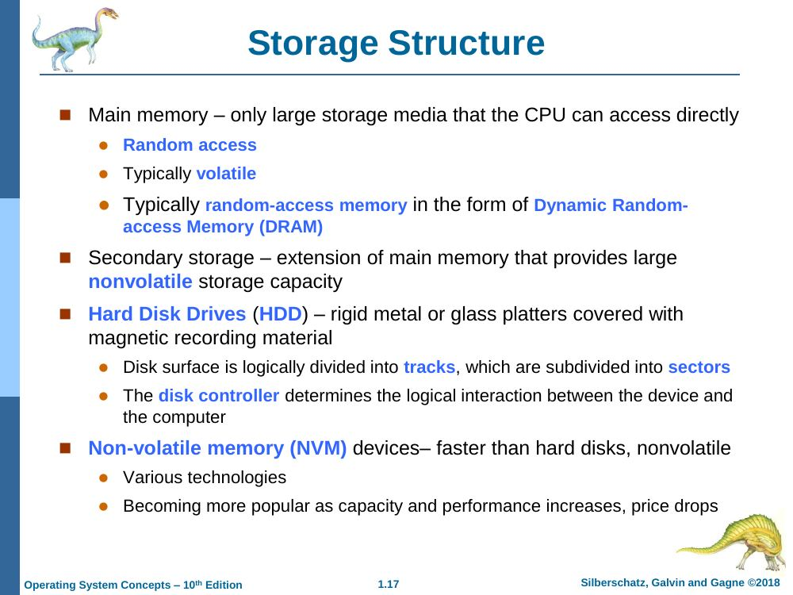

Memori utama cepat dan bisa diakses CPU secara langsung, tetapi umumnya volatil: isinya hilang saat listrik mati. Penyimpanan sekunder mempertahankan data. HDD memakai piringan, *track*, dan *sector*; perangkat NVM seperti SSD memakai teknologi berbeda dan juga tidak volatil. **Jebakan:** "lebih cepat" tidak selalu berarti "lebih permanen".

### Slide 17 — Bit, byte, word, dan satuan kapasitas

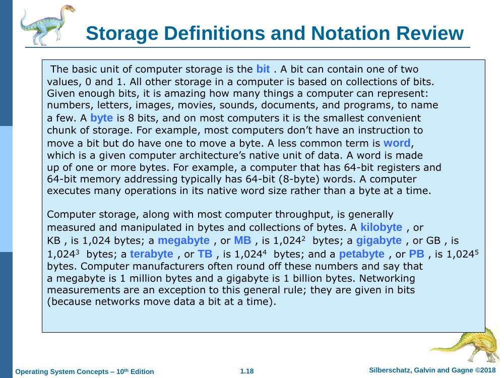

**Bit** bernilai 0 atau 1; **byte = 8 bit**. *Word* adalah ukuran data alami arsitektur, misalnya 64 bit = 8 byte pada contoh tertentu; panjangnya tidak universal. Untuk kapasitas, periksa apakah soal memakai kelipatan desimal (kilo = 10³) atau biner (kibi = 2¹⁰). Jangan menganggap `b` (bit) sama dengan `B` (byte).

### Slide 18 — Hierarki penyimpanan dan caching

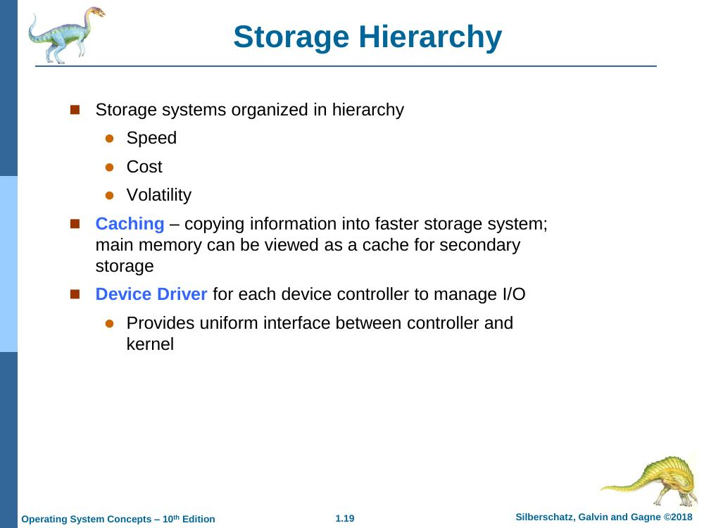

Data yang sering diperlukan disalin dari media lambat ke media lebih cepat; itulah **caching**. Semakin dekat ke CPU, umumnya akses lebih cepat, kapasitas lebih kecil, dan biaya per bit lebih tinggi. Driver menyediakan antarmuka yang seragam sehingga kernel tidak perlu mengetahui rincian fisik setiap perangkat dari awal.

### Slide 19 — Piramida penyimpanan


Baca dari puncak ke bawah: register, cache, memori utama, lalu penyimpanan lebih lambat. Data bergerak antarlapis saat dibutuhkan. Misalnya nilai dari disk dibawa ke RAM, lalu cache, lalu register sebelum CPU mengolahnya. Semakin besar suatu lapis, biasanya semakin lambat dibanding lapis di atasnya; ini kecenderungan umum, bukan rumus mutlak untuk semua perangkat.

### Slide 20 — Arsitektur von Neumann

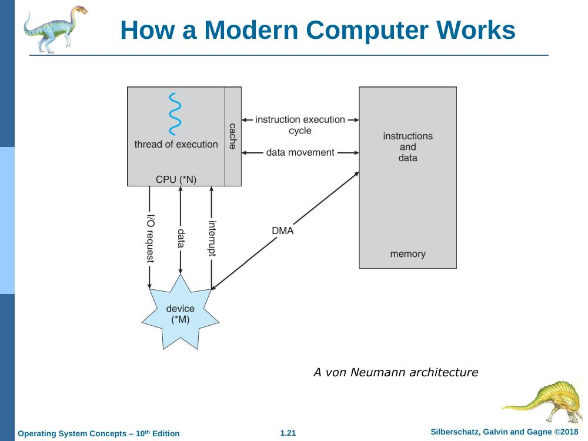

Instruksi dan data berada di memori; CPU mengambil instruksi, mendekode, lalu menjalankannya. Controller dan memori berkomunikasi melalui jalur sistem. SO ikut mengatur kapan program dan I/O boleh memakai sumber daya tersebut. Lihat posisi memori sebagai titik temu pekerjaan CPU dan perangkat I/O.

### Slide 21 — Direct Memory Access (DMA)


Untuk transfer blok besar, CPU mengatur operasi terlebih dahulu, lalu controller **DMA** memindahkan data langsung antara perangkat/buffernya dan RAM. CPU tidak perlu menyalin setiap byte dengan instruksinya sendiri. Setelah satu blok selesai, controller mengirim interupsi; karena itu overhead interupsi bisa jauh lebih kecil daripada satu interupsi per byte.

### Slide 22 — Multiprosesor

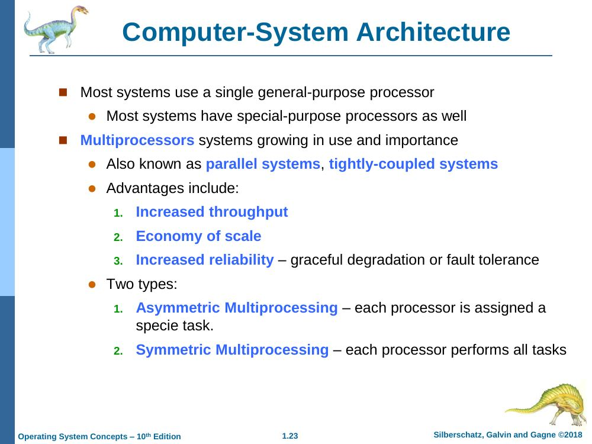

Multiprosesor memakai lebih dari satu prosesor untuk meningkatkan throughput, berbagi fasilitas, dan meningkatkan keandalan. Pada **asymmetric multiprocessing**, peran prosesor dibagi secara khusus. Pada **symmetric multiprocessing (SMP)**, prosesor dapat menjalankan jenis tugas yang sama. Jangan samakan jumlah proses (program berjalan) dengan jumlah prosesor fisik.

### Slide 23 — Gambar SMP


Beberapa prosesor mengakses memori dan perangkat I/O bersama. SO harus mengatur tugas dan menjaga data bersama agar perubahan dari satu prosesor tidak merusak pekerjaan prosesor lain. Jika dua CPU benar-benar mengeksekusi dua tugas pada saat yang sama, itu **paralelisme**; pada satu CPU yang bergantian cepat, itu **konkurensi**.

### Slide 24 — Banyak inti dan banyak chip

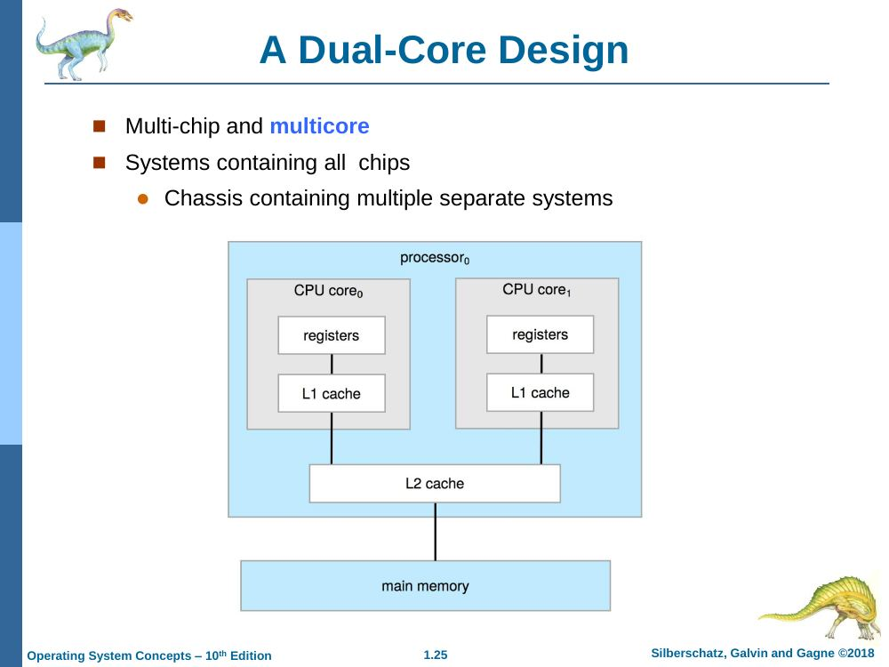

Satu chip dapat mempunyai beberapa *core*. Dua core berarti ada dua unit eksekusi yang dapat bekerja paralel, walaupun tetap berbagi beberapa komponen chip. Banyak chip berbeda dari banyak core pada satu chip; keduanya dapat dipakai dalam satu sistem multiprosesor.

### Slide 25 — NUMA

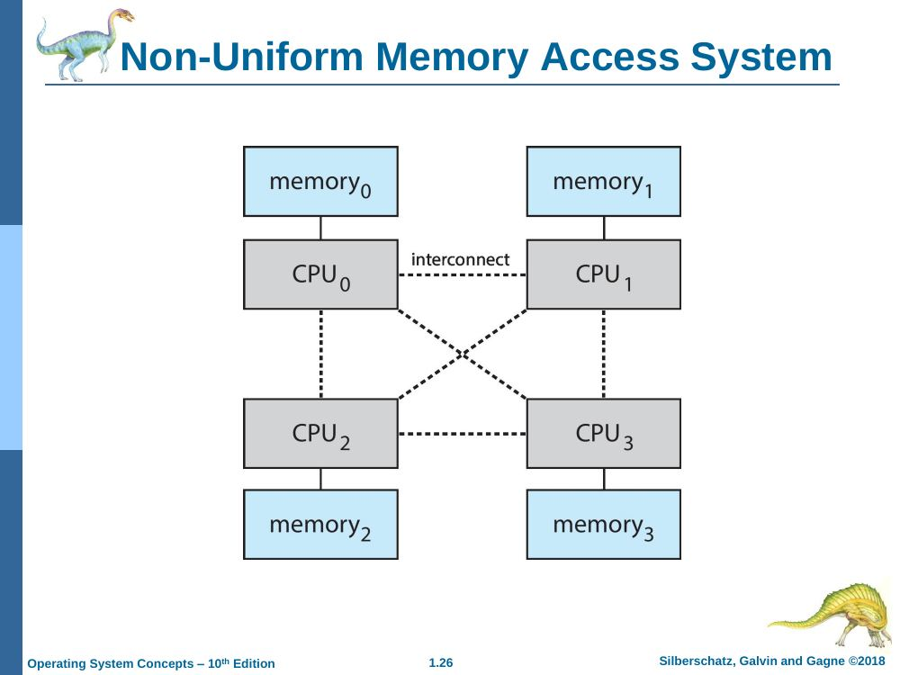

Pada **NUMA**, tiap kelompok CPU punya memori yang lebih dekat. CPU tetap dapat mengakses memori kelompok lain, tetapi waktu aksesnya berbeda. Pada gambar, garis dekat CPU–memori lokal lebih menguntungkan daripada lintasan melewati interkoneksi. SO sebaiknya menempatkan tugas dan datanya berdekatan bila memungkinkan.

### Slide 26 — Cluster

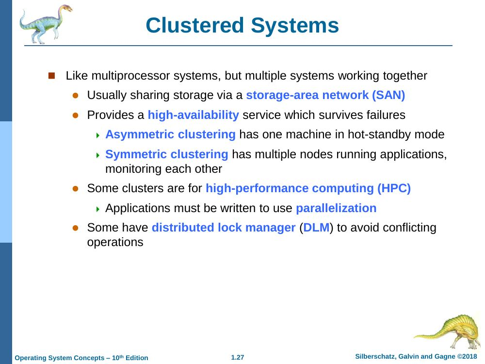

Cluster menghubungkan **beberapa komputer** yang bekerja sama, berbeda dari beberapa CPU dalam satu komputer. *Asymmetric cluster* punya mesin siaga; *symmetric cluster* dapat menjalankan pekerjaan pada banyak simpul. Kegunaannya antara lain menjaga layanan tetap tersedia saat satu mesin gagal atau membagi beban komputasi. Penyimpanan bersama perlu koordinasi agar dua simpul tidak mengubah data yang sama secara kacau.

### Slide 27 — Gambar cluster


Perhatikan kotak komputer yang terpisah dan penyimpanan bersama. Jika satu simpul gagal, simpul lain dapat melanjutkan layanan sesuai rancangan. Ini bukan berarti semua program otomatis menjadi lebih cepat; aplikasi komputasi paralel harus memang bisa dibagi.

### Slide 28 — Papan utama PC

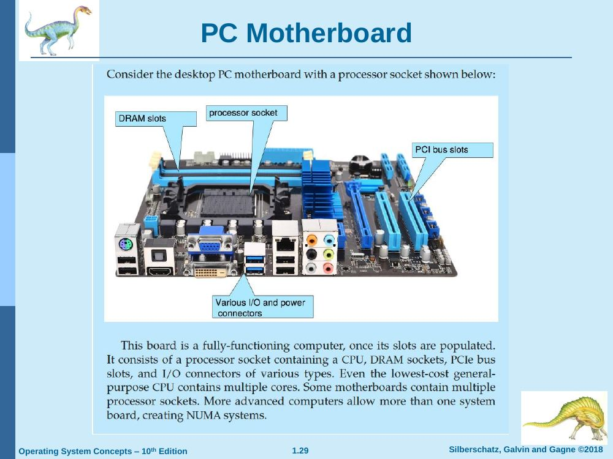

Gambar fisik membantu mengaitkan abstraksi sebelumnya dengan komponen nyata: soket CPU, slot RAM, penghubung perangkat, dan controller. SO tidak berbicara dengan semua komponen menggunakan satu cara identik; driver menjembatani perbedaan perangkat.

### Slide 29 — Boot dan operasi SO

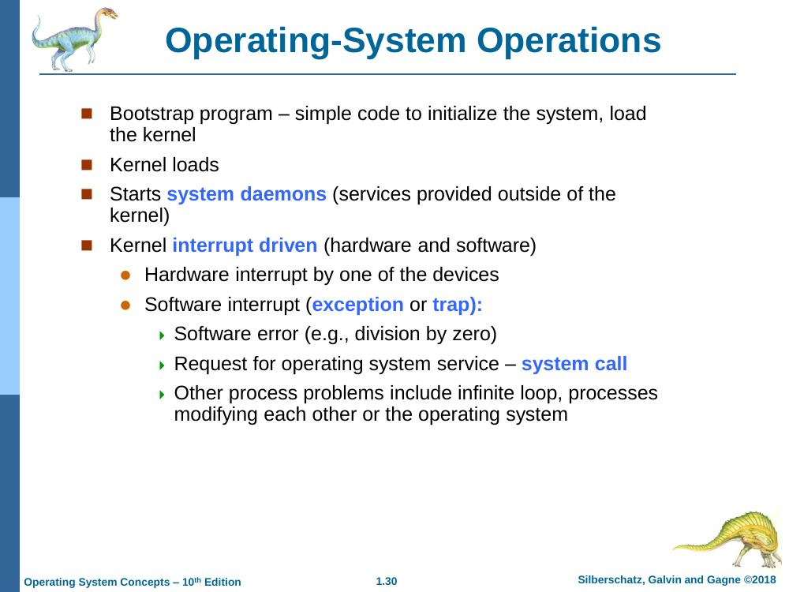

Saat komputer dinyalakan, firmware menjalankan kode awal; **bootstrap/boot loader** menyiapkan sistem dan memuat kernel. Setelah kernel aktif, layanan lain (*daemon*) dapat dimulai. Kerja SO lalu banyak dipicu peristiwa: interupsi perangkat, exception, dan system call. Urutan singkat untuk hafalan: **nyala → bootstrap/loader → kernel → layanan → aplikasi**.

### Slide 30 — Multiprogramming vs multitasking

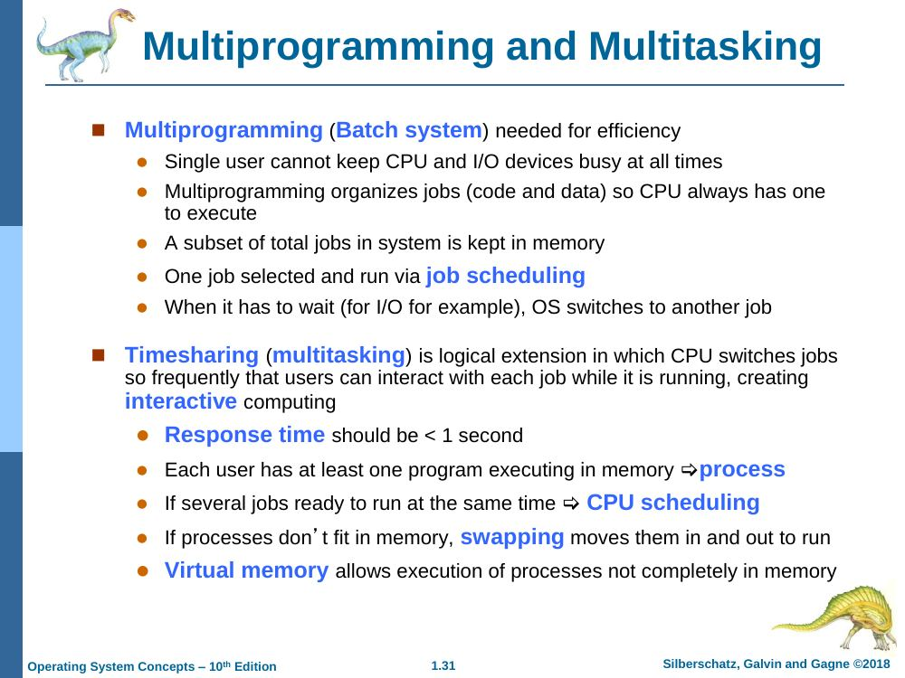

**Multiprogramming** menyimpan beberapa pekerjaan di memori agar CPU tidak menganggur saat satu pekerjaan menunggu I/O. **Multitasking/time-sharing** bergantian menjalankan pekerjaan cukup cepat sehingga pengguna dapat berinteraksi dengan tiap aplikasi. Misalnya unduhan menunggu jaringan sementara editor tetap merespons. Keduanya berbagi CPU, tetapi penekanan pertama adalah pemanfaatan CPU dan penekanan kedua adalah respons interaktif. *Swapping* memindahkan proses/isinya antara memori dan penyimpanan bila memori terbatas.

### Slide 31 — Tata letak memori multiprogramming


Gambar menunjukkan SO dan beberapa pekerjaan menempati memori pada saat bersamaan. Hanya yang sedang memperoleh CPU yang benar-benar mengeksekusi pada satu core; pekerjaan lain dapat menunggu giliran atau I/O. Pemisahan wilayah memori perlu perlindungan supaya satu program tidak bebas menimpa program lain.

### Slide 32 — User mode dan kernel mode

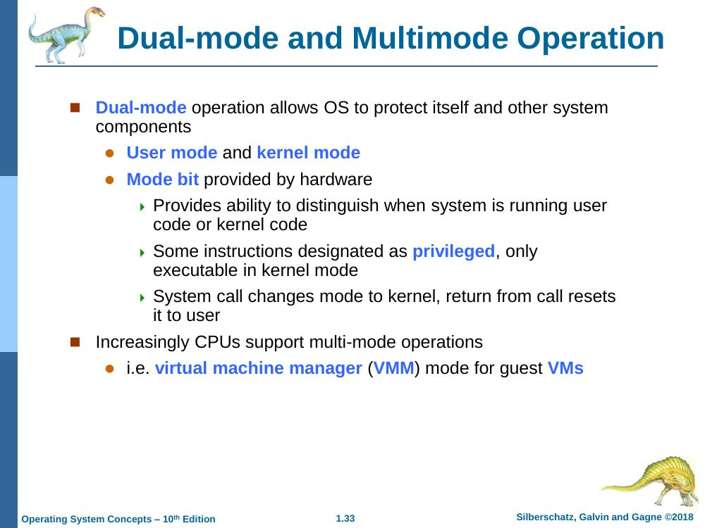

Perangkat keras menyediakan penanda mode. **User mode** membatasi aplikasi; **kernel mode** mengizinkan operasi inti. Instruksi **privileged** hanya sah di kernel mode, misalnya mengatur timer atau I/O tertentu. Saat aplikasi meminta layanan lewat *system call*, CPU masuk kernel mode secara terkendali; setelah layanan selesai, kontrol kembali ke user mode. Inilah pagar utama perlindungan SO.

### Slide 33 — Perpindahan mode dan timer


Sebelum menyerahkan CPU kepada aplikasi, kernel mengatur **timer**. Ketika waktu habis, timer menimbulkan interupsi sehingga kernel memperoleh kendali kembali. Aplikasi tidak boleh bebas menonaktifkan timer, sebab program yang macet bisa menguasai CPU selamanya. *System call* juga masuk ke kernel, tetapi melalui permintaan layanan yang sengaja dilakukan aplikasi, bukan karena waktu habis.

```text
Aplikasi (user mode) ── system call / interrupt / exception ──► kernel mode
Aplikasi (user mode) ◄──────────── kembali dari kernel ───────── kernel mode
```

### Slide 34 — Proses

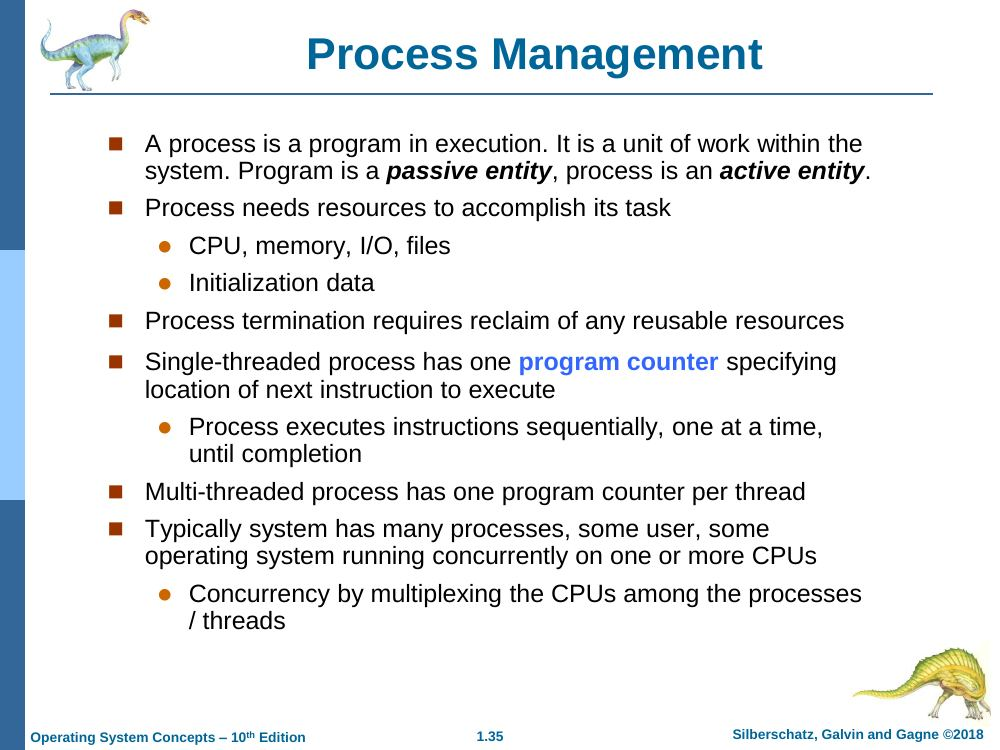

**Program** adalah kumpulan instruksi pasif di penyimpanan; **proses** adalah program yang sedang dijalankan beserta keadaan dan sumber dayanya. Satu proses memerlukan CPU, memori, berkas, dan I/O. Pada proses multithread, tiap thread punya penunjuk instruksi sendiri. Rincian state proses dibahas lagi pada Bab 3; di sini cukup pahami mengapa SO harus mengaturnya.

### Slide 35 — Tugas pengelolaan proses

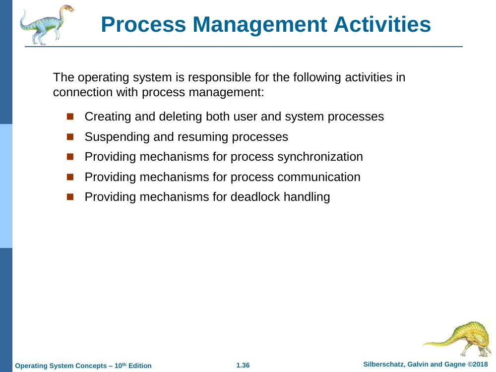

SO membuat, menghentikan, menunda, dan melanjutkan proses. SO juga menyediakan cara proses saling berkomunikasi, menyinkronkan akses data, dan menangani kebuntuan (*deadlock*). Misalnya dua aplikasi yang sama-sama menulis berkas perlu aturan agar hasilnya tidak rusak.

### Slide 36 — Tugas pengelolaan memori

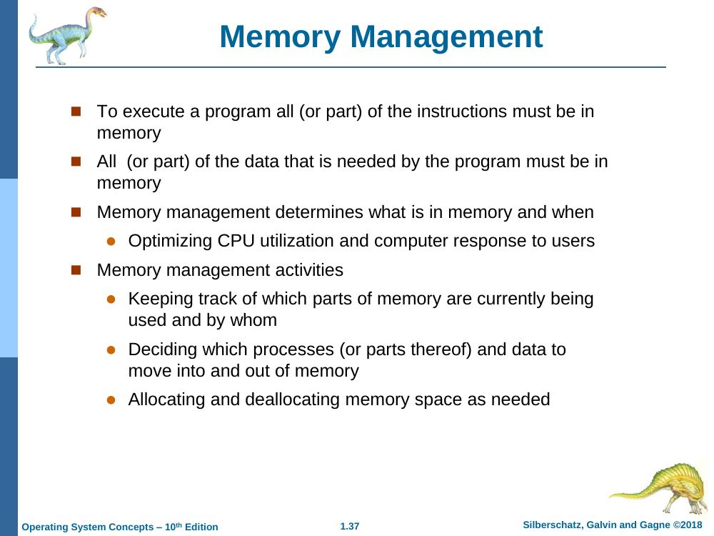

Instruksi dan data yang dibutuhkan harus tersedia di memori saat dipakai. SO mencatat wilayah memori milik siapa, memilih data/proses yang masuk atau keluar, lalu mengalokasikan dan membebaskan ruang. Contoh sederhana: saat aplikasi ditutup, memori yang dipakainya harus tersedia lagi untuk aplikasi lain.

### Slide 37 — Tugas pengelolaan berkas

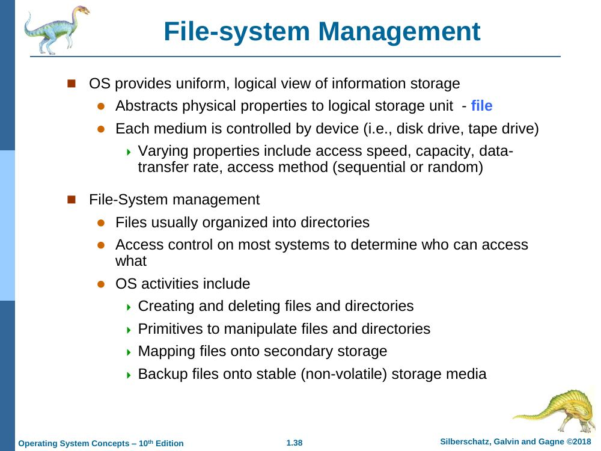

SO memberi tampilan logis berupa **berkas dan direktori**, walau penyimpanan fisiknya berbeda. Tugasnya meliputi membuat/menghapus berkas dan direktori, memetakan berkas ke penyimpanan, membuat cadangan, serta mengatur hak akses. **Jebakan UTS 2018:** mengalokasikan dan membebaskan RAM termasuk pengelolaan memori, bukan pengelolaan berkas.

### Slide 38 — Penyimpanan massal

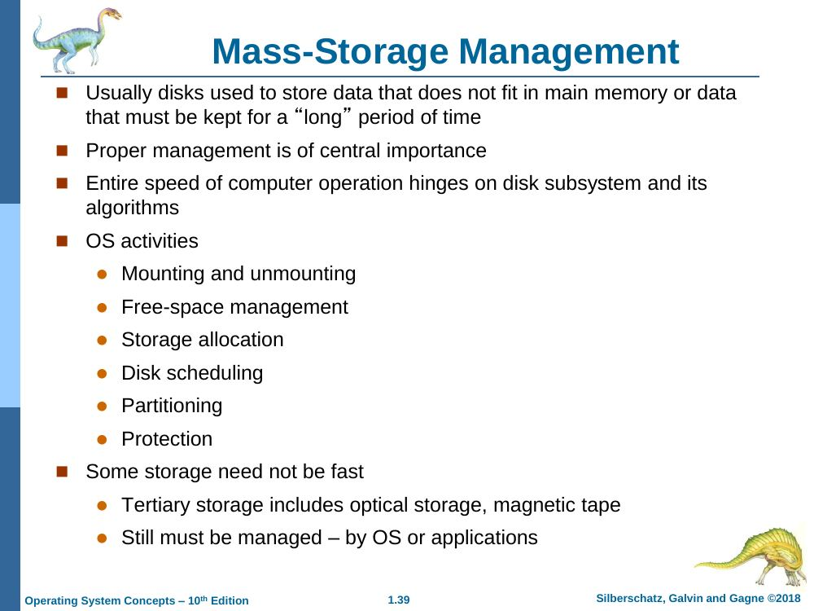

SO mengelola media penyimpanan besar: *mount/unmount*, ruang kosong, alokasi, penjadwalan disk, partisi, dan proteksi. **Mount** membuat sistem berkas di suatu perangkat dapat diakses pada lokasi tertentu; tidak sama dengan membuat direktori. Tape atau media optik dapat dipakai untuk arsip walau tidak secepat disk utama.

### Slide 39 — Cara cache bekerja

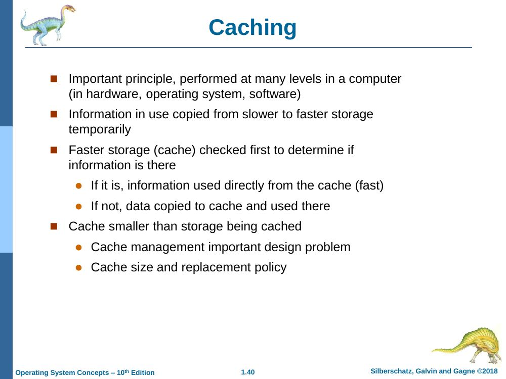

Saat data diminta, sistem memeriksa cache dulu. Jika ada (*hit*), data langsung dipakai. Jika tidak (*miss*), data diambil dari tempat lebih lambat dan biasanya disalin ke cache. Karena cache terbatas, perlu kebijakan memilih data yang diganti. Contoh: membuka berkas yang baru diakses sering lebih cepat karena sebagian data masih tersimpan di cache.

### Slide 40 — Tabel jenis penyimpanan

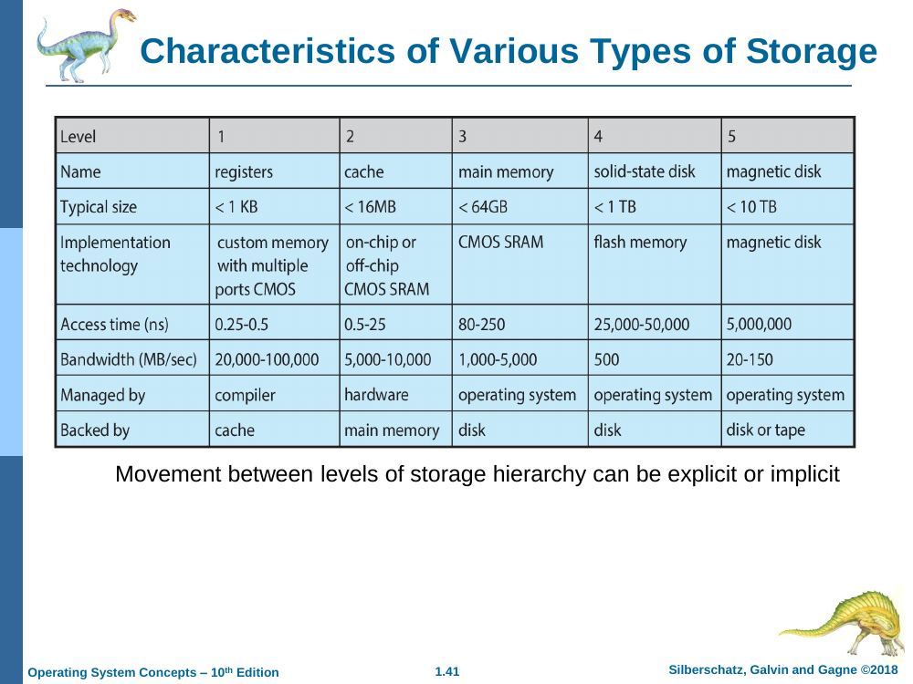

Bandingkan kecepatan, kapasitas, dan apakah data bertahan tanpa listrik. Perpindahan data antarlapis bisa dikelola perangkat keras, SO, atau aplikasi. Untuk menjawab soal, jelaskan alasan sebuah data berada di RAM/cache/disk, bukan menghafal urutan saja.

### Slide 41 — Perjalanan data A


Satu nilai dapat memiliki salinan di disk, RAM, cache, dan register. Jika satu salinan berubah, sistem harus memastikan pembaca berikutnya memakai nilai terbaru. Pada banyak CPU, masalah ini disebut **cache coherency**. Di jaringan, salinan tersebar di komputer berbeda sehingga koordinasinya lebih rumit lagi.

### Slide 42 — Subsistem I/O

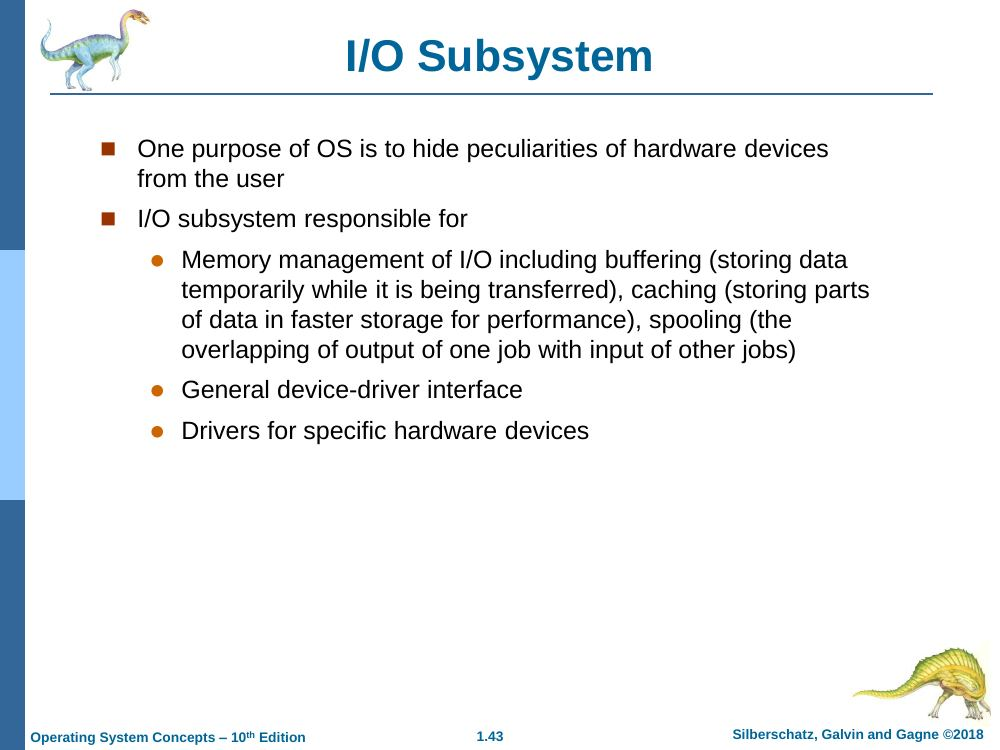

SO menyembunyikan perbedaan perangkat lewat antarmuka umum dan driver khusus. **Buffering** menampung data selama transfer; **caching** menyimpan salinan agar akses berikutnya cepat; **spooling** mengantre pekerjaan, misalnya beberapa dokumen menunggu satu printer. Tiga istilah ini mirip karena sama-sama menyimpan sementara, tetapi tujuannya berbeda.

### Slide 43 — Protection dan security


**Protection** mengatur siapa boleh mengakses sumber daya apa. **Security** melindungi sistem dari ancaman, termasuk serangan dari luar dan penyalahgunaan dari dalam. SO mengenali pengguna lewat UID, dapat mengelompokkan mereka lewat GID, dan mengaitkan identitas itu ke proses serta berkas. Contoh: izin berkas mencegah pengguna biasa mengubah data milik pengguna lain.

### Slide 44 — Virtualisasi, emulasi, interpretasi

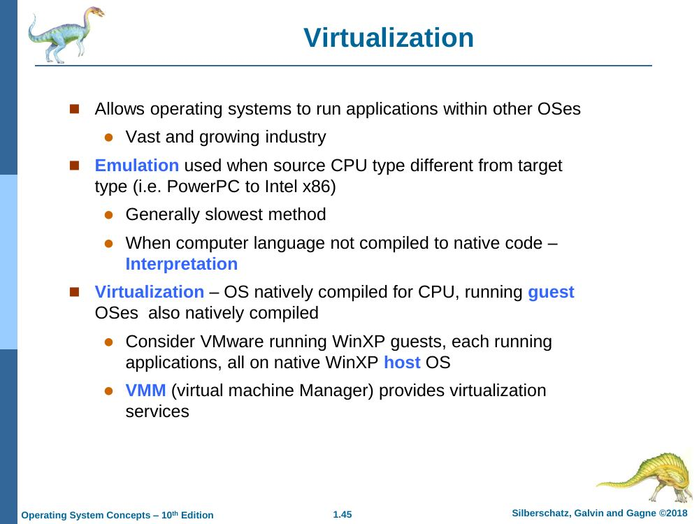

**Virtualisasi** memungkinkan beberapa lingkungan/OS tamu berbagi satu mesin fisik; **hypervisor/VMM** mengelola mesin virtual dan membagi sumber daya fisik. **Emulasi** meniru arsitektur mesin lain sehingga instruksi CPU yang berbeda bisa dijalankan, biasanya dengan biaya kinerja lebih besar. **Interpretasi** menjalankan instruksi melalui penerjemah perangkat lunak. Pada soal, cari apakah arsitektur CPU tamu dan host sama atau berbeda.

### Slide 45 — Mengapa memakai mesin virtual?

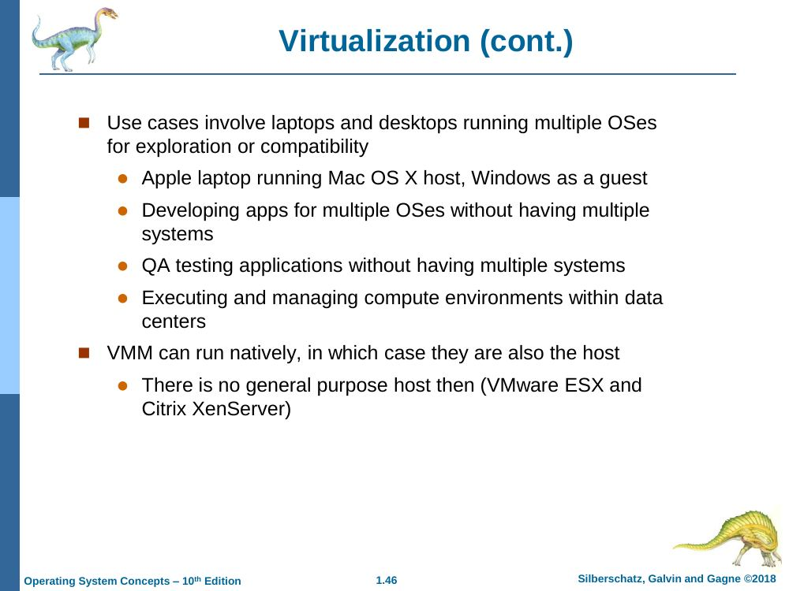

Mesin virtual berguna untuk menguji aplikasi pada beberapa OS, mencoba konfigurasi tanpa menambah komputer fisik, dan menata pusat data. VMM dapat berjalan di atas SO host atau langsung pada perangkat keras. Jika langsung pada perangkat keras, VMM sendiri mengambil peran dasar host.

### Slide 46 — Gambar virtualisasi


Baca lapisannya: perangkat keras fisik di bawah, VMM/host mengelola pembagian, lalu OS tamu dan aplikasi di atasnya. Masing-masing tamu merasa punya komputer sendiri, padahal CPU, memori, dan I/O fisiknya dibagi. Itulah abstraksi utama hypervisor.

### Slide 47 — Sistem terdistribusi


Sistem terdistribusi terdiri atas komputer terpisah yang terhubung jaringan dan bertukar pesan. LAN mencakup area lokal, WAN area luas, MAN skala kota, PAN jarak pribadi. *Network OS* menyediakan komunikasi dan layanan antarmesin; keterpisahan fisik tetap ada meskipun layanan berusaha tampak terpadu.

### Slide 48 — Linked list di kernel


Kernel perlu menyimpan kumpulan proses, perangkat, dan pekerjaan. **Singly linked list** punya penunjuk ke elemen berikut; **doubly linked list** juga ke sebelumnya; **circular list** menghubungkan akhir kembali ke awal. Pada soal konsep, kaitkan bentuk data dengan operasi: daftar ganda mudah dihapus dari tengah bila elemen sudah diketahui.

### Slide 49 — Pohon pencarian

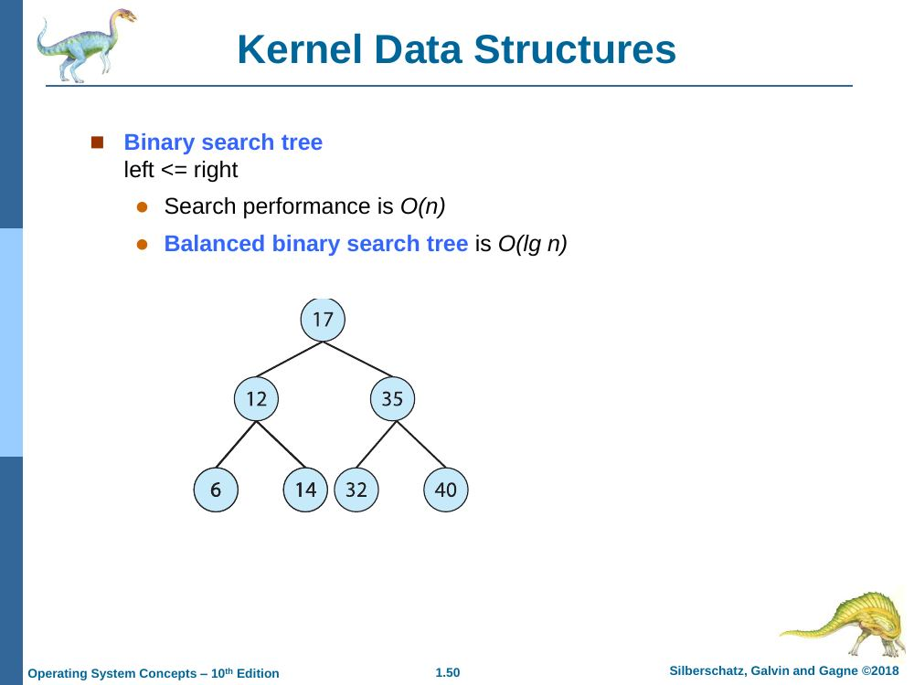

Pada *binary search tree*, nilai kecil dan besar ditempatkan mengikuti aturan kiri/kanan yang konsisten. Pencarian pada pohon sangat timpang dapat menjadi **O(n)**; bila seimbang menjadi **O(log n)**. Ini menjelaskan mengapa kernel memakai struktur data yang menjaga operasi pencarian tetap efisien.

### Slide 50 — Hash map dan bitmap

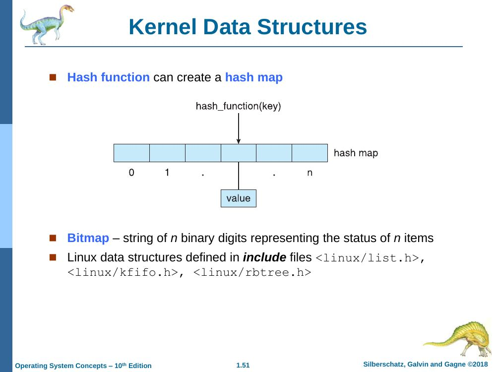

*Hash map* memakai fungsi hash untuk menemukan tempat penyimpanan berdasarkan kunci; akses rata-rata dapat cepat, tetapi benturan kunci perlu ditangani. **Bitmap** memakai satu bit per item untuk menandai keadaan, misalnya blok kosong/terpakai. Untuk 8 item, `00100100` hanya memerlukan 8 bit keadaan.

### Slide 51 — Komputasi tradisional

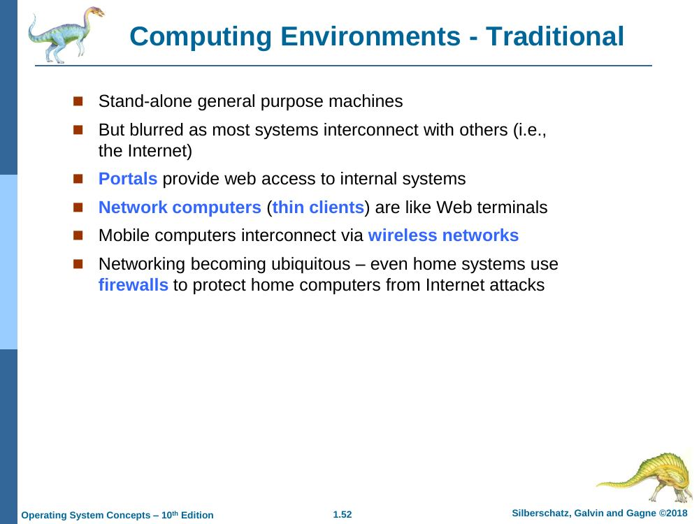

Komputer pribadi masih ada, tetapi kini hampir selalu terhubung ke jaringan dan layanan lain. *Thin client* mengandalkan server untuk sebagian pekerjaan. Firewall melindungi lalu lintas jaringan. Batas "komputer tunggal" dan "layanan jaringan" menjadi semakin kabur.

### Slide 52 — Komputasi mobile

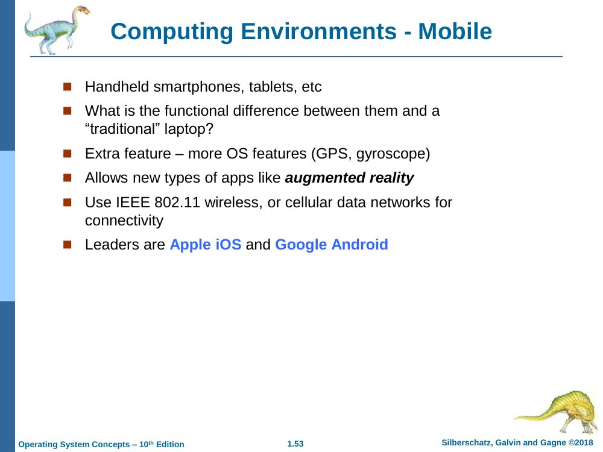

Ponsel dan tablet memiliki sensor, lokasi, layar sentuh, serta koneksi nirkabel yang membentuk jenis aplikasi baru. SO mobile harus mengatur sumber daya terbatas dan baterai. Android dan iOS adalah contoh dalam slide; jangan anggap semua perangkat mobile adalah sistem real-time hanya karena responsnya terasa cepat.

### Slide 53 — Client-server

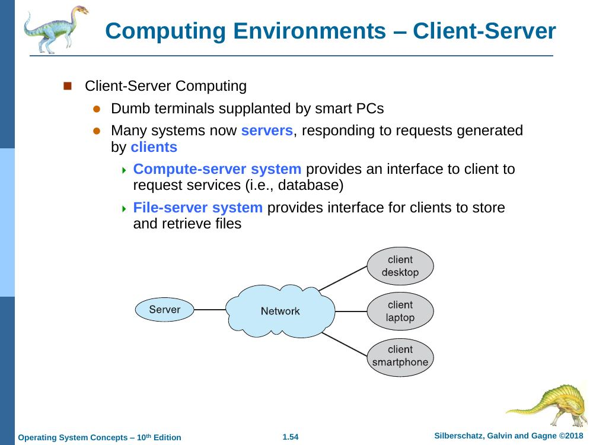

**Client** meminta layanan, **server** menjawab. Server komputasi dapat menjalankan kueri atau perhitungan; file server menyimpan dan mengambil berkas. Contoh: browser meminta halaman kepada web server. Posisi client/server adalah peran komunikasi, bukan ukuran mesin.

### Slide 54 — Peer-to-peer

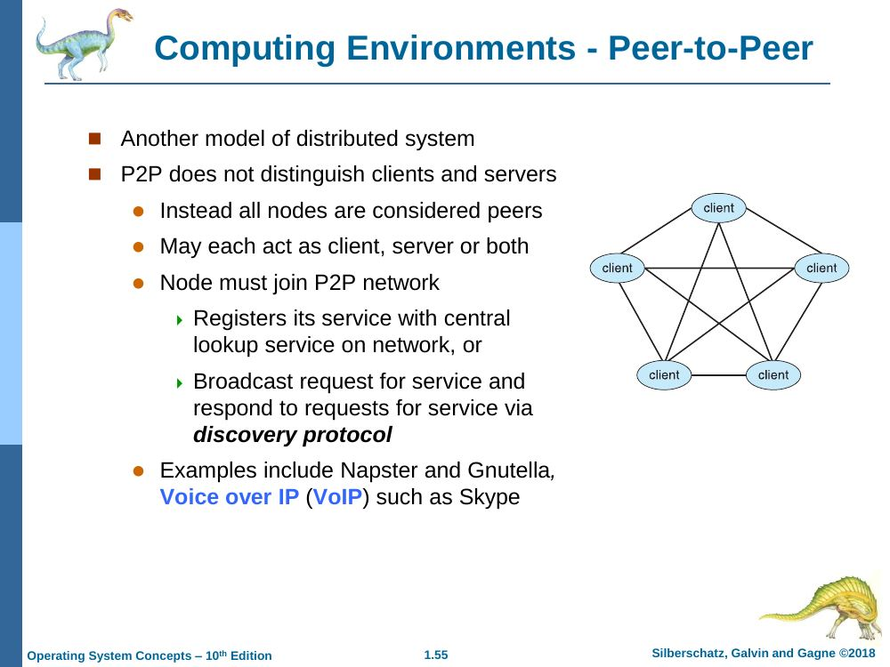

Pada **P2P**, simpul (*peer*) dapat meminta sekaligus menyediakan layanan. Peer perlu menemukan peer lain, misalnya lewat daftar pusat atau mekanisme pencarian. Perbandingan cepat: client-server punya peran layanan yang lebih tetap; P2P memungkinkan peran berganti pada setiap simpul.

### Slide 55 — Cloud dan jenis layanannya

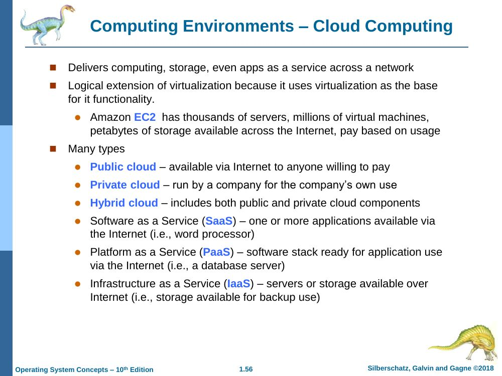

Cloud menyediakan komputasi, penyimpanan, atau aplikasi melalui jaringan. **IaaS** menyediakan infrastruktur virtual; **PaaS** menyediakan lingkungan menjalankan aplikasi; **SaaS** menyediakan aplikasi siap pakai. *Public cloud* ditawarkan ke pelanggan umum, *private cloud* dipakai organisasi sendiri, dan *hybrid* menggabungkan keduanya. Virtualisasi sering menjadi fondasinya, tetapi cloud juga membutuhkan pengelolaan layanan.

### Slide 56 — Susunan cloud


Cloud memadukan SO pada mesin fisik/tamu, VMM, alat pengelola, jaringan, serta pengaman seperti firewall. *Load balancer* menyebarkan permintaan ke beberapa aplikasi/mesin agar beban tidak menumpuk pada satu tempat. VM adalah salah satu bahan bangunan cloud, bukan seluruh cloud.

### Slide 57 — Sistem tertanam real-time

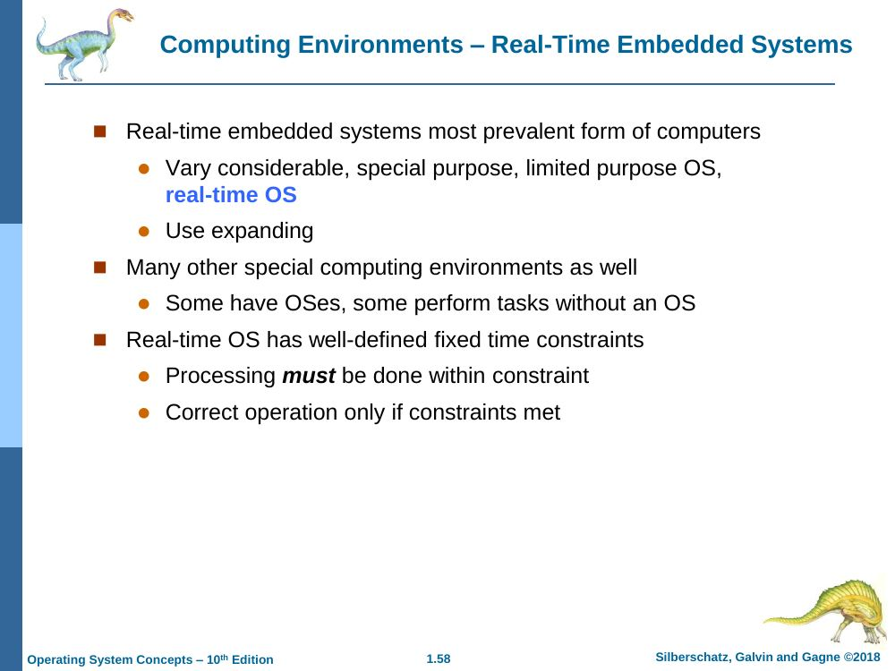

Perangkat tertanam mengerjakan tugas khusus; sebagian memakai SO kecil, sebagian tidak. Pada **real-time**, kebenaran hasil bergantung pada **batas waktu**: jawaban yang benar tetapi terlambat dapat dianggap gagal. Contoh intuitif adalah pengendali rem ABS yang harus bereaksi tepat waktu, bukan sekadar rata-rata cepat.

### Slide 58 — SO bebas dan sumber terbuka

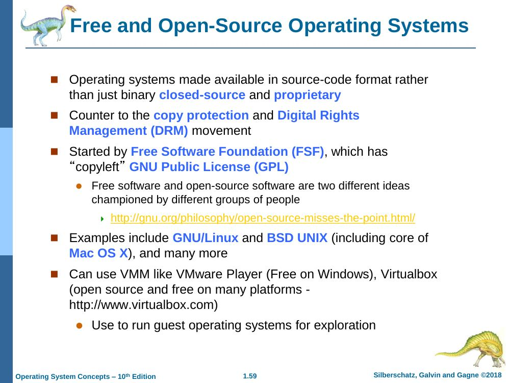

Perangkat lunak sumber terbuka menyediakan kode sumber untuk dipelajari dan diubah sesuai lisensi. Gerakan perangkat lunak bebas dan gerakan sumber terbuka punya penekanan nilai yang berbeda, meskipun banyak proyek terkait keduanya. GNU/Linux dan keluarga BSD adalah contoh pada slide. Untuk UTS, bedakan **kode sumber tersedia** dari sekadar program yang gratis dipakai.

### Slide 59 — Mengapa SO dapat dipelajari langsung?

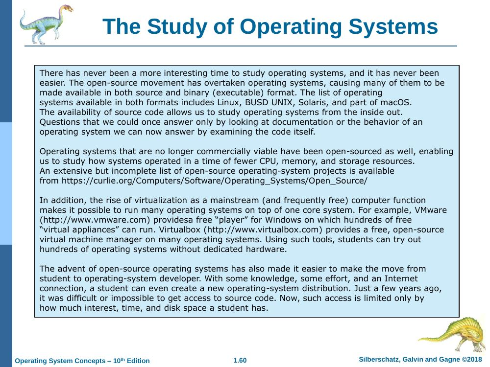

Kode sumber SO terbuka memungkinkan kita melihat bagaimana pengelolaan memori, proses, dan perangkat benar-benar diimplementasikan. Contohnya Linux atau BSD. Untuk awal belajar, pahami dahulu model konsep di slide; membaca kode kernel baru berguna ketika alur dasarnya sudah jelas.

### Slide 60 — Penutup

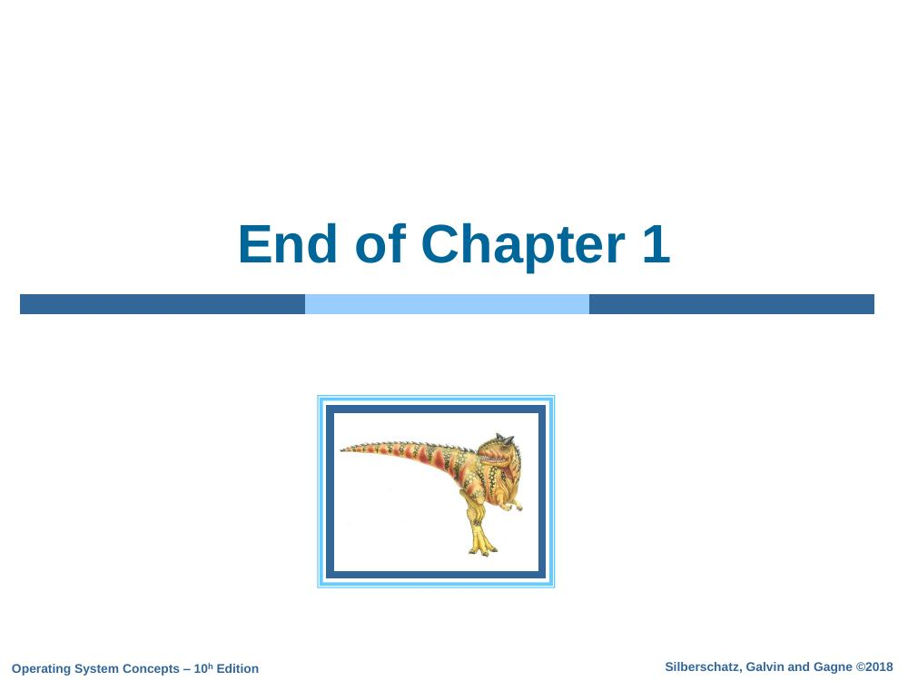

Inti Bab 1: SO menjadi perantara aplikasi dan perangkat keras, mengalokasikan sumber daya, serta melindungi sistem. Mekanisme kunci yang perlu diceritakan kembali tanpa melihat catatan adalah **boot**, **interrupt**, **system call dan dual-mode**, **timer**, **multiprogramming**, dan **virtualisasi**.

## Latihan yang paling dekat dengan contoh UTS

Soal 1–3 mengadaptasi **contoh UTS 2018/2019 dan 2019 yang ada dalam paket**; redaksi dan pembahasannya ditulis ulang. Soal 4–6 adalah latihan baru yang mengikuti **kisi-kisi UTS 2026**. Tahun dan asal ini penting: latihan baru bukan soal UTS asli.

### 1. Empat komponen dan dua fungsi SO — adaptasi UTS 2019

**Soal.** Gambarkan empat komponen sistem komputer. Dari gambar itu, jelaskan dua fungsi utama SO.

**Pembahasan.** Urutkan `pengguna → aplikasi → SO → perangkat keras`. Fungsi pertama: SO membuat perangkat lebih mudah dipakai melalui layanan dan abstraksi, misalnya aplikasi cukup meminta simpan berkas. Fungsi kedua: SO membagi dan mengendalikan CPU, memori, serta I/O agar beberapa program dapat berjalan aman dan efisien. Jawaban "SO hanya antarmuka" belum cukup karena melewatkan pengelolaan sumber daya.

### 2. Sumber daya fisik dan abstraksi — adaptasi isian UTS 2019

**Soal.** Sebutkan tiga sumber daya perangkat keras utama, lalu contoh abstraksi SO yang memudahkan pemakaiannya.

**Pembahasan.** Yang fisik: **CPU, memori, perangkat I/O**. Abstraksi yang lazim: **proses/thread** untuk pemakaian CPU, **ruang alamat virtual** untuk memori, dan **berkas** untuk penyimpanan/I/O. Pasangan ini menjelaskan *mengapa* aplikasi tidak perlu mengurus rincian fisik; istilah yang dipakai dosen pada soal asli tetap perlu diikuti bila ada batasan jawaban.

### 3. Pengelolaan berkas atau memori? — adaptasi pilihan ganda UTS 2018

**Soal.** Manakah kegiatan pengelolaan berkas: (a) membuat direktori, (b) mengalokasikan RAM proses, (c) memetakan berkas ke penyimpanan sekunder, (d) memasang sistem berkas agar dapat diakses?

**Pembahasan.** **(a), (c), dan (d)** berkaitan dengan berkas/sistem berkas; **(b)** adalah pengelolaan memori. Jika soal memakai frasa *attach/detach devices* alih-alih *mount/unmount file system*, baca konteksnya: menghubungkan perangkat fisik termasuk pengelolaan I/O/penyimpanan, bukan otomatis operasi file. Soal asli UTS 2018 meminta memilih yang **tidak termasuk** file management, dan jawaban yang jelas adalah alokasi/free memori.

### 4. Perpindahan mode — latihan dari kisi-kisi

**Soal.** Aplikasi hendak membaca disk. Bolehkah ia langsung menjalankan instruksi pengendali disk dalam user mode? Jelaskan alurnya.

**Pembahasan.** Tidak. Aplikasi meminta layanan lewat system call. CPU berpindah ke kernel mode; kernel memeriksa permintaan dan memakai driver. Controller mengerjakan I/O, lalu memberi interupsi saat selesai. Kernel mengembalikan hasil dan CPU melanjutkan aplikasi di user mode. Hak khusus dijaga agar satu aplikasi tidak mengganggu seluruh sistem.

### 5. Timer dan program macet — latihan dari kisi-kisi

**Soal.** Program menjalankan `while (true) {}` tanpa henti. Mengapa SO masih dapat mengambil alih CPU?

**Pembahasan.** Kernel memasang timer sebelum program berjalan. Saat timer habis, perangkat keras mengirim interupsi dan CPU masuk ke penangan kernel. Kernel dapat menjadwalkan program lain. Jika program user boleh mematikan timer, perlindungan ini gagal; karena itu pengaturan timer termasuk operasi privileged.

### 6. Multiprogramming, multitasking, dan hypervisor — latihan dari kisi-kisi

**Soal.** (a) CPU berganti pekerjaan saat satu proses menunggu disk. (b) Editor tetap terasa responsif ketika peramban bekerja. (c) Dua SO tamu berbagi satu mesin fisik. Sebutkan konsep terdekat untuk masing-masing.

**Pembahasan.** (a) **Multiprogramming**, untuk memakai CPU saat ada pekerjaan yang menunggu. (b) **Multitasking/time-sharing**, agar interaksi tetap responsif melalui pergantian cepat. (c) **Virtualisasi**, diatur hypervisor/VMM. Satu sistem bisa menerapkan ketiganya sekaligus.

## Ringkasan istilah prioritas UTS

| Istilah | Arti satu kalimat | Pembeda penting |
|---|---|---|
| Kernel | Inti SO yang menjalankan operasi dengan hak khusus. | Bukan seluruh aplikasi bawaan. |
| Resource allocator | Pengatur pembagian CPU, memori, dan I/O. | Memilih pemakai dan waktu pemakaian. |
| Interrupt | Sinyal agar CPU menangani peristiwa lalu melanjutkan tugas. | Berasal dari perangkat/timer; trap berasal dari eksekusi instruksi. |
| User/kernel mode | Dua tingkat hak eksekusi. | Instruksi privileged hanya di kernel mode. |
| System call | Permintaan layanan SO dari aplikasi. | Jalan terkendali dari user ke kernel mode. |
| Timer | Pemicu interupsi setelah jatah waktu. | Mengembalikan kendali CPU ke kernel. |
| Multiprogramming | Beberapa pekerjaan siap agar CPU tidak banyak menganggur. | Fokus pemanfaatan CPU. |
| Multitasking | CPU berganti tugas cepat demi respons interaktif. | Fokus pengalaman pengguna. |
| Boot loader | Kode awal yang memuat kernel saat boot. | Bekerja sebelum kernel siap. |
| Hypervisor/VMM | Pengelola mesin virtual. | Membagi mesin fisik bagi OS tamu. |

## Sumber dalam paket Sensei

- `OS/K1.pdf`, 60 halaman, **Chapter 1: Introduction**, bahan slide dari *Operating System Concepts*, edisi ke-10.
- `OS/Kisi kisi.pdf`, bagian **Pertemuan 1. Pengantar sistem operasi** dan ketentuan UTS.
- `OS/Contoh Soal/UTS Sistem Operasi 2018.pdf`, soal A.1 dan pertanyaan terkait pengelolaan SO.
- `OS/Contoh Soal/UTS Sistem Operasi 2019.pdf`, isian 1–2 dan uraian 1.
- Abraham Silberschatz, Peter B. Galvin, dan Greg Gagne, *Operating System Concepts*, edisi ke-10, PDF referensi dalam paket. Buku digunakan untuk mengecek istilah; susunan pembahasan mengikuti slide K1.

Gambar slide berasal dari K1.pdf yang Sensei lampirkan. Keterangan, contoh, dan pembahasan di dokumen ini ditulis ulang untuk belajar; soal adaptasi diberi asalnya agar tidak disangka salinan UTS terbaru.
