# Bab 3 — Proses, slide demi slide
Gambar mengikuti halaman 1–74 dari `K3.pdf` dalam paket Sensei. Nomor slide di bawah adalah halaman PDF asli. Pembahasan menekankan alur konsep; contoh hitungan di akhir memakai konvensi kisi-kisi.

**Fokus UTS:** Proses vs program, bagian memori, PCB, state, context switch, fork/exec/wait, zombie/orphan, dan IPC.

## Pembahasan setiap slide

### Slide 001 — Chapter 3: Processes

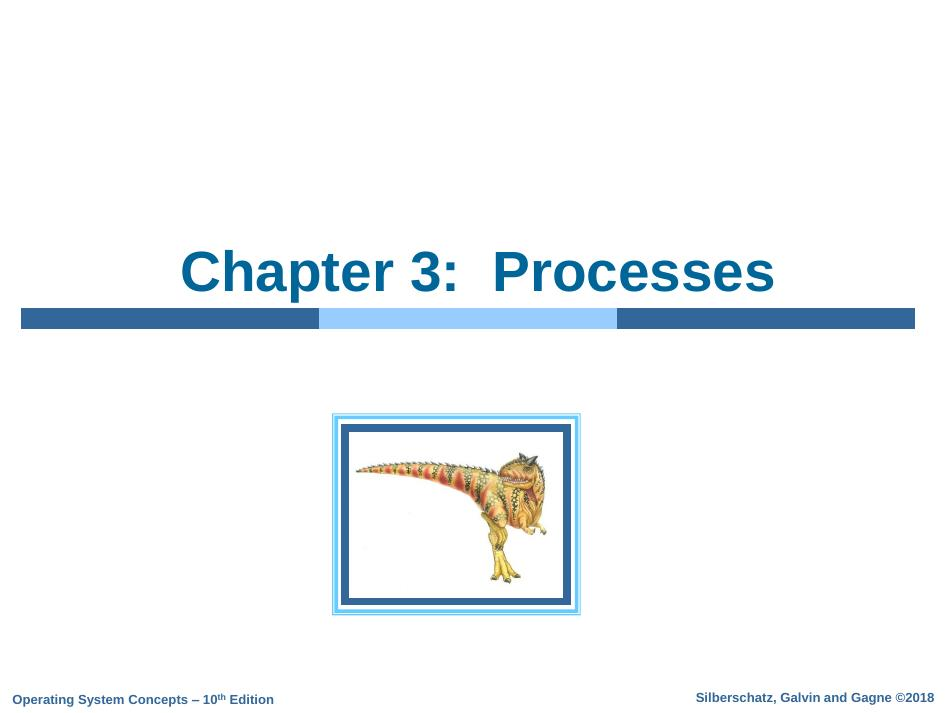

Slide ini memetakan posisi topik dalam bab. Pakai judul-judulnya sebagai daftar cek; utamakan hubungan sebab-akibat dan contoh, bukan hafalan urutan.

### Slide 002 — Outline

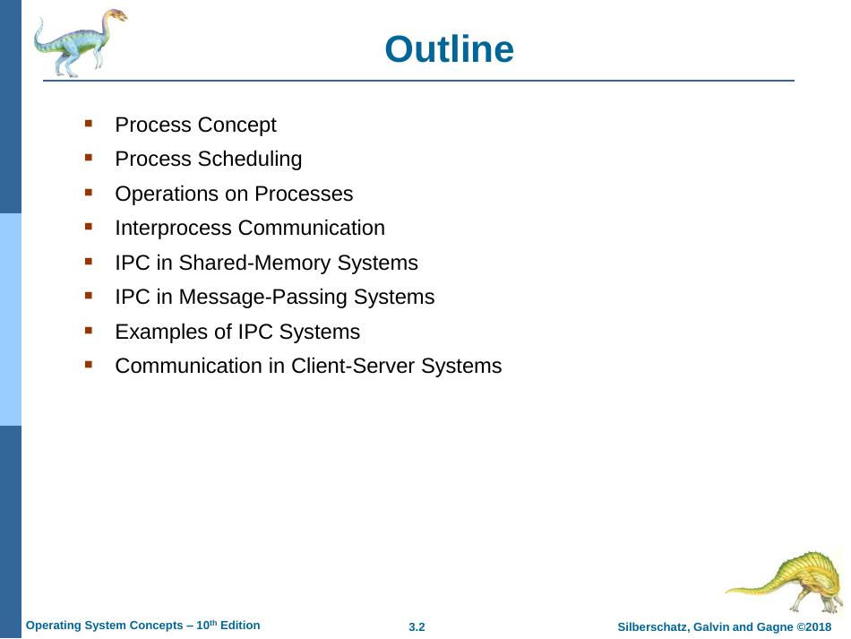

Slide ini memetakan posisi topik dalam bab. Pakai judul-judulnya sebagai daftar cek; utamakan hubungan sebab-akibat dan contoh, bukan hafalan urutan.

### Slide 003 — Objectives

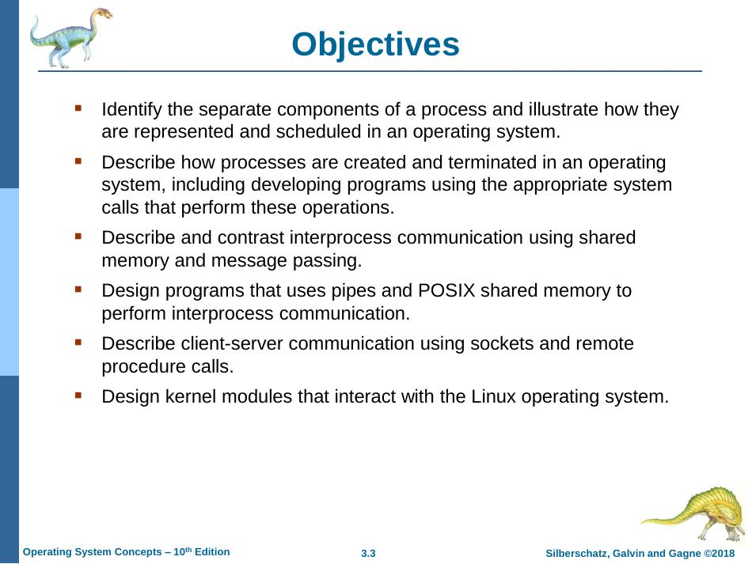

Slide ini memetakan posisi topik dalam bab. Pakai judul-judulnya sebagai daftar cek; utamakan hubungan sebab-akibat dan contoh, bukan hafalan urutan.

### Slide 004 — Process Concept

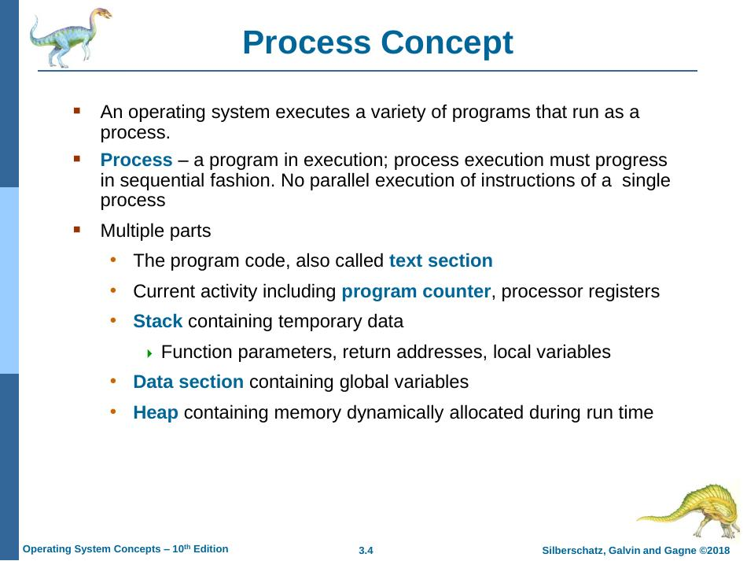

Program adalah kode pasif; proses adalah program yang sedang dijalankan beserta state-nya. Ruang proses biasanya memuat text, data, heap, dan stack. PCB menyimpan konteks seperti state, program counter, register, dan informasi penjadwalan agar proses dapat dilanjutkan.

**Perhatikan pada gambar:** ▪ An operating system executes a variety of programs that run as a; ▪ Process – a program in execution; process execution must progress

### Slide 005 — Process Concept (Cont.)

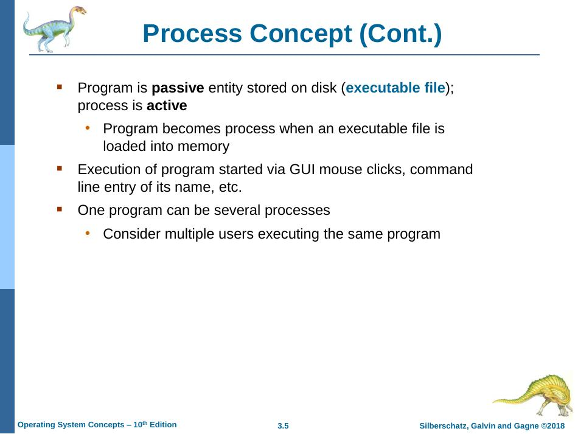

Program adalah kode pasif; proses adalah program yang sedang dijalankan beserta state-nya. Ruang proses biasanya memuat text, data, heap, dan stack. PCB menyimpan konteks seperti state, program counter, register, dan informasi penjadwalan agar proses dapat dilanjutkan.

**Perhatikan pada gambar:** ▪ Program is passive entity stored on disk (executable file);; • Program becomes process when an executable file is

### Slide 006 — Process in Memory

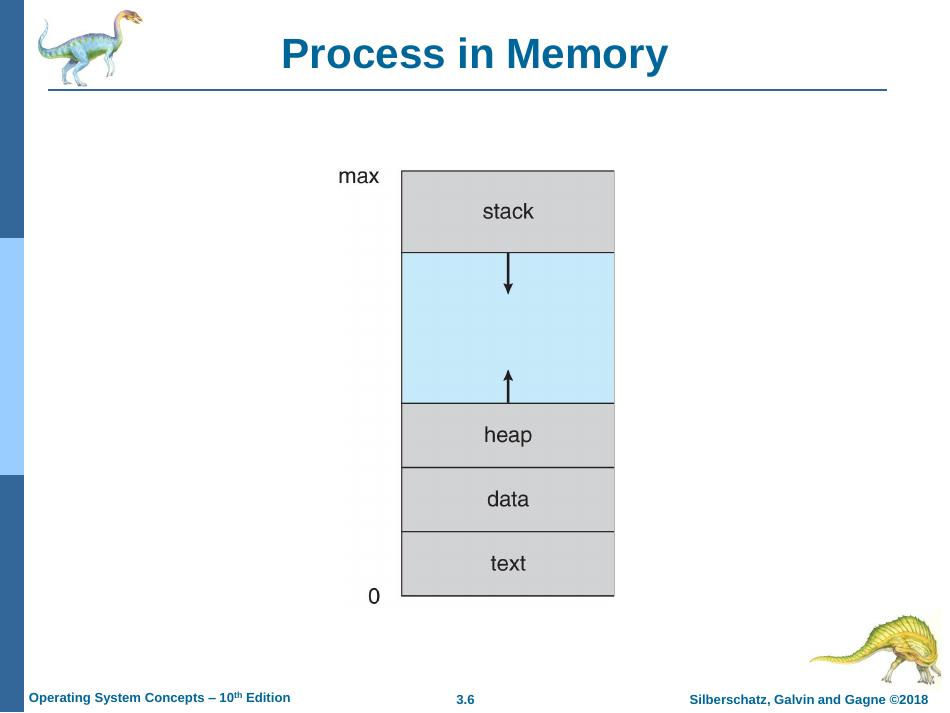

Program adalah kode pasif; proses adalah program yang sedang dijalankan beserta state-nya. Ruang proses biasanya memuat text, data, heap, dan stack. PCB menyimpan konteks seperti state, program counter, register, dan informasi penjadwalan agar proses dapat dilanjutkan.

### Slide 007 — Memory Layout of a C Program

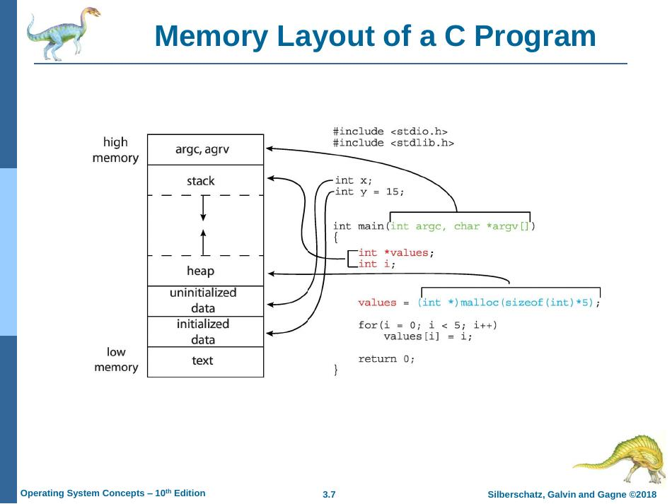

Program adalah kode pasif; proses adalah program yang sedang dijalankan beserta state-nya. Ruang proses biasanya memuat text, data, heap, dan stack. PCB menyimpan konteks seperti state, program counter, register, dan informasi penjadwalan agar proses dapat dilanjutkan.

### Slide 008 — Process State

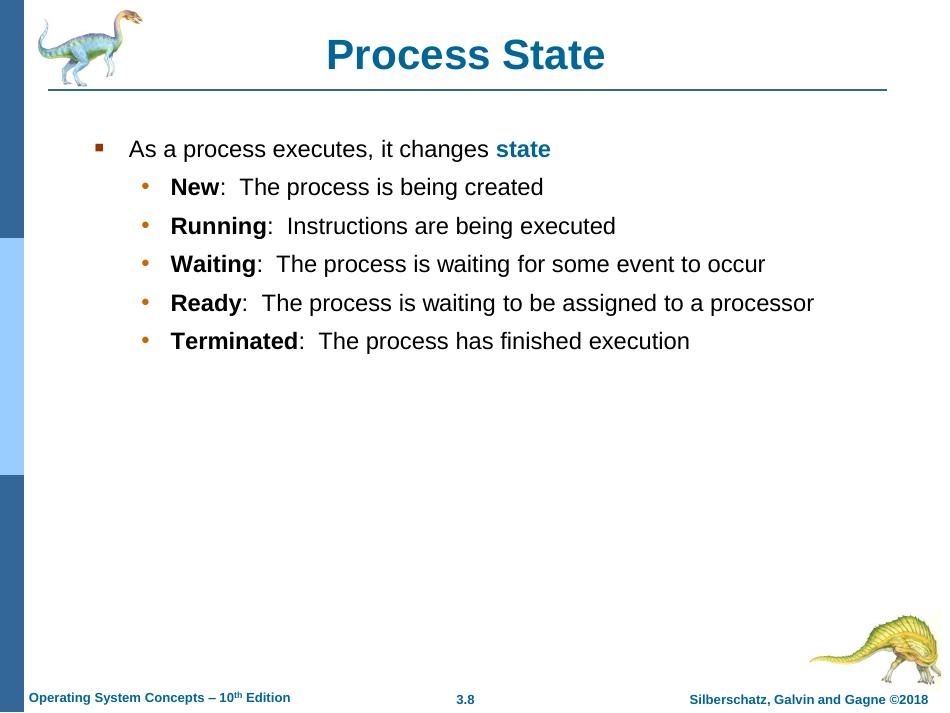

Proses ready siap memakai CPU, running sedang memakai CPU, dan waiting menunggu peristiwa seperti I/O. Habis jatah CPU: running ke ready. Meminta I/O: running ke waiting. I/O selesai: waiting ke ready.

**Perhatikan pada gambar:** ▪ As a process executes, it changes state; • New: The process is being created

### Slide 009 — Diagram of Process State

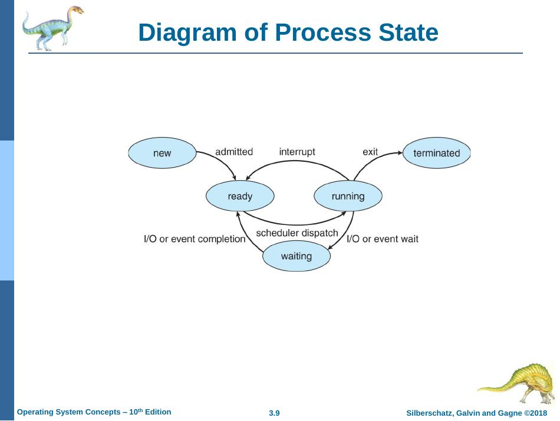

Proses ready siap memakai CPU, running sedang memakai CPU, dan waiting menunggu peristiwa seperti I/O. Habis jatah CPU: running ke ready. Meminta I/O: running ke waiting. I/O selesai: waiting ke ready.

### Slide 010 — Process Control Block (PCB)

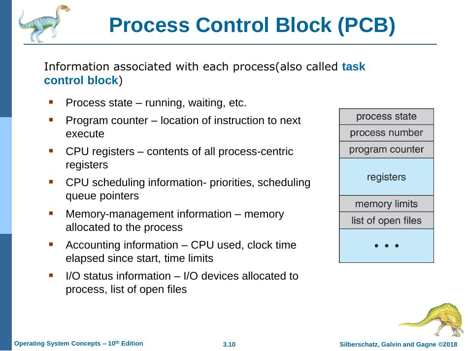

Program adalah kode pasif; proses adalah program yang sedang dijalankan beserta state-nya. Ruang proses biasanya memuat text, data, heap, dan stack. PCB menyimpan konteks seperti state, program counter, register, dan informasi penjadwalan agar proses dapat dilanjutkan.

**Perhatikan pada gambar:** Information associated with each process(also called task; ▪ Process state – running, waiting, etc.

### Slide 011 — Threads

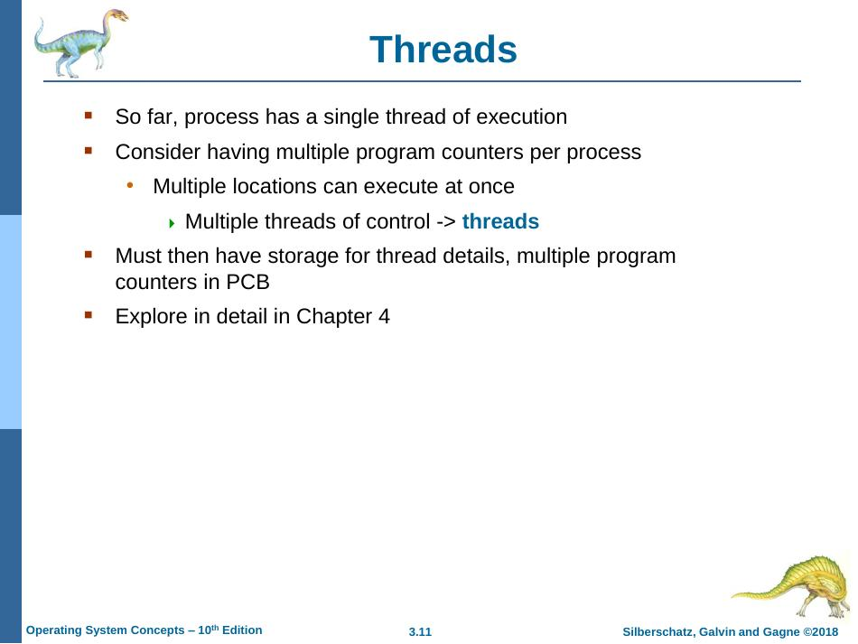

Slide ini memberi contoh tambahan untuk bagian tersebut. Perhatikan urutan pada gambar: identifikasi pelaku, sumber daya yang dipakai, lalu perubahan keadaan setelah setiap langkah. Hubungkan dengan slide sebelumnya sebelum menghafal istilahnya.

**Perhatikan pada gambar:** ▪ So far, process has a single thread of execution; ▪ Consider having multiple program counters per process

### Slide 012 — Process Representation in Linux

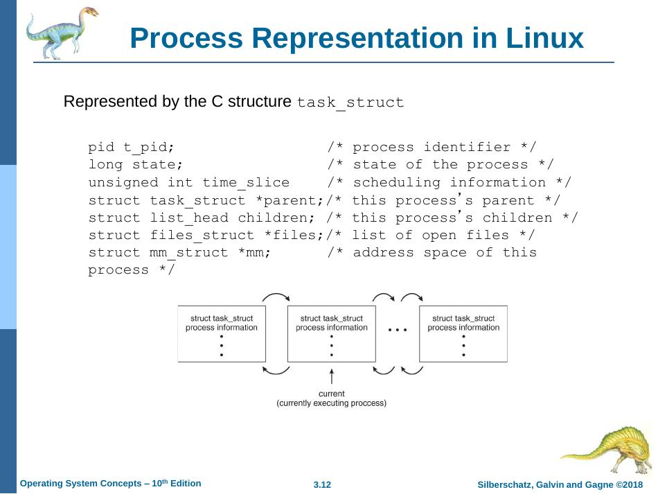

Program adalah kode pasif; proses adalah program yang sedang dijalankan beserta state-nya. Ruang proses biasanya memuat text, data, heap, dan stack. PCB menyimpan konteks seperti state, program counter, register, dan informasi penjadwalan agar proses dapat dilanjutkan.

**Perhatikan pada gambar:** Represented by the C structure task_struct; pid t_pid; /* process identifier */

### Slide 013 — Process Scheduling

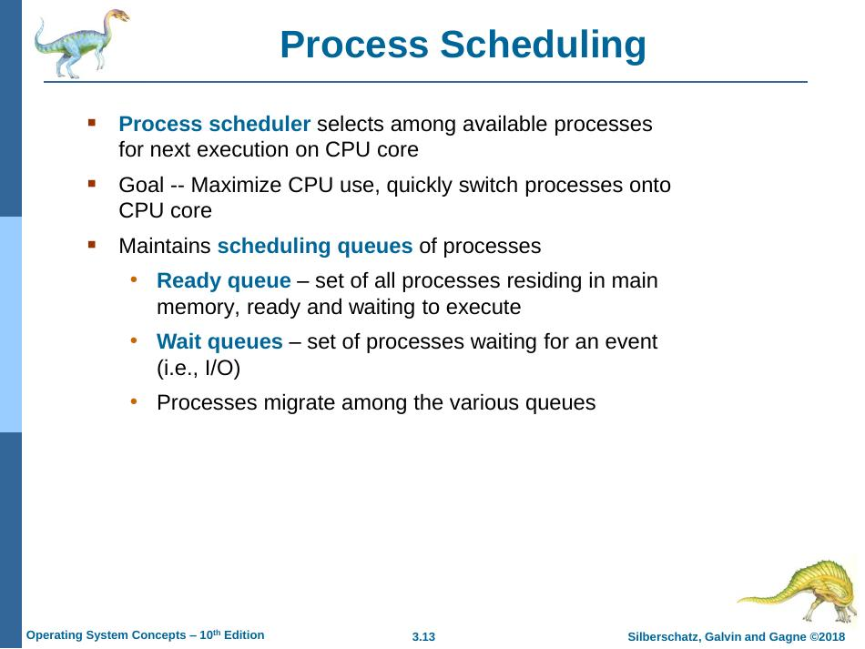

Context switch menyimpan keadaan proses lama ke PCB lalu memulihkan keadaan proses baru. Selama pergantian itu CPU tidak mengerjakan instruksi pengguna, sehingga ada biaya tambahan. Jangan samakan pergantian proses dengan pembuatan proses.

**Perhatikan pada gambar:** ▪ Process scheduler selects among available processes; for next execution on CPU core

### Slide 014 — Ready and Wait Queues

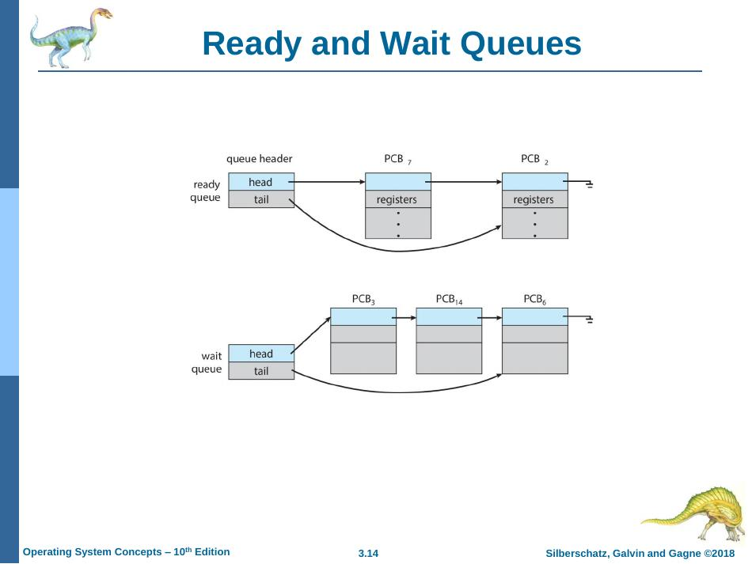

fork() membuat proses anak dengan alur eksekusi terpisah. exec() mengganti citra program pada proses yang memanggilnya. wait() membuat induk menunggu dan mengambil status anak; tanpa pengambilan status, anak yang selesai dapat menjadi zombie. Anak yang induknya lebih dulu selesai menjadi orphan.

### Slide 015 — Representation of Process Scheduling

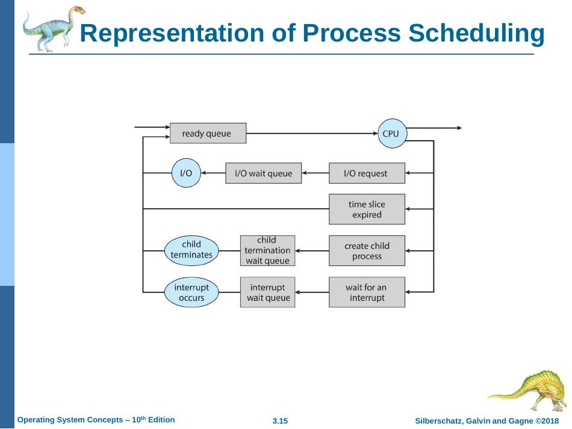

Context switch menyimpan keadaan proses lama ke PCB lalu memulihkan keadaan proses baru. Selama pergantian itu CPU tidak mengerjakan instruksi pengguna, sehingga ada biaya tambahan. Jangan samakan pergantian proses dengan pembuatan proses.

### Slide 016 — CPU Switch From Process to Process

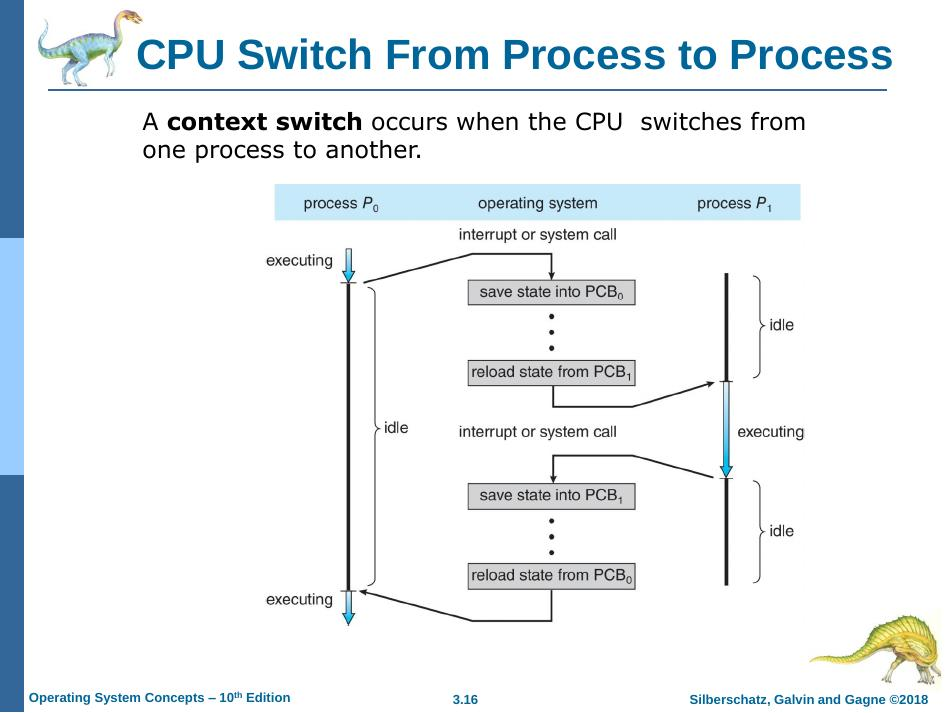

Context switch menyimpan keadaan proses lama ke PCB lalu memulihkan keadaan proses baru. Selama pergantian itu CPU tidak mengerjakan instruksi pengguna, sehingga ada biaya tambahan. Jangan samakan pergantian proses dengan pembuatan proses.

**Perhatikan pada gambar:** A context switch occurs when the CPU switches from; one process to another.

### Slide 017 — Context Switch

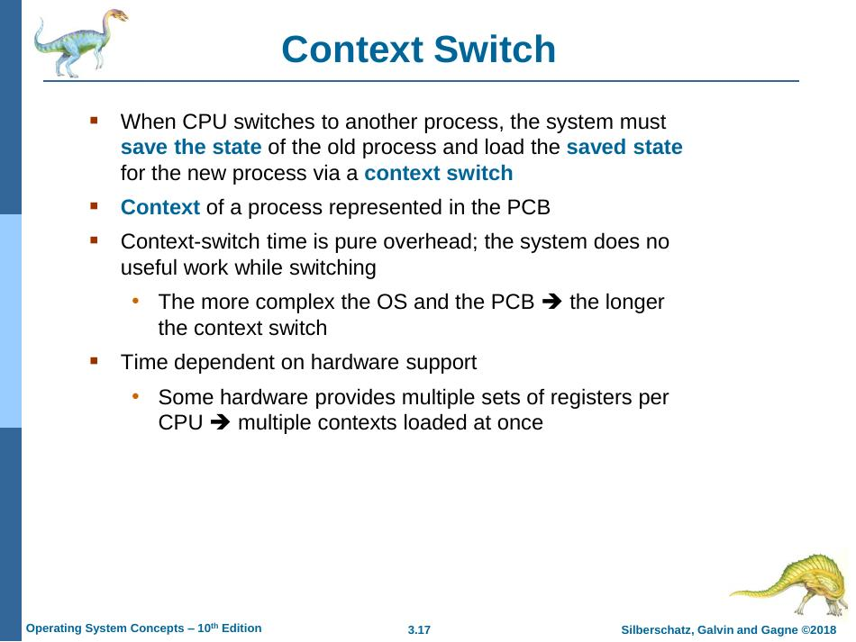

Context switch menyimpan keadaan proses lama ke PCB lalu memulihkan keadaan proses baru. Selama pergantian itu CPU tidak mengerjakan instruksi pengguna, sehingga ada biaya tambahan. Jangan samakan pergantian proses dengan pembuatan proses.

**Perhatikan pada gambar:** ▪ When CPU switches to another process, the system must; save the state of the old process and load the saved state

### Slide 018 — Multitasking in Mobile Systems

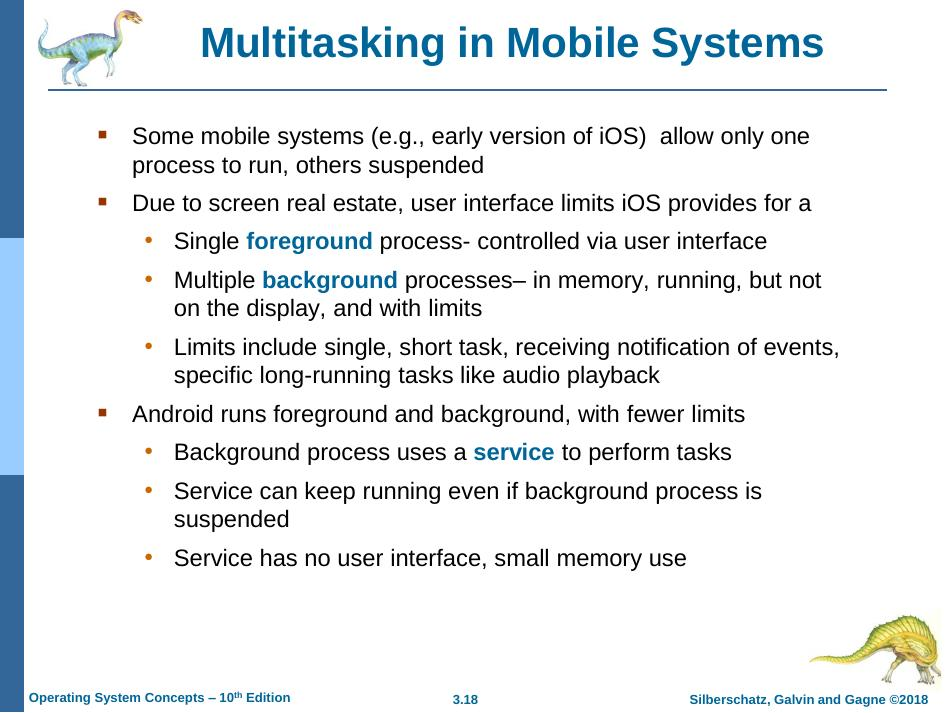

Slide ini memberi contoh tambahan untuk bagian tersebut. Perhatikan urutan pada gambar: identifikasi pelaku, sumber daya yang dipakai, lalu perubahan keadaan setelah setiap langkah. Hubungkan dengan slide sebelumnya sebelum menghafal istilahnya.

**Perhatikan pada gambar:** ▪ Some mobile systems (e.g., early version of iOS) allow only one; process to run, others suspended

### Slide 019 — Operations on Processes

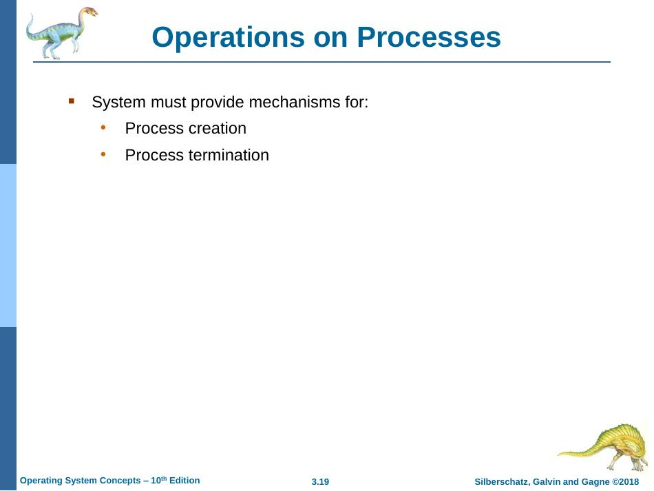

Slide ini memberi contoh tambahan untuk bagian tersebut. Perhatikan urutan pada gambar: identifikasi pelaku, sumber daya yang dipakai, lalu perubahan keadaan setelah setiap langkah. Hubungkan dengan slide sebelumnya sebelum menghafal istilahnya.

**Perhatikan pada gambar:** ▪ System must provide mechanisms for:

### Slide 020 — Process Creation

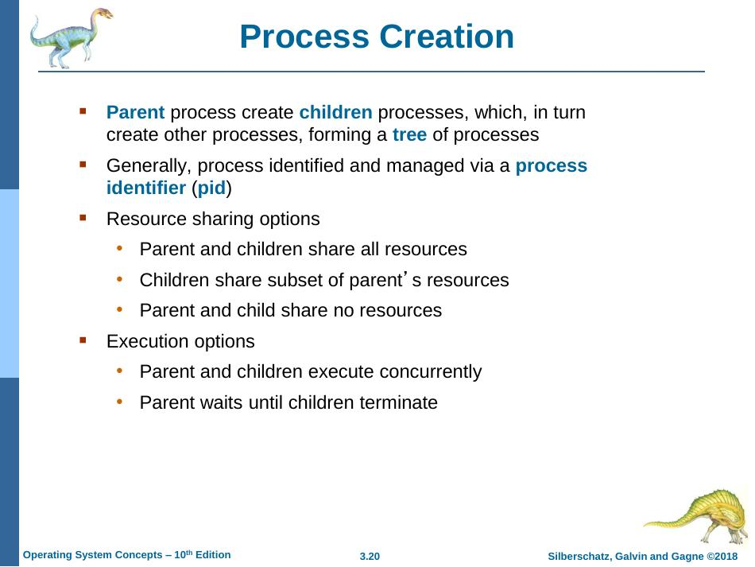

fork() membuat proses anak dengan alur eksekusi terpisah. exec() mengganti citra program pada proses yang memanggilnya. wait() membuat induk menunggu dan mengambil status anak; tanpa pengambilan status, anak yang selesai dapat menjadi zombie. Anak yang induknya lebih dulu selesai menjadi orphan.

**Perhatikan pada gambar:** ▪ Parent process create children processes, which, in turn; create other processes, forming a tree of processes

### Slide 021 — Process Creation (Cont.)

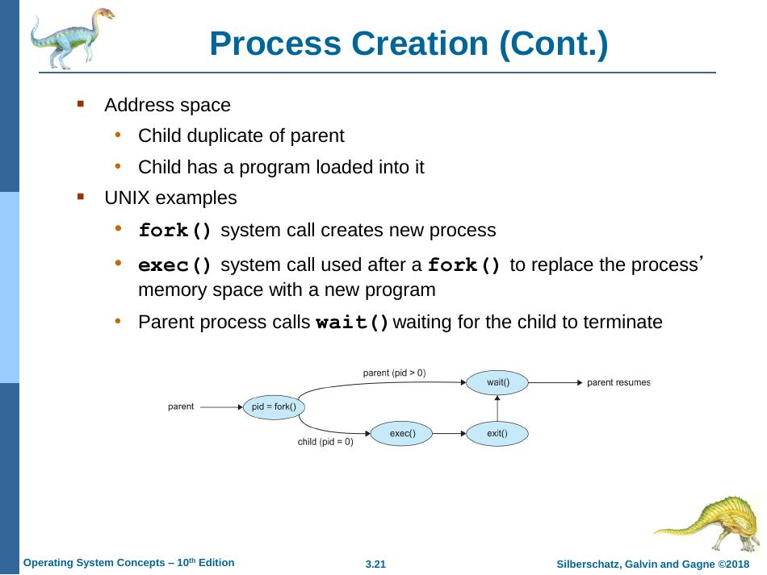

fork() membuat proses anak dengan alur eksekusi terpisah. exec() mengganti citra program pada proses yang memanggilnya. wait() membuat induk menunggu dan mengambil status anak; tanpa pengambilan status, anak yang selesai dapat menjadi zombie. Anak yang induknya lebih dulu selesai menjadi orphan.

**Perhatikan pada gambar:** • Child duplicate of parent; • Child has a program loaded into it

### Slide 022 — A Tree of Processes in Linux

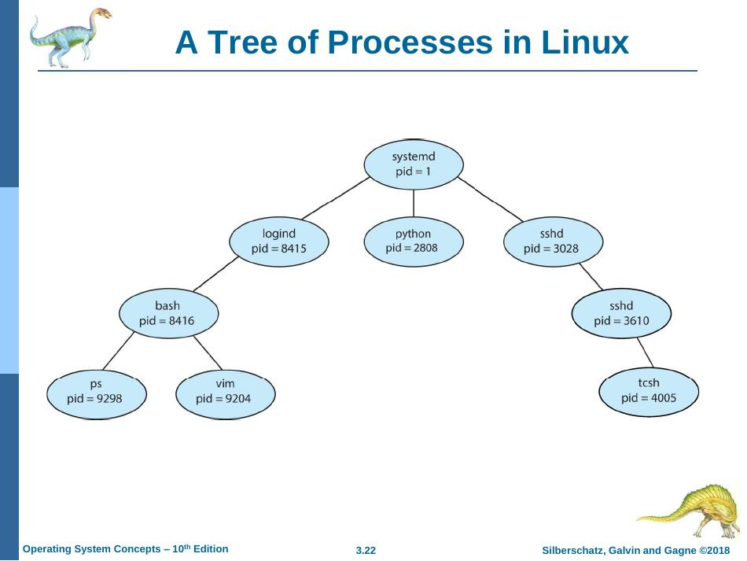

Slide ini memberi contoh tambahan untuk bagian tersebut. Perhatikan urutan pada gambar: identifikasi pelaku, sumber daya yang dipakai, lalu perubahan keadaan setelah setiap langkah. Hubungkan dengan slide sebelumnya sebelum menghafal istilahnya.

### Slide 023 — C Program Forking Separate Process

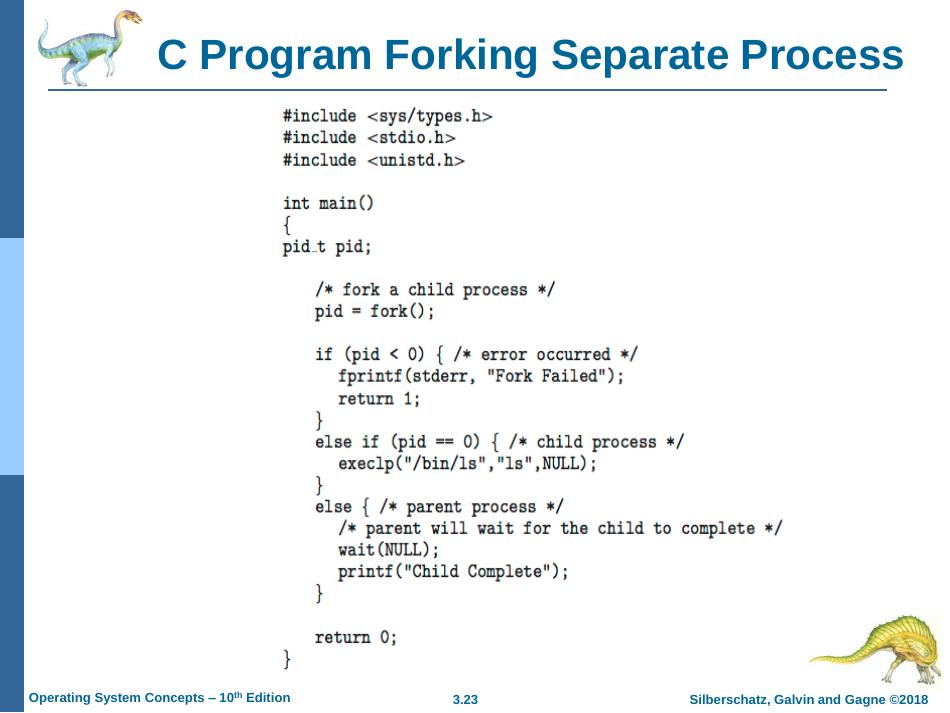

fork() membuat proses anak dengan alur eksekusi terpisah. exec() mengganti citra program pada proses yang memanggilnya. wait() membuat induk menunggu dan mengambil status anak; tanpa pengambilan status, anak yang selesai dapat menjadi zombie. Anak yang induknya lebih dulu selesai menjadi orphan.

### Slide 024 — Creating a Separate Process via Windows API

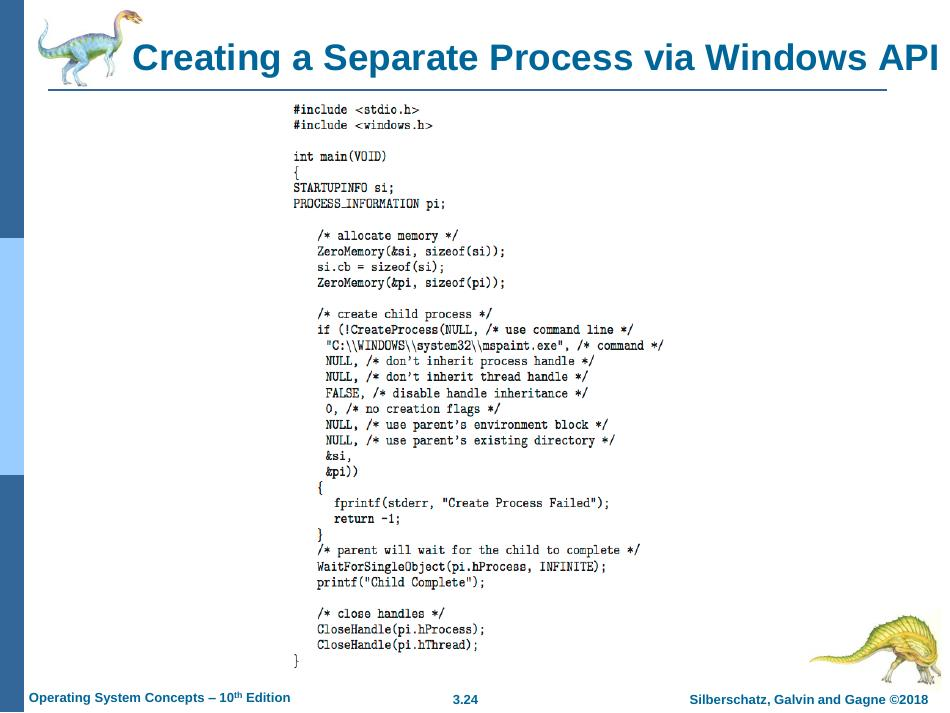

Aplikasi meminta kerja kernel lewat system call. CPU berpindah ke kernel mode untuk menjalankan layanan yang butuh hak istimewa, lalu kembali ke user mode; API adalah antarmuka pemrograman yang sering membungkus panggilan itu. Parameter dapat lewat register, blok memori, atau stack.

### Slide 025 — Process Termination

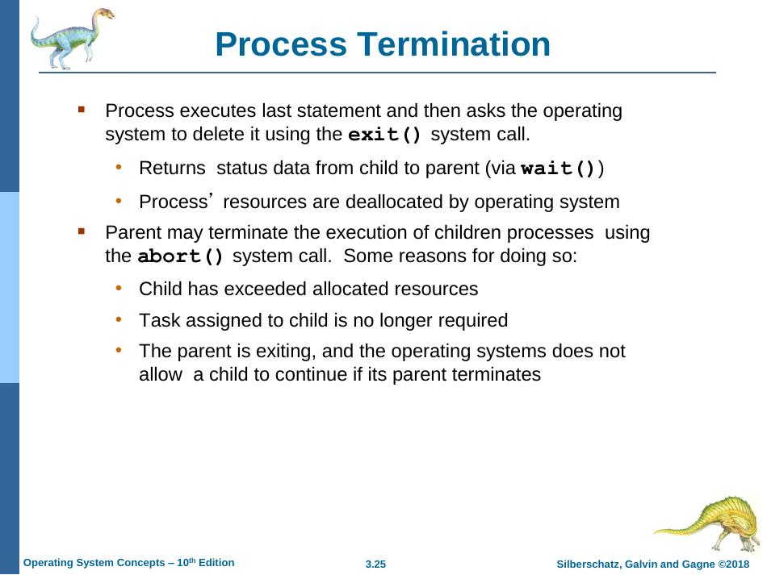

fork() membuat proses anak dengan alur eksekusi terpisah. exec() mengganti citra program pada proses yang memanggilnya. wait() membuat induk menunggu dan mengambil status anak; tanpa pengambilan status, anak yang selesai dapat menjadi zombie. Anak yang induknya lebih dulu selesai menjadi orphan.

**Perhatikan pada gambar:** ▪ Process executes last statement and then asks the operating; system to delete it using the exit() system call.

### Slide 026 — Process Termination

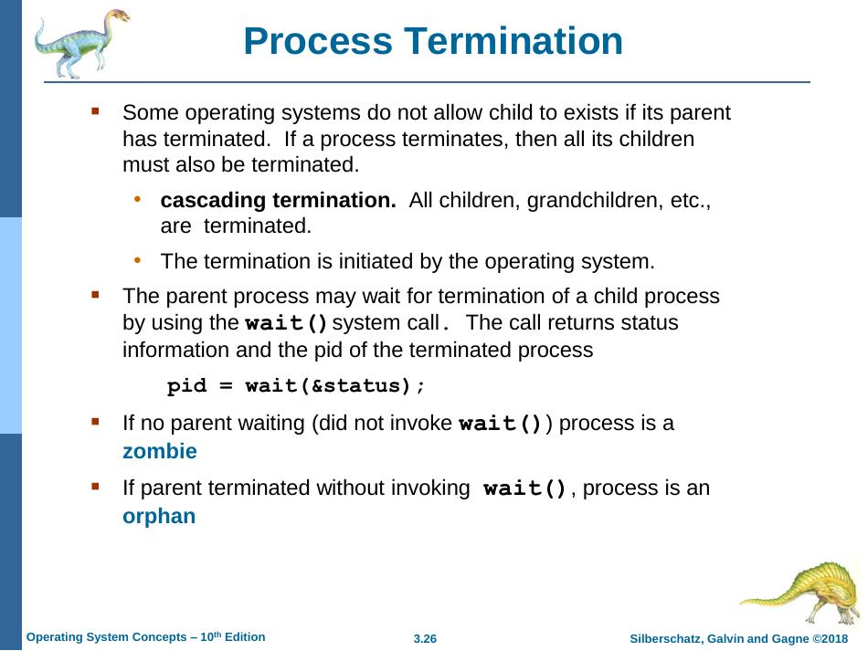

fork() membuat proses anak dengan alur eksekusi terpisah. exec() mengganti citra program pada proses yang memanggilnya. wait() membuat induk menunggu dan mengambil status anak; tanpa pengambilan status, anak yang selesai dapat menjadi zombie. Anak yang induknya lebih dulu selesai menjadi orphan.

**Perhatikan pada gambar:** ▪ Some operating systems do not allow child to exists if its parent; has terminated. If a process terminates, then all its children

### Slide 027 — Android Process Importance Hierarchy

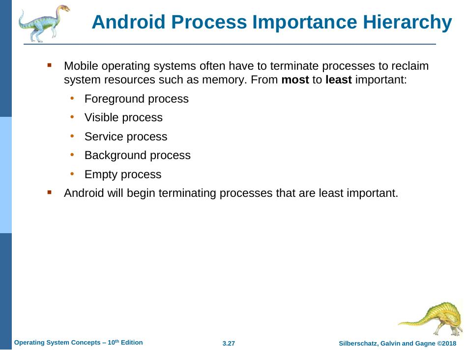

Slide ini memberi contoh tambahan untuk bagian tersebut. Perhatikan urutan pada gambar: identifikasi pelaku, sumber daya yang dipakai, lalu perubahan keadaan setelah setiap langkah. Hubungkan dengan slide sebelumnya sebelum menghafal istilahnya.

**Perhatikan pada gambar:** ▪ Mobile operating systems often have to terminate processes to reclaim; system resources such as memory. From most to least important:

### Slide 028 — Multiprocess Architecture – Chrome Browser

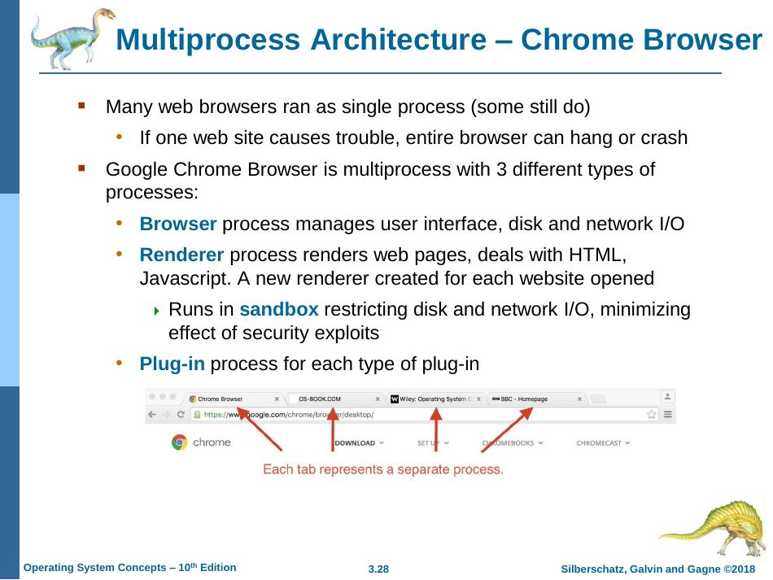

Slide ini memberi contoh tambahan untuk bagian tersebut. Perhatikan urutan pada gambar: identifikasi pelaku, sumber daya yang dipakai, lalu perubahan keadaan setelah setiap langkah. Hubungkan dengan slide sebelumnya sebelum menghafal istilahnya.

**Perhatikan pada gambar:** ▪ Many web browsers ran as single process (some still do); • If one web site causes trouble, entire browser can hang or crash

### Slide 029 — Interprocess Communication

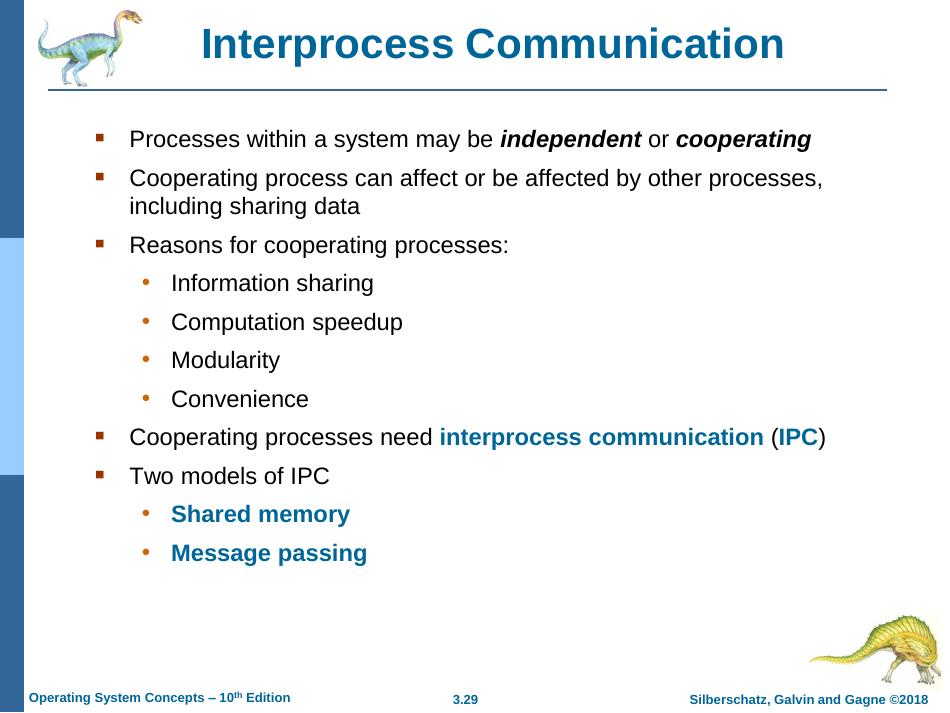

Slide ini memberi contoh tambahan untuk bagian tersebut. Perhatikan urutan pada gambar: identifikasi pelaku, sumber daya yang dipakai, lalu perubahan keadaan setelah setiap langkah. Hubungkan dengan slide sebelumnya sebelum menghafal istilahnya.

**Perhatikan pada gambar:** ▪ Processes within a system may be independent or cooperating; ▪ Cooperating process can affect or be affected by other processes,

### Slide 030 — Communications Models

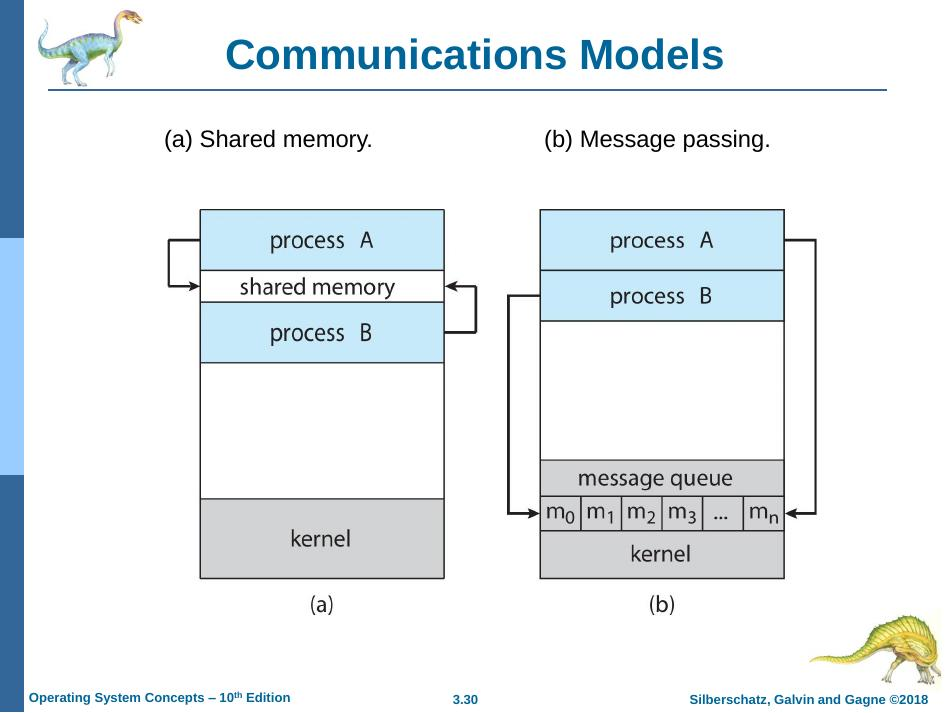

Slide ini memberi contoh tambahan untuk bagian tersebut. Perhatikan urutan pada gambar: identifikasi pelaku, sumber daya yang dipakai, lalu perubahan keadaan setelah setiap langkah. Hubungkan dengan slide sebelumnya sebelum menghafal istilahnya.

**Perhatikan pada gambar:** (a) Shared memory. (b) Message passing.

### Slide 031 — Producer-Consumer Problem

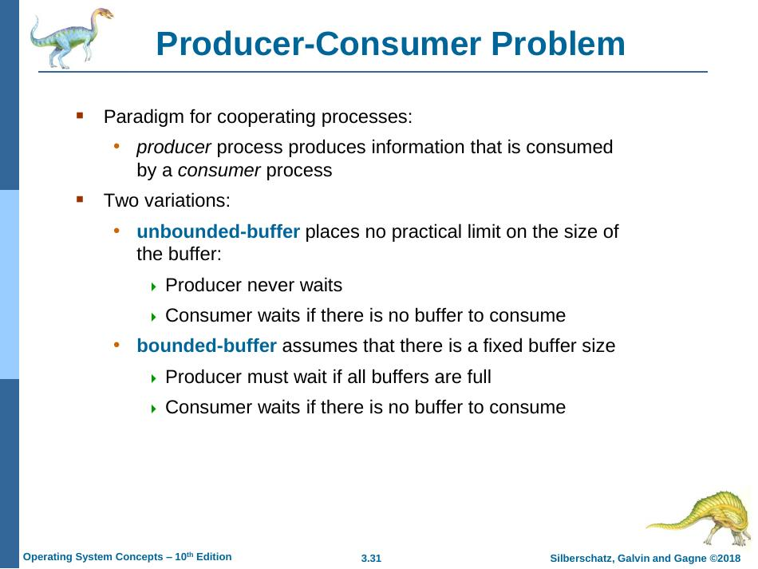

IPC memungkinkan proses bertukar data. Shared memory memakai area yang sama dan perlu sinkronisasi; message passing mengirim pesan melalui fasilitas sistem. Pipe lazim untuk aliran searah, socket untuk komunikasi antartitik, dan RPC membuat pemanggilan jauh tampak seperti fungsi lokal.

**Perhatikan pada gambar:** ▪ Paradigm for cooperating processes:; • producer process produces information that is consumed

### Slide 032 — IPC – Shared Memory

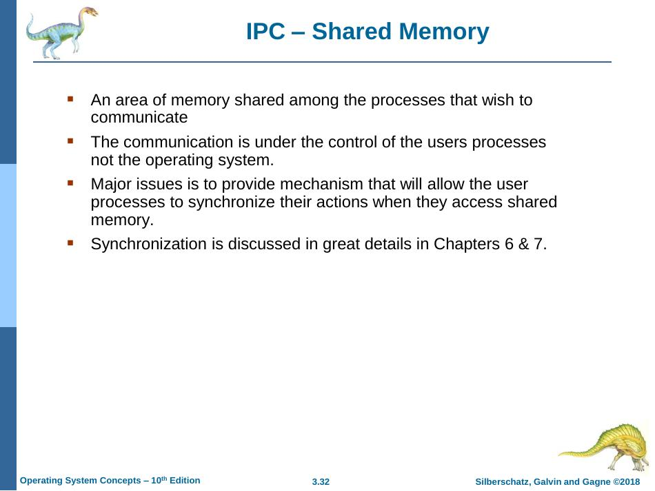

IPC memungkinkan proses bertukar data. Shared memory memakai area yang sama dan perlu sinkronisasi; message passing mengirim pesan melalui fasilitas sistem. Pipe lazim untuk aliran searah, socket untuk komunikasi antartitik, dan RPC membuat pemanggilan jauh tampak seperti fungsi lokal.

**Perhatikan pada gambar:** ▪ An area of memory shared among the processes that wish to; ▪ The communication is under the control of the users processes

### Slide 033 — Bounded-Buffer – Shared-Memory Solution

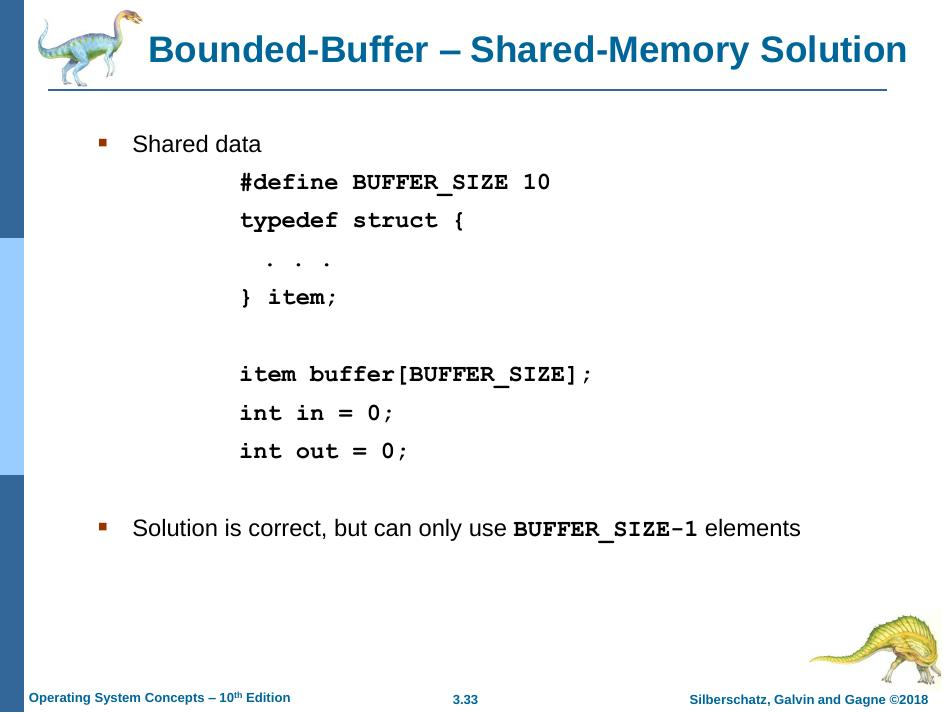

IPC memungkinkan proses bertukar data. Shared memory memakai area yang sama dan perlu sinkronisasi; message passing mengirim pesan melalui fasilitas sistem. Pipe lazim untuk aliran searah, socket untuk komunikasi antartitik, dan RPC membuat pemanggilan jauh tampak seperti fungsi lokal.

**Perhatikan pada gambar:** item buffer[BUFFER_SIZE];; ▪ Solution is correct, but can only use BUFFER_SIZE-1 elements

### Slide 034 — Producer Process – Shared Memory

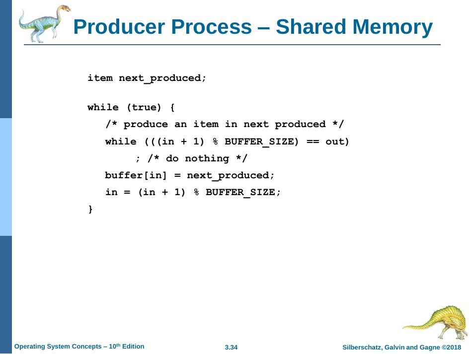

IPC memungkinkan proses bertukar data. Shared memory memakai area yang sama dan perlu sinkronisasi; message passing mengirim pesan melalui fasilitas sistem. Pipe lazim untuk aliran searah, socket untuk komunikasi antartitik, dan RPC membuat pemanggilan jauh tampak seperti fungsi lokal.

**Perhatikan pada gambar:** /* produce an item in next produced */; while (((in + 1) % BUFFER_SIZE) == out)

### Slide 035 — Consumer Process – Shared Memory

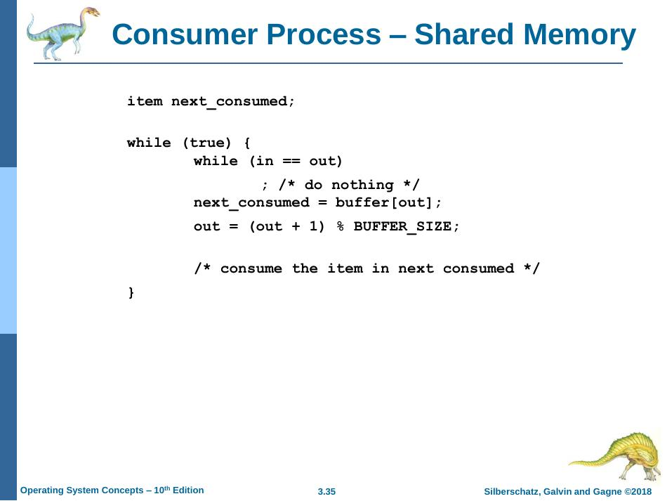

IPC memungkinkan proses bertukar data. Shared memory memakai area yang sama dan perlu sinkronisasi; message passing mengirim pesan melalui fasilitas sistem. Pipe lazim untuk aliran searah, socket untuk komunikasi antartitik, dan RPC membuat pemanggilan jauh tampak seperti fungsi lokal.

**Perhatikan pada gambar:** next_consumed = buffer[out];; out = (out + 1) % BUFFER_SIZE;

### Slide 036 — What about Filling all the Buffers?

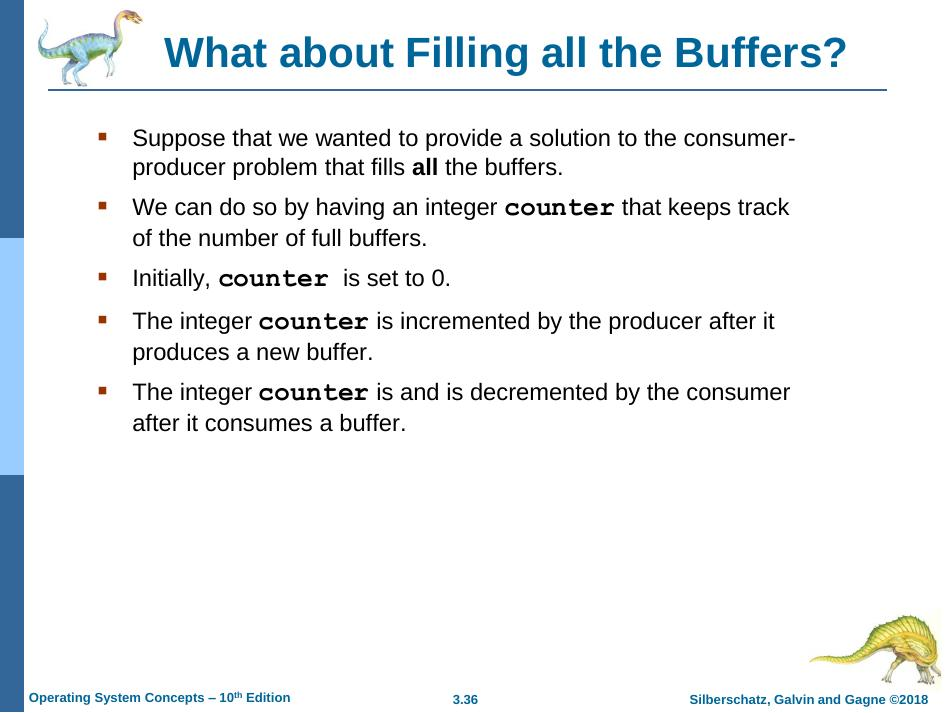

IPC memungkinkan proses bertukar data. Shared memory memakai area yang sama dan perlu sinkronisasi; message passing mengirim pesan melalui fasilitas sistem. Pipe lazim untuk aliran searah, socket untuk komunikasi antartitik, dan RPC membuat pemanggilan jauh tampak seperti fungsi lokal.

**Perhatikan pada gambar:** ▪ Suppose that we wanted to provide a solution to the consumer-; producer problem that fills all the buffers.

### Slide 037 — Producer

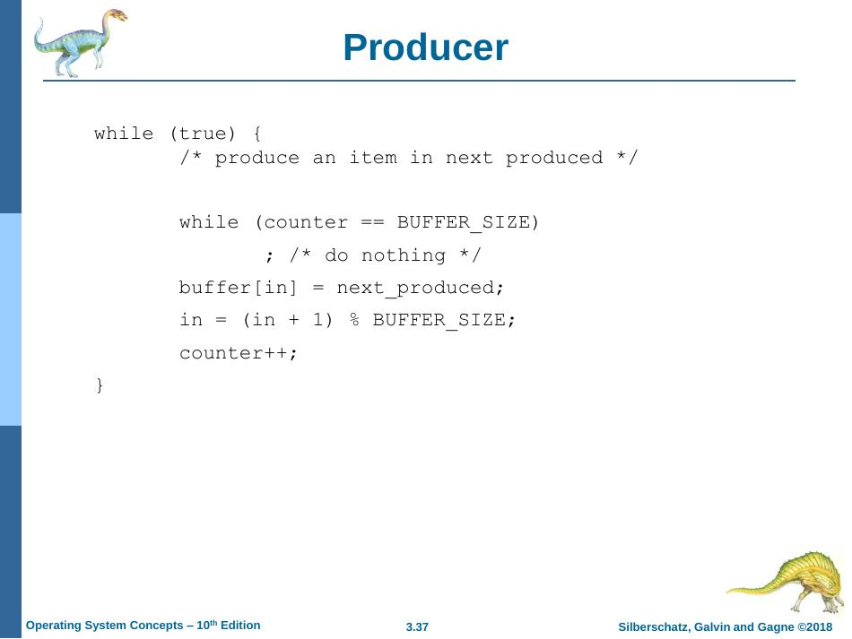

IPC memungkinkan proses bertukar data. Shared memory memakai area yang sama dan perlu sinkronisasi; message passing mengirim pesan melalui fasilitas sistem. Pipe lazim untuk aliran searah, socket untuk komunikasi antartitik, dan RPC membuat pemanggilan jauh tampak seperti fungsi lokal.

**Perhatikan pada gambar:** /* produce an item in next produced */; while (counter == BUFFER_SIZE)

### Slide 038 — Consumer

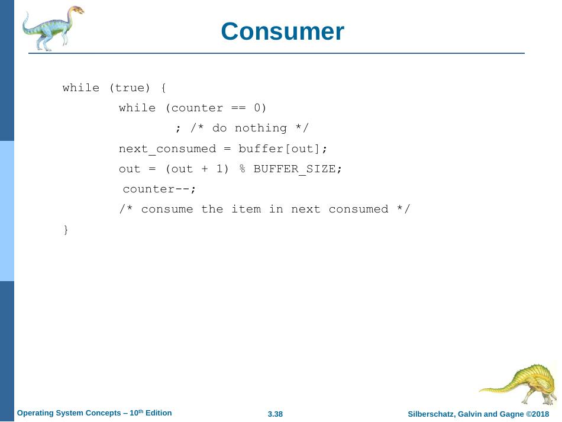

IPC memungkinkan proses bertukar data. Shared memory memakai area yang sama dan perlu sinkronisasi; message passing mengirim pesan melalui fasilitas sistem. Pipe lazim untuk aliran searah, socket untuk komunikasi antartitik, dan RPC membuat pemanggilan jauh tampak seperti fungsi lokal.

**Perhatikan pada gambar:** next_consumed = buffer[out];; out = (out + 1) % BUFFER_SIZE;

### Slide 039 — Race Condition

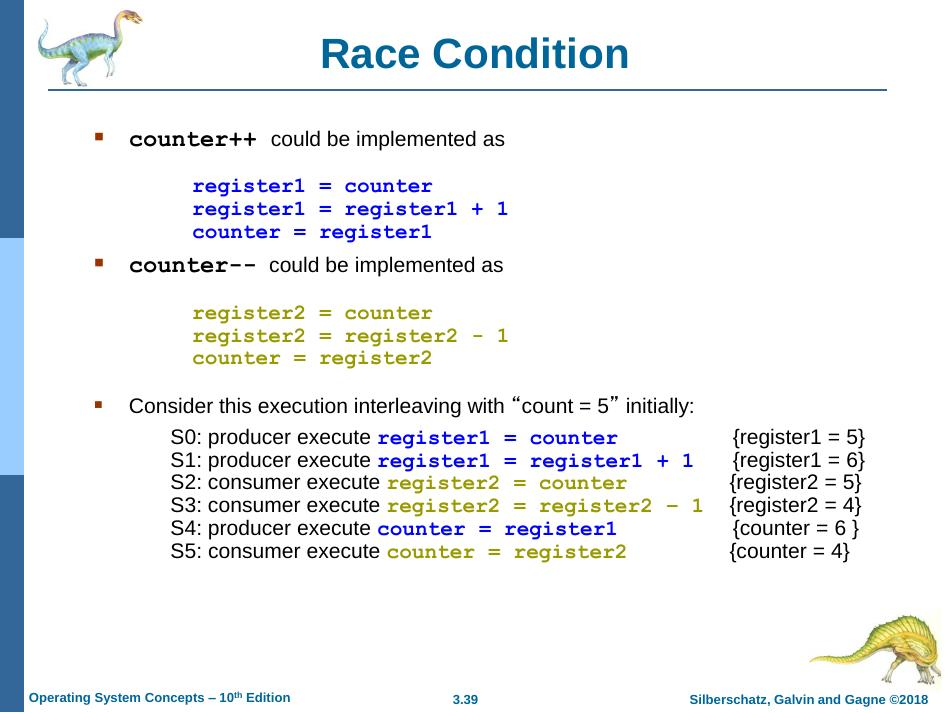

Race condition terjadi ketika hasil bergantung pada urutan operasi yang saling beririsan. Bila dua pekerja mengubah data bersama, lindungi bagian kritis atau gunakan operasi atomik; hasil yang tampak benar sekali belum membuktikan kode aman.

**Perhatikan pada gambar:** ▪ counter++ could be implemented as; register1 = register1 + 1

### Slide 040 — Race Condition (Cont.)

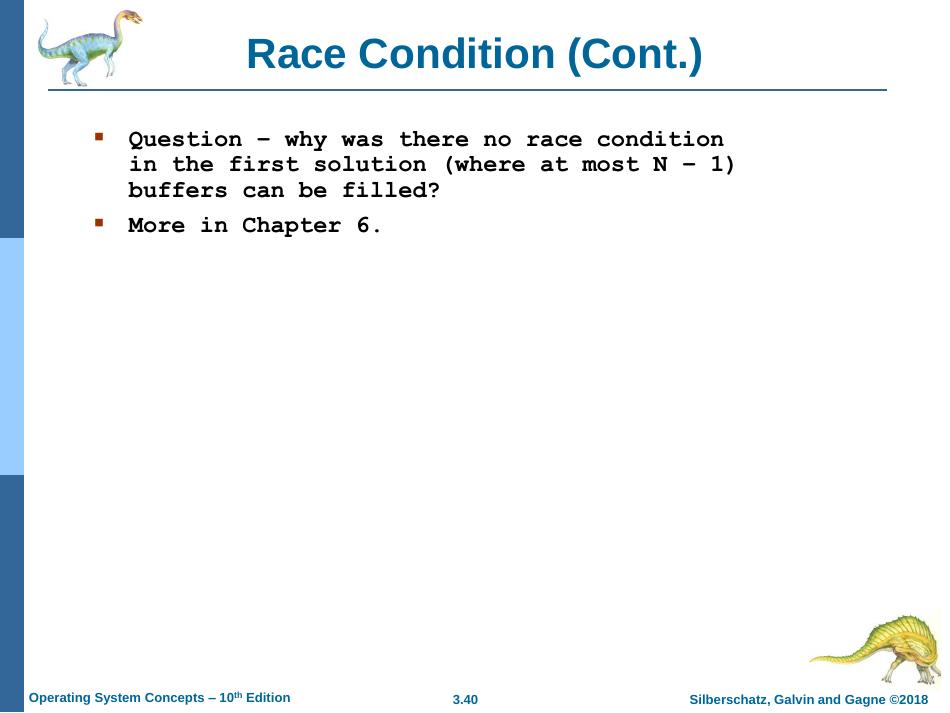

Race condition terjadi ketika hasil bergantung pada urutan operasi yang saling beririsan. Bila dua pekerja mengubah data bersama, lindungi bagian kritis atau gunakan operasi atomik; hasil yang tampak benar sekali belum membuktikan kode aman.

**Perhatikan pada gambar:** ▪ Question – why was there no race condition; in the first solution (where at most N – 1)

### Slide 041 — IPC – Message Passing

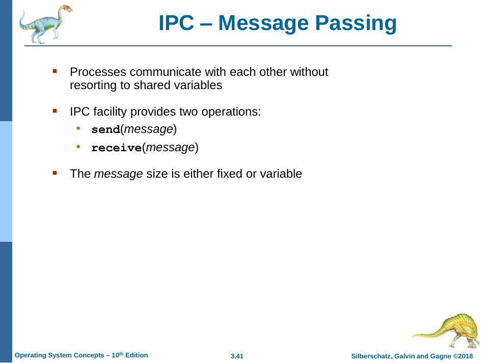

IPC memungkinkan proses bertukar data. Shared memory memakai area yang sama dan perlu sinkronisasi; message passing mengirim pesan melalui fasilitas sistem. Pipe lazim untuk aliran searah, socket untuk komunikasi antartitik, dan RPC membuat pemanggilan jauh tampak seperti fungsi lokal.

**Perhatikan pada gambar:** ▪ Processes communicate with each other without; resorting to shared variables

### Slide 042 — Message Passing (Cont.)

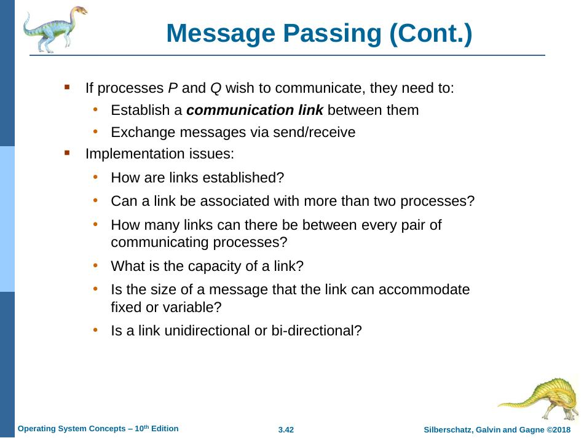

IPC memungkinkan proses bertukar data. Shared memory memakai area yang sama dan perlu sinkronisasi; message passing mengirim pesan melalui fasilitas sistem. Pipe lazim untuk aliran searah, socket untuk komunikasi antartitik, dan RPC membuat pemanggilan jauh tampak seperti fungsi lokal.

**Perhatikan pada gambar:** ▪ If processes P and Q wish to communicate, they need to:; • Establish a communication link between them

### Slide 043 — Implementation of Communication Link

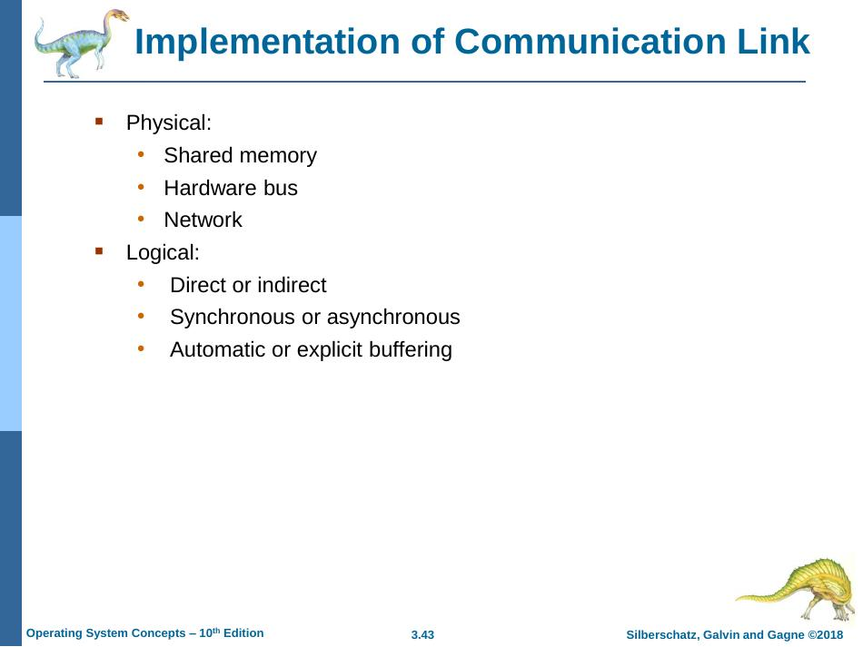

Mekanisme adalah cara sistem melakukan sesuatu; kebijakan menentukan pilihan mana yang diambil. Contohnya, mekanisme timer memberi kesempatan menjadwalkan ulang, sedangkan kebijakan penjadwal memilih proses berikutnya.

**Perhatikan pada gambar:** • Synchronous or asynchronous; • Automatic or explicit buffering

### Slide 044 — Direct Communication

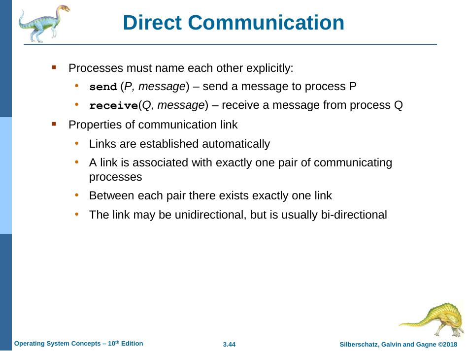

Slide ini memberi contoh tambahan untuk bagian tersebut. Perhatikan urutan pada gambar: identifikasi pelaku, sumber daya yang dipakai, lalu perubahan keadaan setelah setiap langkah. Hubungkan dengan slide sebelumnya sebelum menghafal istilahnya.

**Perhatikan pada gambar:** ▪ Processes must name each other explicitly:; • send (P, message) – send a message to process P

### Slide 045 — Indirect Communication

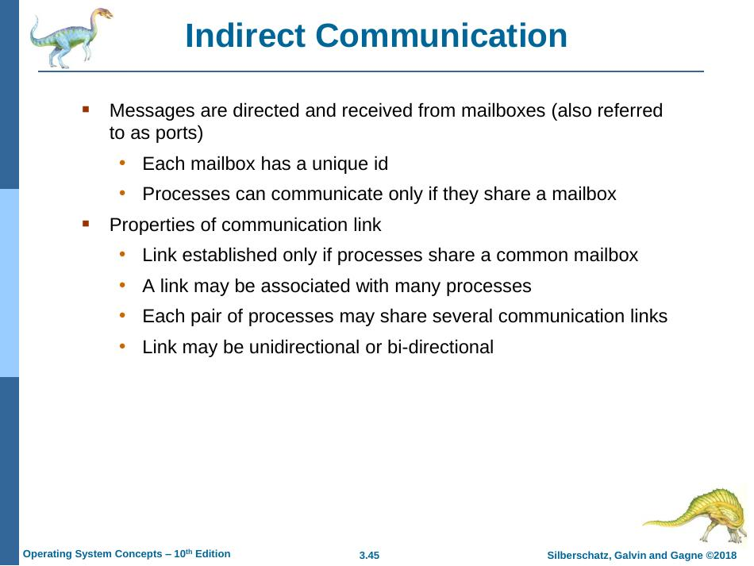

Slide ini memberi contoh tambahan untuk bagian tersebut. Perhatikan urutan pada gambar: identifikasi pelaku, sumber daya yang dipakai, lalu perubahan keadaan setelah setiap langkah. Hubungkan dengan slide sebelumnya sebelum menghafal istilahnya.

**Perhatikan pada gambar:** ▪ Messages are directed and received from mailboxes (also referred; • Each mailbox has a unique id

### Slide 046 — Indirect Communication (Cont.)

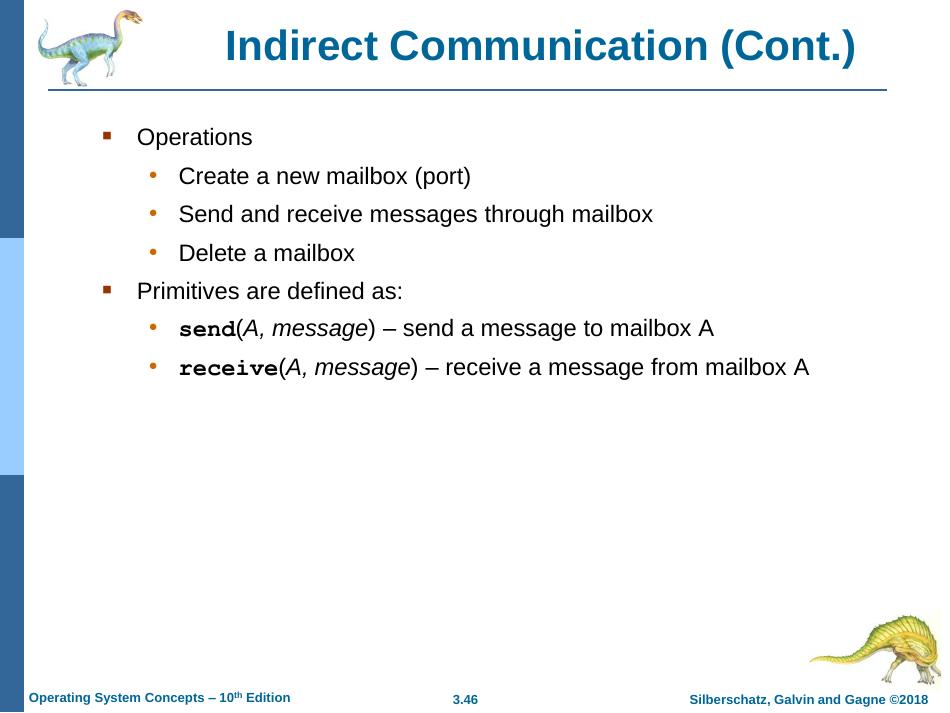

Slide ini memberi contoh tambahan untuk bagian tersebut. Perhatikan urutan pada gambar: identifikasi pelaku, sumber daya yang dipakai, lalu perubahan keadaan setelah setiap langkah. Hubungkan dengan slide sebelumnya sebelum menghafal istilahnya.

**Perhatikan pada gambar:** • Create a new mailbox (port); • Send and receive messages through mailbox

### Slide 047 — Indirect Communication (Cont.)

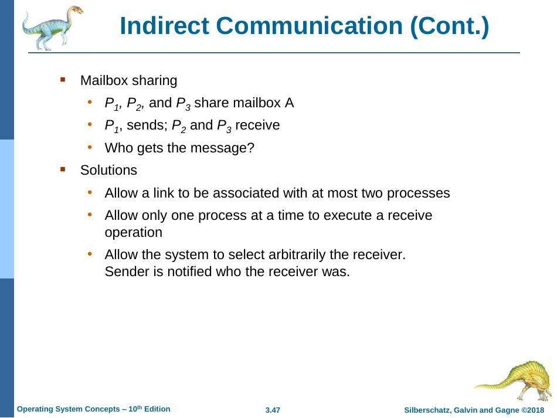

Slide ini memberi contoh tambahan untuk bagian tersebut. Perhatikan urutan pada gambar: identifikasi pelaku, sumber daya yang dipakai, lalu perubahan keadaan setelah setiap langkah. Hubungkan dengan slide sebelumnya sebelum menghafal istilahnya.

**Perhatikan pada gambar:** • P1, P2, and P3 share mailbox A; • P1, sends; P2 and P3 receive

### Slide 048 — Synchronization

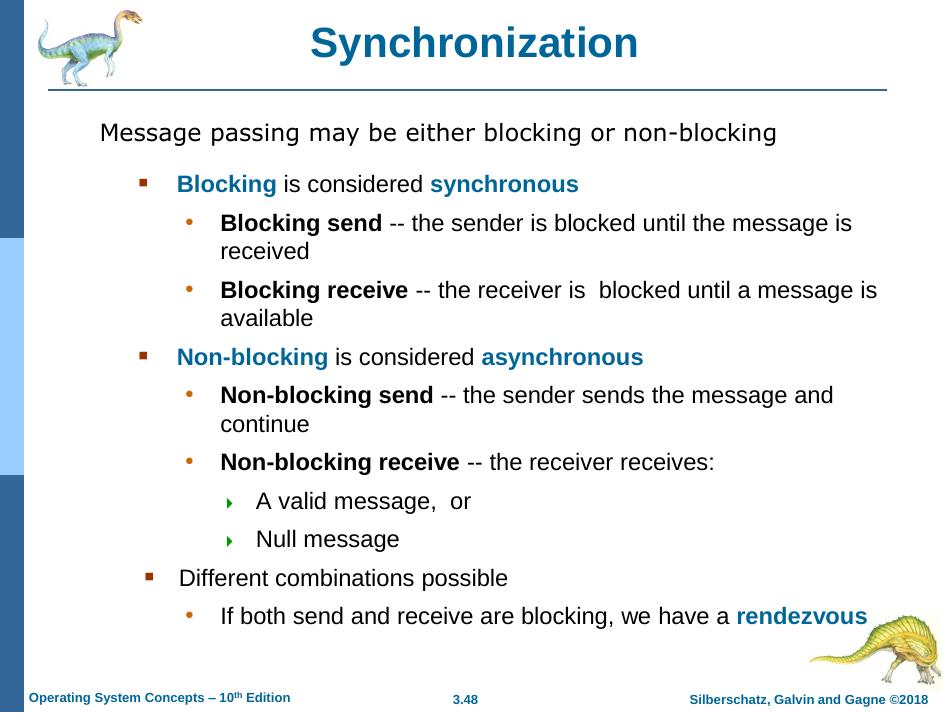

Slide ini memberi contoh tambahan untuk bagian tersebut. Perhatikan urutan pada gambar: identifikasi pelaku, sumber daya yang dipakai, lalu perubahan keadaan setelah setiap langkah. Hubungkan dengan slide sebelumnya sebelum menghafal istilahnya.

**Perhatikan pada gambar:** Message passing may be either blocking or non-blocking; ▪ Blocking is considered synchronous

### Slide 049 — Producer-Consumer: Message Passing

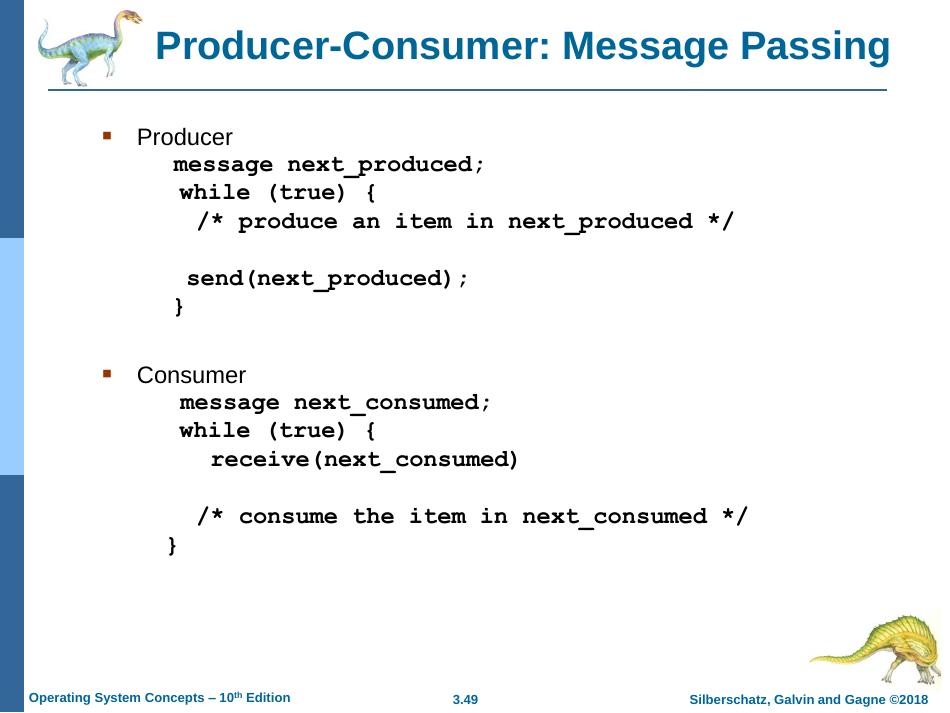

IPC memungkinkan proses bertukar data. Shared memory memakai area yang sama dan perlu sinkronisasi; message passing mengirim pesan melalui fasilitas sistem. Pipe lazim untuk aliran searah, socket untuk komunikasi antartitik, dan RPC membuat pemanggilan jauh tampak seperti fungsi lokal.

**Perhatikan pada gambar:** /* produce an item in next_produced */; /* consume the item in next_consumed */

### Slide 050 — Buffering

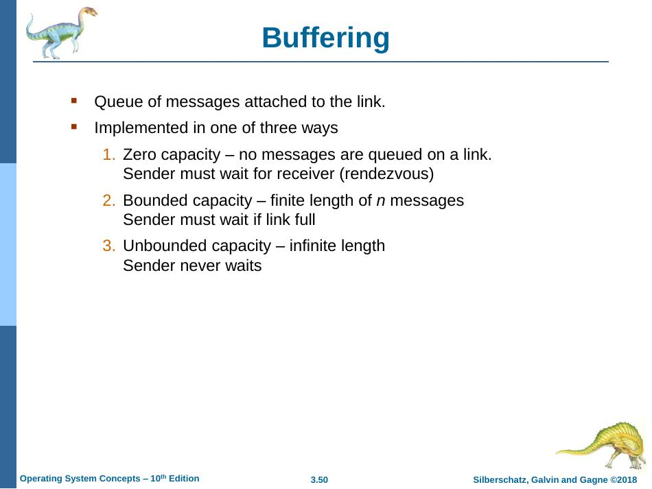

IPC memungkinkan proses bertukar data. Shared memory memakai area yang sama dan perlu sinkronisasi; message passing mengirim pesan melalui fasilitas sistem. Pipe lazim untuk aliran searah, socket untuk komunikasi antartitik, dan RPC membuat pemanggilan jauh tampak seperti fungsi lokal.

**Perhatikan pada gambar:** ▪ Queue of messages attached to the link.; ▪ Implemented in one of three ways

### Slide 051 — Examples of IPC Systems - POSIX


IPC memungkinkan proses bertukar data. Shared memory memakai area yang sama dan perlu sinkronisasi; message passing mengirim pesan melalui fasilitas sistem. Pipe lazim untuk aliran searah, socket untuk komunikasi antartitik, dan RPC membuat pemanggilan jauh tampak seperti fungsi lokal.

**Perhatikan pada gambar:** • Process first creates shared memory segment; shm_fd = shm_open(name, O CREAT | O RDWR, 0666);

### Slide 052 — IPC POSIX Producer


IPC memungkinkan proses bertukar data. Shared memory memakai area yang sama dan perlu sinkronisasi; message passing mengirim pesan melalui fasilitas sistem. Pipe lazim untuk aliran searah, socket untuk komunikasi antartitik, dan RPC membuat pemanggilan jauh tampak seperti fungsi lokal.

### Slide 053 — IPC POSIX Consumer


IPC memungkinkan proses bertukar data. Shared memory memakai area yang sama dan perlu sinkronisasi; message passing mengirim pesan melalui fasilitas sistem. Pipe lazim untuk aliran searah, socket untuk komunikasi antartitik, dan RPC membuat pemanggilan jauh tampak seperti fungsi lokal.

### Slide 054 — Examples of IPC Systems - Mach


IPC memungkinkan proses bertukar data. Shared memory memakai area yang sama dan perlu sinkronisasi; message passing mengirim pesan melalui fasilitas sistem. Pipe lazim untuk aliran searah, socket untuk komunikasi antartitik, dan RPC membuat pemanggilan jauh tampak seperti fungsi lokal.

**Perhatikan pada gambar:** ▪ Mach communication is message based; • Even system calls are messages

### Slide 055 — Mach Messages


IPC memungkinkan proses bertukar data. Shared memory memakai area yang sama dan perlu sinkronisasi; message passing mengirim pesan melalui fasilitas sistem. Pipe lazim untuk aliran searah, socket untuk komunikasi antartitik, dan RPC membuat pemanggilan jauh tampak seperti fungsi lokal.

**Perhatikan pada gambar:** mach_msg_header_t header;

### Slide 056 — Mach Message Passing - Client


IPC memungkinkan proses bertukar data. Shared memory memakai area yang sama dan perlu sinkronisasi; message passing mengirim pesan melalui fasilitas sistem. Pipe lazim untuk aliran searah, socket untuk komunikasi antartitik, dan RPC membuat pemanggilan jauh tampak seperti fungsi lokal.

### Slide 057 — Mach Message Passing - Server


IPC memungkinkan proses bertukar data. Shared memory memakai area yang sama dan perlu sinkronisasi; message passing mengirim pesan melalui fasilitas sistem. Pipe lazim untuk aliran searah, socket untuk komunikasi antartitik, dan RPC membuat pemanggilan jauh tampak seperti fungsi lokal.

### Slide 058 — Examples of IPC Systems – Windows


IPC memungkinkan proses bertukar data. Shared memory memakai area yang sama dan perlu sinkronisasi; message passing mengirim pesan melalui fasilitas sistem. Pipe lazim untuk aliran searah, socket untuk komunikasi antartitik, dan RPC membuat pemanggilan jauh tampak seperti fungsi lokal.

**Perhatikan pada gambar:** ▪ Message-passing centric via advanced local procedure call; • Only works between processes on the same system

### Slide 059 — Local Procedure Calls in Windows


Slide ini memberi contoh tambahan untuk bagian tersebut. Perhatikan urutan pada gambar: identifikasi pelaku, sumber daya yang dipakai, lalu perubahan keadaan setelah setiap langkah. Hubungkan dengan slide sebelumnya sebelum menghafal istilahnya.

### Slide 060 — Pipes


IPC memungkinkan proses bertukar data. Shared memory memakai area yang sama dan perlu sinkronisasi; message passing mengirim pesan melalui fasilitas sistem. Pipe lazim untuk aliran searah, socket untuk komunikasi antartitik, dan RPC membuat pemanggilan jauh tampak seperti fungsi lokal.

**Perhatikan pada gambar:** ▪ Acts as a conduit allowing two processes to communicate; • Is communication unidirectional or bidirectional?

### Slide 061 — Ordinary Pipes


IPC memungkinkan proses bertukar data. Shared memory memakai area yang sama dan perlu sinkronisasi; message passing mengirim pesan melalui fasilitas sistem. Pipe lazim untuk aliran searah, socket untuk komunikasi antartitik, dan RPC membuat pemanggilan jauh tampak seperti fungsi lokal.

**Perhatikan pada gambar:** ▪ Ordinary Pipes allow communication in standard producer-consumer; ▪ Producer writes to one end (the write-end of the pipe)

### Slide 062 — Named Pipes


IPC memungkinkan proses bertukar data. Shared memory memakai area yang sama dan perlu sinkronisasi; message passing mengirim pesan melalui fasilitas sistem. Pipe lazim untuk aliran searah, socket untuk komunikasi antartitik, dan RPC membuat pemanggilan jauh tampak seperti fungsi lokal.

**Perhatikan pada gambar:** ▪ Named Pipes are more powerful than ordinary pipes; ▪ Communication is bidirectional

### Slide 063 — Communications in Client-Server Systems


Slide ini memberi contoh tambahan untuk bagian tersebut. Perhatikan urutan pada gambar: identifikasi pelaku, sumber daya yang dipakai, lalu perubahan keadaan setelah setiap langkah. Hubungkan dengan slide sebelumnya sebelum menghafal istilahnya.

**Perhatikan pada gambar:** ▪ Remote Procedure Calls

### Slide 064 — Sockets


IPC memungkinkan proses bertukar data. Shared memory memakai area yang sama dan perlu sinkronisasi; message passing mengirim pesan melalui fasilitas sistem. Pipe lazim untuk aliran searah, socket untuk komunikasi antartitik, dan RPC membuat pemanggilan jauh tampak seperti fungsi lokal.

**Perhatikan pada gambar:** ▪ A socket is defined as an endpoint for communication; ▪ Concatenation of IP address and port – a number included at start of

### Slide 065 — Socket Communication


IPC memungkinkan proses bertukar data. Shared memory memakai area yang sama dan perlu sinkronisasi; message passing mengirim pesan melalui fasilitas sistem. Pipe lazim untuk aliran searah, socket untuk komunikasi antartitik, dan RPC membuat pemanggilan jauh tampak seperti fungsi lokal.

### Slide 066 — Sockets in Java


IPC memungkinkan proses bertukar data. Shared memory memakai area yang sama dan perlu sinkronisasi; message passing mengirim pesan melalui fasilitas sistem. Pipe lazim untuk aliran searah, socket untuk komunikasi antartitik, dan RPC membuat pemanggilan jauh tampak seperti fungsi lokal.

**Perhatikan pada gambar:** ▪ Three types of sockets; class– data can be sent

### Slide 067 — Sockets in Java


IPC memungkinkan proses bertukar data. Shared memory memakai area yang sama dan perlu sinkronisasi; message passing mengirim pesan melalui fasilitas sistem. Pipe lazim untuk aliran searah, socket untuk komunikasi antartitik, dan RPC membuat pemanggilan jauh tampak seperti fungsi lokal.

**Perhatikan pada gambar:** The equivalent Date client

### Slide 068 — Remote Procedure Calls


Slide ini memberi contoh tambahan untuk bagian tersebut. Perhatikan urutan pada gambar: identifikasi pelaku, sumber daya yang dipakai, lalu perubahan keadaan setelah setiap langkah. Hubungkan dengan slide sebelumnya sebelum menghafal istilahnya.

**Perhatikan pada gambar:** ▪ Remote procedure call (RPC) abstracts procedure calls between; processes on networked systems

### Slide 069 — Remote Procedure Calls (Cont.)


Slide ini memberi contoh tambahan untuk bagian tersebut. Perhatikan urutan pada gambar: identifikasi pelaku, sumber daya yang dipakai, lalu perubahan keadaan setelah setiap langkah. Hubungkan dengan slide sebelumnya sebelum menghafal istilahnya.

**Perhatikan pada gambar:** ▪ Data representation handled via External Data Representation; (XDL) format to account for different architectures

### Slide 070 — Execution of RPC


fork() membuat proses anak dengan alur eksekusi terpisah. exec() mengganti citra program pada proses yang memanggilnya. wait() membuat induk menunggu dan mengambil status anak; tanpa pengambilan status, anak yang selesai dapat menjadi zombie. Anak yang induknya lebih dulu selesai menjadi orphan.

### Slide 071 — End of Chapter 3


Slide ini memetakan posisi topik dalam bab. Pakai judul-judulnya sebagai daftar cek; utamakan hubungan sebab-akibat dan contoh, bukan hafalan urutan.

### Slide 072 — Producer-Consumer Problem


IPC memungkinkan proses bertukar data. Shared memory memakai area yang sama dan perlu sinkronisasi; message passing mengirim pesan melalui fasilitas sistem. Pipe lazim untuk aliran searah, socket untuk komunikasi antartitik, dan RPC membuat pemanggilan jauh tampak seperti fungsi lokal.

**Perhatikan pada gambar:** ▪ Paradigm for cooperating processes:; • producer process produces information that is consumed

### Slide 073 — Cooperating Processes


Slide ini memberi contoh tambahan untuk bagian tersebut. Perhatikan urutan pada gambar: identifikasi pelaku, sumber daya yang dipakai, lalu perubahan keadaan setelah setiap langkah. Hubungkan dengan slide sebelumnya sebelum menghafal istilahnya.

**Perhatikan pada gambar:** ▪ Independent process cannot affect or be affected by the execution; ▪ Cooperating process can affect or be affected by the execution of

### Slide 074 — Synchronization


Slide ini memberi contoh tambahan untuk bagian tersebut. Perhatikan urutan pada gambar: identifikasi pelaku, sumber daya yang dipakai, lalu perubahan keadaan setelah setiap langkah. Hubungkan dengan slide sebelumnya sebelum menghafal istilahnya.

**Perhatikan pada gambar:** ▪ Message passing may be either blocking or non-blocking; • Blocking is considered synchronous

## Contoh soal dan pembahasan

### Contoh 1 — Keluaran `fork()` (latihan dari kisi-kisi)
```c
fork();
fork();
printf("X");
```
**Pembahasan.** Dengan dua `fork()` yang berhasil, jumlah proses menjadi 2² = 4, sehingga `X` dicetak empat kali. Urutan cetak antarproses tidak dijamin. Setiap `fork()` menggandakan jumlah alur yang telah ada.

### Contoh 2 — State setelah I/O (latihan dari kisi-kisi)
**Soal.** Proses berjalan meminta baca disk. Setelah data siap, state apa yang dilalui?

**Pembahasan.** Running → waiting saat meminta I/O; waiting → ready saat I/O selesai. Proses baru menjadi running ketika dipilih penjadwal.

### Contoh 3 — Shell (adaptasi UTS 2018/2022)
**Pembahasan.** Urutannya `fork()` → `exec()` di anak, `wait()` di induk. `fork()` membuat proses; `exec()` mengganti program; `wait()` mengambil status anak selesai.

## Rujukan

- Slide kuliah `K3.pdf` halaman 1–74 dari paket Sensei.

- *Operating System Concepts*, edisi ke-10, Silberschatz, Galvin, dan Gagne, sebagaimana tercantum pada slide.

- `Kisi kisi.pdf` dan kumpulan contoh UTS 2018, 2019, 2021, 2022 dalam paket Sensei. Soal yang diberi label "adaptasi" mengikuti jenis/topik soal terdahulu; angka dan redaksinya tidak diklaim sama dengan soal asli.
