# Bab 4 — Thread dan konkurensi, slide demi slide
Gambar mengikuti halaman 1–63 dari `K4.pdf` dalam paket Sensei. Nomor slide di bawah adalah halaman PDF asli. Pembahasan menekankan alur konsep; contoh hitungan di akhir memakai konvensi kisi-kisi.

**Fokus UTS:** Manfaat dan model thread, thread pool, data/task parallelism, konkurensi, Pthreads, overhead, dan hukum Amdahl.

## Pembahasan setiap slide

### Slide 001 — Chapter 4: Threads &

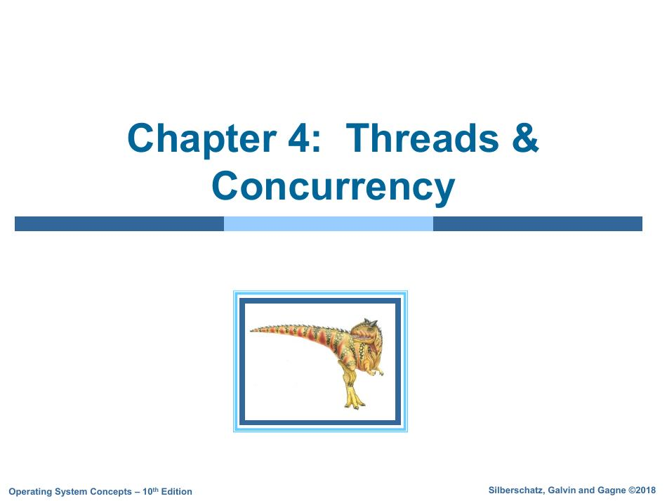

Slide ini memetakan posisi topik dalam bab. Pakai judul-judulnya sebagai daftar cek; utamakan hubungan sebab-akibat dan contoh, bukan hafalan urutan.

### Slide 002 — Outline

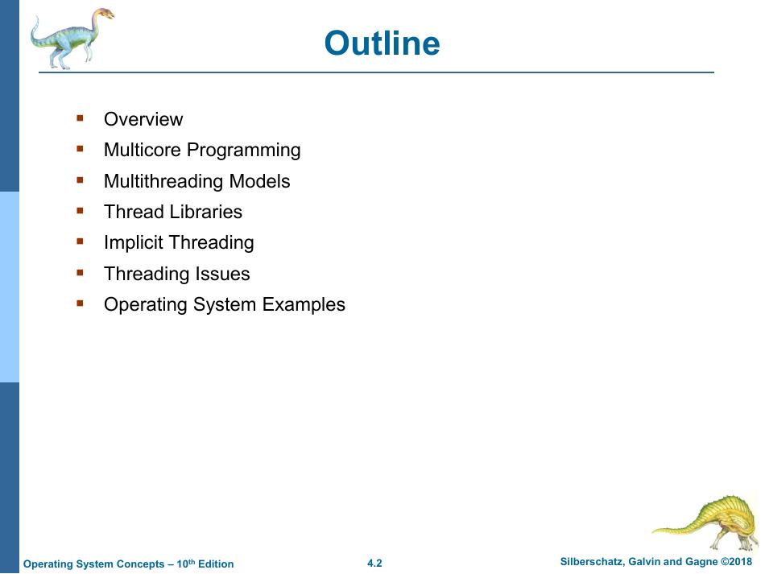

Slide ini memetakan posisi topik dalam bab. Pakai judul-judulnya sebagai daftar cek; utamakan hubungan sebab-akibat dan contoh, bukan hafalan urutan.

### Slide 003 — Objectives

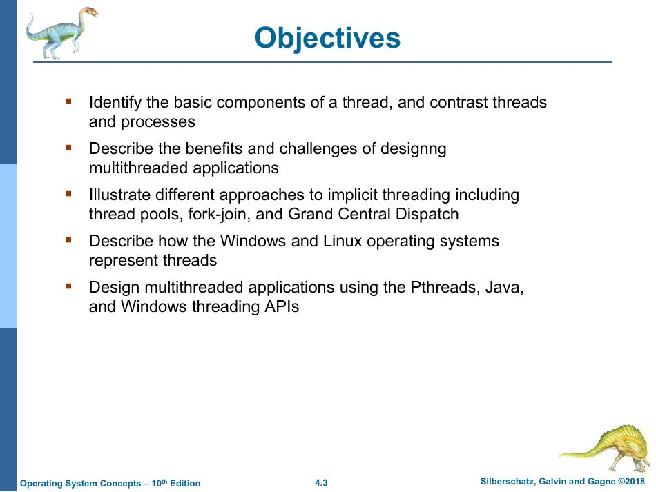

Slide ini memetakan posisi topik dalam bab. Pakai judul-judulnya sebagai daftar cek; utamakan hubungan sebab-akibat dan contoh, bukan hafalan urutan.

### Slide 004 — Motivation

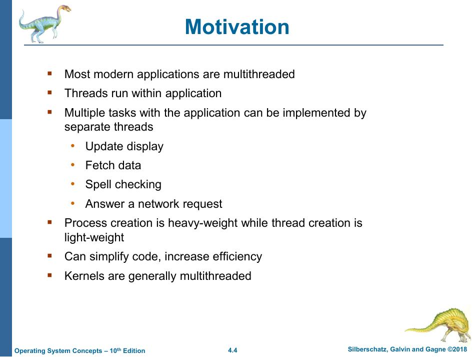

Slide ini memberi contoh tambahan untuk bagian tersebut. Perhatikan urutan pada gambar: identifikasi pelaku, sumber daya yang dipakai, lalu perubahan keadaan setelah setiap langkah. Hubungkan dengan slide sebelumnya sebelum menghafal istilahnya.

**Perhatikan pada gambar:**  Most modern applications are multithreaded;  Threads run within application

### Slide 005 — Single and Multithreaded Processes

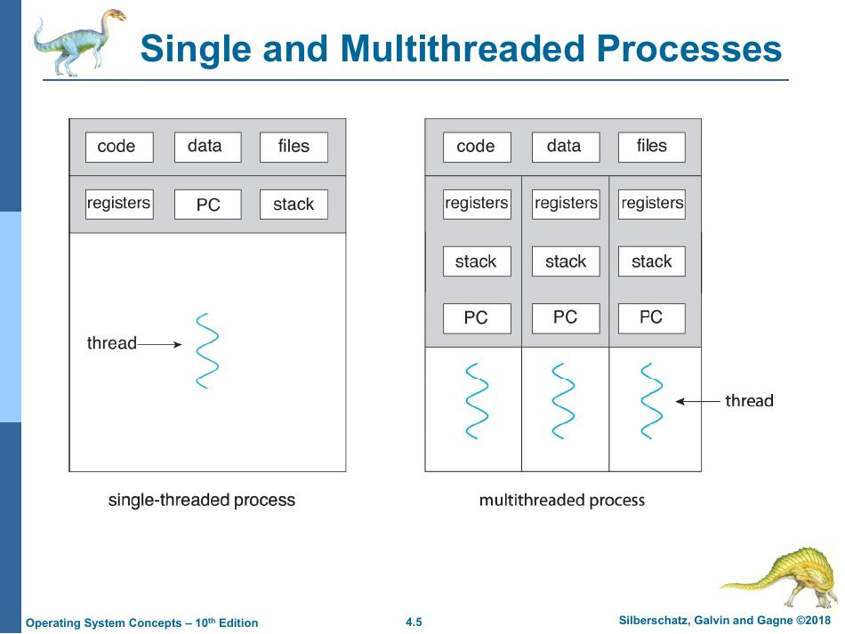

Slide ini memberi contoh tambahan untuk bagian tersebut. Perhatikan urutan pada gambar: identifikasi pelaku, sumber daya yang dipakai, lalu perubahan keadaan setelah setiap langkah. Hubungkan dengan slide sebelumnya sebelum menghafal istilahnya.

### Slide 006 — Multithreaded Server Architecture

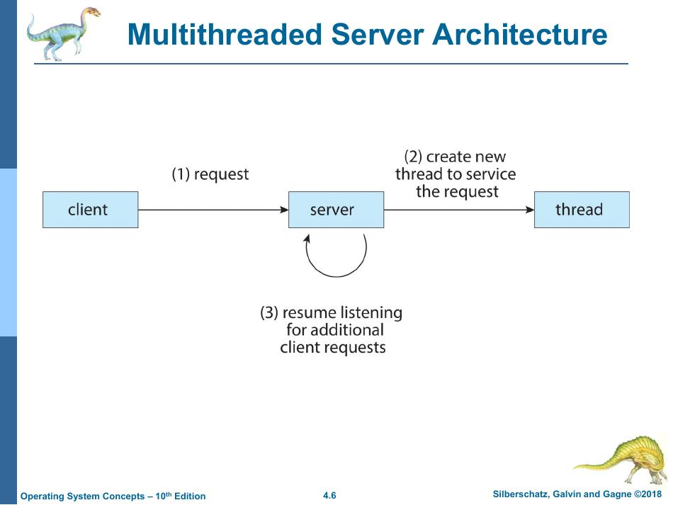

Slide ini memberi contoh tambahan untuk bagian tersebut. Perhatikan urutan pada gambar: identifikasi pelaku, sumber daya yang dipakai, lalu perubahan keadaan setelah setiap langkah. Hubungkan dengan slide sebelumnya sebelum menghafal istilahnya.

### Slide 007 — Benefits

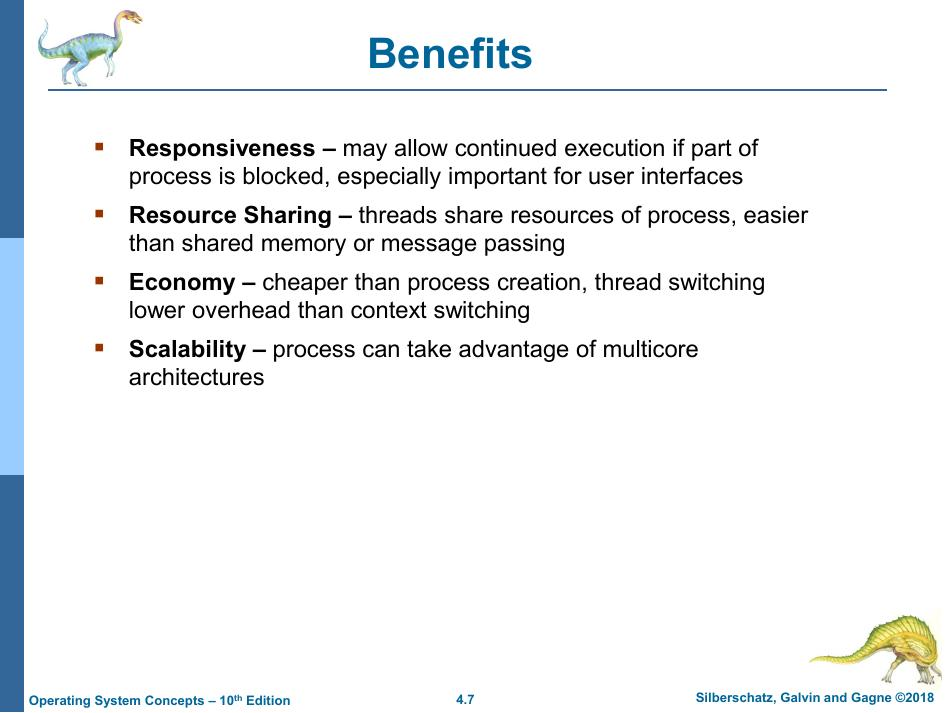

Slide ini memberi contoh tambahan untuk bagian tersebut. Perhatikan urutan pada gambar: identifikasi pelaku, sumber daya yang dipakai, lalu perubahan keadaan setelah setiap langkah. Hubungkan dengan slide sebelumnya sebelum menghafal istilahnya.

**Perhatikan pada gambar:**  Responsiveness – may allow continued execution if part of; process is blocked, especially important for user interfaces

### Slide 008 — Multicore Programming

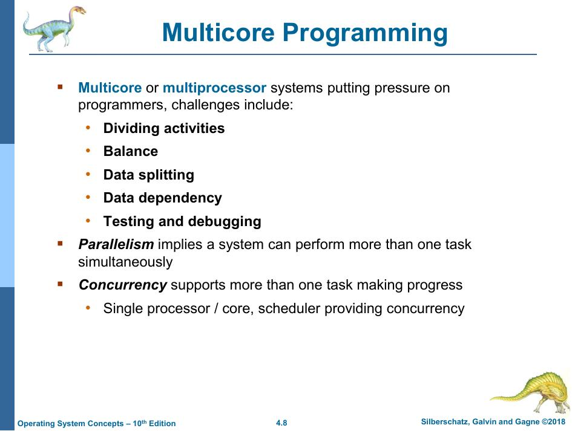

Konkurensi berarti beberapa pekerjaan maju dalam periode yang sama, meski CPU dapat bergantian. Paralelisme berarti pekerjaan benar-benar berjalan serentak pada inti berbeda. Data parallelism membagi data dengan operasi serupa; task parallelism membagi jenis pekerjaan.

**Perhatikan pada gambar:**  Multicore or multiprocessor systems putting pressure on; programmers, challenges include:

### Slide 009 — Concurrency vs. Parallelism

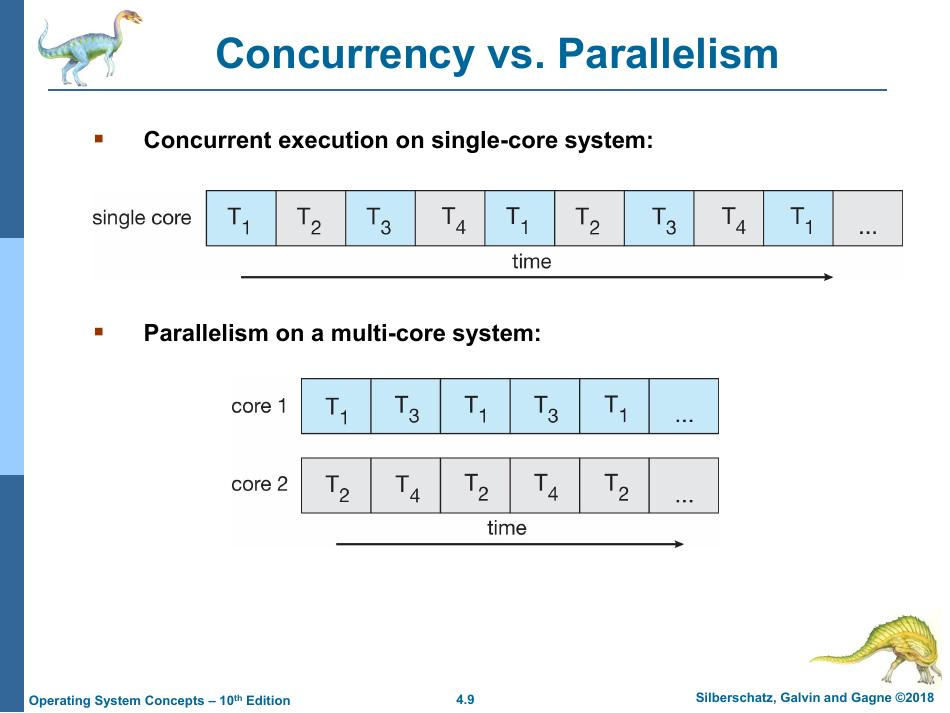

Konkurensi berarti beberapa pekerjaan maju dalam periode yang sama, meski CPU dapat bergantian. Paralelisme berarti pekerjaan benar-benar berjalan serentak pada inti berbeda. Data parallelism membagi data dengan operasi serupa; task parallelism membagi jenis pekerjaan.

**Perhatikan pada gambar:**  Concurrent execution on single-core system:;  Parallelism on a multi-core system:

### Slide 010 — Multicore Programming

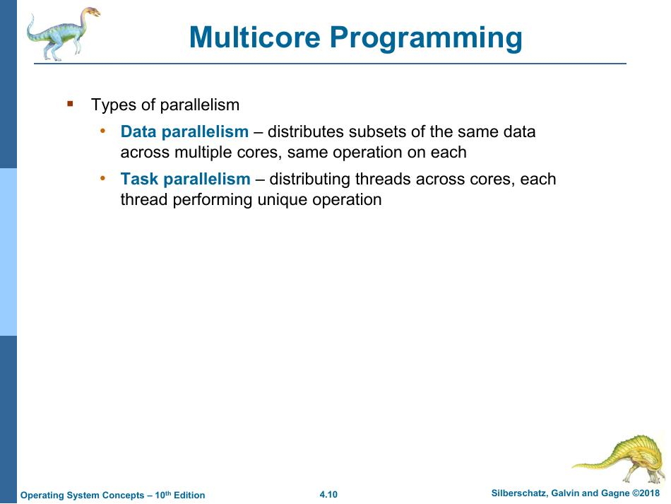

Konkurensi berarti beberapa pekerjaan maju dalam periode yang sama, meski CPU dapat bergantian. Paralelisme berarti pekerjaan benar-benar berjalan serentak pada inti berbeda. Data parallelism membagi data dengan operasi serupa; task parallelism membagi jenis pekerjaan.

**Perhatikan pada gambar:** • Data parallelism – distributes subsets of the same data; across multiple cores, same operation on each

### Slide 011 — Data and Task Parallelism

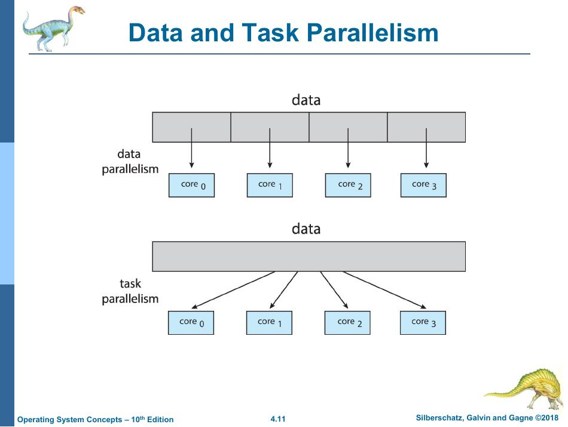

Konkurensi berarti beberapa pekerjaan maju dalam periode yang sama, meski CPU dapat bergantian. Paralelisme berarti pekerjaan benar-benar berjalan serentak pada inti berbeda. Data parallelism membagi data dengan operasi serupa; task parallelism membagi jenis pekerjaan.

### Slide 012 — Amdahl’s Law

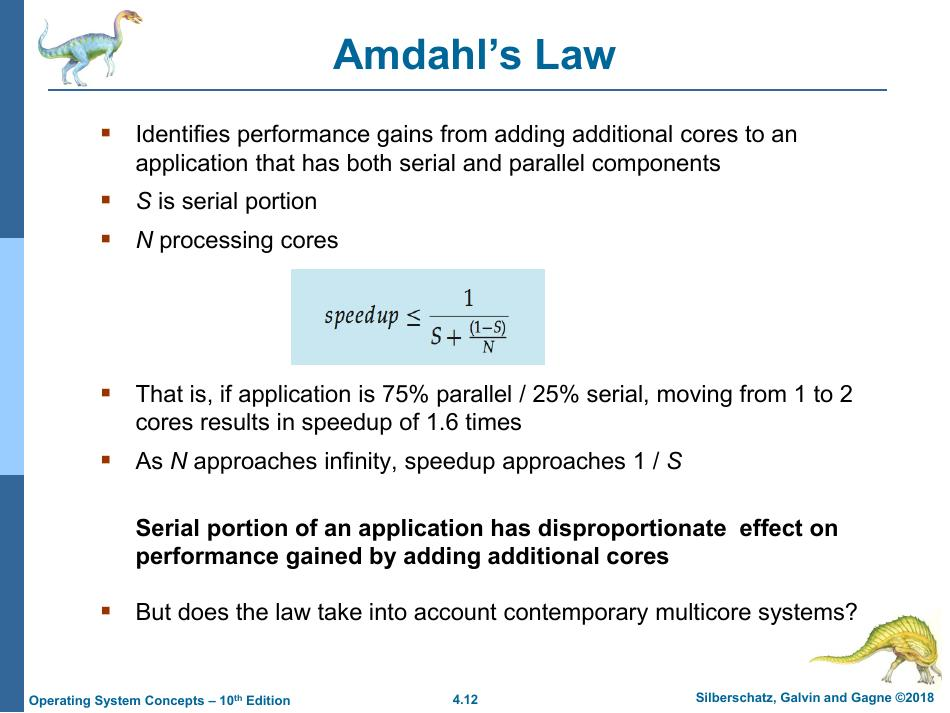

Hukum Amdahl: speedup = 1 / ((1-p) + p/N), dengan p porsi kerja yang dapat diparalelkan dan N jumlah inti. Bagian serial (1-p) membatasi percepatan meski inti ditambah terus.

**Perhatikan pada gambar:**  Identifies performance gains from adding additional cores to an; application that has both serial and parallel components

### Slide 013 — Amdahl’s Law

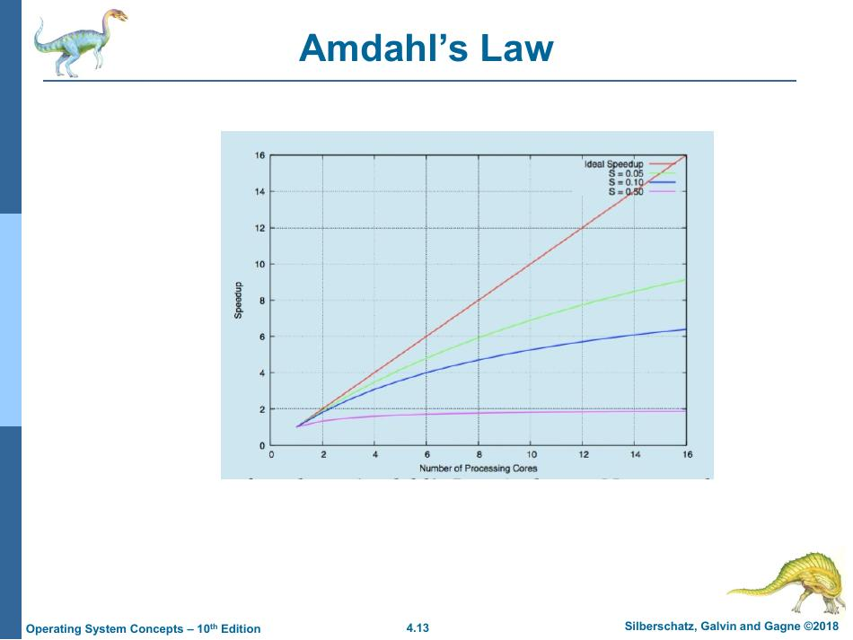

Hukum Amdahl: speedup = 1 / ((1-p) + p/N), dengan p porsi kerja yang dapat diparalelkan dan N jumlah inti. Bagian serial (1-p) membatasi percepatan meski inti ditambah terus.

### Slide 014 — User Threads and Kernel Threads

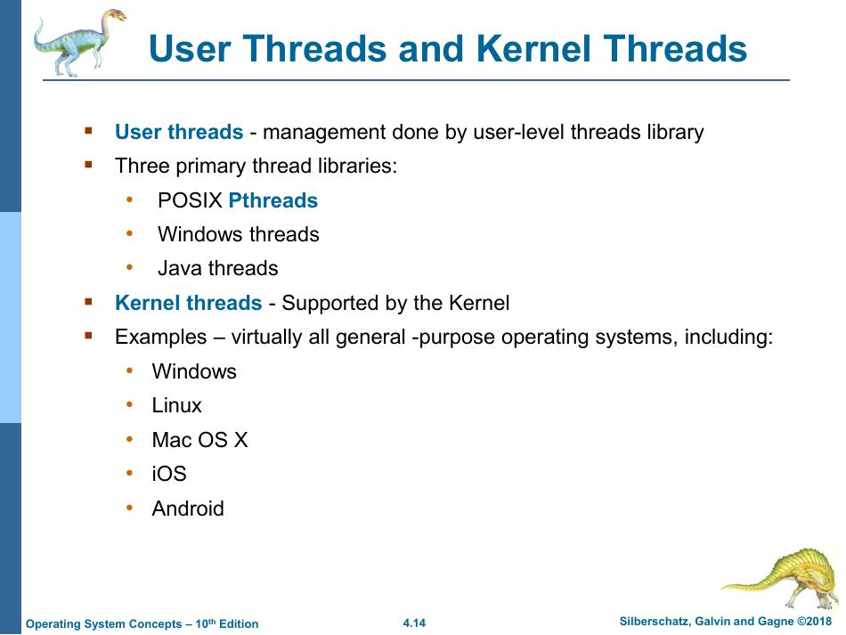

Pada many-to-one, banyak thread pengguna dipetakan ke satu thread kernel; satu operasi blocking dapat menahan semuanya. One-to-one memberi thread kernel per thread pengguna dengan biaya lebih besar. Many-to-many memungkinkan sejumlah thread pengguna memakai kumpulan thread kernel.

**Perhatikan pada gambar:**  User threads - management done by user-level threads library;  Three primary thread libraries:

### Slide 015 — User and Kernel Threads

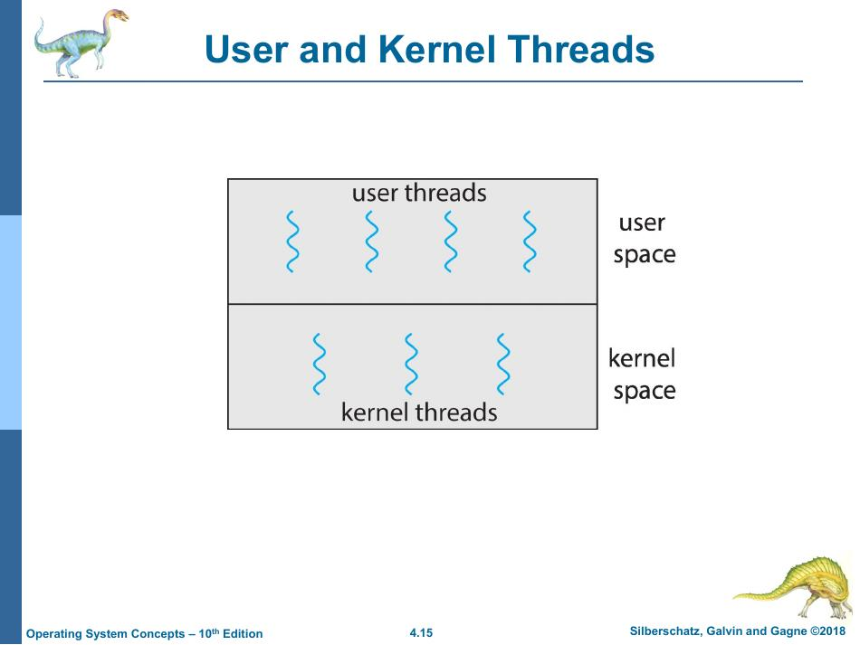

Pada many-to-one, banyak thread pengguna dipetakan ke satu thread kernel; satu operasi blocking dapat menahan semuanya. One-to-one memberi thread kernel per thread pengguna dengan biaya lebih besar. Many-to-many memungkinkan sejumlah thread pengguna memakai kumpulan thread kernel.

### Slide 016 — Multithreading Models

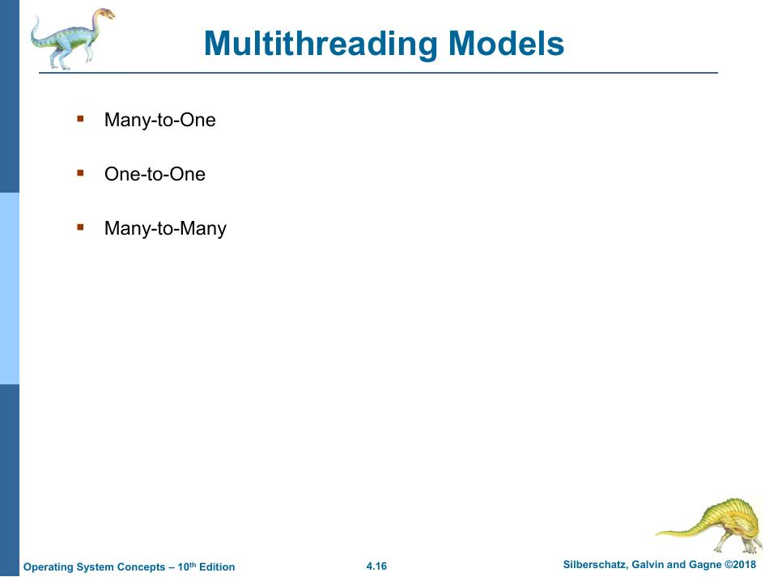

Pada many-to-one, banyak thread pengguna dipetakan ke satu thread kernel; satu operasi blocking dapat menahan semuanya. One-to-one memberi thread kernel per thread pengguna dengan biaya lebih besar. Many-to-many memungkinkan sejumlah thread pengguna memakai kumpulan thread kernel.

### Slide 017 — Many-to-One

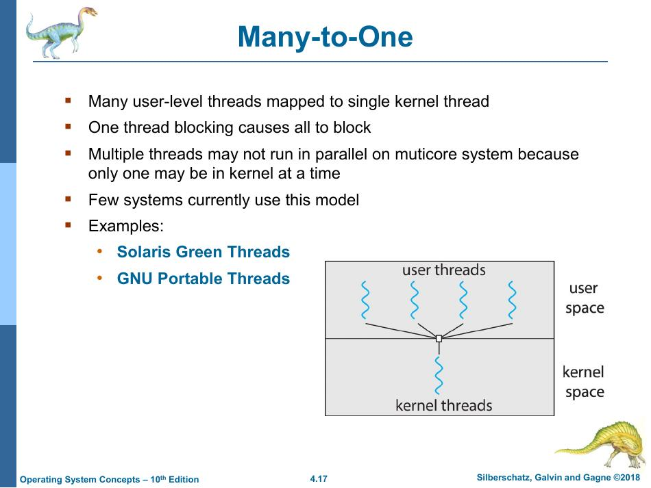

Pada many-to-one, banyak thread pengguna dipetakan ke satu thread kernel; satu operasi blocking dapat menahan semuanya. One-to-one memberi thread kernel per thread pengguna dengan biaya lebih besar. Many-to-many memungkinkan sejumlah thread pengguna memakai kumpulan thread kernel.

**Perhatikan pada gambar:**  Many user-level threads mapped to single kernel thread;  One thread blocking causes all to block

### Slide 018 — One-to-One

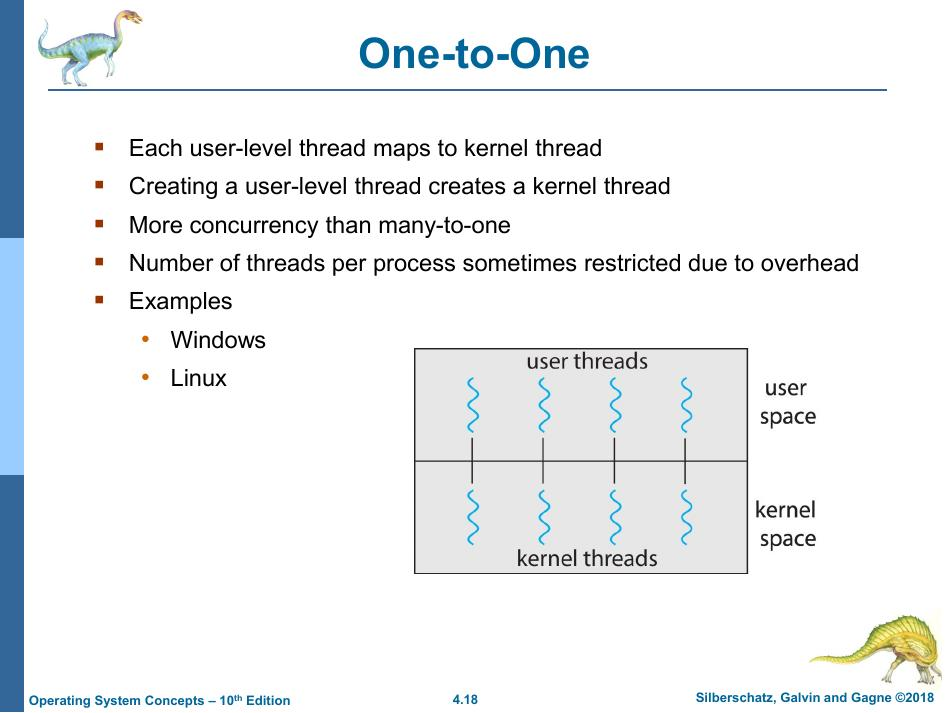

Pada many-to-one, banyak thread pengguna dipetakan ke satu thread kernel; satu operasi blocking dapat menahan semuanya. One-to-one memberi thread kernel per thread pengguna dengan biaya lebih besar. Many-to-many memungkinkan sejumlah thread pengguna memakai kumpulan thread kernel.

**Perhatikan pada gambar:**  Each user-level thread maps to kernel thread;  Creating a user-level thread creates a kernel thread

### Slide 019 — Many-to-Many Model

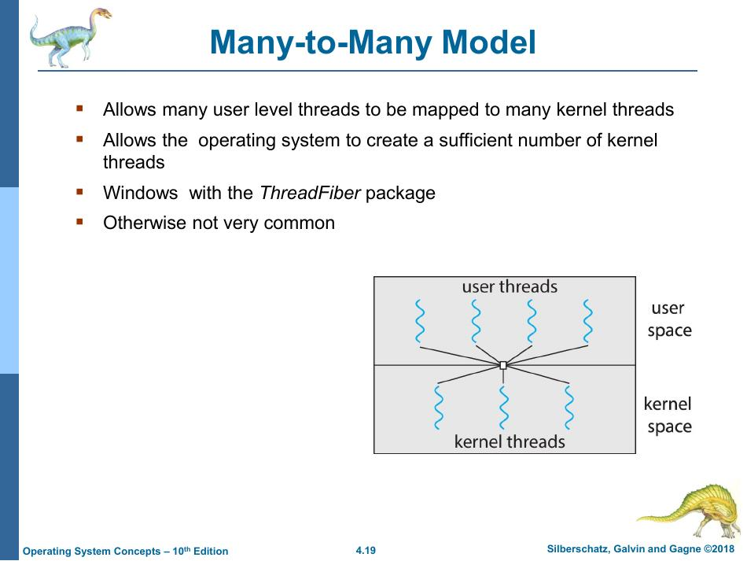

Pada many-to-one, banyak thread pengguna dipetakan ke satu thread kernel; satu operasi blocking dapat menahan semuanya. One-to-one memberi thread kernel per thread pengguna dengan biaya lebih besar. Many-to-many memungkinkan sejumlah thread pengguna memakai kumpulan thread kernel.

**Perhatikan pada gambar:**  Allows many user level threads to be mapped to many kernel threads;  Allows the operating system to create a sufficient number of kernel

### Slide 020 — Two-level Model

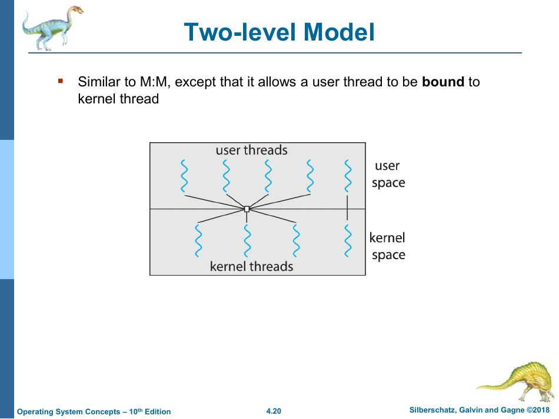

Pada many-to-one, banyak thread pengguna dipetakan ke satu thread kernel; satu operasi blocking dapat menahan semuanya. One-to-one memberi thread kernel per thread pengguna dengan biaya lebih besar. Many-to-many memungkinkan sejumlah thread pengguna memakai kumpulan thread kernel.

**Perhatikan pada gambar:**  Similar to M:M, except that it allows a user thread to be bound to

### Slide 021 — Thread Libraries

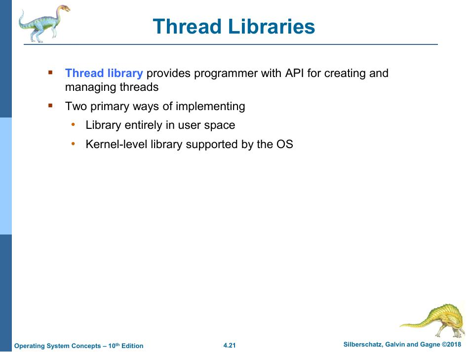

Thread dalam satu proses berbagi kode, data, dan berkas terbuka, tetapi memiliki stack serta register sendiri. Pembuatan thread memulai pekerjaan; join menunggu pekerja selesai. Pastikan data argumen masih hidup dan akses data bersama aman.

**Perhatikan pada gambar:**  Thread library provides programmer with API for creating and;  Two primary ways of implementing

### Slide 022 — Pthreads

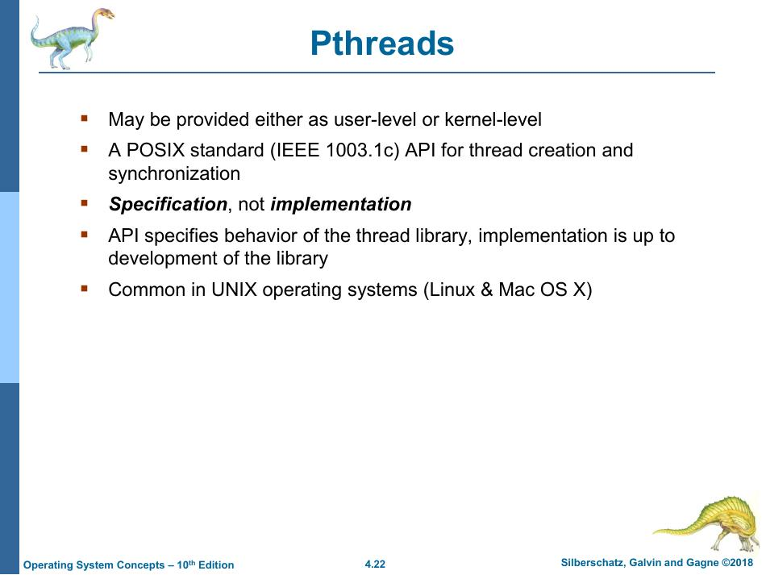

Thread dalam satu proses berbagi kode, data, dan berkas terbuka, tetapi memiliki stack serta register sendiri. Pembuatan thread memulai pekerjaan; join menunggu pekerja selesai. Pastikan data argumen masih hidup dan akses data bersama aman.

**Perhatikan pada gambar:**  May be provided either as user-level or kernel-level;  A POSIX standard (IEEE 1003.1c) API for thread creation and

### Slide 023 — Pthreads Example

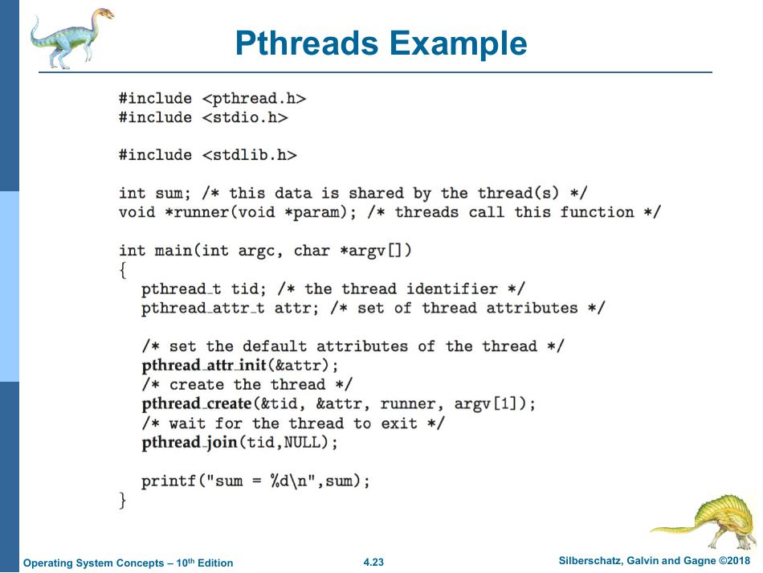

Thread dalam satu proses berbagi kode, data, dan berkas terbuka, tetapi memiliki stack serta register sendiri. Pembuatan thread memulai pekerjaan; join menunggu pekerja selesai. Pastikan data argumen masih hidup dan akses data bersama aman.

### Slide 024 — Pthreads Example (Cont.)

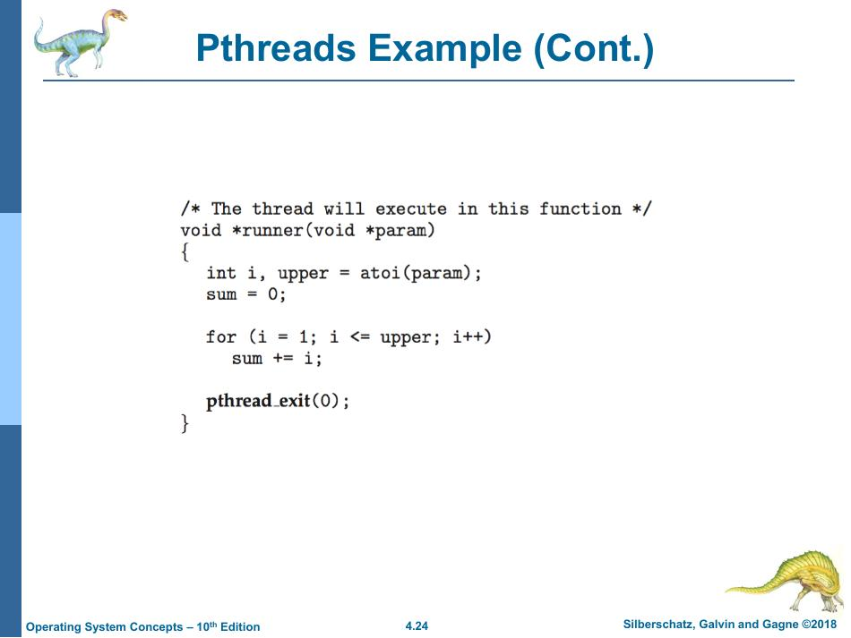

Thread dalam satu proses berbagi kode, data, dan berkas terbuka, tetapi memiliki stack serta register sendiri. Pembuatan thread memulai pekerjaan; join menunggu pekerja selesai. Pastikan data argumen masih hidup dan akses data bersama aman.

### Slide 025 — Pthreads Code for Joining 10 Threads

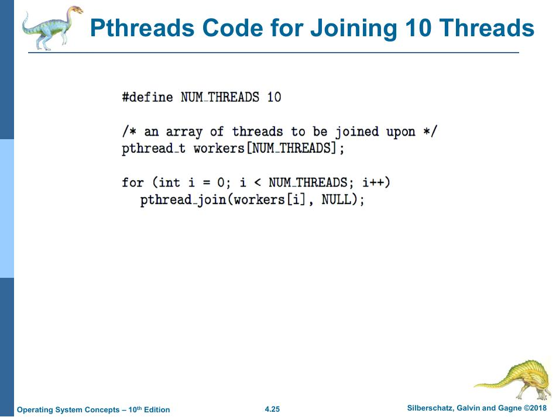

Thread dalam satu proses berbagi kode, data, dan berkas terbuka, tetapi memiliki stack serta register sendiri. Pembuatan thread memulai pekerjaan; join menunggu pekerja selesai. Pastikan data argumen masih hidup dan akses data bersama aman.

### Slide 026 — Windows Multithreaded C Program

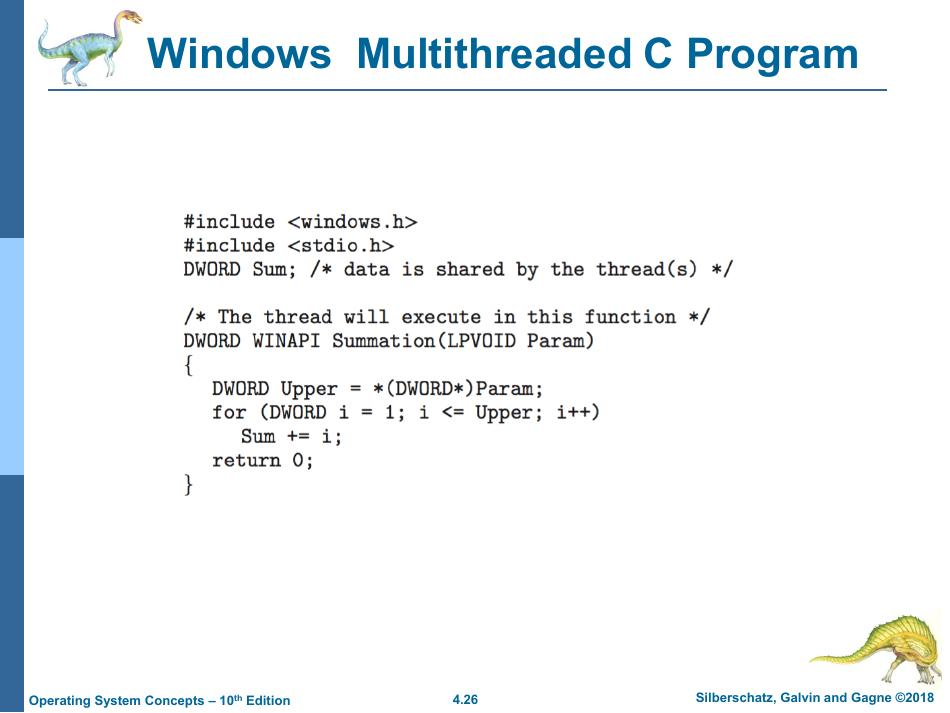

Thread dalam satu proses berbagi kode, data, dan berkas terbuka, tetapi memiliki stack serta register sendiri. Pembuatan thread memulai pekerjaan; join menunggu pekerja selesai. Pastikan data argumen masih hidup dan akses data bersama aman.

### Slide 027 — Windows Multithreaded C Program (Cont.)

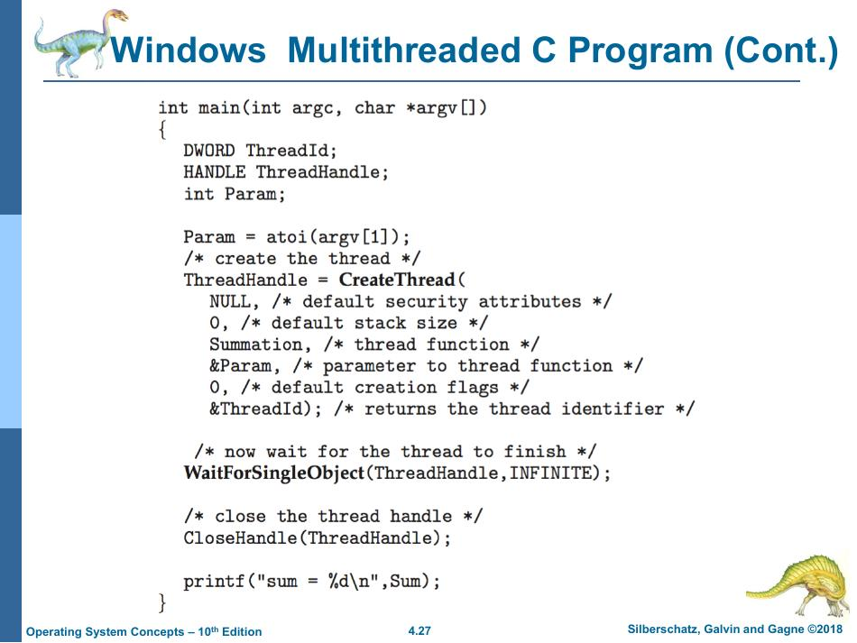

Thread dalam satu proses berbagi kode, data, dan berkas terbuka, tetapi memiliki stack serta register sendiri. Pembuatan thread memulai pekerjaan; join menunggu pekerja selesai. Pastikan data argumen masih hidup dan akses data bersama aman.

### Slide 028 — Java Threads

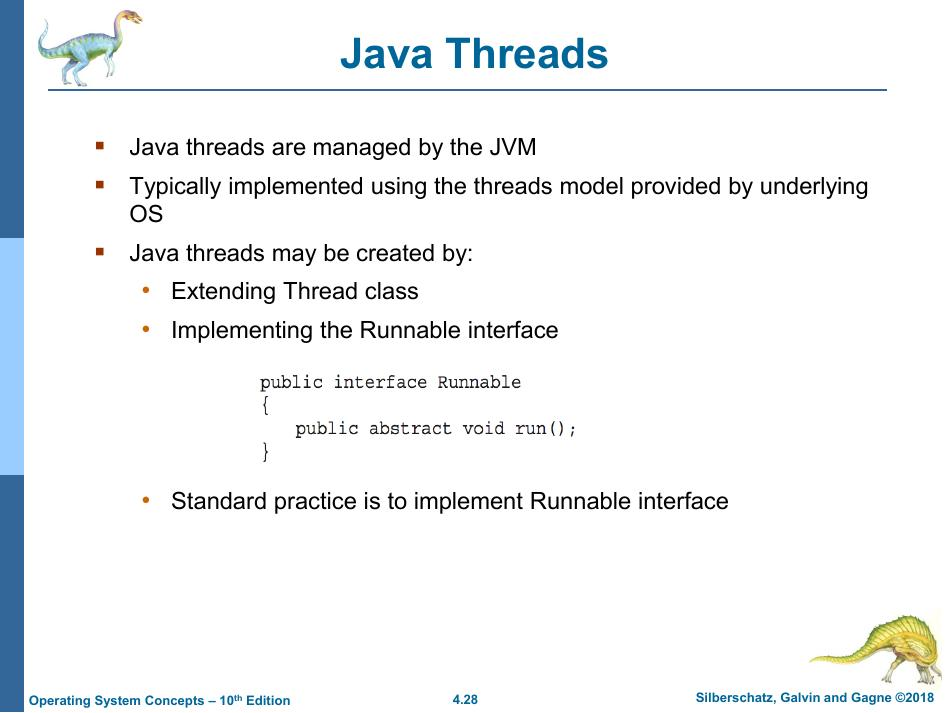

Thread dalam satu proses berbagi kode, data, dan berkas terbuka, tetapi memiliki stack serta register sendiri. Pembuatan thread memulai pekerjaan; join menunggu pekerja selesai. Pastikan data argumen masih hidup dan akses data bersama aman.

**Perhatikan pada gambar:**  Java threads are managed by the JVM;  Typically implemented using the threads model provided by underlying

### Slide 029 — Java Threads

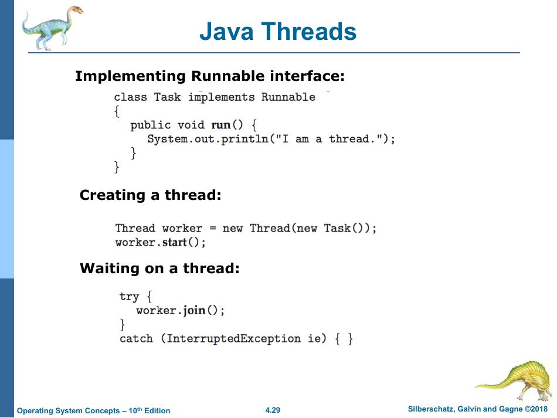

Thread dalam satu proses berbagi kode, data, dan berkas terbuka, tetapi memiliki stack serta register sendiri. Pembuatan thread memulai pekerjaan; join menunggu pekerja selesai. Pastikan data argumen masih hidup dan akses data bersama aman.

**Perhatikan pada gambar:** Implementing Runnable interface:

### Slide 030 — Java Executor Framework

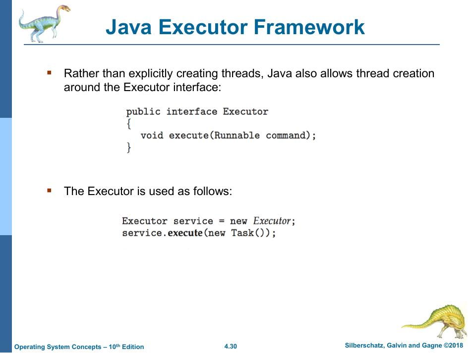

fork() membuat proses anak dengan alur eksekusi terpisah. exec() mengganti citra program pada proses yang memanggilnya. wait() membuat induk menunggu dan mengambil status anak; tanpa pengambilan status, anak yang selesai dapat menjadi zombie. Anak yang induknya lebih dulu selesai menjadi orphan.

**Perhatikan pada gambar:**  Rather than explicitly creating threads, Java also allows thread creation; around the Executor interface:

### Slide 031 — Java Executor Framework

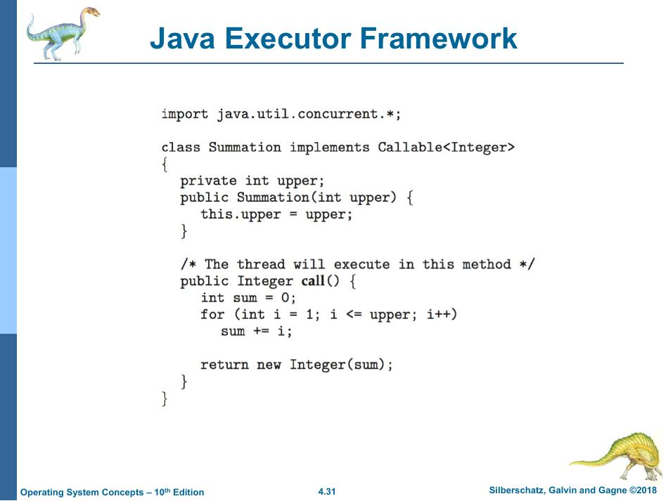

fork() membuat proses anak dengan alur eksekusi terpisah. exec() mengganti citra program pada proses yang memanggilnya. wait() membuat induk menunggu dan mengambil status anak; tanpa pengambilan status, anak yang selesai dapat menjadi zombie. Anak yang induknya lebih dulu selesai menjadi orphan.

### Slide 032 — Java Executor Framework (Cont.)

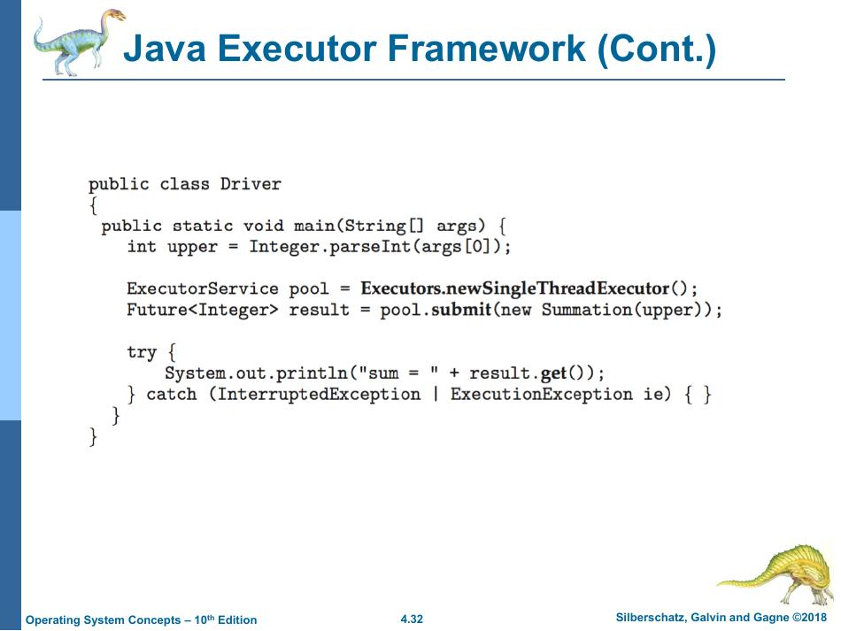

fork() membuat proses anak dengan alur eksekusi terpisah. exec() mengganti citra program pada proses yang memanggilnya. wait() membuat induk menunggu dan mengambil status anak; tanpa pengambilan status, anak yang selesai dapat menjadi zombie. Anak yang induknya lebih dulu selesai menjadi orphan.

### Slide 033 — Implicit Threading

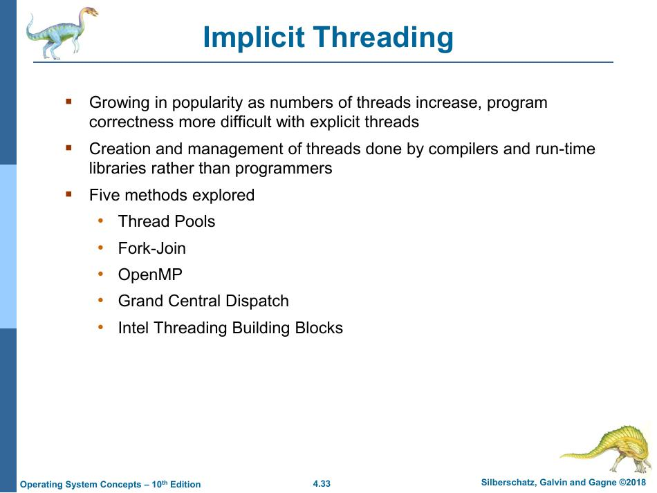

Thread pool memakai pekerja yang sudah tersedia agar biaya membuat thread berulang berkurang. Pada fork-join, pekerjaan dibagi lalu hasilnya digabung. Ukur overhead dan ketergantungan tugas sebelum menyimpulkan lebih banyak thread pasti lebih cepat.

**Perhatikan pada gambar:**  Growing in popularity as numbers of threads increase, program; correctness more difficult with explicit threads

### Slide 034 — Thread Pools

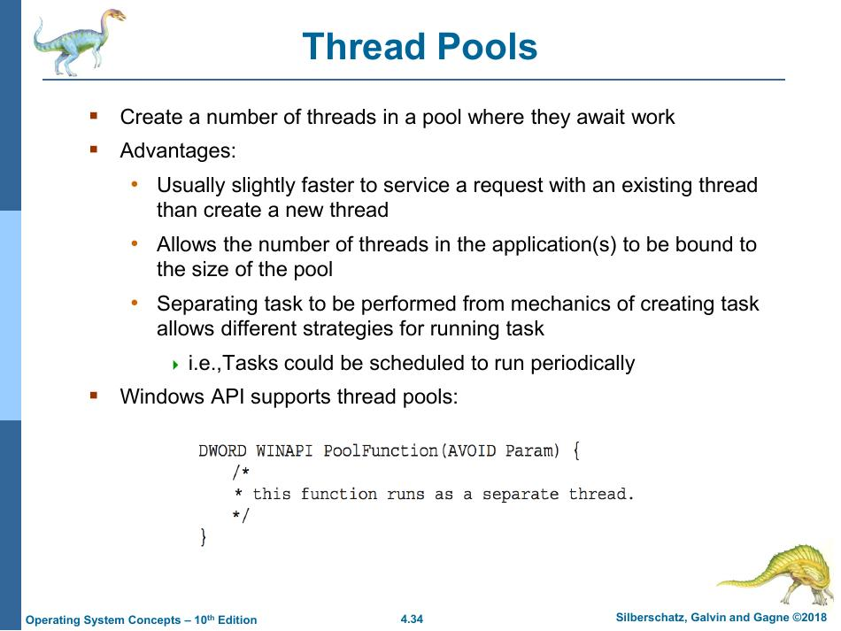

Thread pool memakai pekerja yang sudah tersedia agar biaya membuat thread berulang berkurang. Pada fork-join, pekerjaan dibagi lalu hasilnya digabung. Ukur overhead dan ketergantungan tugas sebelum menyimpulkan lebih banyak thread pasti lebih cepat.

**Perhatikan pada gambar:**  Create a number of threads in a pool where they await work; • Usually slightly faster to service a request with an existing thread

### Slide 035 — Java Thread Pools

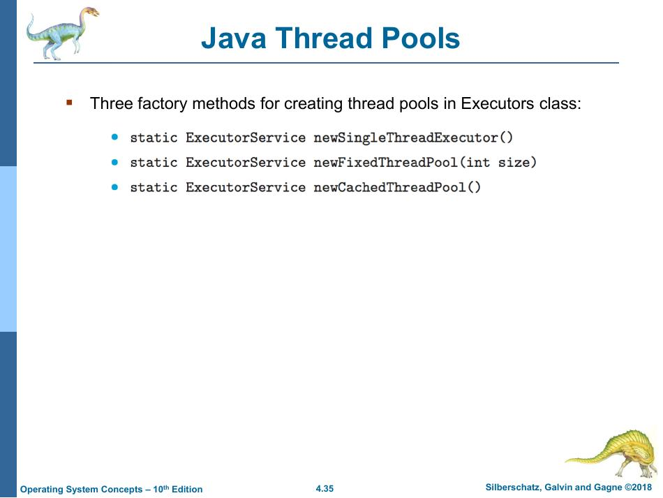

Thread pool memakai pekerja yang sudah tersedia agar biaya membuat thread berulang berkurang. Pada fork-join, pekerjaan dibagi lalu hasilnya digabung. Ukur overhead dan ketergantungan tugas sebelum menyimpulkan lebih banyak thread pasti lebih cepat.

**Perhatikan pada gambar:**  Three factory methods for creating thread pools in Executors class:

### Slide 036 — Java Thread Pools (Cont.)

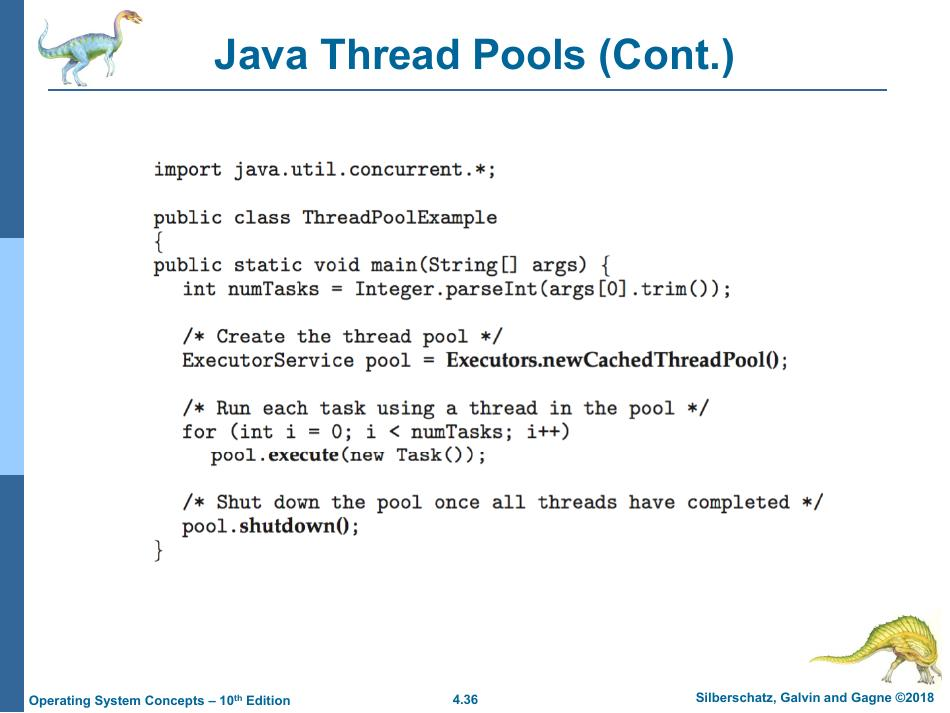

Thread pool memakai pekerja yang sudah tersedia agar biaya membuat thread berulang berkurang. Pada fork-join, pekerjaan dibagi lalu hasilnya digabung. Ukur overhead dan ketergantungan tugas sebelum menyimpulkan lebih banyak thread pasti lebih cepat.

### Slide 037 — Fork-Join Parallelism

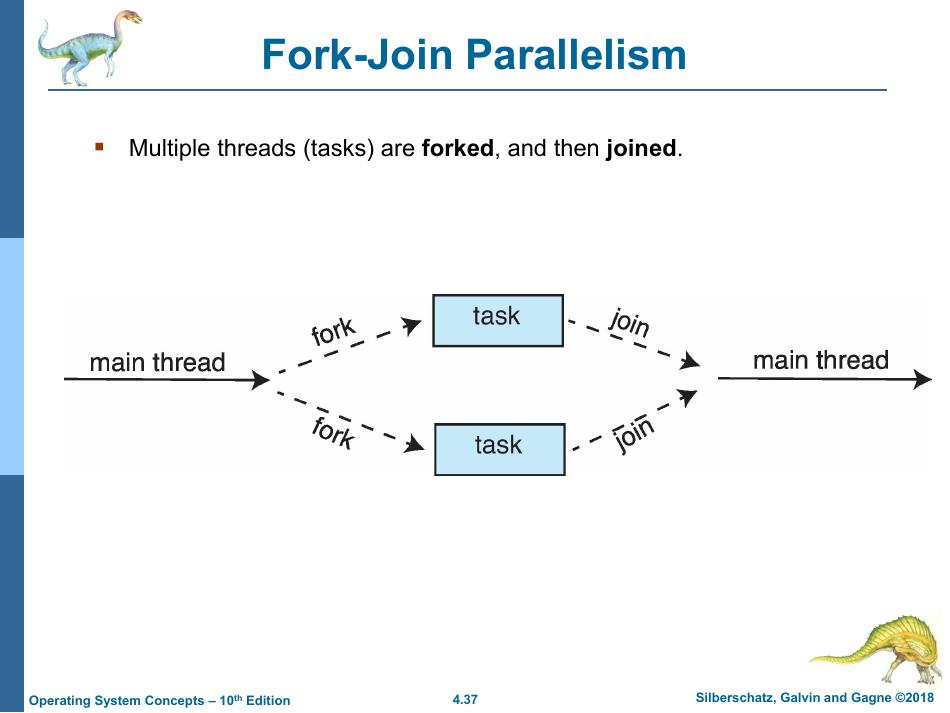

fork() membuat proses anak dengan alur eksekusi terpisah. exec() mengganti citra program pada proses yang memanggilnya. wait() membuat induk menunggu dan mengambil status anak; tanpa pengambilan status, anak yang selesai dapat menjadi zombie. Anak yang induknya lebih dulu selesai menjadi orphan.

**Perhatikan pada gambar:**  Multiple threads (tasks) are forked, and then joined.

### Slide 038 — Fork-Join Parallelism

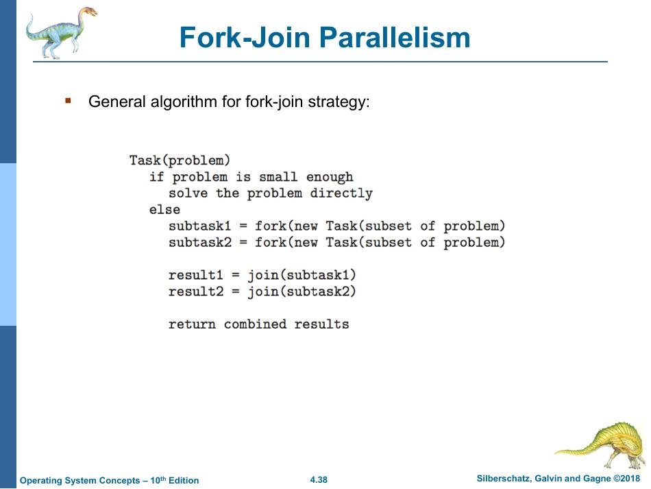

fork() membuat proses anak dengan alur eksekusi terpisah. exec() mengganti citra program pada proses yang memanggilnya. wait() membuat induk menunggu dan mengambil status anak; tanpa pengambilan status, anak yang selesai dapat menjadi zombie. Anak yang induknya lebih dulu selesai menjadi orphan.

**Perhatikan pada gambar:**  General algorithm for fork-join strategy:

### Slide 039 — Fork-Join Parallelism

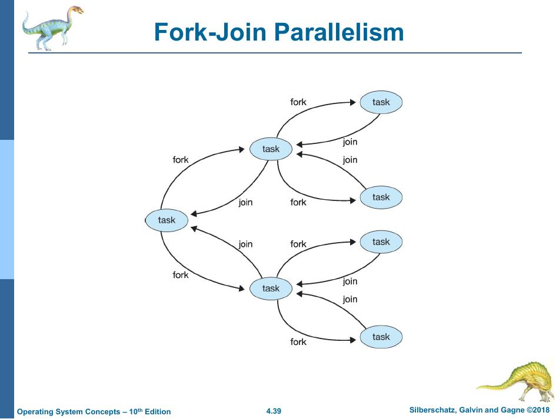

fork() membuat proses anak dengan alur eksekusi terpisah. exec() mengganti citra program pada proses yang memanggilnya. wait() membuat induk menunggu dan mengambil status anak; tanpa pengambilan status, anak yang selesai dapat menjadi zombie. Anak yang induknya lebih dulu selesai menjadi orphan.

### Slide 040 — Fork-Join Parallelism in Java

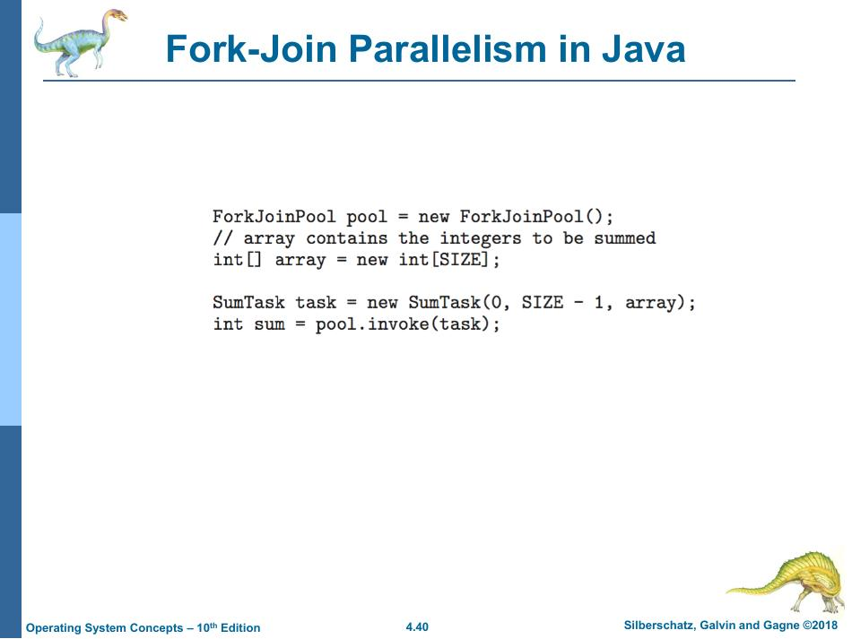

fork() membuat proses anak dengan alur eksekusi terpisah. exec() mengganti citra program pada proses yang memanggilnya. wait() membuat induk menunggu dan mengambil status anak; tanpa pengambilan status, anak yang selesai dapat menjadi zombie. Anak yang induknya lebih dulu selesai menjadi orphan.

### Slide 041 — Fork-Join Parallelism in Java

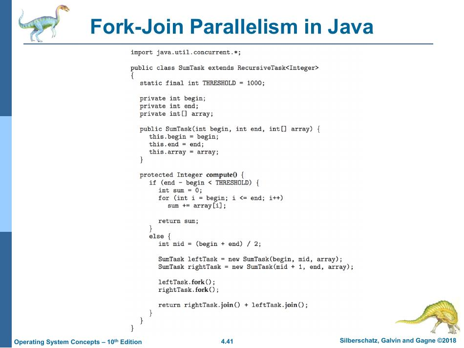

fork() membuat proses anak dengan alur eksekusi terpisah. exec() mengganti citra program pada proses yang memanggilnya. wait() membuat induk menunggu dan mengambil status anak; tanpa pengambilan status, anak yang selesai dapat menjadi zombie. Anak yang induknya lebih dulu selesai menjadi orphan.

### Slide 042 — Fork-Join Parallelism in Java

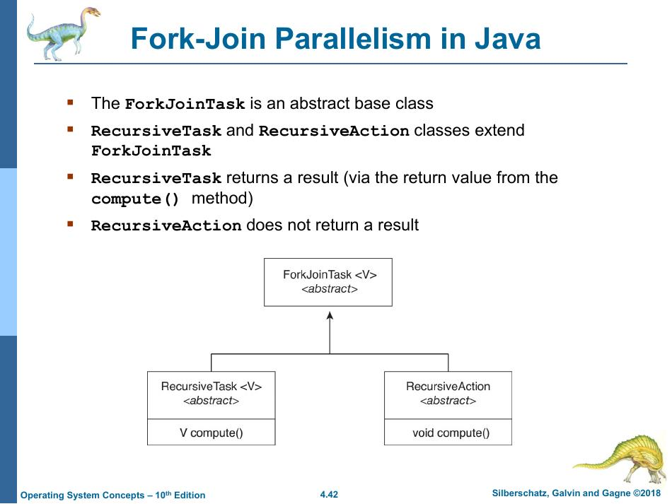

fork() membuat proses anak dengan alur eksekusi terpisah. exec() mengganti citra program pada proses yang memanggilnya. wait() membuat induk menunggu dan mengambil status anak; tanpa pengambilan status, anak yang selesai dapat menjadi zombie. Anak yang induknya lebih dulu selesai menjadi orphan.

**Perhatikan pada gambar:**  The ForkJoinTask is an abstract base class;  RecursiveTask and RecursiveAction classes extend

### Slide 043 — OpenMP

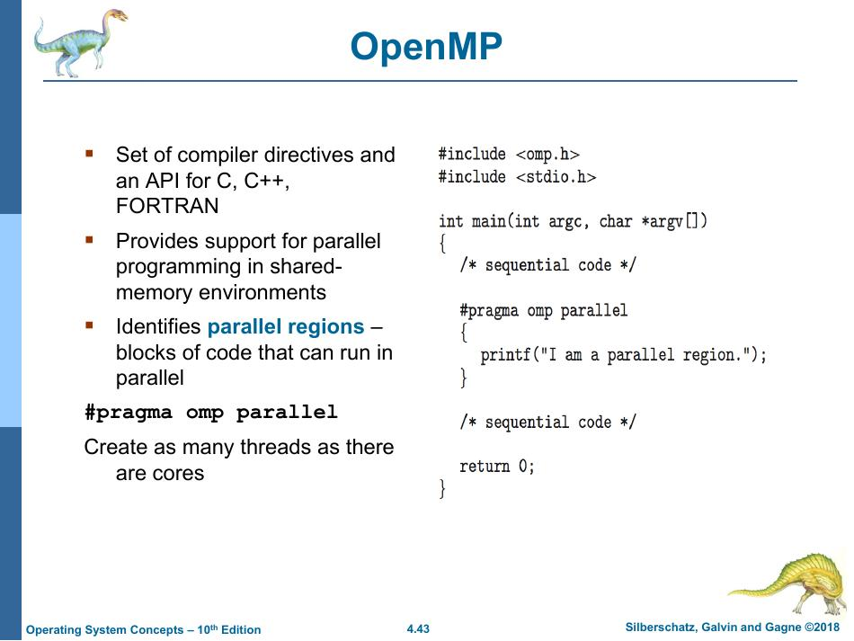

Thread pool memakai pekerja yang sudah tersedia agar biaya membuat thread berulang berkurang. Pada fork-join, pekerjaan dibagi lalu hasilnya digabung. Ukur overhead dan ketergantungan tugas sebelum menyimpulkan lebih banyak thread pasti lebih cepat.

**Perhatikan pada gambar:**  Set of compiler directives and;  Provides support for parallel

### Slide 044 — Run the Loop in Parallel

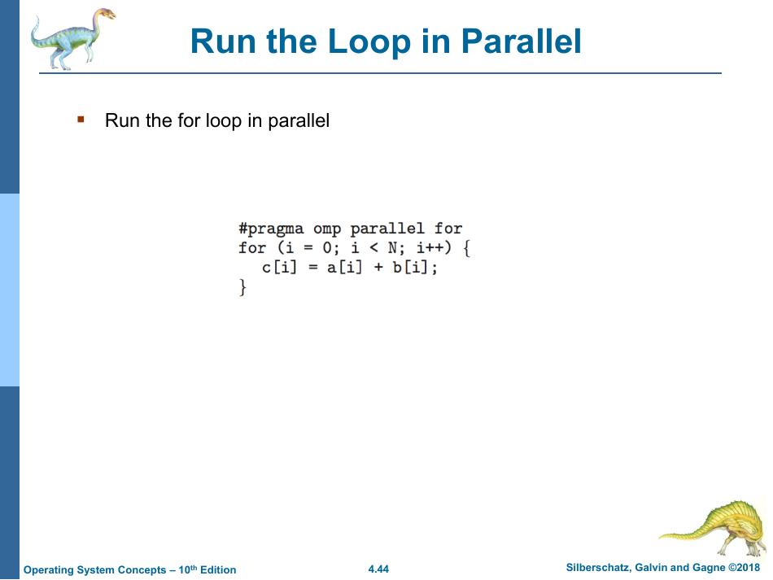

Slide ini memberi contoh tambahan untuk bagian tersebut. Perhatikan urutan pada gambar: identifikasi pelaku, sumber daya yang dipakai, lalu perubahan keadaan setelah setiap langkah. Hubungkan dengan slide sebelumnya sebelum menghafal istilahnya.

**Perhatikan pada gambar:**  Run the for loop in parallel

### Slide 045 — Grand Central Dispatch

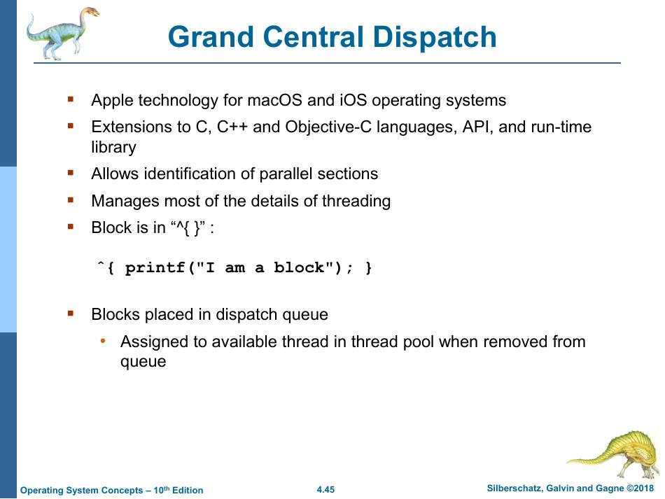

Thread pool memakai pekerja yang sudah tersedia agar biaya membuat thread berulang berkurang. Pada fork-join, pekerjaan dibagi lalu hasilnya digabung. Ukur overhead dan ketergantungan tugas sebelum menyimpulkan lebih banyak thread pasti lebih cepat.

**Perhatikan pada gambar:**  Apple technology for macOS and iOS operating systems;  Extensions to C, C++ and Objective-C languages, API, and run-time

### Slide 046 — Grand Central Dispatch

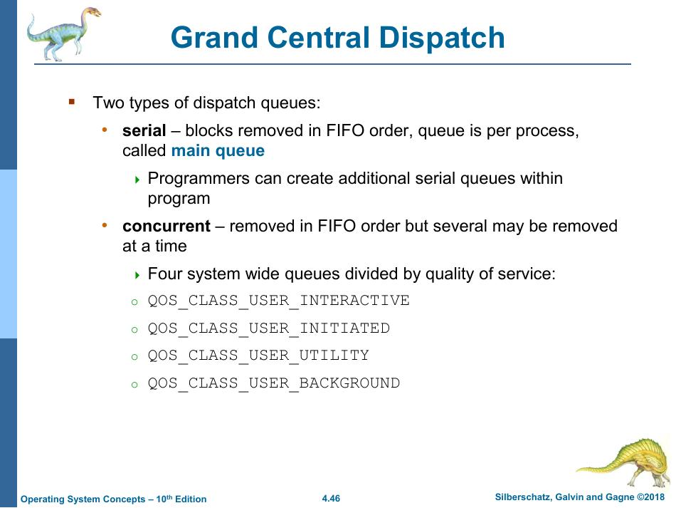

Thread pool memakai pekerja yang sudah tersedia agar biaya membuat thread berulang berkurang. Pada fork-join, pekerjaan dibagi lalu hasilnya digabung. Ukur overhead dan ketergantungan tugas sebelum menyimpulkan lebih banyak thread pasti lebih cepat.

**Perhatikan pada gambar:**  Two types of dispatch queues:; • serial – blocks removed in FIFO order, queue is per process,

### Slide 047 — Grand Central Dispatch

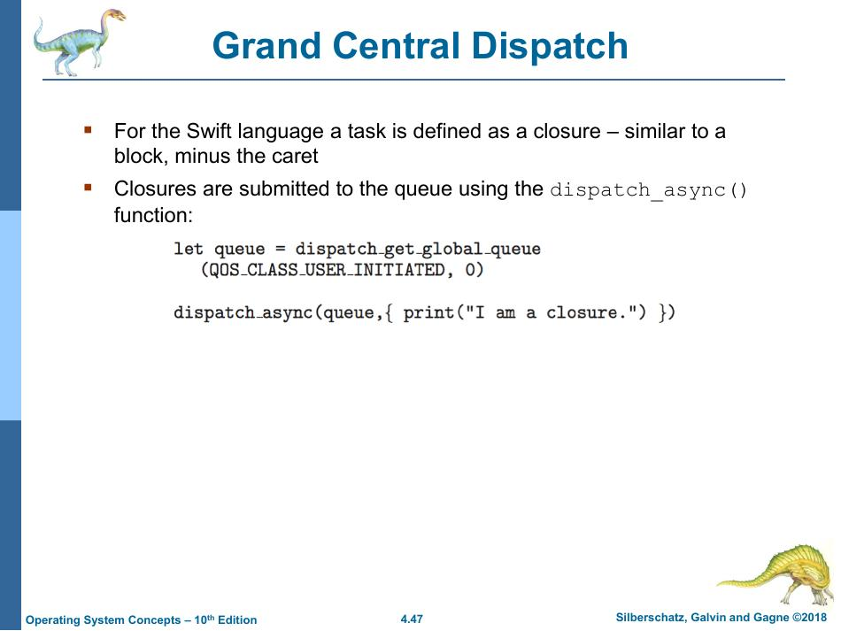

Thread pool memakai pekerja yang sudah tersedia agar biaya membuat thread berulang berkurang. Pada fork-join, pekerjaan dibagi lalu hasilnya digabung. Ukur overhead dan ketergantungan tugas sebelum menyimpulkan lebih banyak thread pasti lebih cepat.

**Perhatikan pada gambar:**  For the Swift language a task is defined as a closure – similar to a;  Closures are submitted to the queue using the dispatch_async()

### Slide 048 — Intel Threading Building Blocks (TBB)

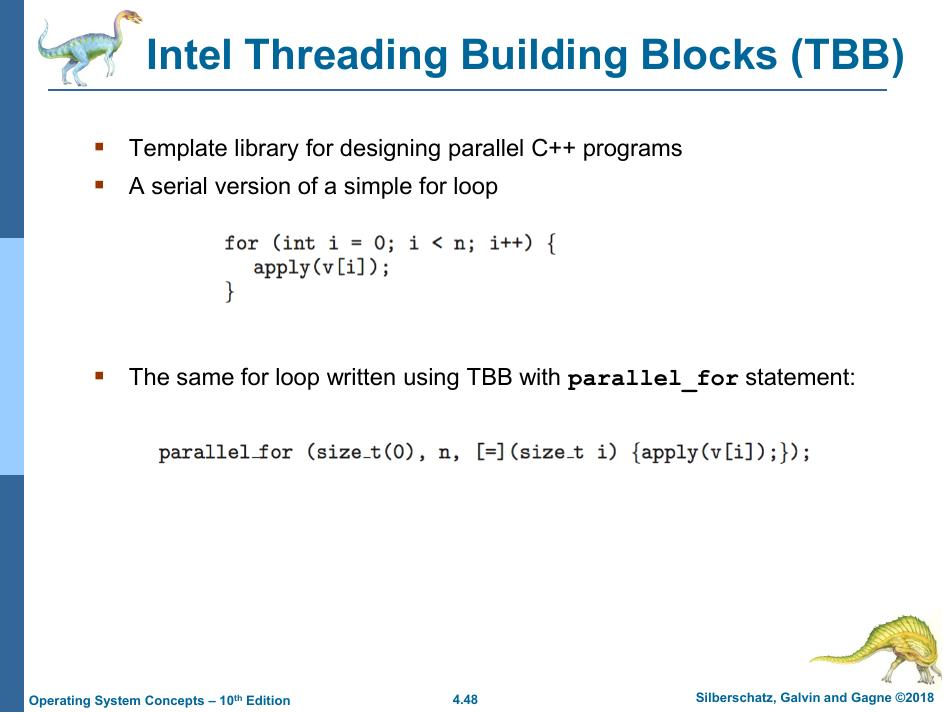

Saat komputer menyala, firmware memulai boot loader. Boot loader memuat kernel; kernel menyiapkan memori, perangkat, dan layanan awal. Bedakan tahap pemuatan sistem ini dari menjalankan aplikasi biasa.

**Perhatikan pada gambar:**  Template library for designing parallel C++ programs;  A serial version of a simple for loop

### Slide 049 — Threading Issues

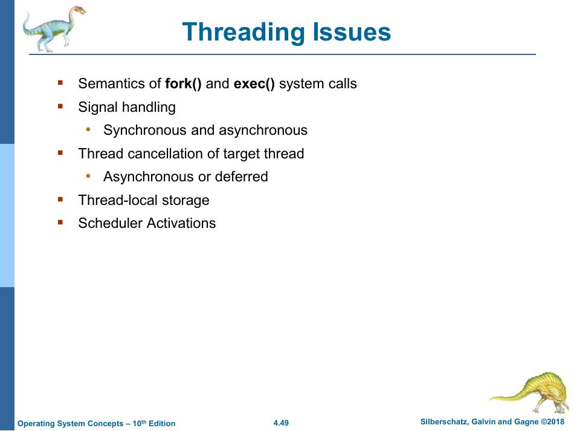

Slide ini memberi contoh tambahan untuk bagian tersebut. Perhatikan urutan pada gambar: identifikasi pelaku, sumber daya yang dipakai, lalu perubahan keadaan setelah setiap langkah. Hubungkan dengan slide sebelumnya sebelum menghafal istilahnya.

**Perhatikan pada gambar:**  Semantics of fork() and exec() system calls; • Synchronous and asynchronous

### Slide 050 — Semantics of fork() and exec()

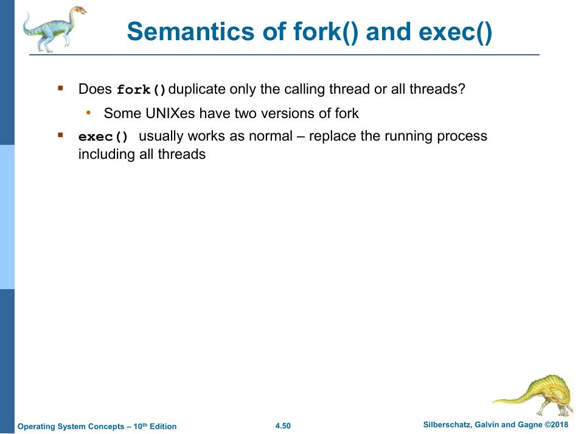

fork() membuat proses anak dengan alur eksekusi terpisah. exec() mengganti citra program pada proses yang memanggilnya. wait() membuat induk menunggu dan mengambil status anak; tanpa pengambilan status, anak yang selesai dapat menjadi zombie. Anak yang induknya lebih dulu selesai menjadi orphan.

**Perhatikan pada gambar:**  Does fork()duplicate only the calling thread or all threads?; • Some UNIXes have two versions of fork

### Slide 051 — Signal Handling

Slide ini memberi contoh tambahan untuk bagian tersebut. Perhatikan urutan pada gambar: identifikasi pelaku, sumber daya yang dipakai, lalu perubahan keadaan setelah setiap langkah. Hubungkan dengan slide sebelumnya sebelum menghafal istilahnya.

**Perhatikan pada gambar:**  Signals are used in UNIX systems to notify a process that a particular;  A signal handler is used to process signals

### Slide 052 — Signal Handling (Cont.)

Slide ini memberi contoh tambahan untuk bagian tersebut. Perhatikan urutan pada gambar: identifikasi pelaku, sumber daya yang dipakai, lalu perubahan keadaan setelah setiap langkah. Hubungkan dengan slide sebelumnya sebelum menghafal istilahnya.

**Perhatikan pada gambar:**  Where should a signal be delivered for multi-threaded?; • Deliver the signal to the thread to which the signal applies

### Slide 053 — Thread Cancellation

Slide ini memberi contoh tambahan untuk bagian tersebut. Perhatikan urutan pada gambar: identifikasi pelaku, sumber daya yang dipakai, lalu perubahan keadaan setelah setiap langkah. Hubungkan dengan slide sebelumnya sebelum menghafal istilahnya.

**Perhatikan pada gambar:**  Terminating a thread before it has finished;  Thread to be canceled is target thread

### Slide 054 — Thread Cancellation (Cont.)

Slide ini memberi contoh tambahan untuk bagian tersebut. Perhatikan urutan pada gambar: identifikasi pelaku, sumber daya yang dipakai, lalu perubahan keadaan setelah setiap langkah. Hubungkan dengan slide sebelumnya sebelum menghafal istilahnya.

**Perhatikan pada gambar:**  Invoking thread cancellation requests cancellation, but actual; cancellation depends on thread state

### Slide 055 — Thread Cancellation in Java

Slide ini memberi contoh tambahan untuk bagian tersebut. Perhatikan urutan pada gambar: identifikasi pelaku, sumber daya yang dipakai, lalu perubahan keadaan setelah setiap langkah. Hubungkan dengan slide sebelumnya sebelum menghafal istilahnya.

**Perhatikan pada gambar:**  Deferred cancellation uses the interrupt() method, which sets the; interrupted status of a thread.

### Slide 056 — Thread-Local Storage

Slide ini memberi contoh tambahan untuk bagian tersebut. Perhatikan urutan pada gambar: identifikasi pelaku, sumber daya yang dipakai, lalu perubahan keadaan setelah setiap langkah. Hubungkan dengan slide sebelumnya sebelum menghafal istilahnya.

**Perhatikan pada gambar:**  Thread-local storage (TLS) allows each thread to have its own copy;  Useful when you do not have control over the thread creation process

### Slide 057 — Scheduler Activations

Slide ini memberi contoh tambahan untuk bagian tersebut. Perhatikan urutan pada gambar: identifikasi pelaku, sumber daya yang dipakai, lalu perubahan keadaan setelah setiap langkah. Hubungkan dengan slide sebelumnya sebelum menghafal istilahnya.

**Perhatikan pada gambar:**  Both M:M and Two-level models require; communication to maintain the appropriate

### Slide 058 — Operating System Examples

Slide ini memberi contoh tambahan untuk bagian tersebut. Perhatikan urutan pada gambar: identifikasi pelaku, sumber daya yang dipakai, lalu perubahan keadaan setelah setiap langkah. Hubungkan dengan slide sebelumnya sebelum menghafal istilahnya.

### Slide 059 — Windows Threads

Slide ini memberi contoh tambahan untuk bagian tersebut. Perhatikan urutan pada gambar: identifikasi pelaku, sumber daya yang dipakai, lalu perubahan keadaan setelah setiap langkah. Hubungkan dengan slide sebelumnya sebelum menghafal istilahnya.

**Perhatikan pada gambar:**  Windows API – primary API for Windows applications;  Implements the one-to-one mapping, kernel-level

### Slide 060 — Windows Threads (Cont.)

Slide ini memberi contoh tambahan untuk bagian tersebut. Perhatikan urutan pada gambar: identifikasi pelaku, sumber daya yang dipakai, lalu perubahan keadaan setelah setiap langkah. Hubungkan dengan slide sebelumnya sebelum menghafal istilahnya.

**Perhatikan pada gambar:**  The primary data structures of a thread include:; • ETHREAD (executive thread block) – includes pointer to process

### Slide 061 — Windows Threads Data Structures

Struktur monolitik menaruh banyak layanan di kernel sehingga komunikasi antarkomponen cepat tetapi batas kegagalannya luas. Struktur berlapis memisahkan tanggung jawab; microkernel memindahkan lebih banyak layanan ke luar kernel; modul dapat dimuat saat perlu. Bandingkan fleksibilitas, isolasi, dan biaya komunikasi.

### Slide 062 — Linux Threads

Slide ini memberi contoh tambahan untuk bagian tersebut. Perhatikan urutan pada gambar: identifikasi pelaku, sumber daya yang dipakai, lalu perubahan keadaan setelah setiap langkah. Hubungkan dengan slide sebelumnya sebelum menghafal istilahnya.

**Perhatikan pada gambar:**  Linux refers to them as tasks rather than threads;  Thread creation is done through clone() system call

### Slide 063 — End of Chapter 4

Slide ini memetakan posisi topik dalam bab. Pakai judul-judulnya sebagai daftar cek; utamakan hubungan sebab-akibat dan contoh, bukan hafalan urutan.

## Contoh soal dan pembahasan

### Contoh 1 — Speedup Amdahl (latihan dari kisi-kisi)
**Soal.** 80% pekerjaan dapat diparalelkan pada 4 inti. Berapa speedup ideal?

**Pembahasan.** S = 1 / ((1−0,8)+0,8/4) = 1/0,4 = 2,5 kali. Batas saat inti tak terbatas adalah 1/(1−0,8) = 5 kali.

### Contoh 2 — Overhead thread (latihan dari kisi-kisi)
**Soal.** Pekerjaan serial 120 ms dibagi rata ke 4 thread; overhead pembentukan tiap thread 3 ms. Bandingkan dibuat bersamaan dan berurutan.

**Pembahasan.** Kerja per thread 120/4 = 30 ms. Jika dibuat bersamaan, total 30+3 = 33 ms. Jika pembuatan serial, total 30+4×3 = 42 ms. Ini mengabaikan sinkronisasi lain.

### Contoh 3 — Memori bersama (adaptasi UTS 2019)
**Pembahasan.** Thread satu proses berbagi kode, data/heap, dan berkas terbuka. Masing-masing mempunyai stack, register, dan program counter sendiri.

## Rujukan

- Slide kuliah `K4.pdf` halaman 1–63 dari paket Sensei.

- *Operating System Concepts*, edisi ke-10, Silberschatz, Galvin, dan Gagne, sebagaimana tercantum pada slide.

- `Kisi kisi.pdf` dan kumpulan contoh UTS 2018, 2019, 2021, 2022 dalam paket Sensei. Soal yang diberi label "adaptasi" mengikuti jenis/topik soal terdahulu; angka dan redaksinya tidak diklaim sama dengan soal asli.
