# Bab 5 — Penjadwalan CPU, slide demi slide
Gambar mengikuti halaman 1–44 dari `K5 & K6.pdf` dalam paket Sensei. Nomor slide di bawah adalah halaman PDF asli. Pembahasan menekankan alur konsep; contoh hitungan di akhir memakai konvensi kisi-kisi.

**Fokus UTS:** FCFS, SJF, RR, Gantt chart, waktu tunggu rata-rata, dan efek quantum.

## Pembahasan setiap slide

### Slide 001 — Chapter 5: CPU Scheduling

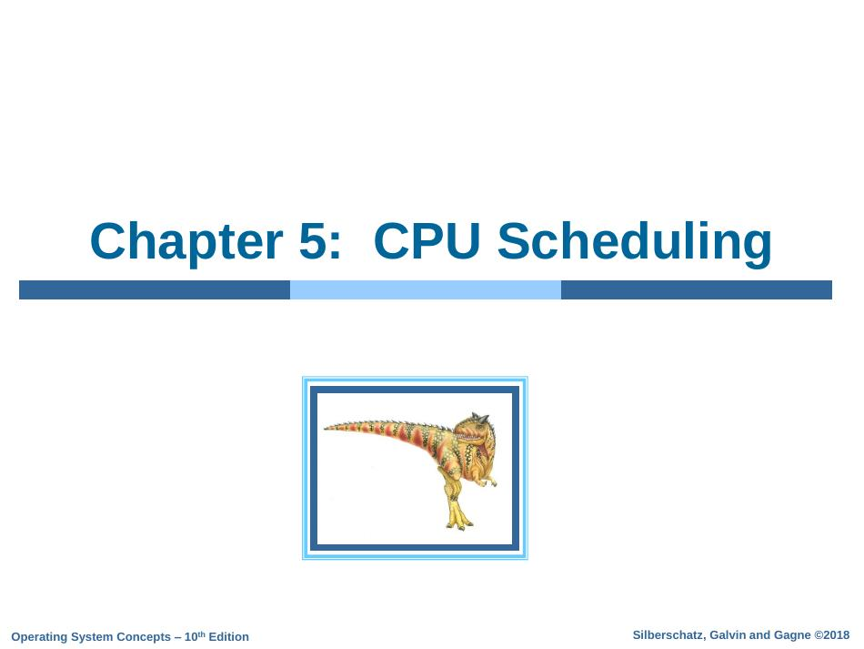

Slide ini memetakan posisi topik dalam bab. Pakai judul-judulnya sebagai daftar cek; utamakan hubungan sebab-akibat dan contoh, bukan hafalan urutan.

### Slide 002 — Outline

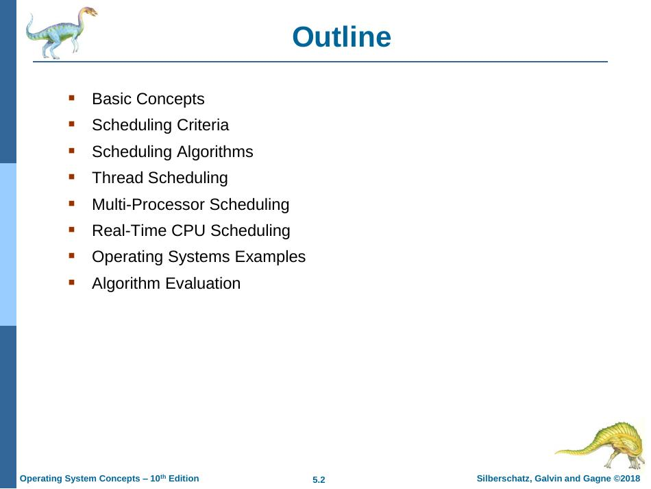

Slide ini memetakan posisi topik dalam bab. Pakai judul-judulnya sebagai daftar cek; utamakan hubungan sebab-akibat dan contoh, bukan hafalan urutan.

### Slide 003 — Objectives

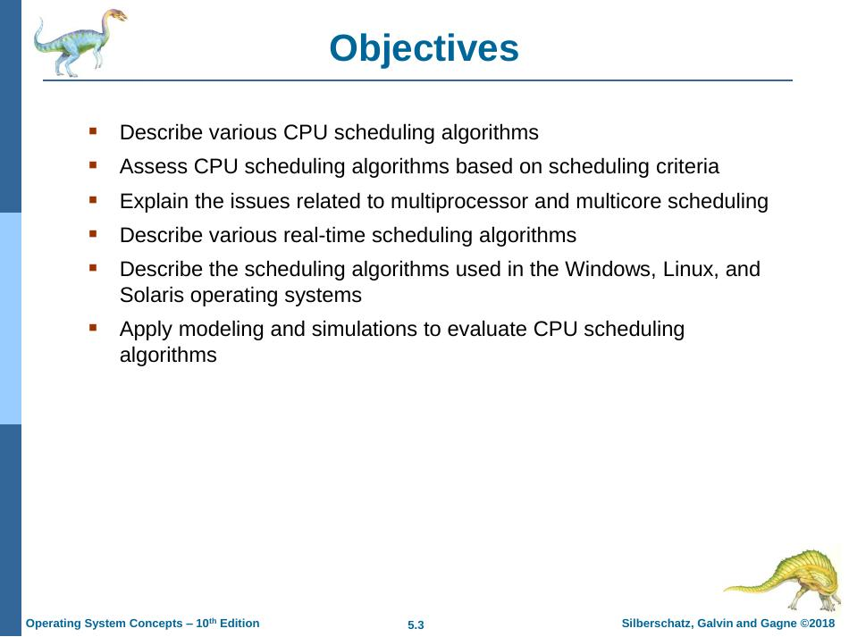

Slide ini memetakan posisi topik dalam bab. Pakai judul-judulnya sebagai daftar cek; utamakan hubungan sebab-akibat dan contoh, bukan hafalan urutan.

### Slide 004 — Basic Concepts

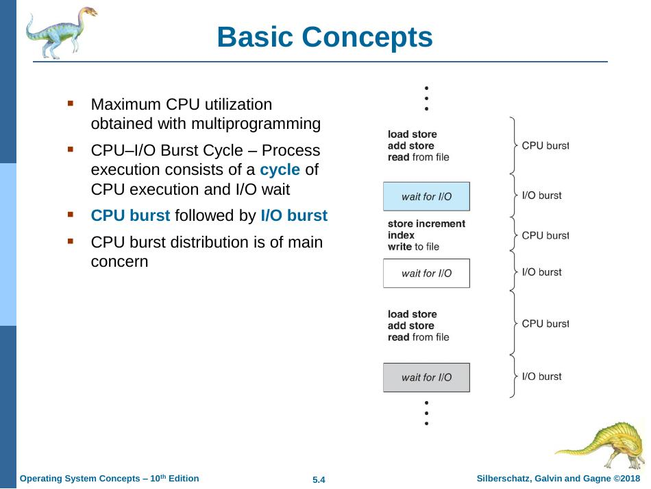

Slide ini memberi contoh tambahan untuk bagian tersebut. Perhatikan urutan pada gambar: identifikasi pelaku, sumber daya yang dipakai, lalu perubahan keadaan setelah setiap langkah. Hubungkan dengan slide sebelumnya sebelum menghafal istilahnya.

**Perhatikan pada gambar:** ▪ Maximum CPU utilization; obtained with multiprogramming

### Slide 005 — Histogram of CPU-burst Times

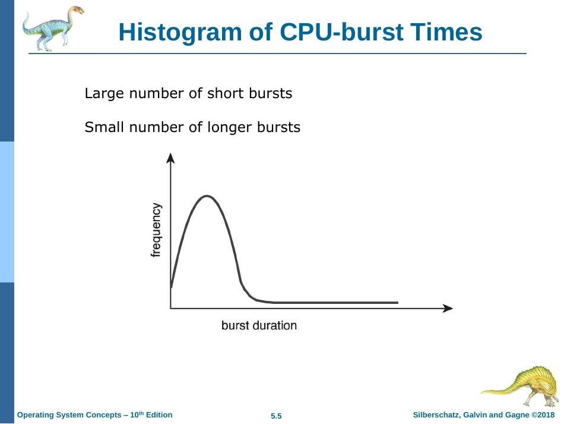

Slide ini memberi contoh tambahan untuk bagian tersebut. Perhatikan urutan pada gambar: identifikasi pelaku, sumber daya yang dipakai, lalu perubahan keadaan setelah setiap langkah. Hubungkan dengan slide sebelumnya sebelum menghafal istilahnya.

**Perhatikan pada gambar:** Large number of short bursts; Small number of longer bursts

### Slide 006 — CPU Scheduler

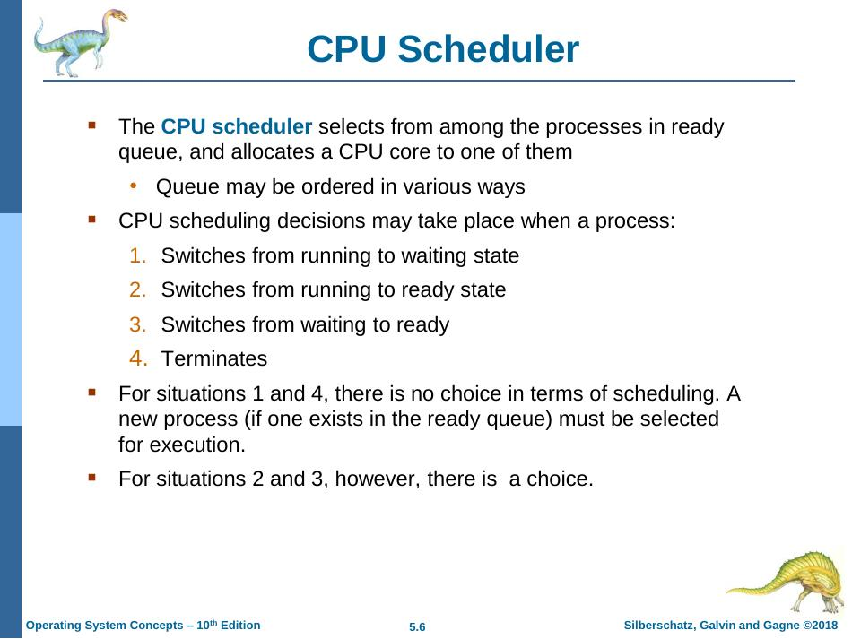

Penjadwal memilih proses ready untuk CPU; dispatcher benar-benar menyerahkan CPU. Preemptive dapat menghentikan proses yang sedang berjalan, sedangkan nonpreemptive menunggu proses melepas CPU. Bandingkan throughput, turnaround, waiting, response, serta overhead context switch.

**Perhatikan pada gambar:** ▪ The CPU scheduler selects from among the processes in ready; queue, and allocates a CPU core to one of them

### Slide 007 — Preemptive and Nonpreemptive Scheduling

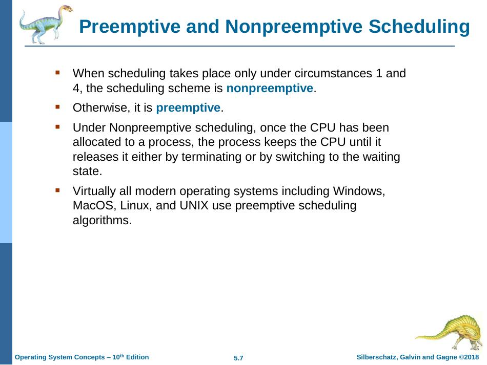

Penjadwal memilih proses ready untuk CPU; dispatcher benar-benar menyerahkan CPU. Preemptive dapat menghentikan proses yang sedang berjalan, sedangkan nonpreemptive menunggu proses melepas CPU. Bandingkan throughput, turnaround, waiting, response, serta overhead context switch.

**Perhatikan pada gambar:** ▪ When scheduling takes place only under circumstances 1 and; 4, the scheduling scheme is nonpreemptive.

### Slide 008 — Preemptive Scheduling and Race Conditions

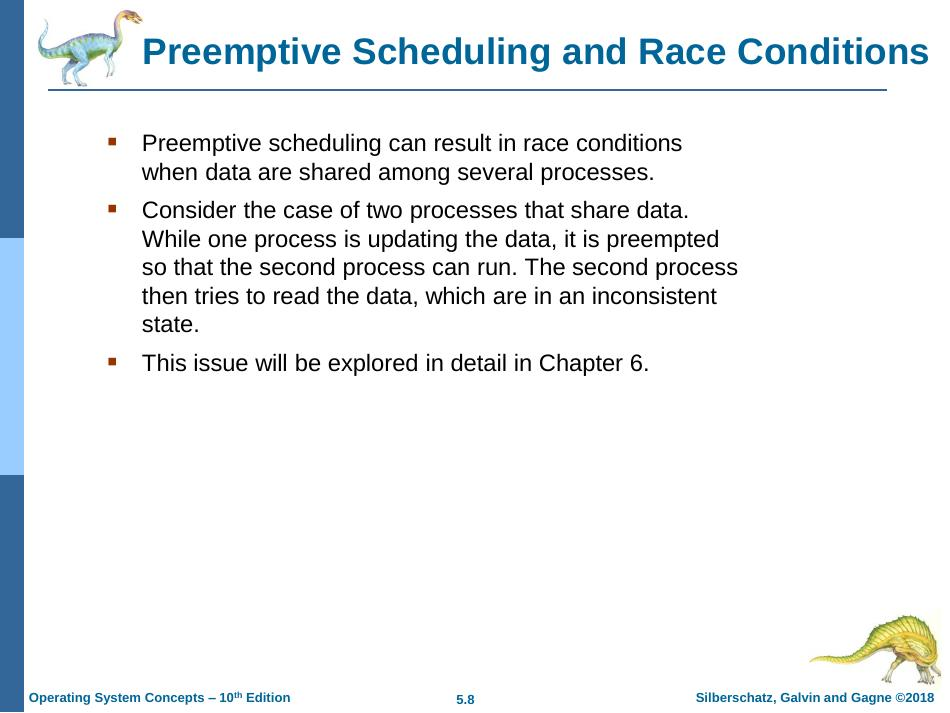

Race condition terjadi ketika hasil bergantung pada urutan operasi yang saling beririsan. Bila dua pekerja mengubah data bersama, lindungi bagian kritis atau gunakan operasi atomik; hasil yang tampak benar sekali belum membuktikan kode aman.

**Perhatikan pada gambar:** ▪ Preemptive scheduling can result in race conditions; when data are shared among several processes.

### Slide 009 — Dispatcher

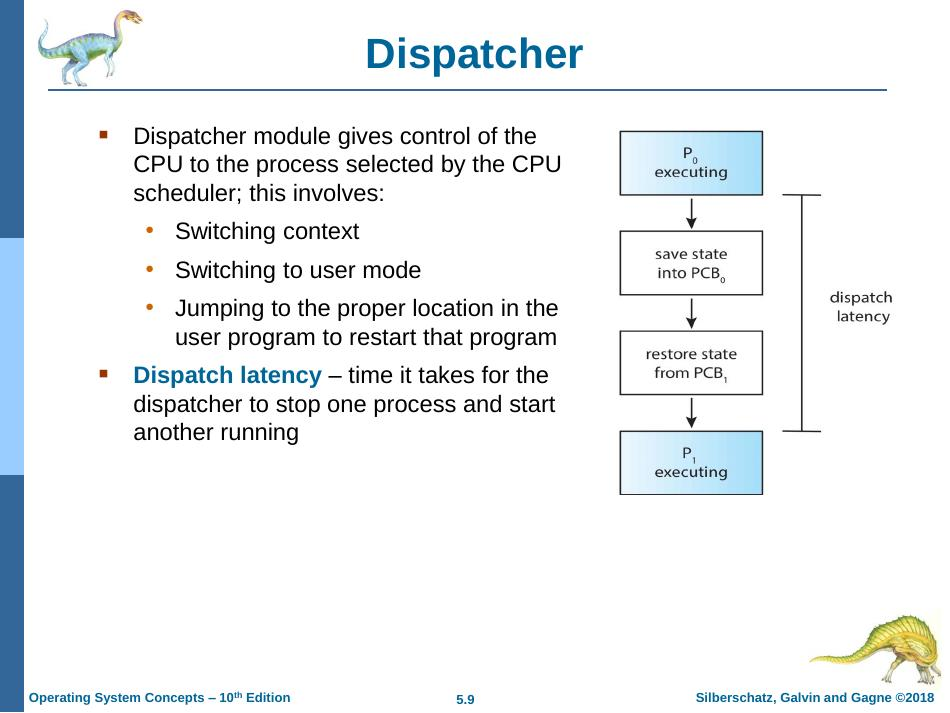

Penjadwal memilih proses ready untuk CPU; dispatcher benar-benar menyerahkan CPU. Preemptive dapat menghentikan proses yang sedang berjalan, sedangkan nonpreemptive menunggu proses melepas CPU. Bandingkan throughput, turnaround, waiting, response, serta overhead context switch.

**Perhatikan pada gambar:** ▪ Dispatcher module gives control of the; CPU to the process selected by the CPU

### Slide 010 — Scheduling Criteria

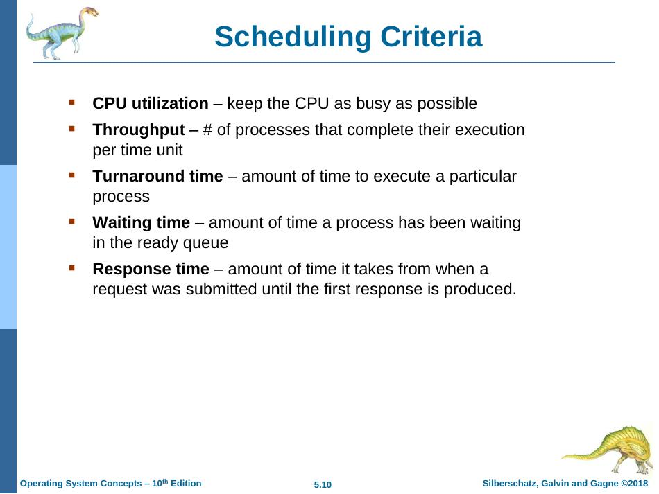

Penjadwal memilih proses ready untuk CPU; dispatcher benar-benar menyerahkan CPU. Preemptive dapat menghentikan proses yang sedang berjalan, sedangkan nonpreemptive menunggu proses melepas CPU. Bandingkan throughput, turnaround, waiting, response, serta overhead context switch.

**Perhatikan pada gambar:** ▪ CPU utilization – keep the CPU as busy as possible; ▪ Throughput – # of processes that complete their execution

### Slide 011 — Scheduling Algorithm Optimization Criteria

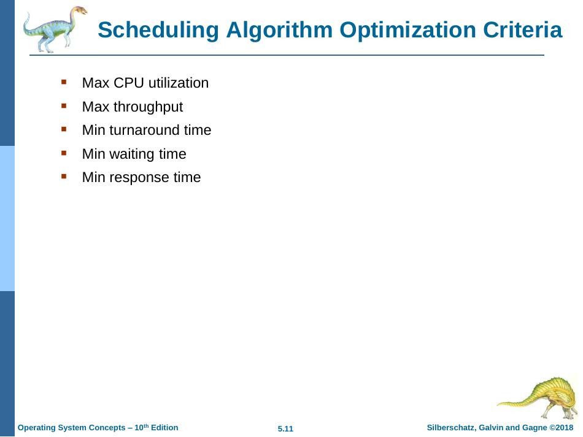

Penjadwal memilih proses ready untuk CPU; dispatcher benar-benar menyerahkan CPU. Preemptive dapat menghentikan proses yang sedang berjalan, sedangkan nonpreemptive menunggu proses melepas CPU. Bandingkan throughput, turnaround, waiting, response, serta overhead context switch.

### Slide 012 — First- Come, First-Served (FCFS) Scheduling

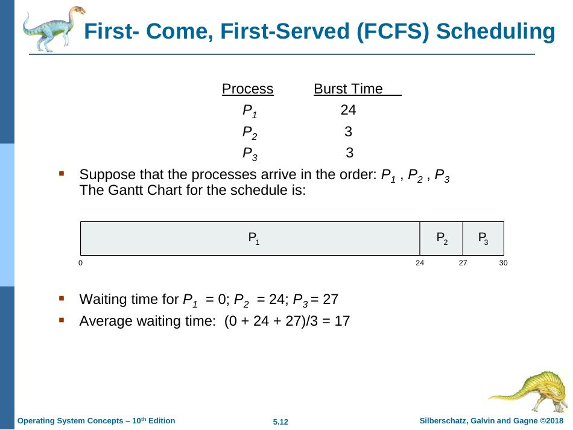

FCFS menjalankan proses menurut urutan kedatangan. Pada semua proses tiba waktu 0, waktu tunggu suatu proses adalah jumlah burst semua proses di depannya. Proses panjang di depan dapat membuat banyak proses pendek menunggu.

**Perhatikan pada gambar:** ▪ Suppose that the processes arrive in the order: P1 , P2 , P3; The Gantt Chart for the schedule is:

### Slide 013 — FCFS Scheduling (Cont.)

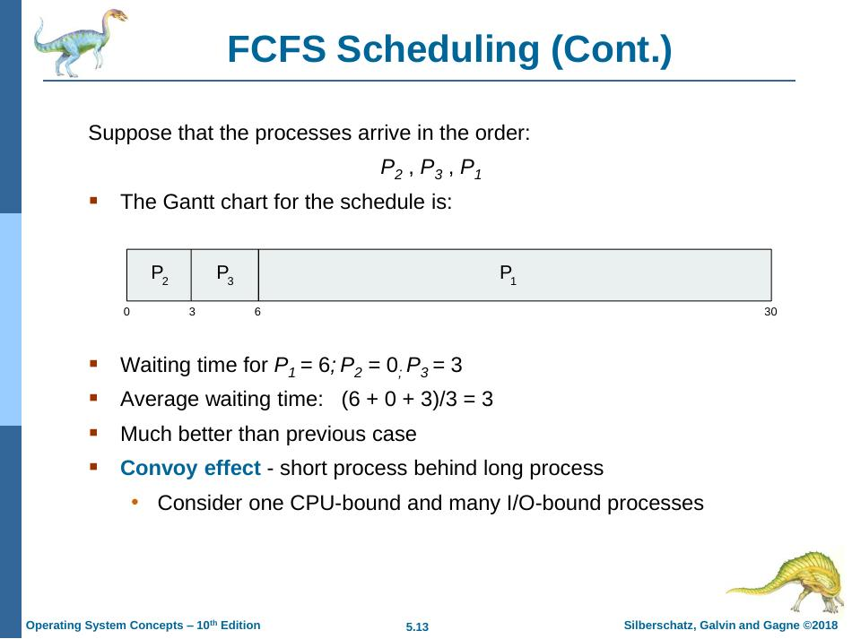

FCFS menjalankan proses menurut urutan kedatangan. Pada semua proses tiba waktu 0, waktu tunggu suatu proses adalah jumlah burst semua proses di depannya. Proses panjang di depan dapat membuat banyak proses pendek menunggu.

**Perhatikan pada gambar:** Suppose that the processes arrive in the order:; ▪ The Gantt chart for the schedule is:

### Slide 014 — Shortest-Job-First (SJF) Scheduling

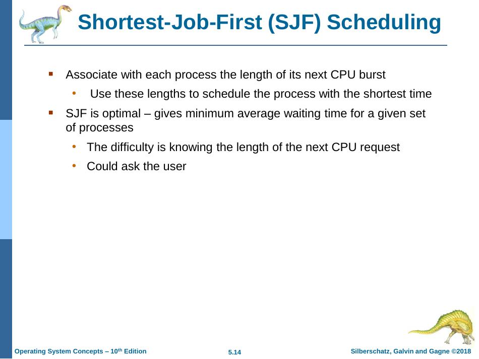

SJF nonpreemptive memilih burst terkecil dari antrean ready. SRTF adalah versi preemptive yang memilih sisa waktu terkecil. Urutkan proses dahulu, gambar Gantt chart, baru hitung waiting = completion − arrival − burst.

**Perhatikan pada gambar:** ▪ Associate with each process the length of its next CPU burst; • Use these lengths to schedule the process with the shortest time

### Slide 015 — Shortest-Job-First (SJF) Scheduling

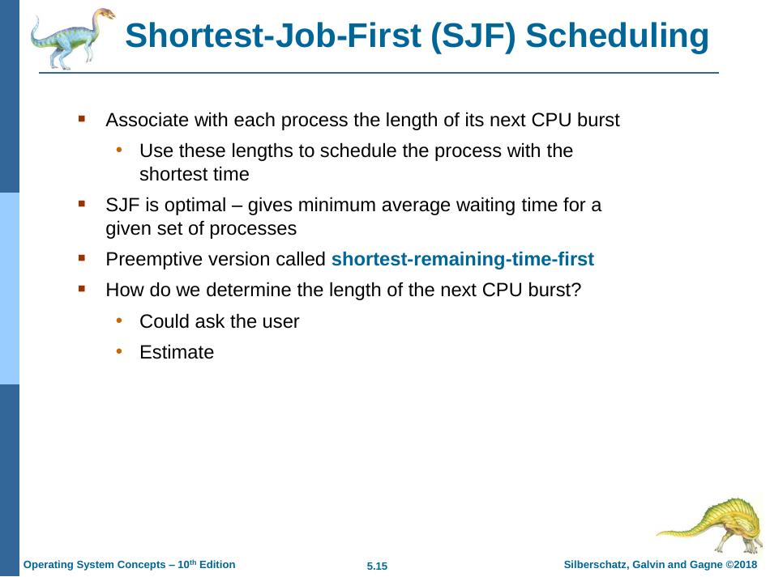

SJF nonpreemptive memilih burst terkecil dari antrean ready. SRTF adalah versi preemptive yang memilih sisa waktu terkecil. Urutkan proses dahulu, gambar Gantt chart, baru hitung waiting = completion − arrival − burst.

**Perhatikan pada gambar:** ▪ Associate with each process the length of its next CPU burst; • Use these lengths to schedule the process with the

### Slide 016 — Example of SJF

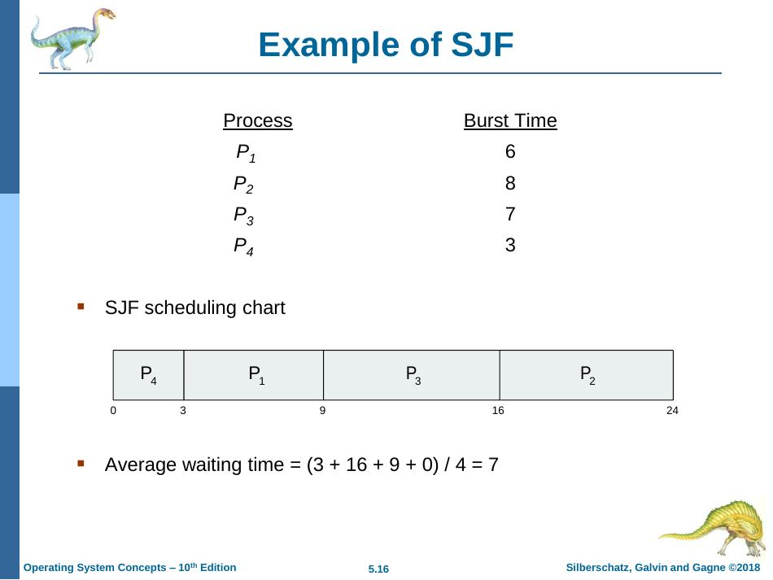

SJF nonpreemptive memilih burst terkecil dari antrean ready. SRTF adalah versi preemptive yang memilih sisa waktu terkecil. Urutkan proses dahulu, gambar Gantt chart, baru hitung waiting = completion − arrival − burst.

**Perhatikan pada gambar:** ProcessArrival Time Burst Time; ▪ Average waiting time = (3 + 16 + 9 + 0) / 4 = 7

### Slide 017 — Determining Length of Next CPU Burst

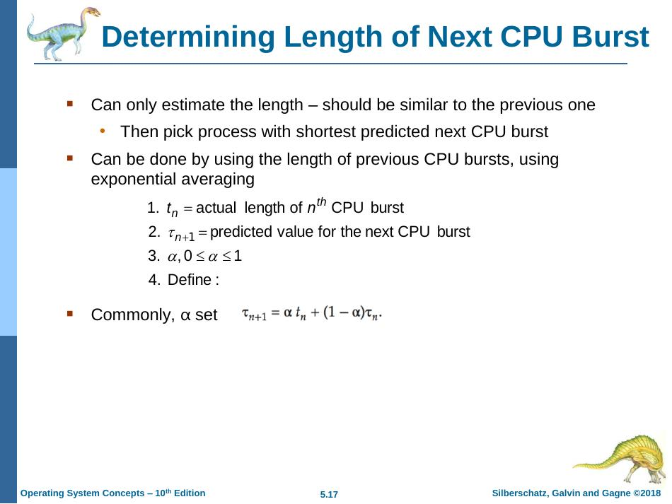

Slide ini memberi contoh tambahan untuk bagian tersebut. Perhatikan urutan pada gambar: identifikasi pelaku, sumber daya yang dipakai, lalu perubahan keadaan setelah setiap langkah. Hubungkan dengan slide sebelumnya sebelum menghafal istilahnya.

**Perhatikan pada gambar:** ▪ Can only estimate the length – should be similar to the previous one; • Then pick process with shortest predicted next CPU burst

### Slide 018 — Prediction of the Length of the Next CPU Burst

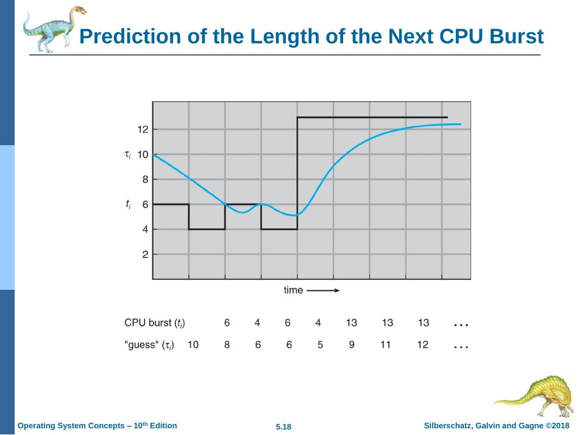

Slide ini memberi contoh tambahan untuk bagian tersebut. Perhatikan urutan pada gambar: identifikasi pelaku, sumber daya yang dipakai, lalu perubahan keadaan setelah setiap langkah. Hubungkan dengan slide sebelumnya sebelum menghafal istilahnya.

### Slide 019 — Examples of Exponential Averaging

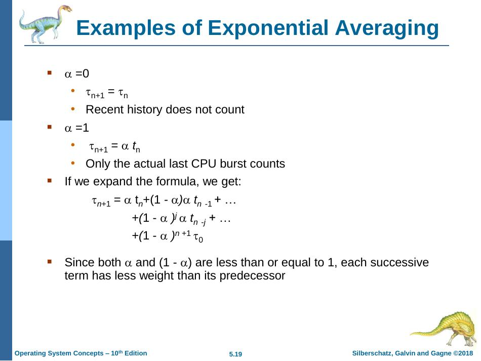

Slide ini memberi contoh tambahan untuk bagian tersebut. Perhatikan urutan pada gambar: identifikasi pelaku, sumber daya yang dipakai, lalu perubahan keadaan setelah setiap langkah. Hubungkan dengan slide sebelumnya sebelum menghafal istilahnya.

**Perhatikan pada gambar:** • Recent history does not count; • Only the actual last CPU burst counts

### Slide 020 — Example of Shortest-remaining-time-first

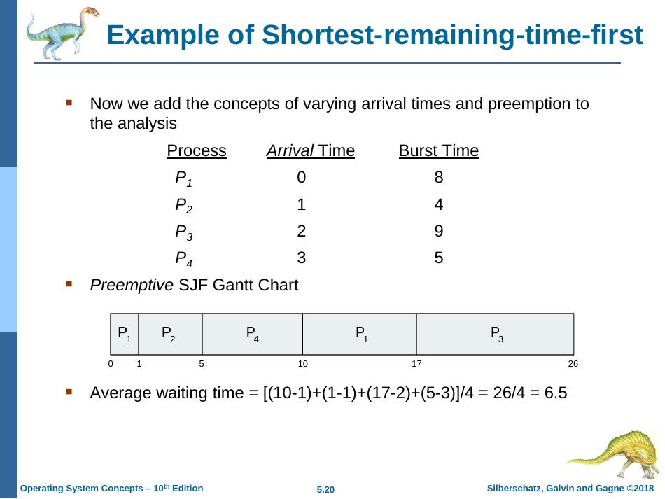

SJF nonpreemptive memilih burst terkecil dari antrean ready. SRTF adalah versi preemptive yang memilih sisa waktu terkecil. Urutkan proses dahulu, gambar Gantt chart, baru hitung waiting = completion − arrival − burst.

**Perhatikan pada gambar:** ▪ Now we add the concepts of varying arrival times and preemption to; ProcessAarri Arrival TimeT Burst Time

### Slide 021 — Round Robin (RR)

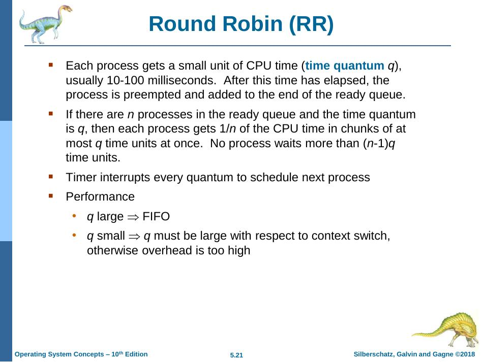

Round Robin memberi setiap proses jatah q. Jika belum selesai saat q habis, proses masuk belakang antrean. Quantum terlalu kecil memperbanyak context switch; terlalu besar membuat perilakunya mendekati FCFS.

**Perhatikan pada gambar:** ▪ Each process gets a small unit of CPU time (time quantum q),; usually 10-100 milliseconds. After this time has elapsed, the

### Slide 022 — Example of RR with Time Quantum = 4

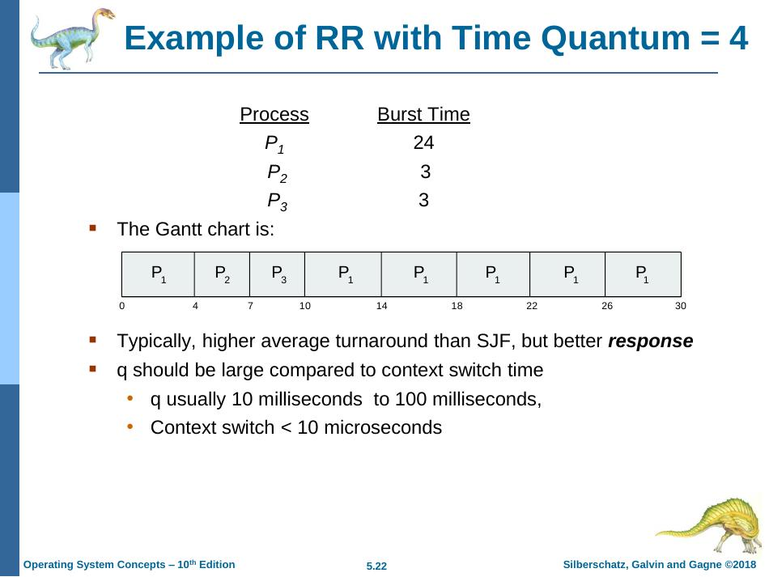

Round Robin memberi setiap proses jatah q. Jika belum selesai saat q habis, proses masuk belakang antrean. Quantum terlalu kecil memperbanyak context switch; terlalu besar membuat perilakunya mendekati FCFS.

**Perhatikan pada gambar:** P1 P2 P3 P1 P1 P1 P1 P1; 0 4 7 10 14 18 22 26 30

### Slide 023 — Time Quantum and Context Switch Time

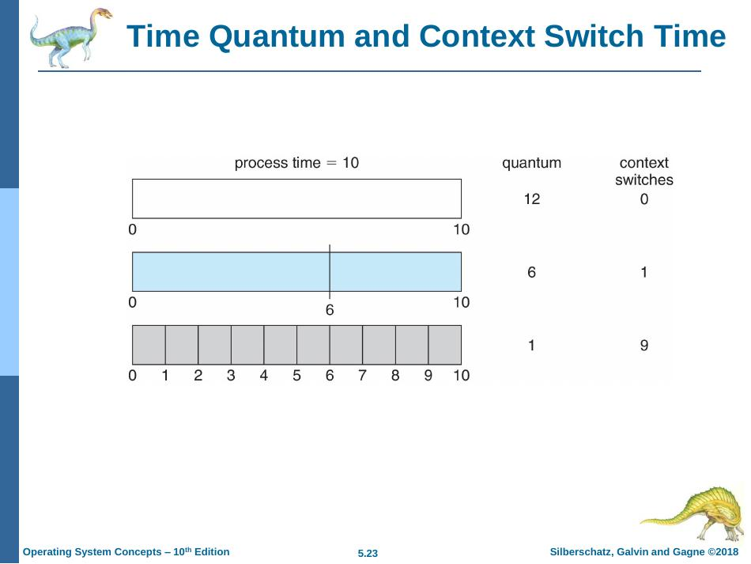

Context switch menyimpan keadaan proses lama ke PCB lalu memulihkan keadaan proses baru. Selama pergantian itu CPU tidak mengerjakan instruksi pengguna, sehingga ada biaya tambahan. Jangan samakan pergantian proses dengan pembuatan proses.

### Slide 024 — Turnaround Time Varies With The Time Quantum

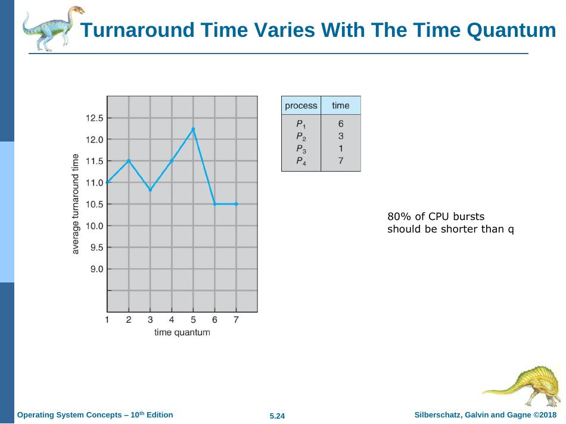

Round Robin memberi setiap proses jatah q. Jika belum selesai saat q habis, proses masuk belakang antrean. Quantum terlalu kecil memperbanyak context switch; terlalu besar membuat perilakunya mendekati FCFS.

**Perhatikan pada gambar:** should be shorter than q

### Slide 025 — Priority Scheduling

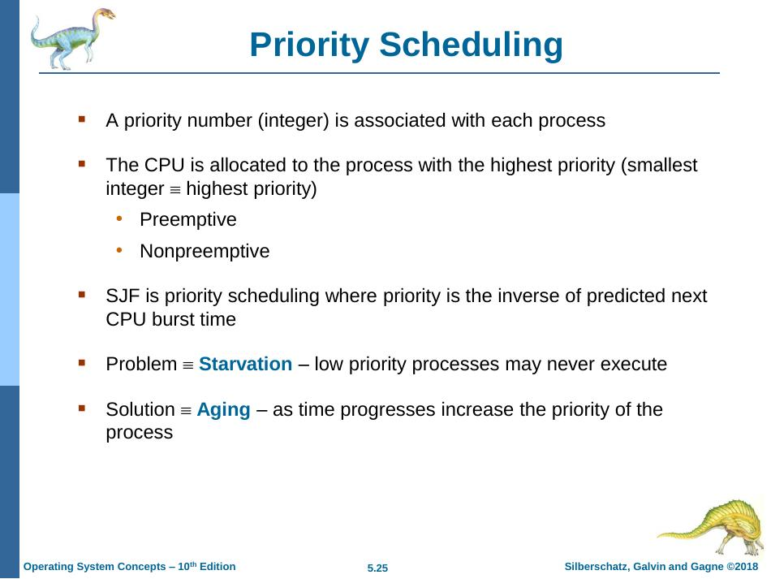

Prioritas menentukan siapa lebih dulu mendapat CPU; proses berprioritas rendah dapat kelaparan dan aging dapat menguranginya. Antrean bertingkat memisahkan kelas pekerjaan. Pada banyak CPU, affinity dan NUMA memengaruhi lokasi data serta biaya perpindahan.

**Perhatikan pada gambar:** ▪ A priority number (integer) is associated with each process; ▪ The CPU is allocated to the process with the highest priority (smallest

### Slide 026 — Example of Priority Scheduling

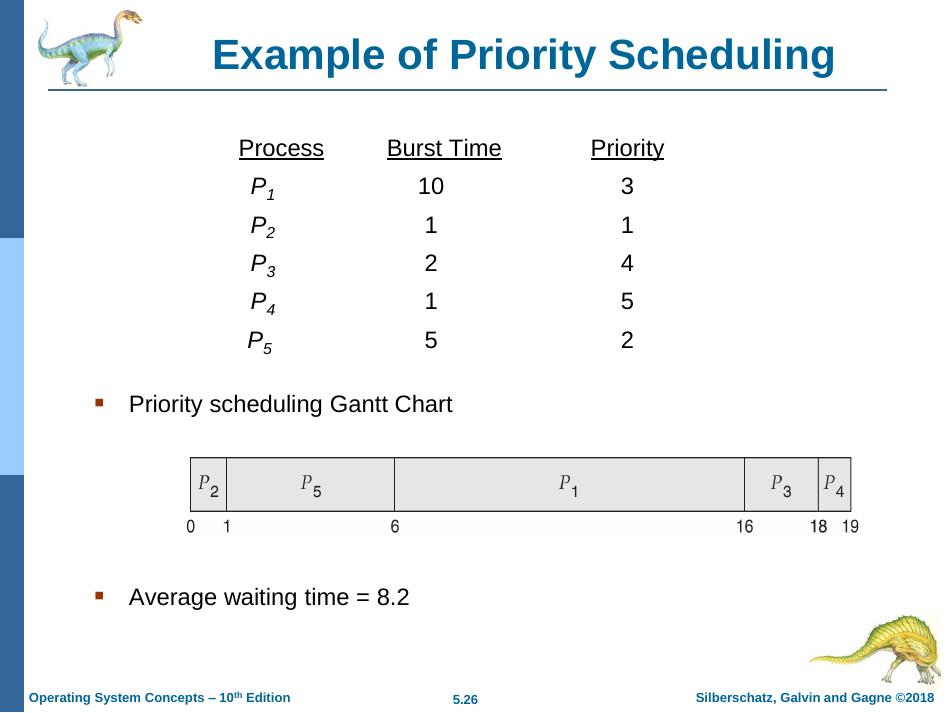

Prioritas menentukan siapa lebih dulu mendapat CPU; proses berprioritas rendah dapat kelaparan dan aging dapat menguranginya. Antrean bertingkat memisahkan kelas pekerjaan. Pada banyak CPU, affinity dan NUMA memengaruhi lokasi data serta biaya perpindahan.

**Perhatikan pada gambar:** ProcessA arri Burst TimeT Priority; ▪ Priority scheduling Gantt Chart

### Slide 027 — Priority Scheduling w/ Round-Robin

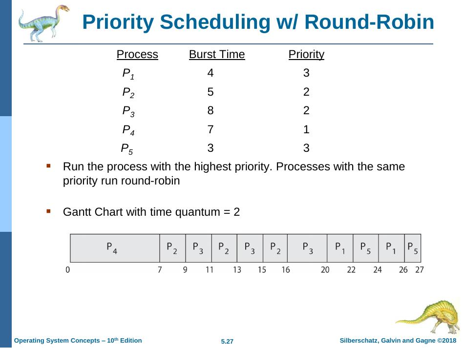

Prioritas menentukan siapa lebih dulu mendapat CPU; proses berprioritas rendah dapat kelaparan dan aging dapat menguranginya. Antrean bertingkat memisahkan kelas pekerjaan. Pada banyak CPU, affinity dan NUMA memengaruhi lokasi data serta biaya perpindahan.

**Perhatikan pada gambar:** ProcessA arri Burst TimeT Priority; ▪ Run the process with the highest priority. Processes with the same

### Slide 028 — Multilevel Queue

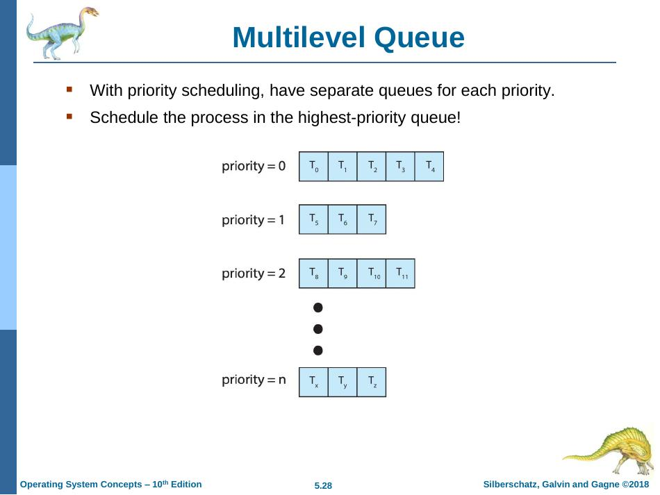

Prioritas menentukan siapa lebih dulu mendapat CPU; proses berprioritas rendah dapat kelaparan dan aging dapat menguranginya. Antrean bertingkat memisahkan kelas pekerjaan. Pada banyak CPU, affinity dan NUMA memengaruhi lokasi data serta biaya perpindahan.

**Perhatikan pada gambar:** ▪ With priority scheduling, have separate queues for each priority.; ▪ Schedule the process in the highest-priority queue!

### Slide 029 — Multilevel Queue

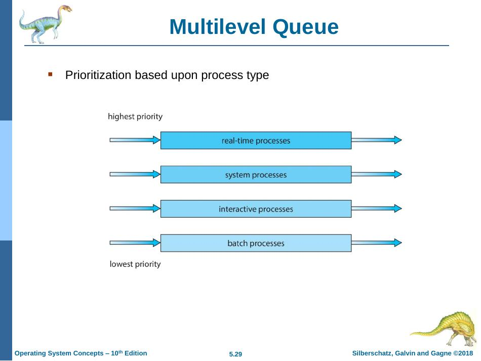

Prioritas menentukan siapa lebih dulu mendapat CPU; proses berprioritas rendah dapat kelaparan dan aging dapat menguranginya. Antrean bertingkat memisahkan kelas pekerjaan. Pada banyak CPU, affinity dan NUMA memengaruhi lokasi data serta biaya perpindahan.

**Perhatikan pada gambar:** ▪ Prioritization based upon process type

### Slide 030 — Multilevel Feedback Queue

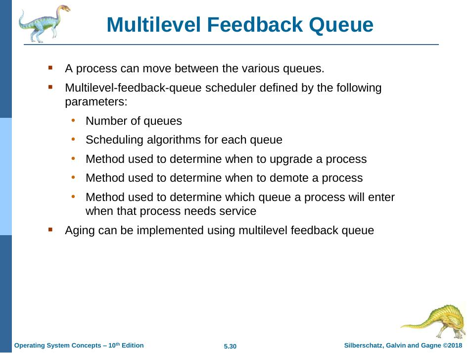

Prioritas menentukan siapa lebih dulu mendapat CPU; proses berprioritas rendah dapat kelaparan dan aging dapat menguranginya. Antrean bertingkat memisahkan kelas pekerjaan. Pada banyak CPU, affinity dan NUMA memengaruhi lokasi data serta biaya perpindahan.

**Perhatikan pada gambar:** ▪ A process can move between the various queues.; ▪ Multilevel-feedback-queue scheduler defined by the following

### Slide 031 — Example of Multilevel Feedback Queue

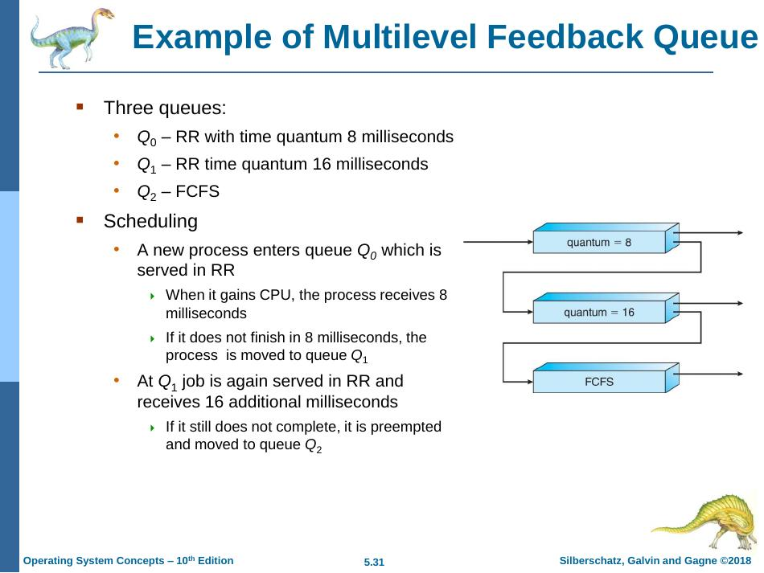

Prioritas menentukan siapa lebih dulu mendapat CPU; proses berprioritas rendah dapat kelaparan dan aging dapat menguranginya. Antrean bertingkat memisahkan kelas pekerjaan. Pada banyak CPU, affinity dan NUMA memengaruhi lokasi data serta biaya perpindahan.

**Perhatikan pada gambar:** • Q0 – RR with time quantum 8 milliseconds; • Q1 – RR time quantum 16 milliseconds

### Slide 032 — Thread Scheduling

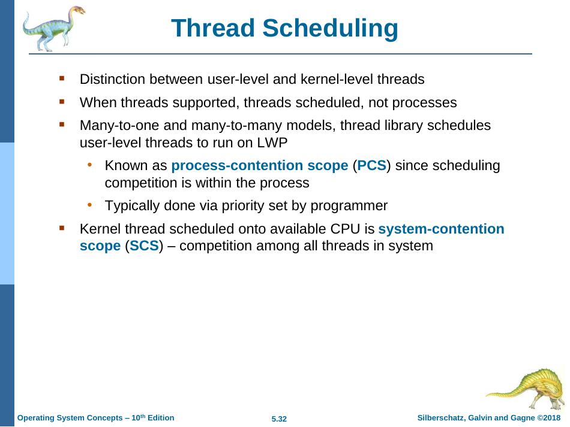

Slide ini memberi contoh tambahan untuk bagian tersebut. Perhatikan urutan pada gambar: identifikasi pelaku, sumber daya yang dipakai, lalu perubahan keadaan setelah setiap langkah. Hubungkan dengan slide sebelumnya sebelum menghafal istilahnya.

**Perhatikan pada gambar:** ▪ Distinction between user-level and kernel-level threads; ▪ When threads supported, threads scheduled, not processes

### Slide 033 — Pthread Scheduling

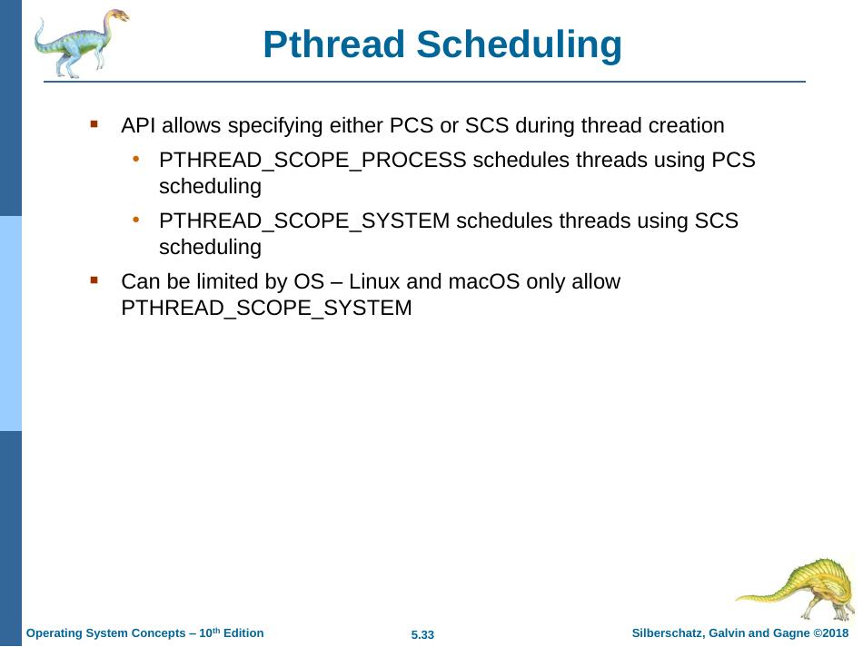

Slide ini memberi contoh tambahan untuk bagian tersebut. Perhatikan urutan pada gambar: identifikasi pelaku, sumber daya yang dipakai, lalu perubahan keadaan setelah setiap langkah. Hubungkan dengan slide sebelumnya sebelum menghafal istilahnya.

**Perhatikan pada gambar:** ▪ API allows specifying either PCS or SCS during thread creation; • PTHREAD_SCOPE_PROCESS schedules threads using PCS

### Slide 034 — Pthread Scheduling API

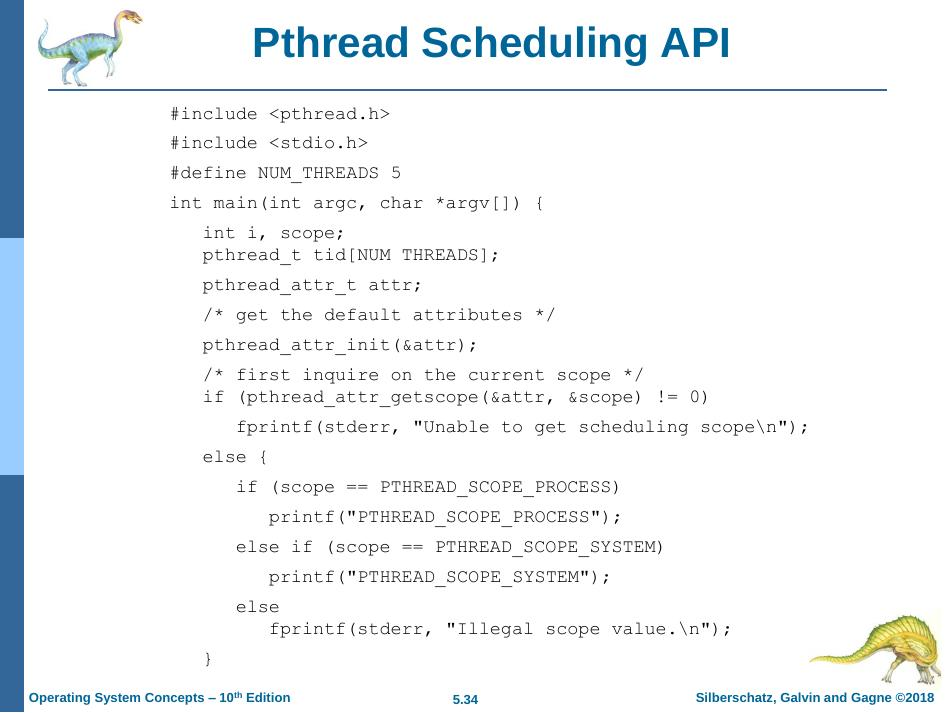

Aplikasi meminta kerja kernel lewat system call. CPU berpindah ke kernel mode untuk menjalankan layanan yang butuh hak istimewa, lalu kembali ke user mode; API adalah antarmuka pemrograman yang sering membungkus panggilan itu. Parameter dapat lewat register, blok memori, atau stack.

**Perhatikan pada gambar:** int main(int argc, char *argv[]) {; pthread_t tid[NUM THREADS];

### Slide 035 — Pthread Scheduling API

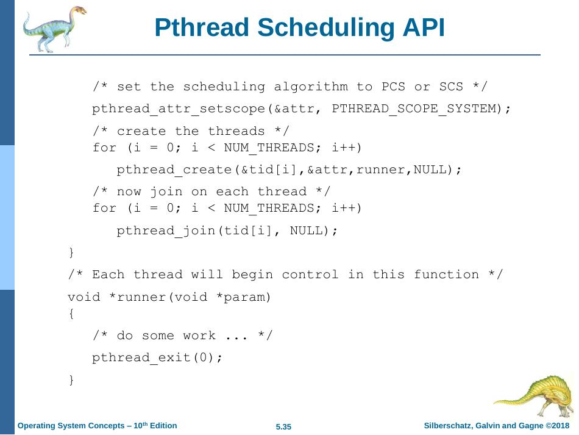

Aplikasi meminta kerja kernel lewat system call. CPU berpindah ke kernel mode untuk menjalankan layanan yang butuh hak istimewa, lalu kembali ke user mode; API adalah antarmuka pemrograman yang sering membungkus panggilan itu. Parameter dapat lewat register, blok memori, atau stack.

**Perhatikan pada gambar:** /* set the scheduling algorithm to PCS or SCS */; pthread_attr_setscope(&attr, PTHREAD_SCOPE_SYSTEM);

### Slide 036 — Multiple-Processor Scheduling

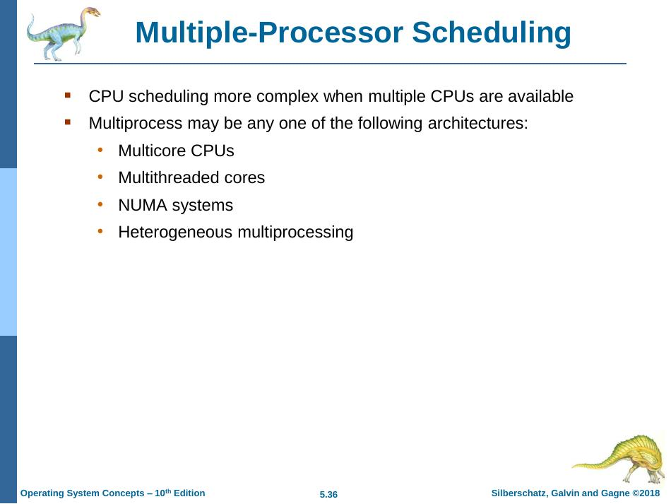

Slide ini memberi contoh tambahan untuk bagian tersebut. Perhatikan urutan pada gambar: identifikasi pelaku, sumber daya yang dipakai, lalu perubahan keadaan setelah setiap langkah. Hubungkan dengan slide sebelumnya sebelum menghafal istilahnya.

**Perhatikan pada gambar:** ▪ CPU scheduling more complex when multiple CPUs are available; ▪ Multiprocess may be any one of the following architectures:

### Slide 037 — Multiple-Processor Scheduling

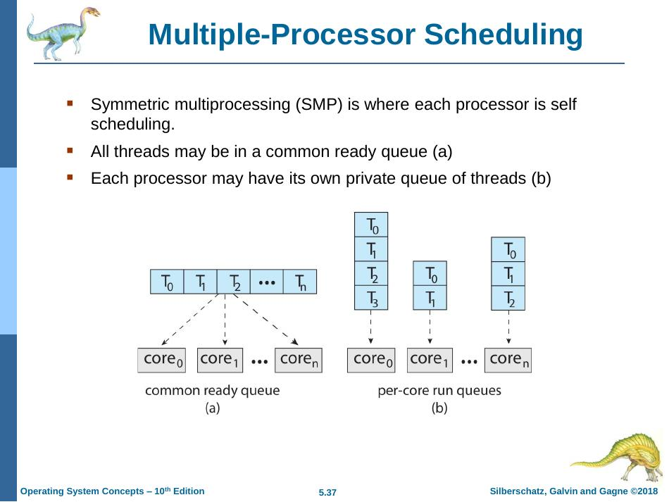

Slide ini memberi contoh tambahan untuk bagian tersebut. Perhatikan urutan pada gambar: identifikasi pelaku, sumber daya yang dipakai, lalu perubahan keadaan setelah setiap langkah. Hubungkan dengan slide sebelumnya sebelum menghafal istilahnya.

**Perhatikan pada gambar:** ▪ Symmetric multiprocessing (SMP) is where each processor is self; ▪ All threads may be in a common ready queue (a)

### Slide 038 — Multicore Processors

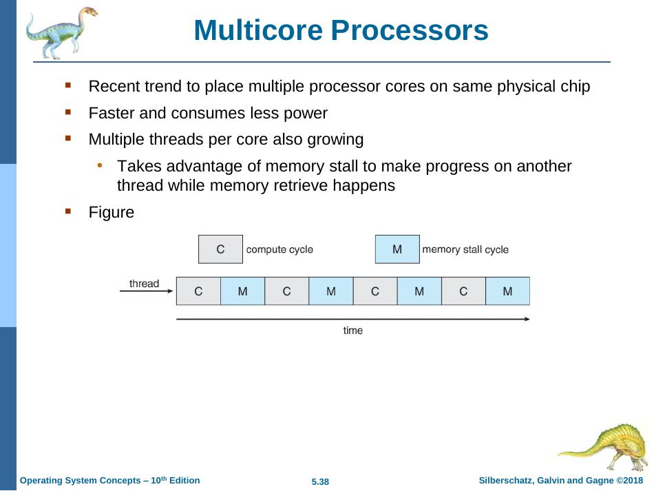

Konkurensi berarti beberapa pekerjaan maju dalam periode yang sama, meski CPU dapat bergantian. Paralelisme berarti pekerjaan benar-benar berjalan serentak pada inti berbeda. Data parallelism membagi data dengan operasi serupa; task parallelism membagi jenis pekerjaan.

**Perhatikan pada gambar:** ▪ Recent trend to place multiple processor cores on same physical chip; ▪ Faster and consumes less power

### Slide 039 — Multithreaded Multicore System

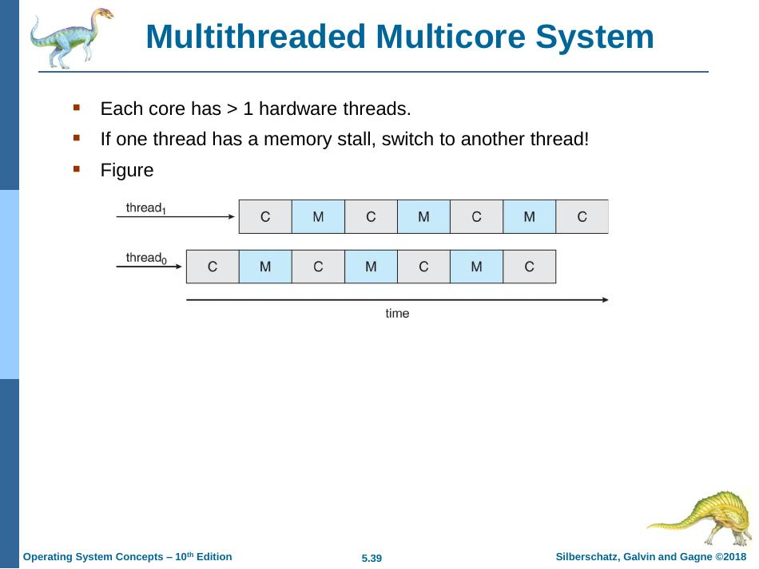

Konkurensi berarti beberapa pekerjaan maju dalam periode yang sama, meski CPU dapat bergantian. Paralelisme berarti pekerjaan benar-benar berjalan serentak pada inti berbeda. Data parallelism membagi data dengan operasi serupa; task parallelism membagi jenis pekerjaan.

**Perhatikan pada gambar:** ▪ Each core has > 1 hardware threads.; ▪ If one thread has a memory stall, switch to another thread!

### Slide 040 — Multithreaded Multicore System

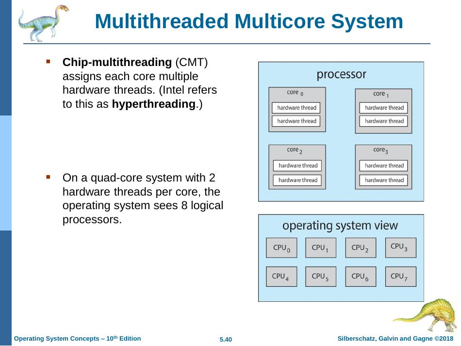

Konkurensi berarti beberapa pekerjaan maju dalam periode yang sama, meski CPU dapat bergantian. Paralelisme berarti pekerjaan benar-benar berjalan serentak pada inti berbeda. Data parallelism membagi data dengan operasi serupa; task parallelism membagi jenis pekerjaan.

**Perhatikan pada gambar:** ▪ Chip-multithreading (CMT); assigns each core multiple

### Slide 041 — Multithreaded Multicore System

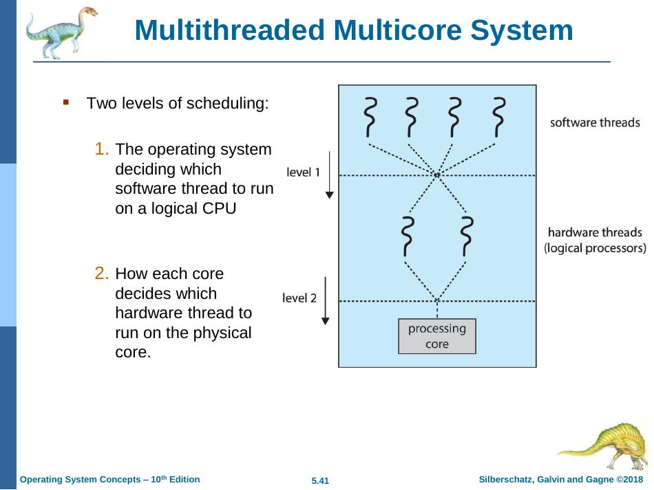

Konkurensi berarti beberapa pekerjaan maju dalam periode yang sama, meski CPU dapat bergantian. Paralelisme berarti pekerjaan benar-benar berjalan serentak pada inti berbeda. Data parallelism membagi data dengan operasi serupa; task parallelism membagi jenis pekerjaan.

**Perhatikan pada gambar:** ▪ Two levels of scheduling:; 1. The operating system

### Slide 042 — Multiple-Processor Scheduling – Load Balancing

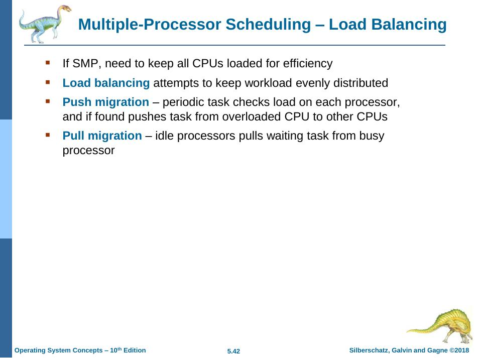

Prioritas menentukan siapa lebih dulu mendapat CPU; proses berprioritas rendah dapat kelaparan dan aging dapat menguranginya. Antrean bertingkat memisahkan kelas pekerjaan. Pada banyak CPU, affinity dan NUMA memengaruhi lokasi data serta biaya perpindahan.

**Perhatikan pada gambar:** ▪ If SMP, need to keep all CPUs loaded for efficiency; ▪ Load balancing attempts to keep workload evenly distributed

### Slide 043 — Multiple-Processor Scheduling – Processor Affinity

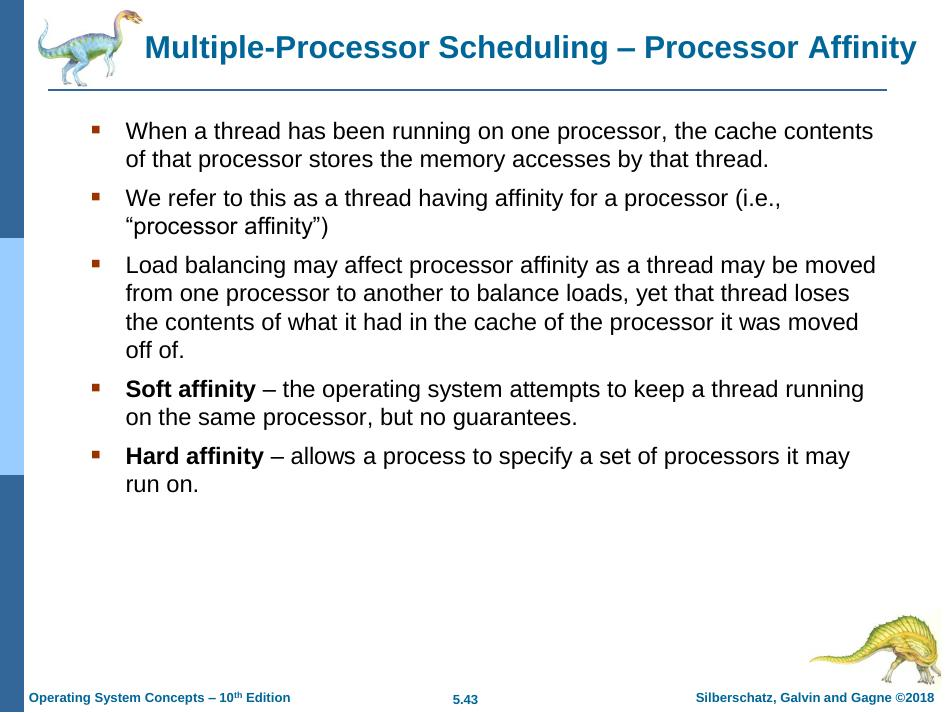

Prioritas menentukan siapa lebih dulu mendapat CPU; proses berprioritas rendah dapat kelaparan dan aging dapat menguranginya. Antrean bertingkat memisahkan kelas pekerjaan. Pada banyak CPU, affinity dan NUMA memengaruhi lokasi data serta biaya perpindahan.

**Perhatikan pada gambar:** ▪ When a thread has been running on one processor, the cache contents; of that processor stores the memory accesses by that thread.

### Slide 044 — NUMA and CPU Scheduling

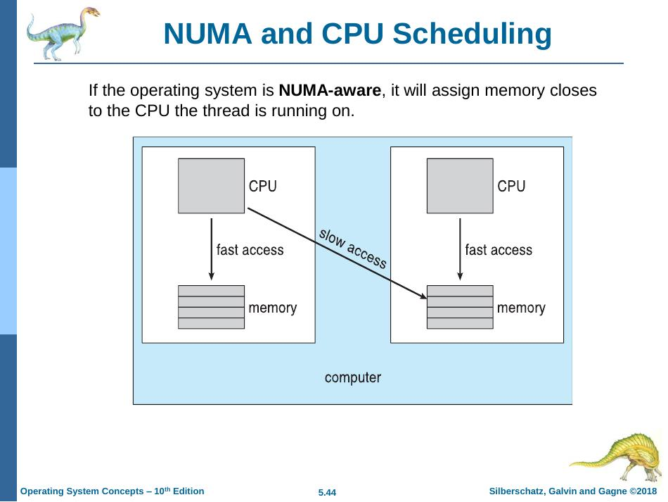

Prioritas menentukan siapa lebih dulu mendapat CPU; proses berprioritas rendah dapat kelaparan dan aging dapat menguranginya. Antrean bertingkat memisahkan kelas pekerjaan. Pada banyak CPU, affinity dan NUMA memengaruhi lokasi data serta biaya perpindahan.

**Perhatikan pada gambar:** If the operating system is NUMA-aware, it will assign memory closes; to the CPU the thread is running on.

## Contoh soal dan pembahasan

### Contoh — FCFS, SJF, dan RR (adaptasi jenis hitungan UTS 2019)
**Soal latihan.** Semua tiba waktu 0; P1=8, P2=4, P3=2. Quantum RR=3. Antrean awal P1,P2,P3.

| Metode | Gantt chart | Waktu tunggu P1,P2,P3 | Rata-rata |
|---|---|---|---:|
| FCFS | 0–8 P1, 8–12 P2, 12–14 P3 | 0, 8, 12 | 6,67 |
| SJF nonpreemptive | 0–2 P3, 2–6 P2, 6–14 P1 | 6, 2, 0 | 2,67 |
| RR q=3 | 0–3 P1, 3–6 P2, 6–8 P3, 8–11 P1, 11–12 P2, 12–14 P1 | 6, 8, 6 | 6,67 |

Gunakan `waiting = completion − arrival − burst`. Untuk RR, waktu selesai P1=14, P2=12, P3=8; maka waktu tunggunya 6, 8, 6. Angka di sini adalah contoh baru, bukan kutipan angka dari UTS.

## Rujukan

- Slide kuliah `K5 & K6.pdf` halaman 1–44 dari paket Sensei.

- *Operating System Concepts*, edisi ke-10, Silberschatz, Galvin, dan Gagne, sebagaimana tercantum pada slide.

- `Kisi kisi.pdf` dan kumpulan contoh UTS 2018, 2019, 2021, 2022 dalam paket Sensei. Soal yang diberi label "adaptasi" mengikuti jenis/topik soal terdahulu; angka dan redaksinya tidak diklaim sama dengan soal asli.
