# Pertemuan 2 — Layanan dan struktur sistem operasi, slide demi slide
Gambar mengikuti halaman 1–59 dari `K2.pdf` dalam paket Sensei. Nomor slide di bawah adalah halaman PDF asli. Pembahasan menekankan alur konsep; contoh hitungan di akhir memakai konvensi kisi-kisi.

**Fokus UTS:** Layanan SO, kategori system call, perpindahan mode, parameter, API, loader, pustaka dinamis, struktur kernel, policy dan mechanism.

## Pembahasan setiap slide

### Slide 001 — Chapter 2: Operating-System

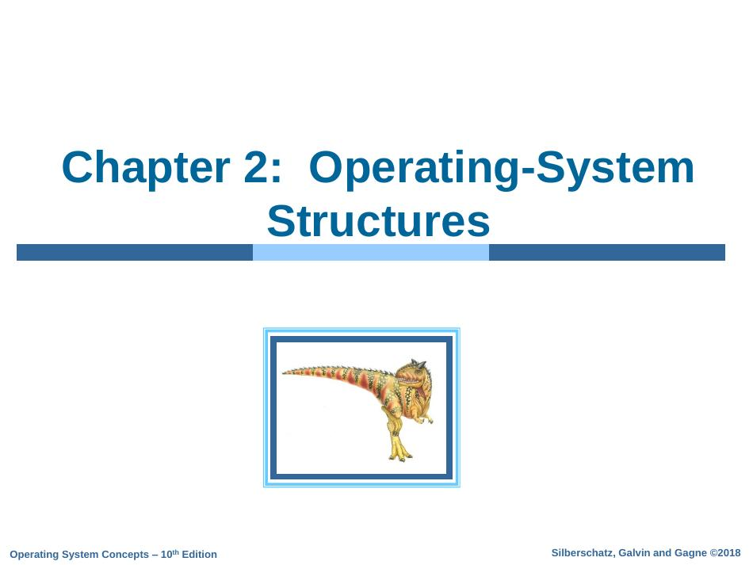

Slide ini memetakan posisi topik dalam bab. Pakai judul-judulnya sebagai daftar cek; utamakan hubungan sebab-akibat dan contoh, bukan hafalan urutan.

### Slide 002 — Chapter 2: Operating-System Structures

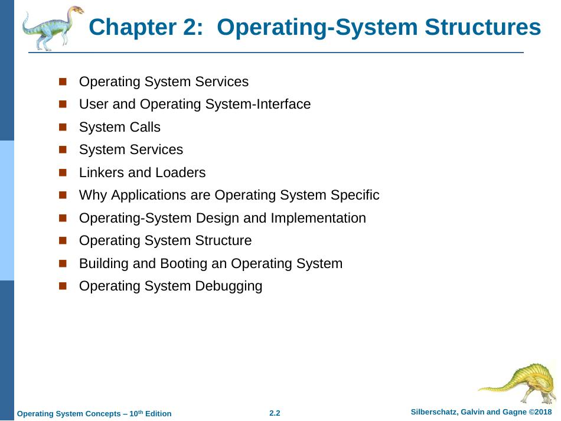

Slide ini memetakan posisi topik dalam bab. Pakai judul-judulnya sebagai daftar cek; utamakan hubungan sebab-akibat dan contoh, bukan hafalan urutan.

**Perhatikan pada gambar:** Operating System Services; User and Operating System-Interface

### Slide 003 — Objectives

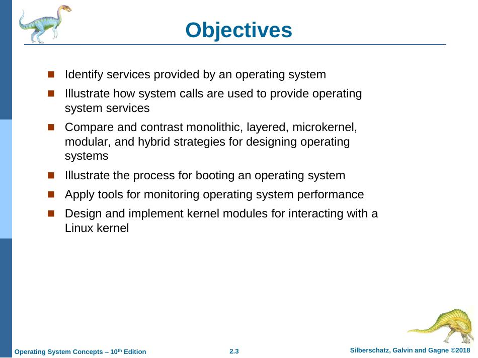

Slide ini memetakan posisi topik dalam bab. Pakai judul-judulnya sebagai daftar cek; utamakan hubungan sebab-akibat dan contoh, bukan hafalan urutan.

### Slide 004 — Operating System Services

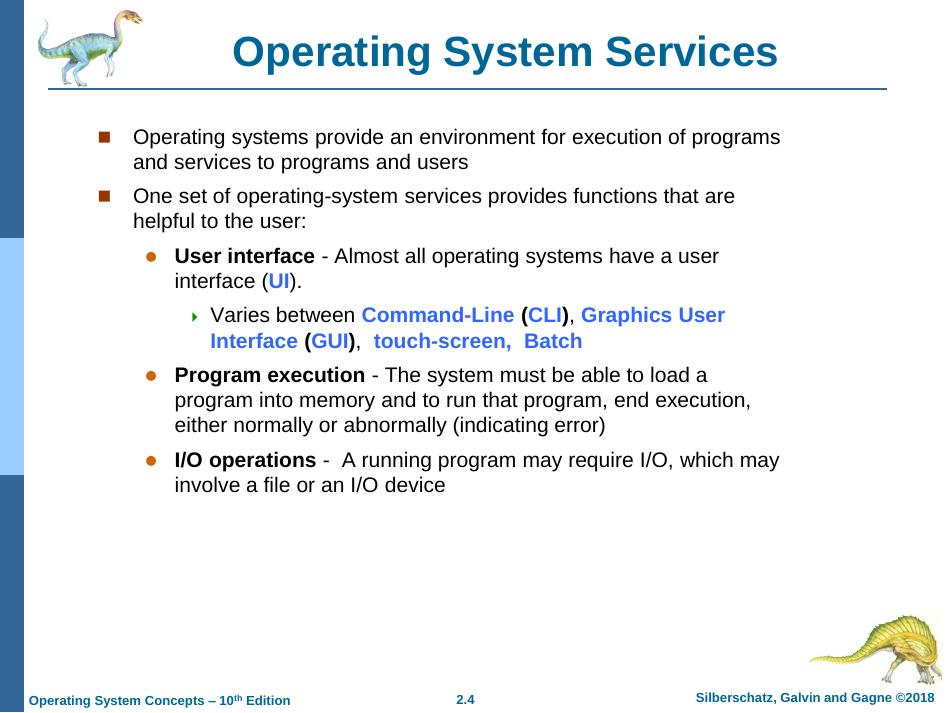

Sistem operasi menyediakan cara berinteraksi dan layanan menjalankan program, I/O, berkas, komunikasi, serta penanganan galat. Di belakangnya ada alokasi sumber daya, pencatatan penggunaan, dan perlindungan. Cocokkan permintaan pengguna dengan layanan yang benar.

**Perhatikan pada gambar:** Operating systems provide an environment for execution of programs; and services to programs and users

### Slide 005 — Operating System Services (Cont.)

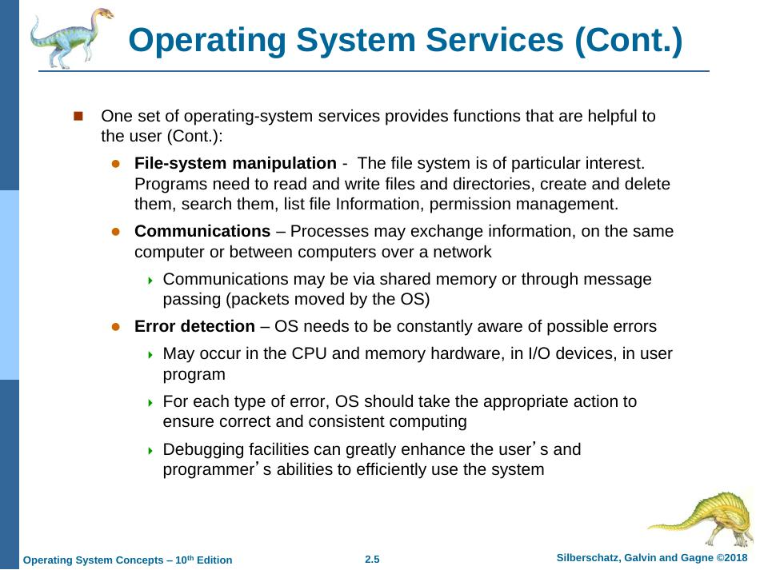

Sistem operasi menyediakan cara berinteraksi dan layanan menjalankan program, I/O, berkas, komunikasi, serta penanganan galat. Di belakangnya ada alokasi sumber daya, pencatatan penggunaan, dan perlindungan. Cocokkan permintaan pengguna dengan layanan yang benar.

**Perhatikan pada gambar:** One set of operating-system services provides functions that are helpful to; File-system manipulation - The file system is of particular interest.

### Slide 006 — Operating System Services (Cont.)

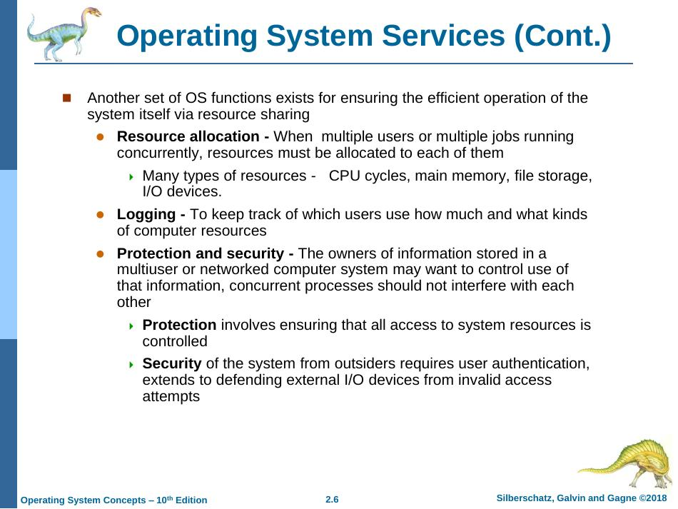

Sistem operasi menyediakan cara berinteraksi dan layanan menjalankan program, I/O, berkas, komunikasi, serta penanganan galat. Di belakangnya ada alokasi sumber daya, pencatatan penggunaan, dan perlindungan. Cocokkan permintaan pengguna dengan layanan yang benar.

**Perhatikan pada gambar:** Another set of OS functions exists for ensuring the efficient operation of the; system itself via resource sharing

### Slide 007 — A View of Operating System Services

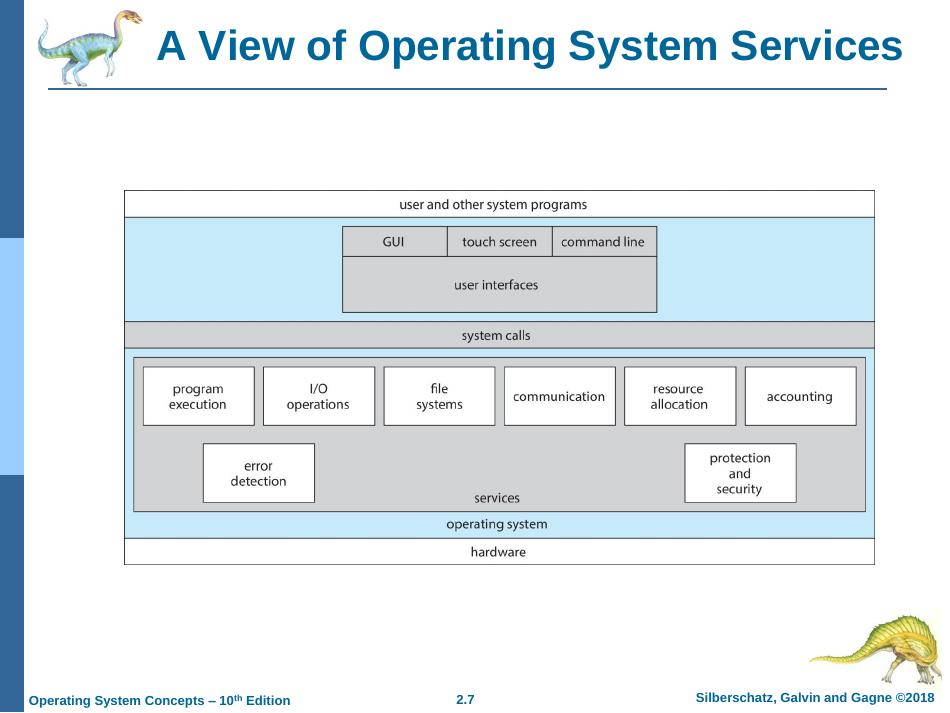

Sistem operasi menyediakan cara berinteraksi dan layanan menjalankan program, I/O, berkas, komunikasi, serta penanganan galat. Di belakangnya ada alokasi sumber daya, pencatatan penggunaan, dan perlindungan. Cocokkan permintaan pengguna dengan layanan yang benar.

### Slide 008 — User Operating System Interface - CLI

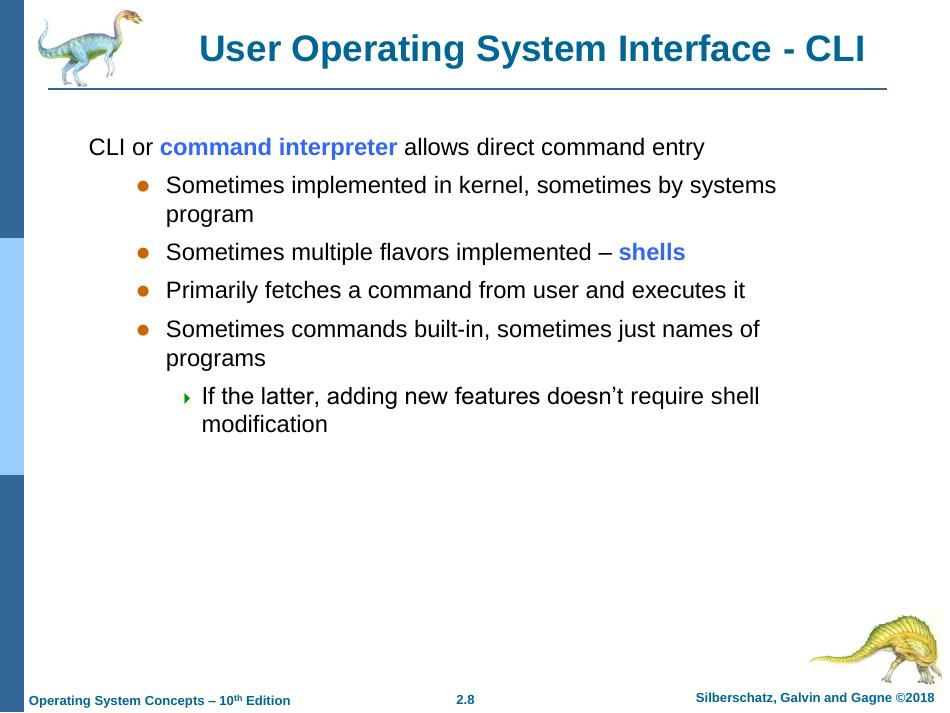

Sistem operasi menyediakan cara berinteraksi dan layanan menjalankan program, I/O, berkas, komunikasi, serta penanganan galat. Di belakangnya ada alokasi sumber daya, pencatatan penggunaan, dan perlindungan. Cocokkan permintaan pengguna dengan layanan yang benar.

**Perhatikan pada gambar:** CLI or command interpreter allows direct command entry; Sometimes implemented in kernel, sometimes by systems

### Slide 009 — Bourne Shell Command Interpreter

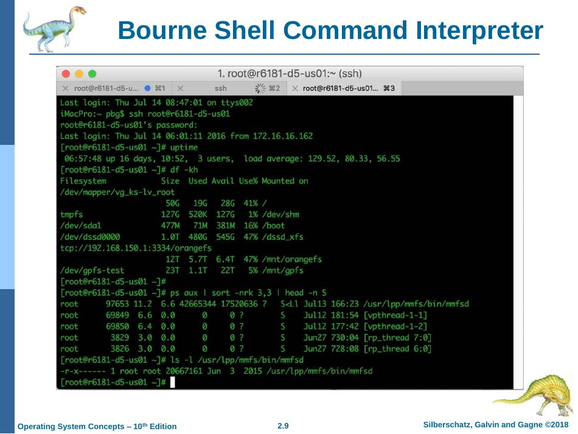

Sistem operasi menyediakan cara berinteraksi dan layanan menjalankan program, I/O, berkas, komunikasi, serta penanganan galat. Di belakangnya ada alokasi sumber daya, pencatatan penggunaan, dan perlindungan. Cocokkan permintaan pengguna dengan layanan yang benar.

### Slide 010 — User Operating System Interface - GUI

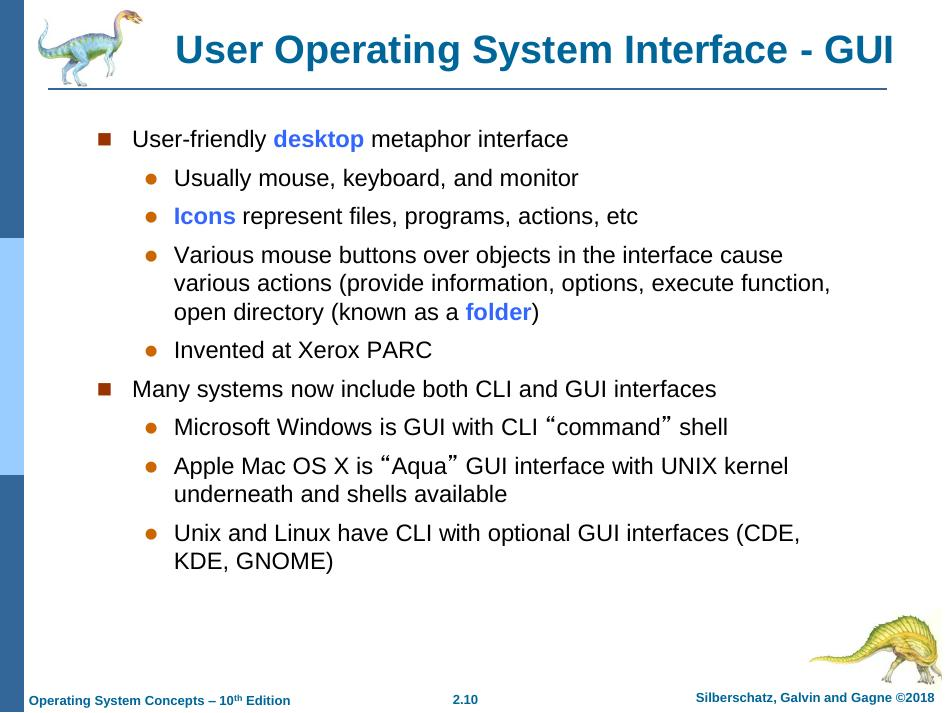

Sistem operasi menyediakan cara berinteraksi dan layanan menjalankan program, I/O, berkas, komunikasi, serta penanganan galat. Di belakangnya ada alokasi sumber daya, pencatatan penggunaan, dan perlindungan. Cocokkan permintaan pengguna dengan layanan yang benar.

**Perhatikan pada gambar:** User-friendly desktop metaphor interface; Usually mouse, keyboard, and monitor

### Slide 011 — Touchscreen Interfaces

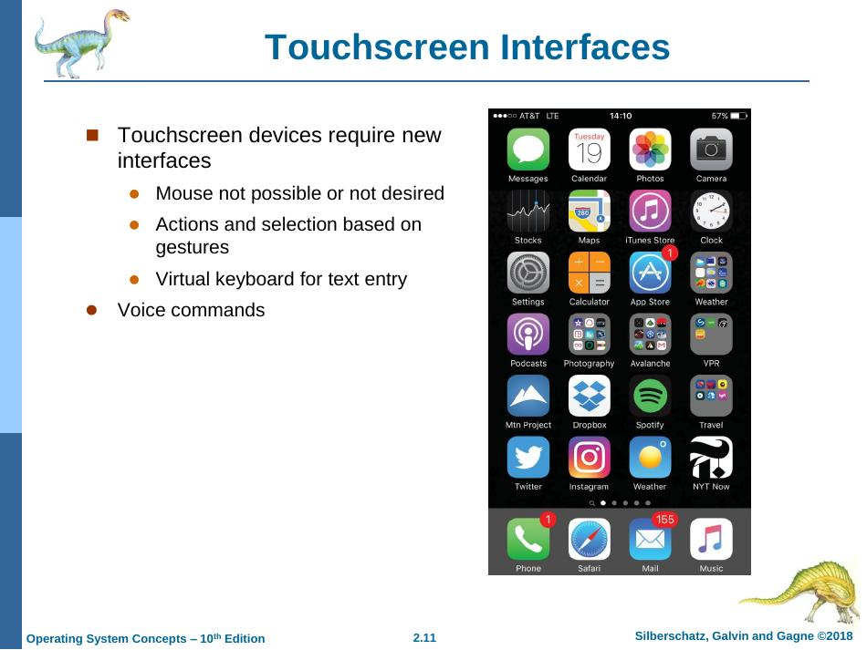

Sistem operasi menyediakan cara berinteraksi dan layanan menjalankan program, I/O, berkas, komunikasi, serta penanganan galat. Di belakangnya ada alokasi sumber daya, pencatatan penggunaan, dan perlindungan. Cocokkan permintaan pengguna dengan layanan yang benar.

**Perhatikan pada gambar:** Touchscreen devices require new; Mouse not possible or not desired

### Slide 012 — The Mac OS X GUI

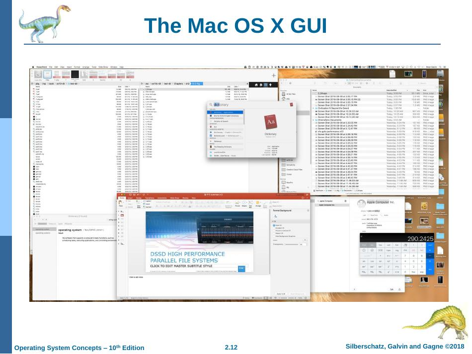

Sistem operasi menyediakan cara berinteraksi dan layanan menjalankan program, I/O, berkas, komunikasi, serta penanganan galat. Di belakangnya ada alokasi sumber daya, pencatatan penggunaan, dan perlindungan. Cocokkan permintaan pengguna dengan layanan yang benar.

### Slide 013 — System Calls

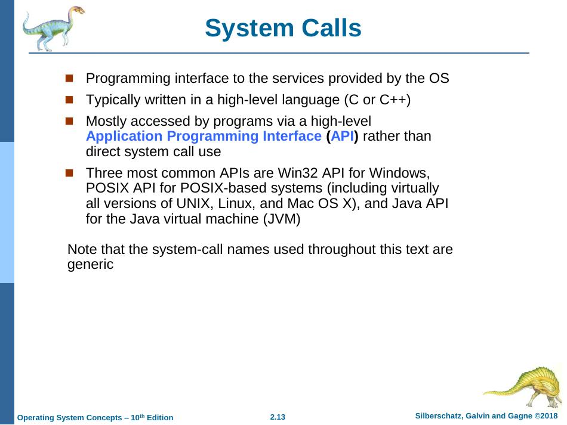

Aplikasi meminta kerja kernel lewat system call. CPU berpindah ke kernel mode untuk menjalankan layanan yang butuh hak istimewa, lalu kembali ke user mode; API adalah antarmuka pemrograman yang sering membungkus panggilan itu. Parameter dapat lewat register, blok memori, atau stack.

**Perhatikan pada gambar:** Programming interface to the services provided by the OS; Typically written in a high-level language (C or C++)

### Slide 014 — Example of System Calls

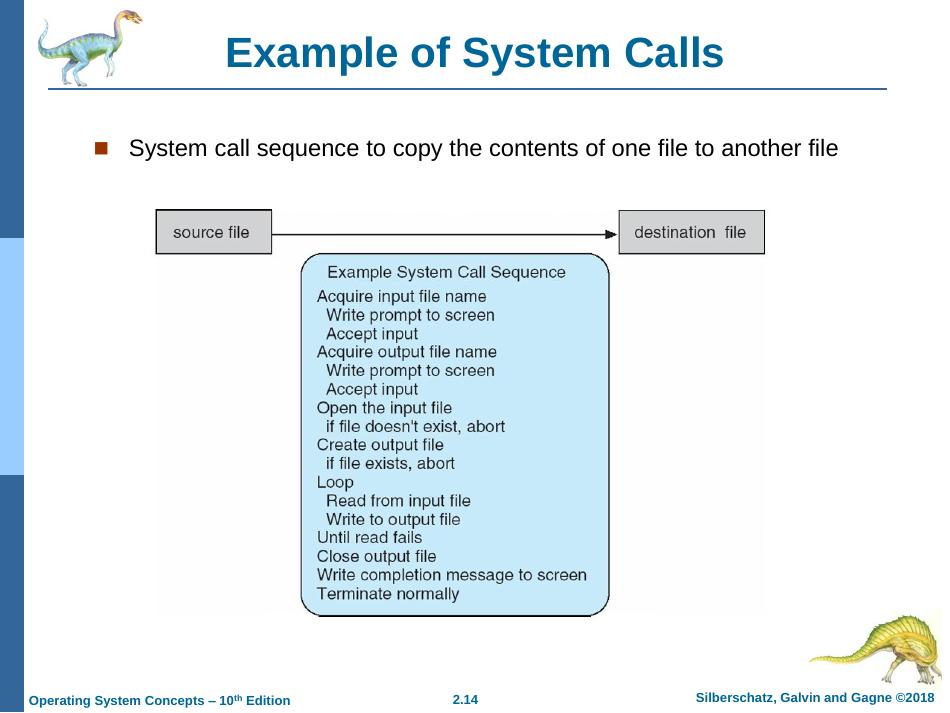

Aplikasi meminta kerja kernel lewat system call. CPU berpindah ke kernel mode untuk menjalankan layanan yang butuh hak istimewa, lalu kembali ke user mode; API adalah antarmuka pemrograman yang sering membungkus panggilan itu. Parameter dapat lewat register, blok memori, atau stack.

**Perhatikan pada gambar:** System call sequence to copy the contents of one file to another file

### Slide 015 — Example of Standard API

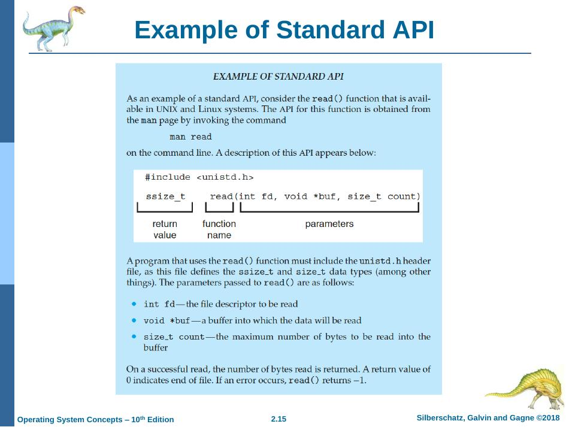

Aplikasi meminta kerja kernel lewat system call. CPU berpindah ke kernel mode untuk menjalankan layanan yang butuh hak istimewa, lalu kembali ke user mode; API adalah antarmuka pemrograman yang sering membungkus panggilan itu. Parameter dapat lewat register, blok memori, atau stack.

### Slide 016 — System Call Implementation

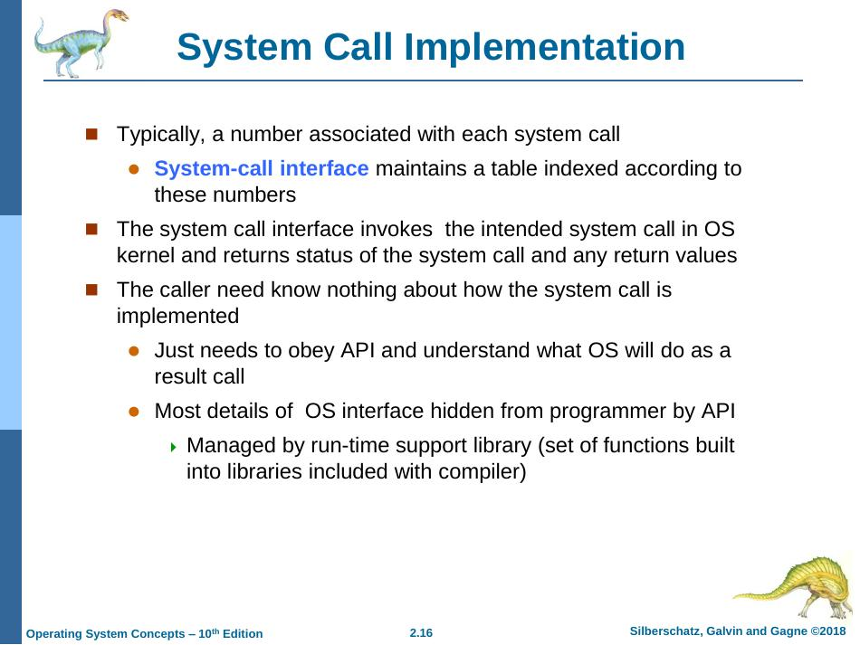

Aplikasi meminta kerja kernel lewat system call. CPU berpindah ke kernel mode untuk menjalankan layanan yang butuh hak istimewa, lalu kembali ke user mode; API adalah antarmuka pemrograman yang sering membungkus panggilan itu. Parameter dapat lewat register, blok memori, atau stack.

**Perhatikan pada gambar:** Typically, a number associated with each system call; System-call interface maintains a table indexed according to

### Slide 017 — API – System Call – OS Relationship

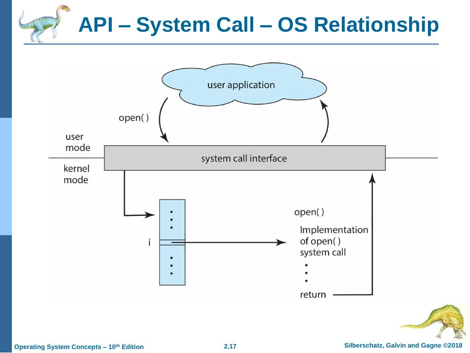

Aplikasi meminta kerja kernel lewat system call. CPU berpindah ke kernel mode untuk menjalankan layanan yang butuh hak istimewa, lalu kembali ke user mode; API adalah antarmuka pemrograman yang sering membungkus panggilan itu. Parameter dapat lewat register, blok memori, atau stack.

### Slide 018 — System Call Parameter Passing

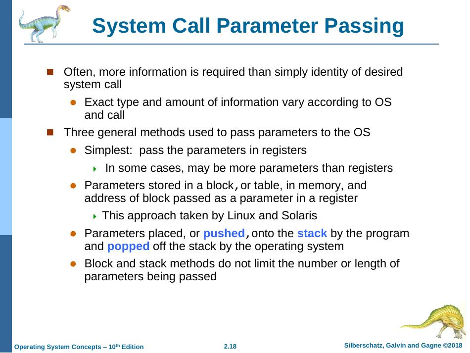

Aplikasi meminta kerja kernel lewat system call. CPU berpindah ke kernel mode untuk menjalankan layanan yang butuh hak istimewa, lalu kembali ke user mode; API adalah antarmuka pemrograman yang sering membungkus panggilan itu. Parameter dapat lewat register, blok memori, atau stack.

**Perhatikan pada gambar:** Often, more information is required than simply identity of desired; Exact type and amount of information vary according to OS

### Slide 019 — Parameter Passing via Table

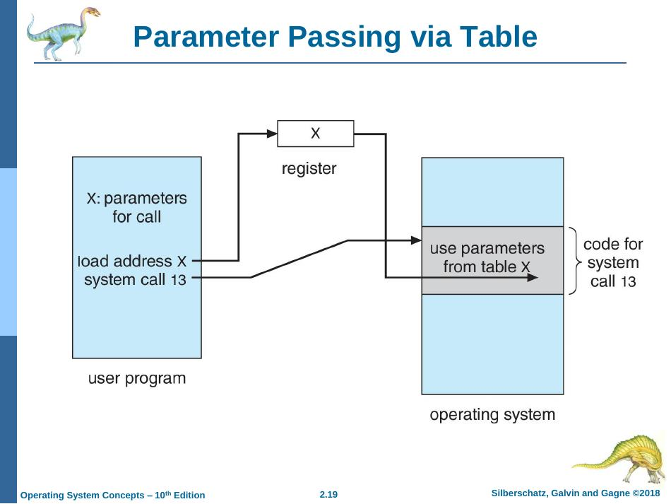

Aplikasi meminta kerja kernel lewat system call. CPU berpindah ke kernel mode untuk menjalankan layanan yang butuh hak istimewa, lalu kembali ke user mode; API adalah antarmuka pemrograman yang sering membungkus panggilan itu. Parameter dapat lewat register, blok memori, atau stack.

### Slide 020 — Types of System Calls

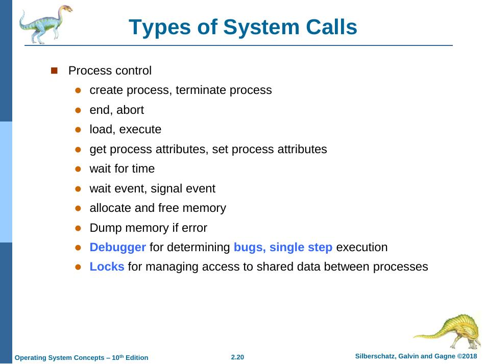

Aplikasi meminta kerja kernel lewat system call. CPU berpindah ke kernel mode untuk menjalankan layanan yang butuh hak istimewa, lalu kembali ke user mode; API adalah antarmuka pemrograman yang sering membungkus panggilan itu. Parameter dapat lewat register, blok memori, atau stack.

**Perhatikan pada gambar:** create process, terminate process; get process attributes, set process attributes

### Slide 021 — Types of System Calls (cont.)

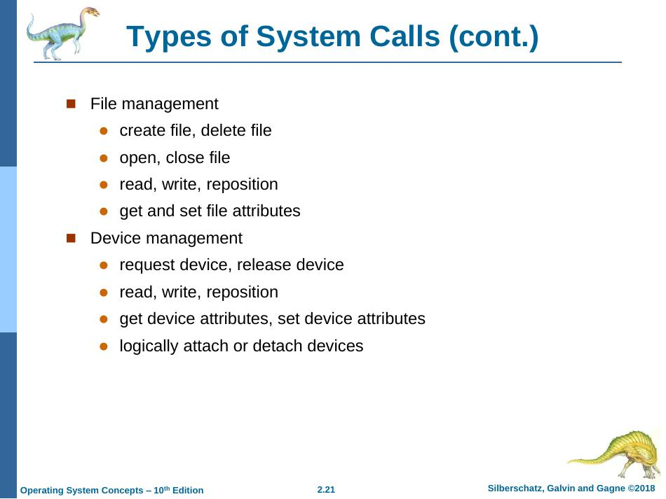

Aplikasi meminta kerja kernel lewat system call. CPU berpindah ke kernel mode untuk menjalankan layanan yang butuh hak istimewa, lalu kembali ke user mode; API adalah antarmuka pemrograman yang sering membungkus panggilan itu. Parameter dapat lewat register, blok memori, atau stack.

**Perhatikan pada gambar:** create file, delete file; read, write, reposition

### Slide 022 — Types of System Calls (Cont.)

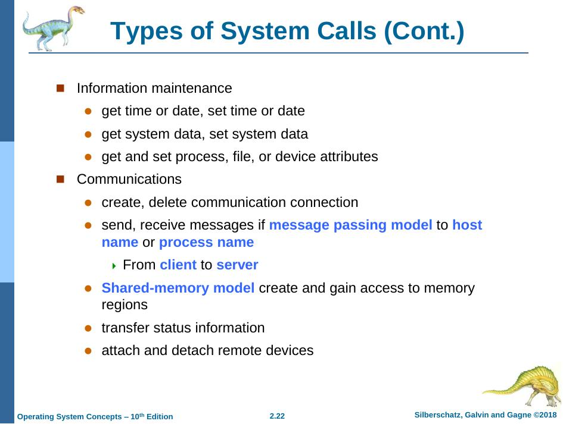

Aplikasi meminta kerja kernel lewat system call. CPU berpindah ke kernel mode untuk menjalankan layanan yang butuh hak istimewa, lalu kembali ke user mode; API adalah antarmuka pemrograman yang sering membungkus panggilan itu. Parameter dapat lewat register, blok memori, atau stack.

**Perhatikan pada gambar:** Information maintenance; get time or date, set time or date

### Slide 023 — Types of System Calls (Cont.)

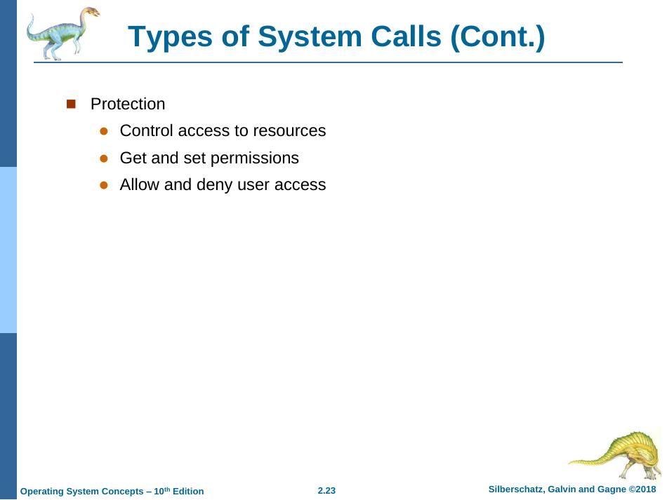

Aplikasi meminta kerja kernel lewat system call. CPU berpindah ke kernel mode untuk menjalankan layanan yang butuh hak istimewa, lalu kembali ke user mode; API adalah antarmuka pemrograman yang sering membungkus panggilan itu. Parameter dapat lewat register, blok memori, atau stack.

**Perhatikan pada gambar:** Control access to resources; Get and set permissions

### Slide 024 — Examples of Windows and Unix System Calls

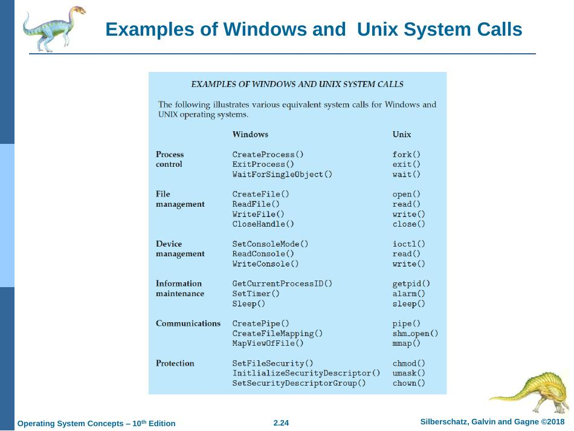

Aplikasi meminta kerja kernel lewat system call. CPU berpindah ke kernel mode untuk menjalankan layanan yang butuh hak istimewa, lalu kembali ke user mode; API adalah antarmuka pemrograman yang sering membungkus panggilan itu. Parameter dapat lewat register, blok memori, atau stack.

### Slide 025 — Standard C Library Example

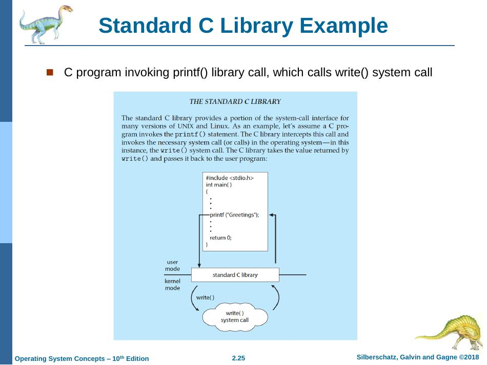

Linker menyatukan modul dan rujukan simbol menjadi program yang dapat dimuat. Loader menempatkan program ke memori dan menyiapkannya untuk berjalan. Pustaka dinamis dihubungkan saat pemuatan atau saat dibutuhkan, sehingga kode pustaka dapat dipakai bersama.

**Perhatikan pada gambar:** C program invoking printf() library call, which calls write() system call

### Slide 026 — Example: Arduino

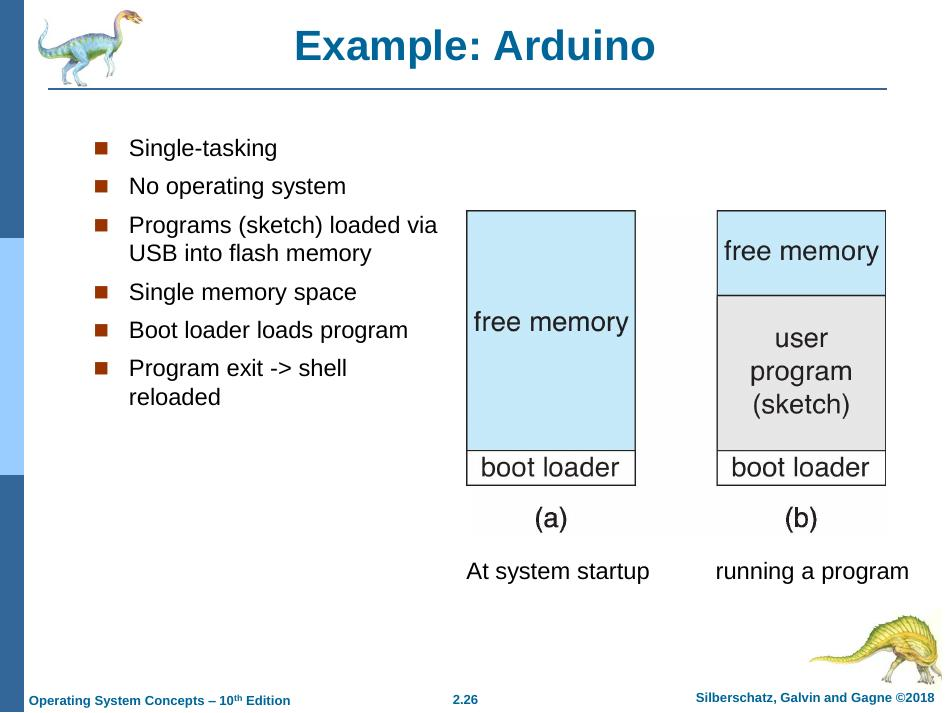

Slide ini memberi contoh tambahan untuk bagian tersebut. Perhatikan urutan pada gambar: identifikasi pelaku, sumber daya yang dipakai, lalu perubahan keadaan setelah setiap langkah. Hubungkan dengan slide sebelumnya sebelum menghafal istilahnya.

**Perhatikan pada gambar:** Programs (sketch) loaded via; Boot loader loads program

### Slide 027 — Example: FreeBSD

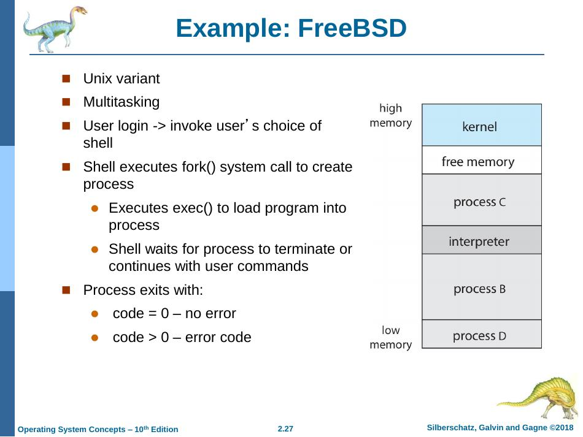

Slide ini memberi contoh tambahan untuk bagian tersebut. Perhatikan urutan pada gambar: identifikasi pelaku, sumber daya yang dipakai, lalu perubahan keadaan setelah setiap langkah. Hubungkan dengan slide sebelumnya sebelum menghafal istilahnya.

**Perhatikan pada gambar:** User login -> invoke user’s choice of; Shell executes fork() system call to create

### Slide 028 — System Services

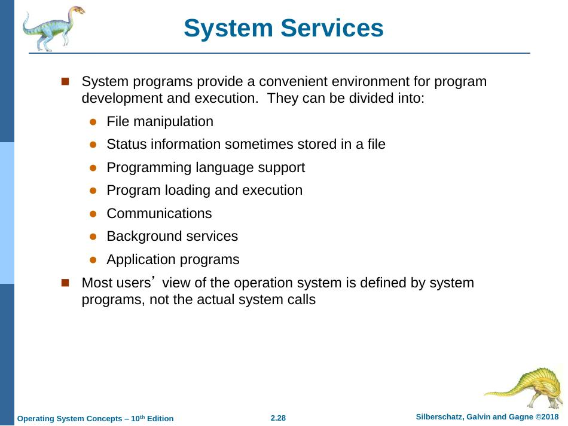

Sistem operasi menyediakan cara berinteraksi dan layanan menjalankan program, I/O, berkas, komunikasi, serta penanganan galat. Di belakangnya ada alokasi sumber daya, pencatatan penggunaan, dan perlindungan. Cocokkan permintaan pengguna dengan layanan yang benar.

**Perhatikan pada gambar:** System programs provide a convenient environment for program; development and execution. They can be divided into:

### Slide 029 — System Services (cont.)

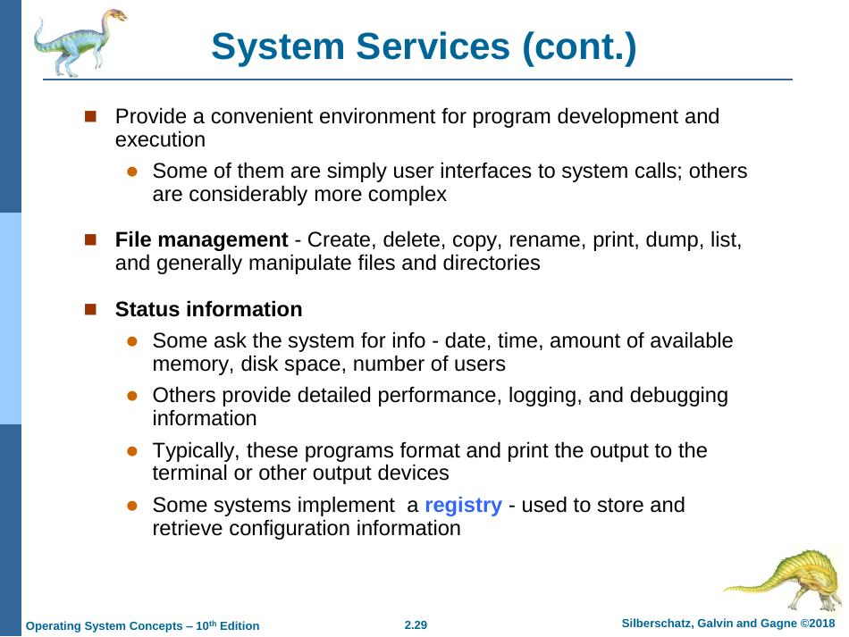

Sistem operasi menyediakan cara berinteraksi dan layanan menjalankan program, I/O, berkas, komunikasi, serta penanganan galat. Di belakangnya ada alokasi sumber daya, pencatatan penggunaan, dan perlindungan. Cocokkan permintaan pengguna dengan layanan yang benar.

**Perhatikan pada gambar:** Provide a convenient environment for program development and; Some of them are simply user interfaces to system calls; others

### Slide 030 — System Services (Cont.)

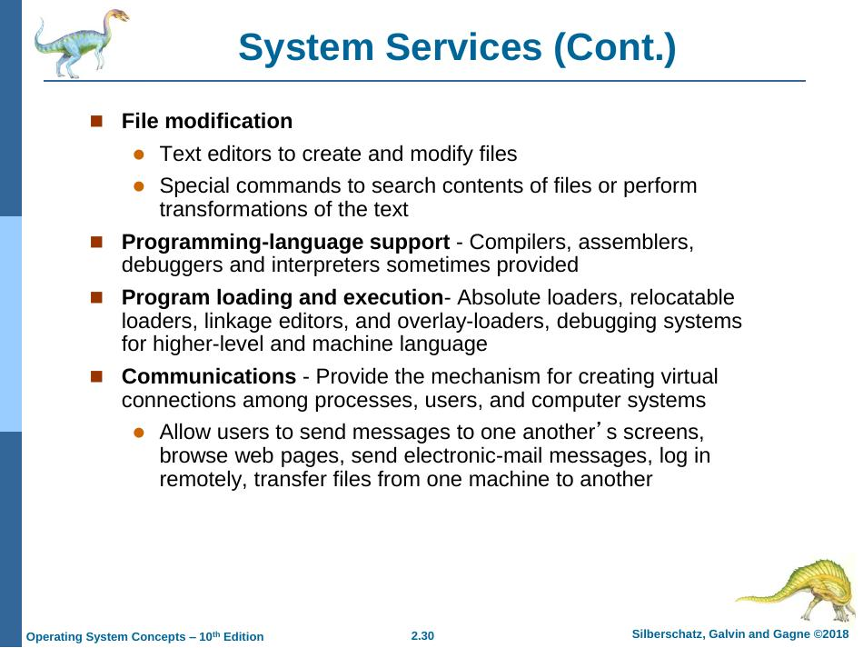

Sistem operasi menyediakan cara berinteraksi dan layanan menjalankan program, I/O, berkas, komunikasi, serta penanganan galat. Di belakangnya ada alokasi sumber daya, pencatatan penggunaan, dan perlindungan. Cocokkan permintaan pengguna dengan layanan yang benar.

**Perhatikan pada gambar:** Text editors to create and modify files; Special commands to search contents of files or perform

### Slide 031 — System Services (Cont.)

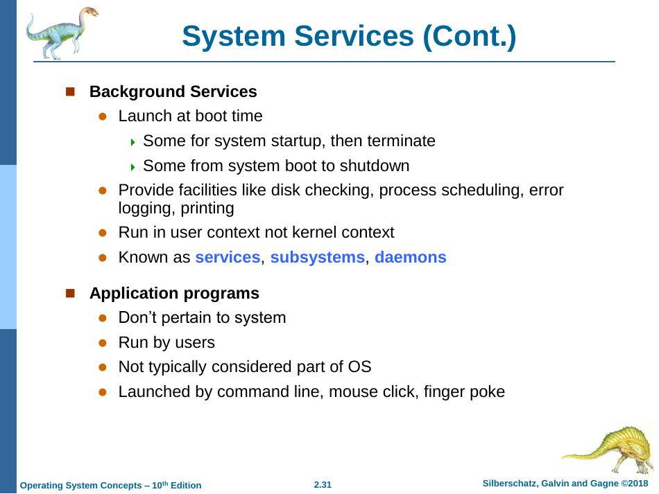

Sistem operasi menyediakan cara berinteraksi dan layanan menjalankan program, I/O, berkas, komunikasi, serta penanganan galat. Di belakangnya ada alokasi sumber daya, pencatatan penggunaan, dan perlindungan. Cocokkan permintaan pengguna dengan layanan yang benar.

**Perhatikan pada gambar:** Provide facilities like disk checking, process scheduling, error; Run in user context not kernel context

### Slide 032 — Linkers and Loaders

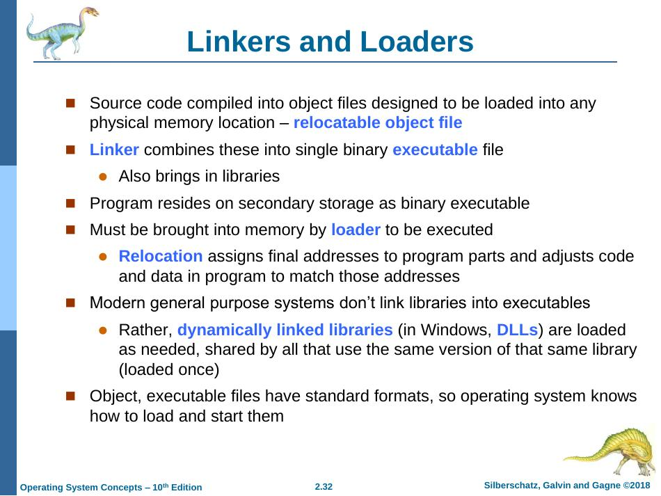

Linker menyatukan modul dan rujukan simbol menjadi program yang dapat dimuat. Loader menempatkan program ke memori dan menyiapkannya untuk berjalan. Pustaka dinamis dihubungkan saat pemuatan atau saat dibutuhkan, sehingga kode pustaka dapat dipakai bersama.

**Perhatikan pada gambar:** Source code compiled into object files designed to be loaded into any; physical memory location – relocatable object file

### Slide 033 — The Role of the Linker and Loader

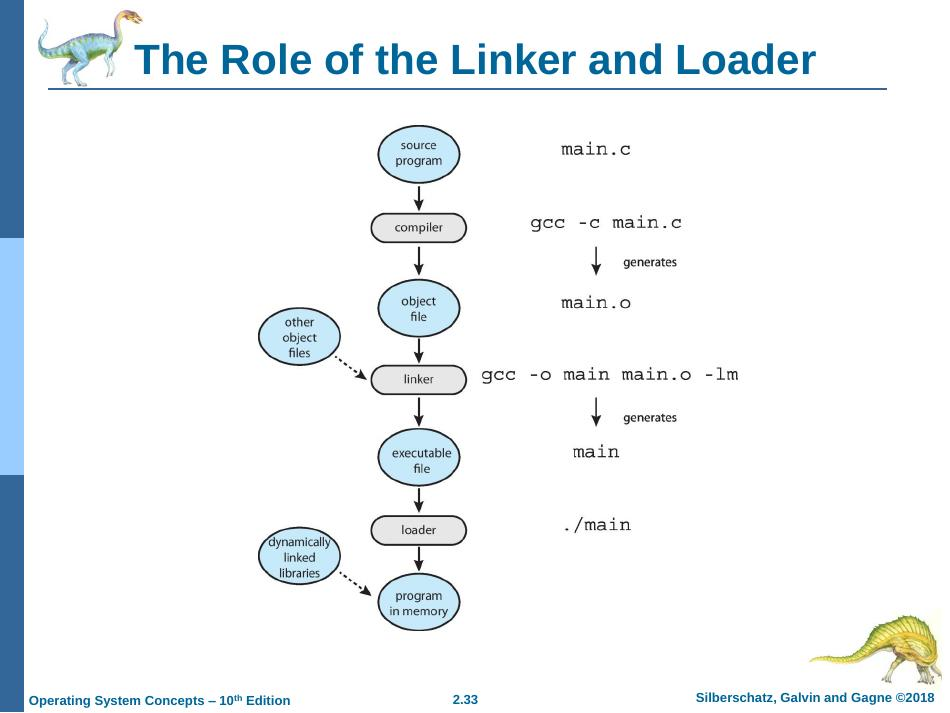

Linker menyatukan modul dan rujukan simbol menjadi program yang dapat dimuat. Loader menempatkan program ke memori dan menyiapkannya untuk berjalan. Pustaka dinamis dihubungkan saat pemuatan atau saat dibutuhkan, sehingga kode pustaka dapat dipakai bersama.

### Slide 034 — Why Applications are Operating System Specific

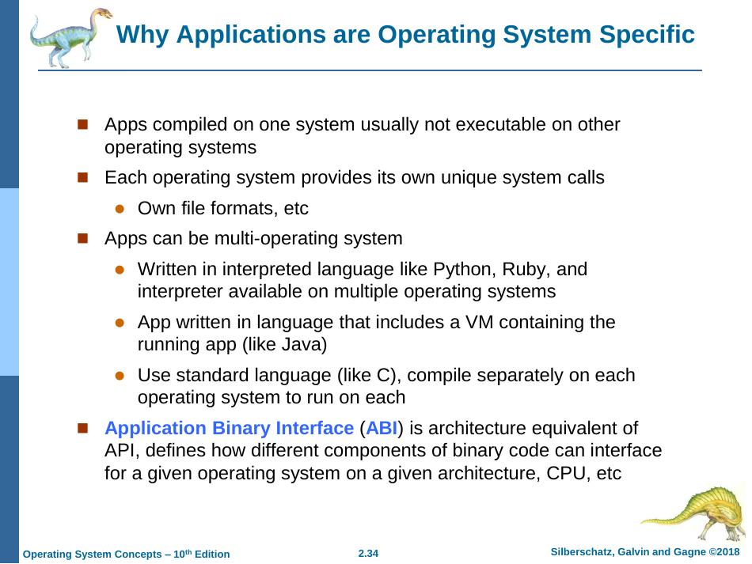

Slide ini memberi contoh tambahan untuk bagian tersebut. Perhatikan urutan pada gambar: identifikasi pelaku, sumber daya yang dipakai, lalu perubahan keadaan setelah setiap langkah. Hubungkan dengan slide sebelumnya sebelum menghafal istilahnya.

**Perhatikan pada gambar:** Apps compiled on one system usually not executable on other; Each operating system provides its own unique system calls

### Slide 035 — Operating System Design and Implementation

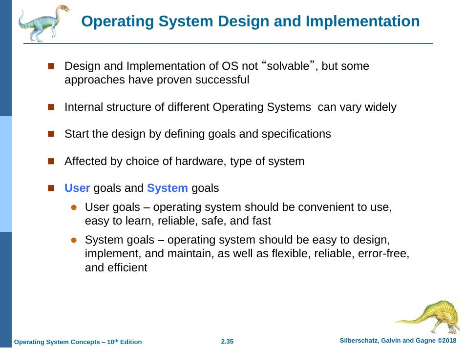

Mekanisme adalah cara sistem melakukan sesuatu; kebijakan menentukan pilihan mana yang diambil. Contohnya, mekanisme timer memberi kesempatan menjadwalkan ulang, sedangkan kebijakan penjadwal memilih proses berikutnya.

**Perhatikan pada gambar:** Design and Implementation of OS not “solvable”, but some; approaches have proven successful

### Slide 036 — Operating System Design and Implementation (Cont.)

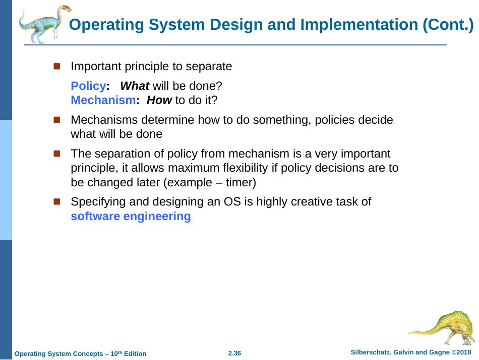

Mekanisme adalah cara sistem melakukan sesuatu; kebijakan menentukan pilihan mana yang diambil. Contohnya, mekanisme timer memberi kesempatan menjadwalkan ulang, sedangkan kebijakan penjadwal memilih proses berikutnya.

**Perhatikan pada gambar:** Important principle to separate; Policy: What will be done?

### Slide 037 — Implementation

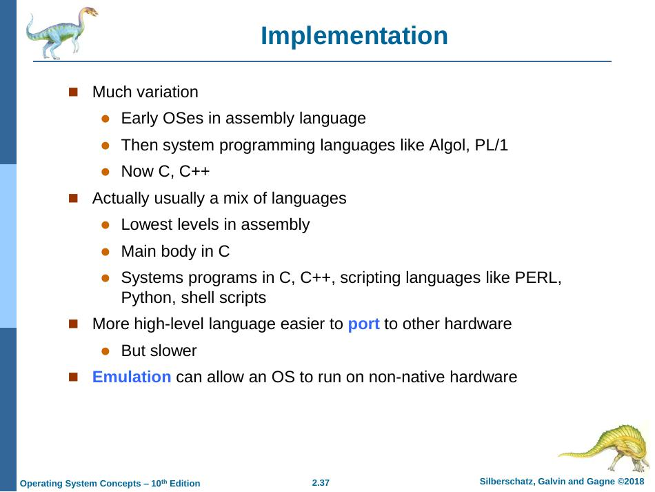

Mekanisme adalah cara sistem melakukan sesuatu; kebijakan menentukan pilihan mana yang diambil. Contohnya, mekanisme timer memberi kesempatan menjadwalkan ulang, sedangkan kebijakan penjadwal memilih proses berikutnya.

**Perhatikan pada gambar:** Early OSes in assembly language; Then system programming languages like Algol, PL/1

### Slide 038 — Operating System Structure

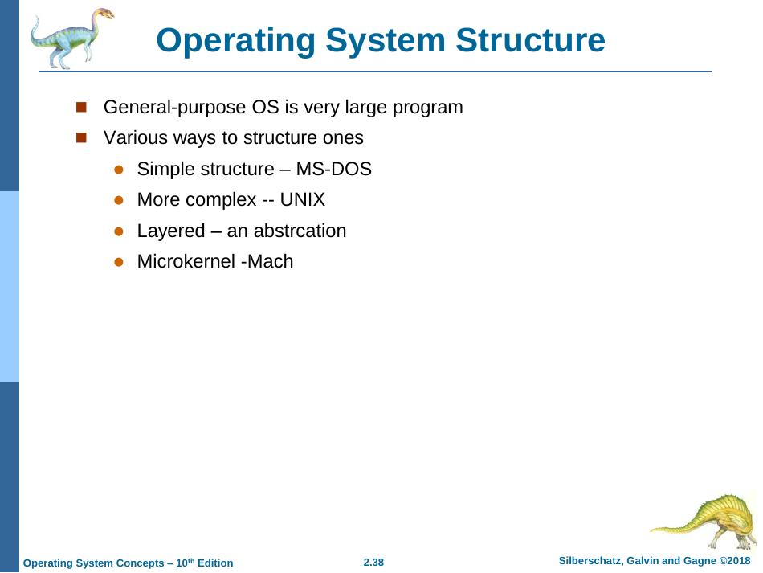

Struktur monolitik menaruh banyak layanan di kernel sehingga komunikasi antarkomponen cepat tetapi batas kegagalannya luas. Struktur berlapis memisahkan tanggung jawab; microkernel memindahkan lebih banyak layanan ke luar kernel; modul dapat dimuat saat perlu. Bandingkan fleksibilitas, isolasi, dan biaya komunikasi.

**Perhatikan pada gambar:** General-purpose OS is very large program; Various ways to structure ones

### Slide 039 — Monolithic Structure – Original UNIX

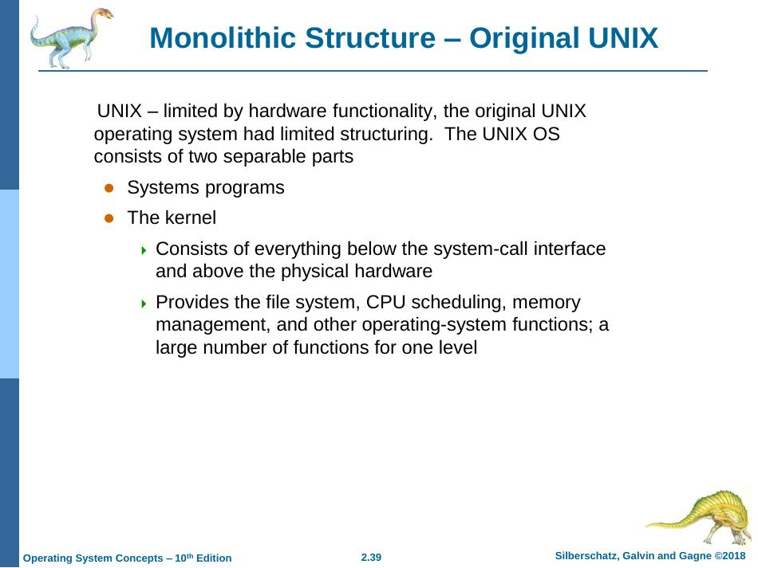

Struktur monolitik menaruh banyak layanan di kernel sehingga komunikasi antarkomponen cepat tetapi batas kegagalannya luas. Struktur berlapis memisahkan tanggung jawab; microkernel memindahkan lebih banyak layanan ke luar kernel; modul dapat dimuat saat perlu. Bandingkan fleksibilitas, isolasi, dan biaya komunikasi.

**Perhatikan pada gambar:** UNIX – limited by hardware functionality, the original UNIX; operating system had limited structuring. The UNIX OS

### Slide 040 — Traditional UNIX System Structure

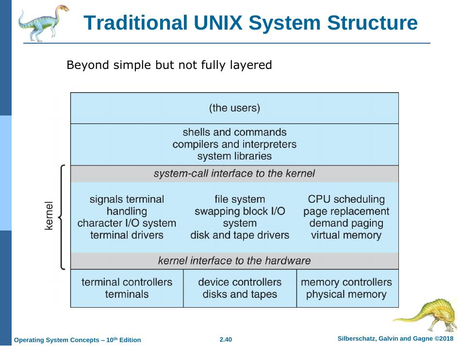

Struktur monolitik menaruh banyak layanan di kernel sehingga komunikasi antarkomponen cepat tetapi batas kegagalannya luas. Struktur berlapis memisahkan tanggung jawab; microkernel memindahkan lebih banyak layanan ke luar kernel; modul dapat dimuat saat perlu. Bandingkan fleksibilitas, isolasi, dan biaya komunikasi.

**Perhatikan pada gambar:** Beyond simple but not fully layered

### Slide 041 — Linux System Structure

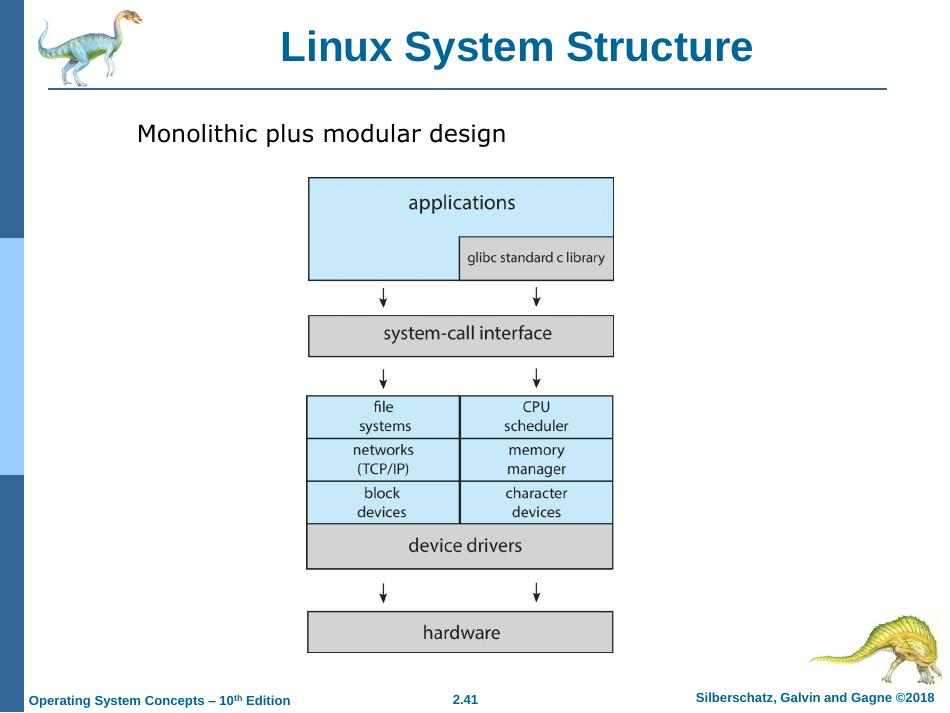

Struktur monolitik menaruh banyak layanan di kernel sehingga komunikasi antarkomponen cepat tetapi batas kegagalannya luas. Struktur berlapis memisahkan tanggung jawab; microkernel memindahkan lebih banyak layanan ke luar kernel; modul dapat dimuat saat perlu. Bandingkan fleksibilitas, isolasi, dan biaya komunikasi.

**Perhatikan pada gambar:** Monolithic plus modular design

### Slide 042 — Layered Approach

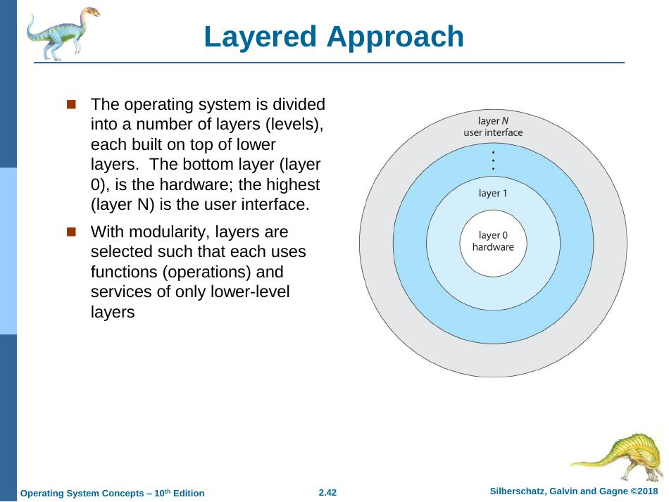

Struktur monolitik menaruh banyak layanan di kernel sehingga komunikasi antarkomponen cepat tetapi batas kegagalannya luas. Struktur berlapis memisahkan tanggung jawab; microkernel memindahkan lebih banyak layanan ke luar kernel; modul dapat dimuat saat perlu. Bandingkan fleksibilitas, isolasi, dan biaya komunikasi.

**Perhatikan pada gambar:** The operating system is divided; into a number of layers (levels),

### Slide 043 — Microkernels

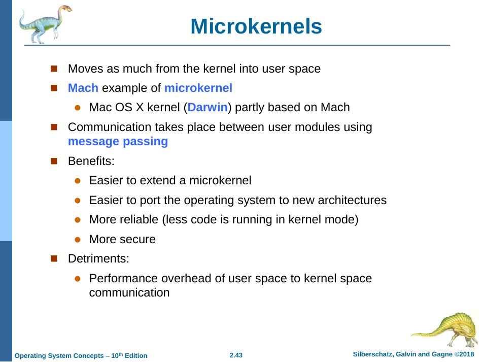

Struktur monolitik menaruh banyak layanan di kernel sehingga komunikasi antarkomponen cepat tetapi batas kegagalannya luas. Struktur berlapis memisahkan tanggung jawab; microkernel memindahkan lebih banyak layanan ke luar kernel; modul dapat dimuat saat perlu. Bandingkan fleksibilitas, isolasi, dan biaya komunikasi.

**Perhatikan pada gambar:** Moves as much from the kernel into user space; Mach example of microkernel

### Slide 044 — Microkernel System Structure

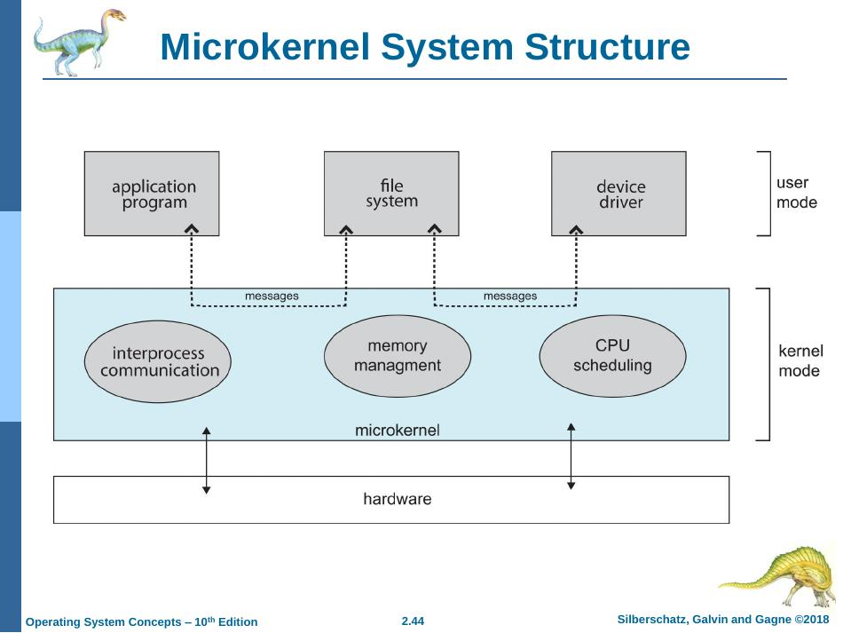

Struktur monolitik menaruh banyak layanan di kernel sehingga komunikasi antarkomponen cepat tetapi batas kegagalannya luas. Struktur berlapis memisahkan tanggung jawab; microkernel memindahkan lebih banyak layanan ke luar kernel; modul dapat dimuat saat perlu. Bandingkan fleksibilitas, isolasi, dan biaya komunikasi.

### Slide 045 — Modules

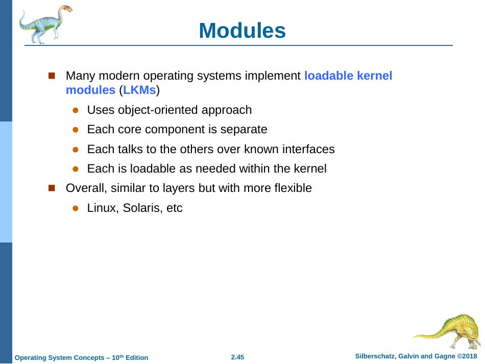

Struktur monolitik menaruh banyak layanan di kernel sehingga komunikasi antarkomponen cepat tetapi batas kegagalannya luas. Struktur berlapis memisahkan tanggung jawab; microkernel memindahkan lebih banyak layanan ke luar kernel; modul dapat dimuat saat perlu. Bandingkan fleksibilitas, isolasi, dan biaya komunikasi.

**Perhatikan pada gambar:** Many modern operating systems implement loadable kernel; Uses object-oriented approach

### Slide 046 — Hybrid Systems

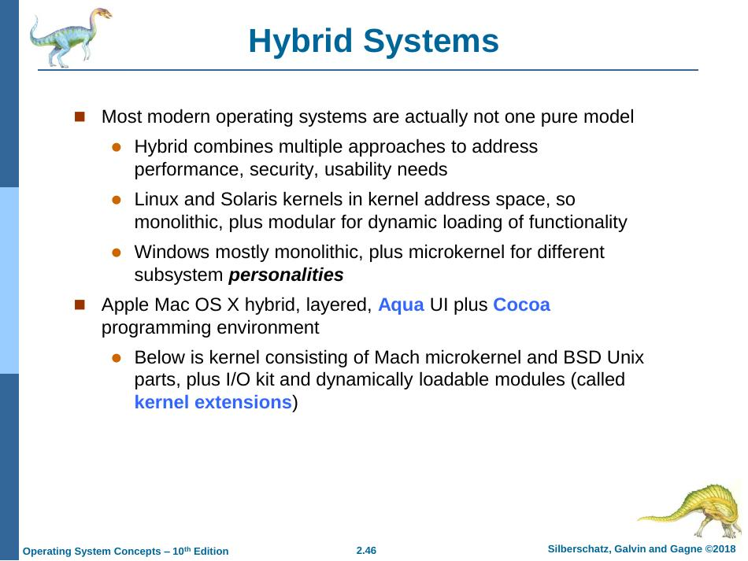

Struktur monolitik menaruh banyak layanan di kernel sehingga komunikasi antarkomponen cepat tetapi batas kegagalannya luas. Struktur berlapis memisahkan tanggung jawab; microkernel memindahkan lebih banyak layanan ke luar kernel; modul dapat dimuat saat perlu. Bandingkan fleksibilitas, isolasi, dan biaya komunikasi.

**Perhatikan pada gambar:** Most modern operating systems are actually not one pure model; Hybrid combines multiple approaches to address

### Slide 047 — macOS and iOS Structure

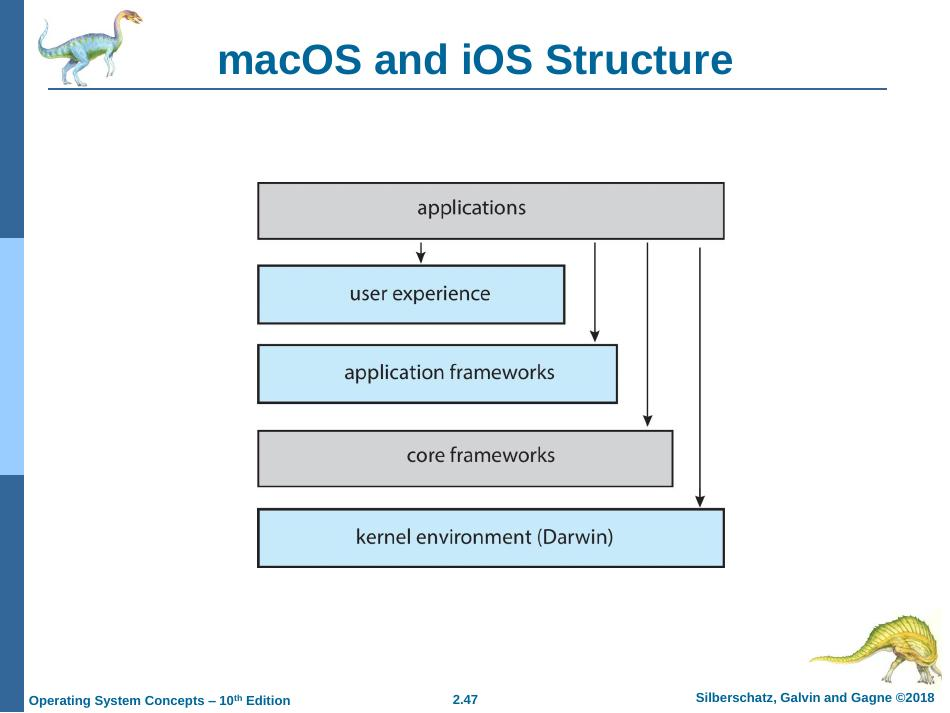

Struktur monolitik menaruh banyak layanan di kernel sehingga komunikasi antarkomponen cepat tetapi batas kegagalannya luas. Struktur berlapis memisahkan tanggung jawab; microkernel memindahkan lebih banyak layanan ke luar kernel; modul dapat dimuat saat perlu. Bandingkan fleksibilitas, isolasi, dan biaya komunikasi.

### Slide 048 — Darwin

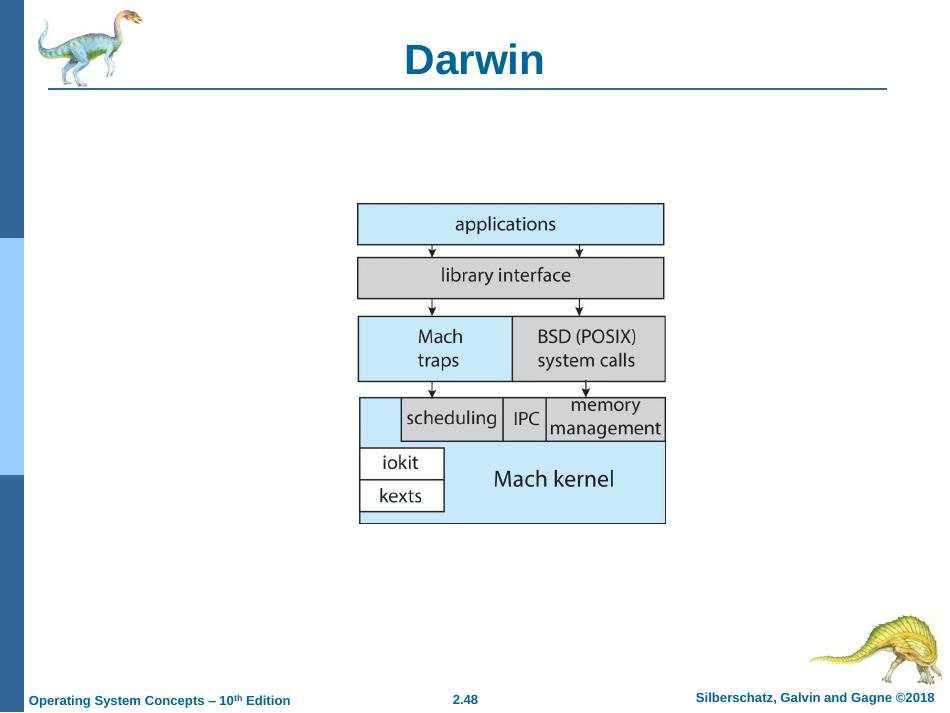

Slide ini memberi contoh tambahan untuk bagian tersebut. Perhatikan urutan pada gambar: identifikasi pelaku, sumber daya yang dipakai, lalu perubahan keadaan setelah setiap langkah. Hubungkan dengan slide sebelumnya sebelum menghafal istilahnya.

### Slide 049 — Android

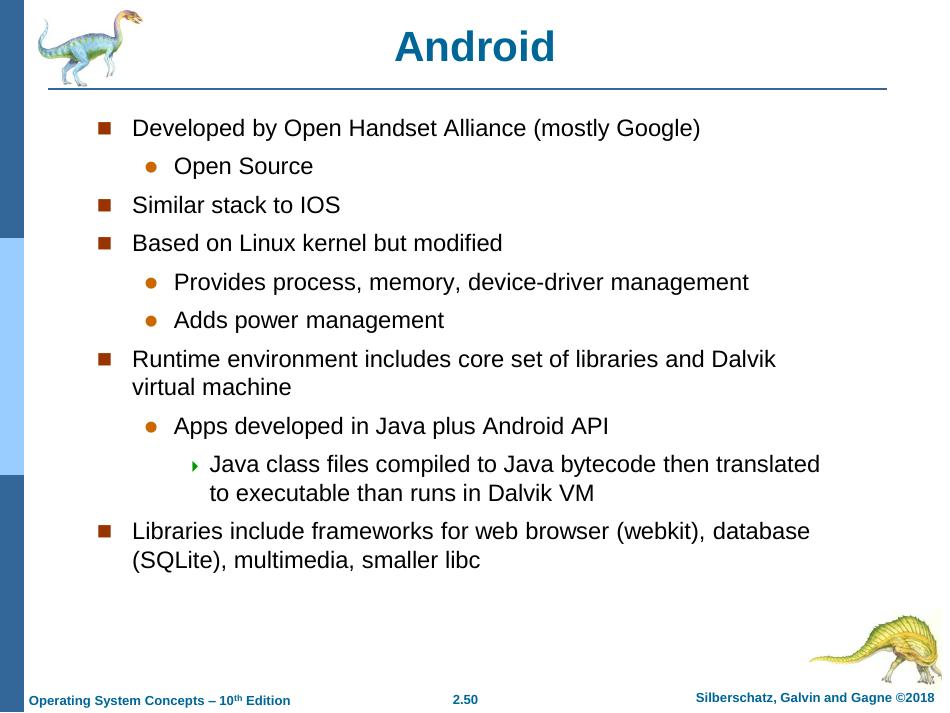

Slide ini memberi contoh tambahan untuk bagian tersebut. Perhatikan urutan pada gambar: identifikasi pelaku, sumber daya yang dipakai, lalu perubahan keadaan setelah setiap langkah. Hubungkan dengan slide sebelumnya sebelum menghafal istilahnya.

**Perhatikan pada gambar:** Developed by Open Handset Alliance (mostly Google); Based on Linux kernel but modified

### Slide 050 — Android Architecture

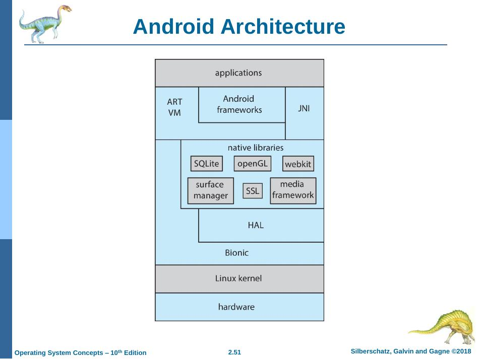

Slide ini memberi contoh tambahan untuk bagian tersebut. Perhatikan urutan pada gambar: identifikasi pelaku, sumber daya yang dipakai, lalu perubahan keadaan setelah setiap langkah. Hubungkan dengan slide sebelumnya sebelum menghafal istilahnya.

### Slide 051 — Building and Booting an Operating System

Saat komputer menyala, firmware memulai boot loader. Boot loader memuat kernel; kernel menyiapkan memori, perangkat, dan layanan awal. Bedakan tahap pemuatan sistem ini dari menjalankan aplikasi biasa.

**Perhatikan pada gambar:** Operating systems generally designed to run on a class of systems; with variety of perpherals

### Slide 052 — Building and Booting Linux

Saat komputer menyala, firmware memulai boot loader. Boot loader memuat kernel; kernel menyiapkan memori, perangkat, dan layanan awal. Bedakan tahap pemuatan sistem ini dari menjalankan aplikasi biasa.

**Perhatikan pada gambar:** Download Linux source code (http://www.kernel.org); Configure kernel via “make menuconfig”

### Slide 053 — System Boot

Saat komputer menyala, firmware memulai boot loader. Boot loader memuat kernel; kernel menyiapkan memori, perangkat, dan layanan awal. Bedakan tahap pemuatan sistem ini dari menjalankan aplikasi biasa.

**Perhatikan pada gambar:** When power initialized on system, execution starts at a fixed memory; Operating system must be made available to hardware so hardware can

### Slide 054 — Operating-System Debugging

Pengukuran kinerja menunjukkan bagian yang benar-benar lambat. Tracing mencatat peristiwa saat sistem berjalan; debugging mencari penyebab galat. Data hasil ukur lebih kuat daripada menebak dari gejala.

**Perhatikan pada gambar:** Debugging is finding and fixing errors, or bugs; Also performance tuning

### Slide 055 — Performance Tuning

Pengukuran kinerja menunjukkan bagian yang benar-benar lambat. Tracing mencatat peristiwa saat sistem berjalan; debugging mencari penyebab galat. Data hasil ukur lebih kuat daripada menebak dari gejala.

**Perhatikan pada gambar:** Improve performance by removing bottlenecks; OS must provide means of computing and displaying measures of system

### Slide 056 — Tracing

Pengukuran kinerja menunjukkan bagian yang benar-benar lambat. Tracing mencatat peristiwa saat sistem berjalan; debugging mencari penyebab galat. Data hasil ukur lebih kuat daripada menebak dari gejala.

**Perhatikan pada gambar:** Collects data for a specific event, such as steps involved in a system; strace – trace system calls invoked by a process

### Slide 057 — BCC

Pengukuran kinerja menunjukkan bagian yang benar-benar lambat. Tracing mencatat peristiwa saat sistem berjalan; debugging mencari penyebab galat. Data hasil ukur lebih kuat daripada menebak dari gejala.

**Perhatikan pada gambar:** Debugging interactions between user-level and kernel code nearly; impossible without toolset that understands both and an instrument

### Slide 058 — Linux bcc/BPF Tracing Tools

Pengukuran kinerja menunjukkan bagian yang benar-benar lambat. Tracing mencatat peristiwa saat sistem berjalan; debugging mencari penyebab galat. Data hasil ukur lebih kuat daripada menebak dari gejala.

### Slide 059 — End of Chapter 2

Slide ini memetakan posisi topik dalam bab. Pakai judul-judulnya sebagai daftar cek; utamakan hubungan sebab-akibat dan contoh, bukan hafalan urutan.

## Contoh soal dan pembahasan

### Contoh 1 — Membuat proses dari shell (adaptasi UTS 2018/2022)
**Soal.** Sebutkan panggilan yang diperlukan ketika shell menjalankan sebuah perintah dan menunggu hasilnya.

**Pembahasan.** Shell memanggil `fork()` untuk membuat anak. Pada cabang anak, `exec()` mengganti program anak dengan perintah yang diminta. Pada cabang induk, `wait()` menunggu dan mengambil status keluarnya anak. `exec()` yang berhasil tidak kembali ke kode program lama.

### Contoh 2 — Memilih desain kernel (latihan dari kisi-kisi)
**Soal.** Layanan driver mudah diganti dan kesalahan driver diharapkan lebih terisolasi. Desain apa yang paling sesuai?

**Pembahasan.** Microkernel menempatkan lebih banyak layanan di proses pengguna sehingga isolasi lebih kuat, tetapi komunikasi antarproses menambah biaya. Jika hanya butuh memasang fitur kernel saat diperlukan, modul kernel lebih langsung. Pilihan bergantung pada prioritas isolasi dan performa.

## Rujukan

- Slide kuliah `K2.pdf` halaman 1–59 dari paket Sensei.

- *Operating System Concepts*, edisi ke-10, Silberschatz, Galvin, dan Gagne, sebagaimana tercantum pada slide.

- `Kisi kisi.pdf` dan kumpulan contoh UTS 2018, 2019, 2021, 2022 dalam paket Sensei. Soal yang diberi label "adaptasi" mengikuti jenis/topik soal terdahulu; angka dan redaksinya tidak diklaim sama dengan soal asli.
