# Pertemuan 6 — Penjadwalan real-time, slide demi slide
Gambar mengikuti halaman 45–79 dari `K5 & K6.pdf` dalam paket Sensei. Nomor slide di bawah adalah halaman PDF asli. Pembahasan menekankan alur konsep; contoh hitungan di akhir memakai konvensi kisi-kisi.

**Fokus UTS:** Rate-monotonic, earliest-deadline-first, utilisasi, timeline, dan deadline miss.

## Pembahasan setiap slide

### Slide 045 — Real-Time CPU Scheduling

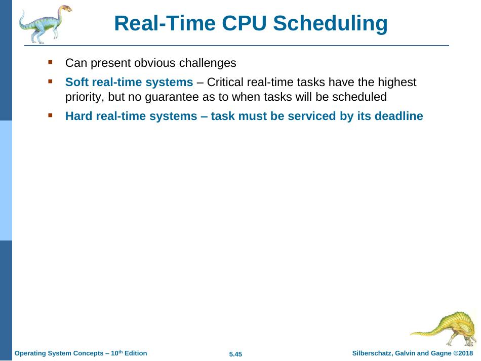

EDF memilih pekerjaan dengan deadline absolut terdekat dan dapat melakukan preemption. Untuk model satu CPU periodik ideal dengan deadline = periode, U ≤ 1 cukup untuk kelayakan EDF. Uji dengan timeline karena prioritas berubah pada setiap pelepasan pekerjaan.

**Perhatikan pada gambar:** ▪ Can present obvious challenges; ▪ Soft real-time systems – Critical real-time tasks have the highest

### Slide 046 — Real-Time CPU Scheduling

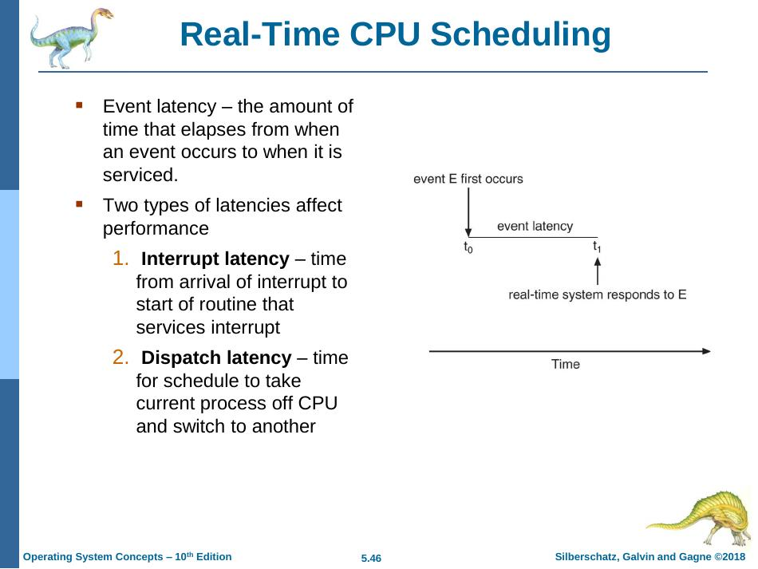

EDF memilih pekerjaan dengan deadline absolut terdekat dan dapat melakukan preemption. Untuk model satu CPU periodik ideal dengan deadline = periode, U ≤ 1 cukup untuk kelayakan EDF. Uji dengan timeline karena prioritas berubah pada setiap pelepasan pekerjaan.

**Perhatikan pada gambar:** ▪ Event latency – the amount of; time that elapses from when

### Slide 047 — Interrupt Latency

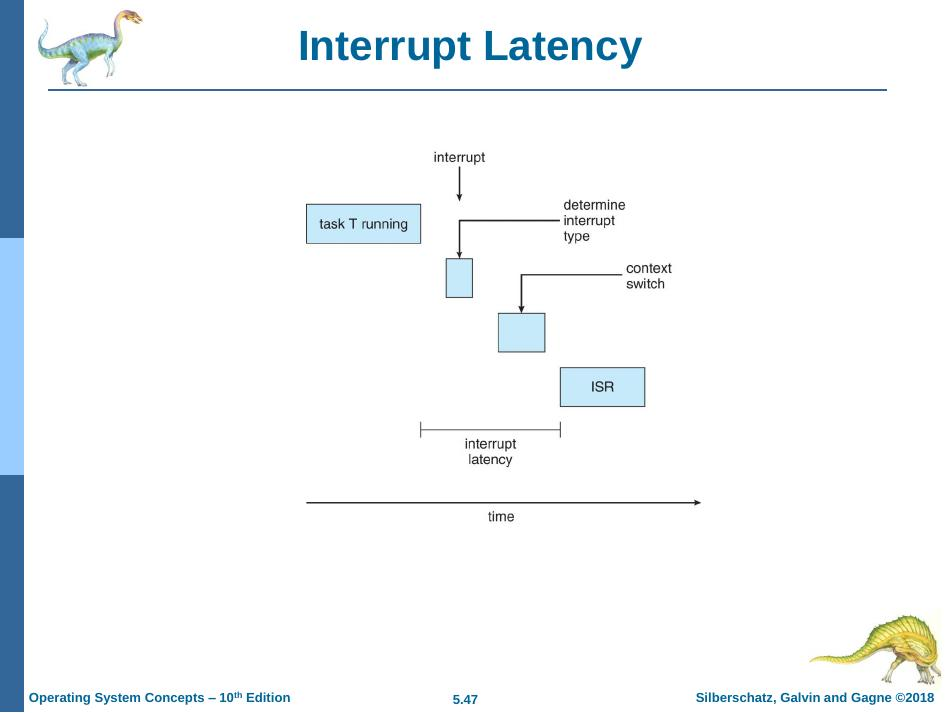

Round Robin memberi setiap proses jatah q. Jika belum selesai saat q habis, proses masuk belakang antrean. Quantum terlalu kecil memperbanyak context switch; terlalu besar membuat perilakunya mendekati FCFS.

### Slide 048 — Dispatch Latency

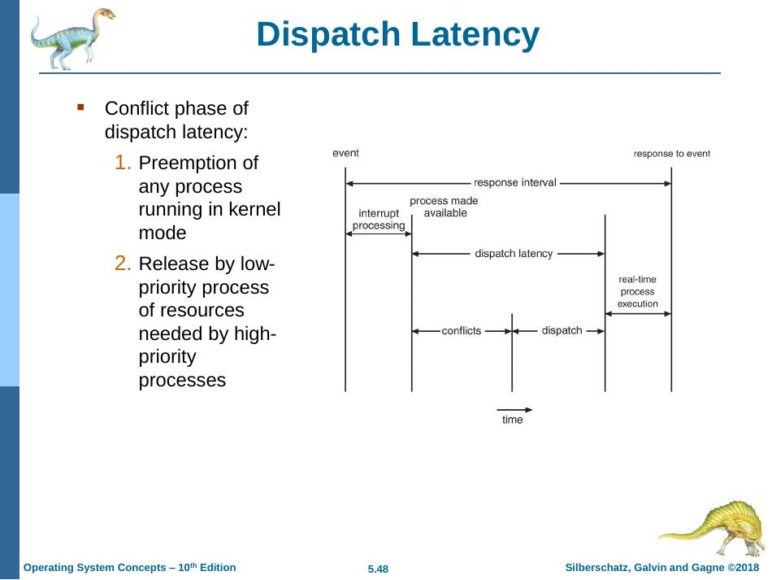

EDF memilih pekerjaan dengan deadline absolut terdekat dan dapat melakukan preemption. Untuk model satu CPU periodik ideal dengan deadline = periode, U ≤ 1 cukup untuk kelayakan EDF. Uji dengan timeline karena prioritas berubah pada setiap pelepasan pekerjaan.

### Slide 049 — Priority-based Scheduling

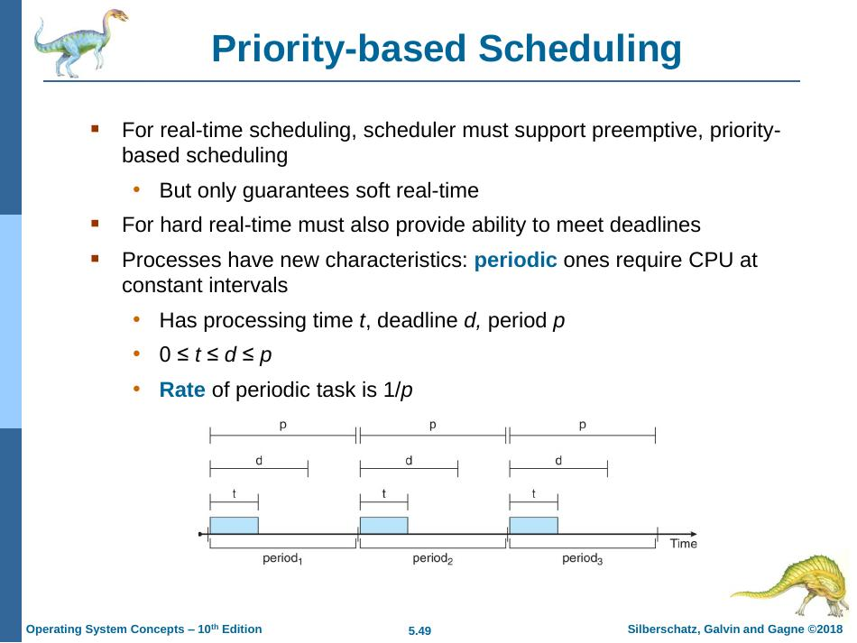

Prioritas menentukan siapa lebih dulu mendapat CPU; proses berprioritas rendah dapat kelaparan dan aging dapat menguranginya. Antrean bertingkat memisahkan kelas pekerjaan. Pada banyak CPU, affinity dan NUMA memengaruhi lokasi data serta biaya perpindahan.

**Perhatikan pada gambar:** ▪ For real-time scheduling, scheduler must support preemptive, priority-; • But only guarantees soft real-time

### Slide 050 — Rate Monotonic Scheduling

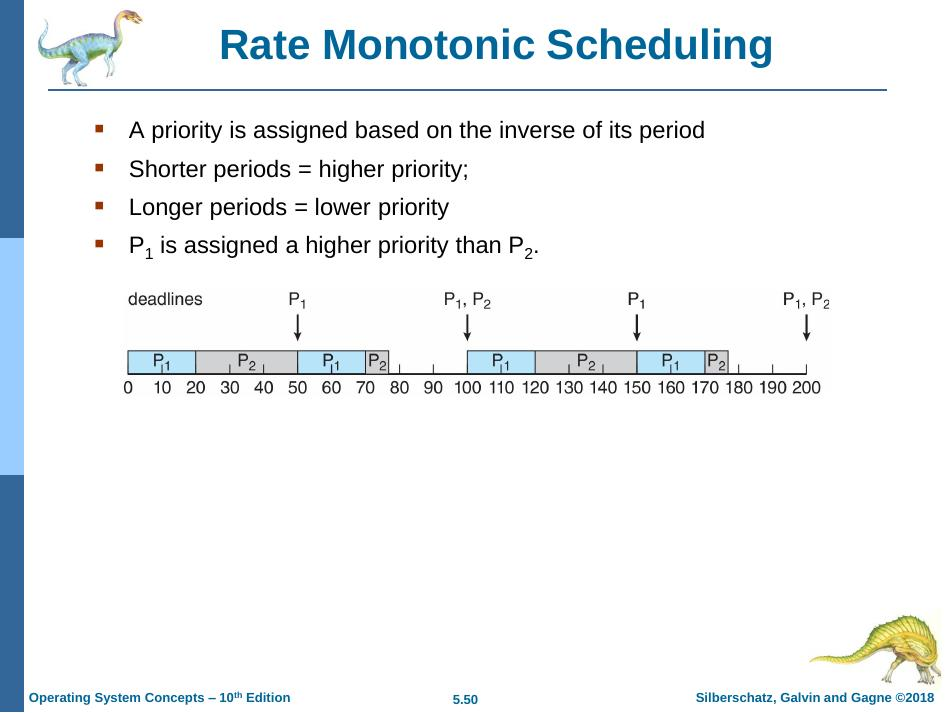

Rate-monotonic memberi prioritas tetap: periode lebih pendek lebih tinggi. Untuk tugas periodik independen dengan deadline = periode, jumlah utilisasi U = Σ(t_i/p_i); batas cukup Liu-Layland untuk n tugas adalah n(2^(1/n)−1). Bila melewati deadline, catat waktu lewatnya, lalu lanjutkan sesuai aturan soal.

**Perhatikan pada gambar:** ▪ A priority is assigned based on the inverse of its period; ▪ Shorter periods = higher priority;

### Slide 051 — Missed Deadlines with Rate Monotonic Scheduling

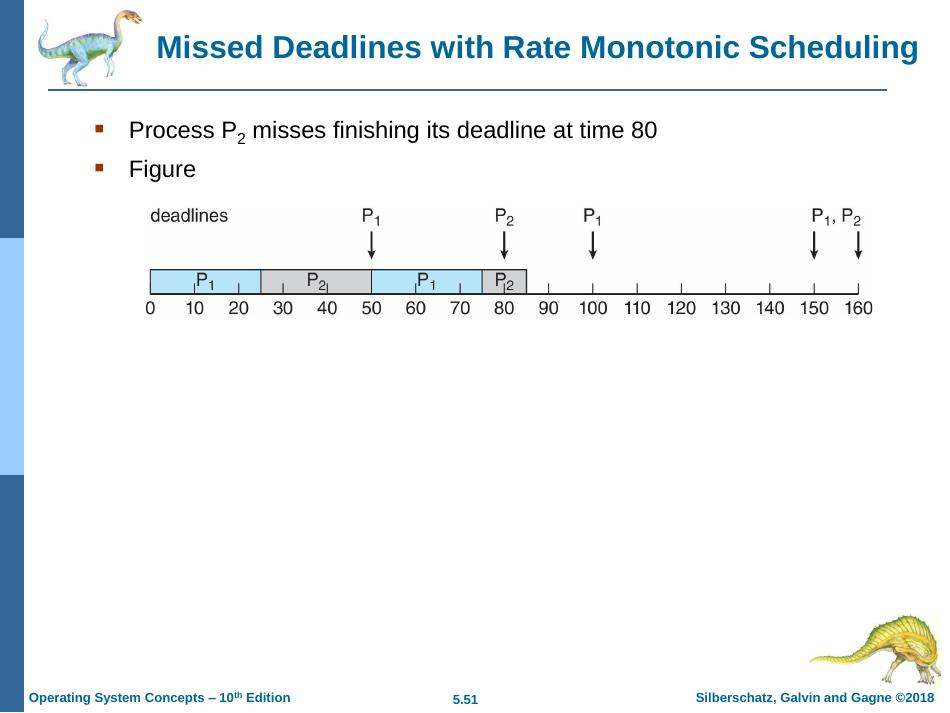

Rate-monotonic memberi prioritas tetap: periode lebih pendek lebih tinggi. Untuk tugas periodik independen dengan deadline = periode, jumlah utilisasi U = Σ(t_i/p_i); batas cukup Liu-Layland untuk n tugas adalah n(2^(1/n)−1). Bila melewati deadline, catat waktu lewatnya, lalu lanjutkan sesuai aturan soal.

**Perhatikan pada gambar:** ▪ Process P2 misses finishing its deadline at time 80

### Slide 052 — Earliest Deadline First Scheduling (EDF)

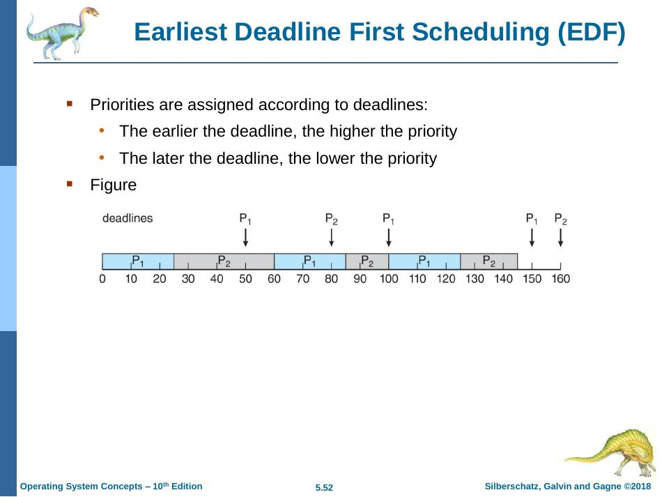

EDF memilih pekerjaan dengan deadline absolut terdekat dan dapat melakukan preemption. Untuk model satu CPU periodik ideal dengan deadline = periode, U ≤ 1 cukup untuk kelayakan EDF. Uji dengan timeline karena prioritas berubah pada setiap pelepasan pekerjaan.

**Perhatikan pada gambar:** ▪ Priorities are assigned according to deadlines:; • The earlier the deadline, the higher the priority

### Slide 053 — Proportional Share Scheduling

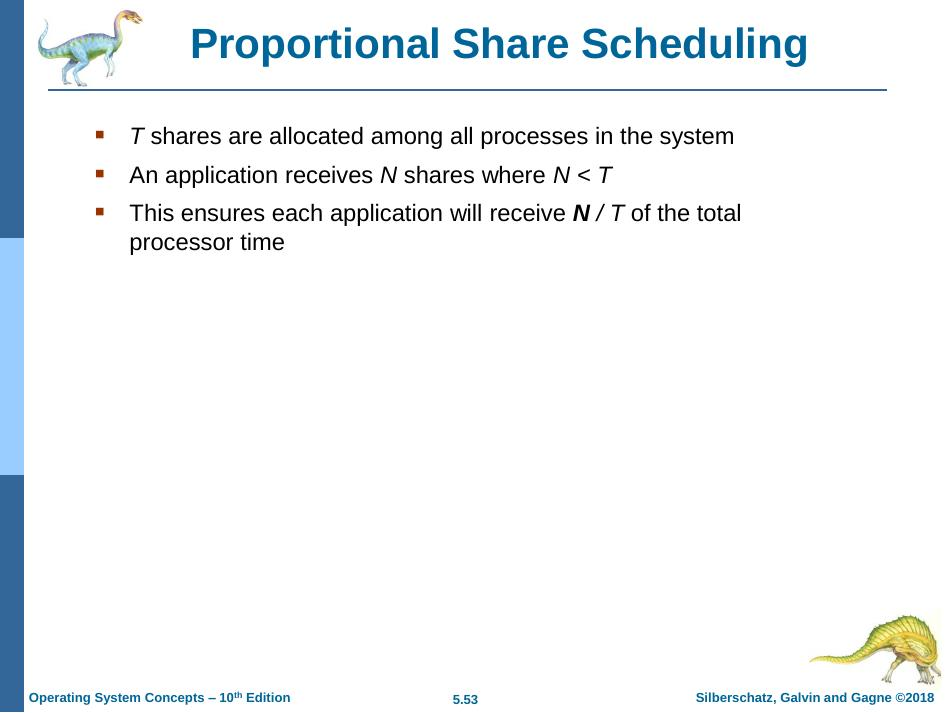

Slide ini memberi contoh tambahan untuk bagian tersebut. Perhatikan urutan pada gambar: identifikasi pelaku, sumber daya yang dipakai, lalu perubahan keadaan setelah setiap langkah. Hubungkan dengan slide sebelumnya sebelum menghafal istilahnya.

**Perhatikan pada gambar:** ▪ T shares are allocated among all processes in the system; ▪ An application receives N shares where N < T

### Slide 054 — POSIX Real-Time Scheduling

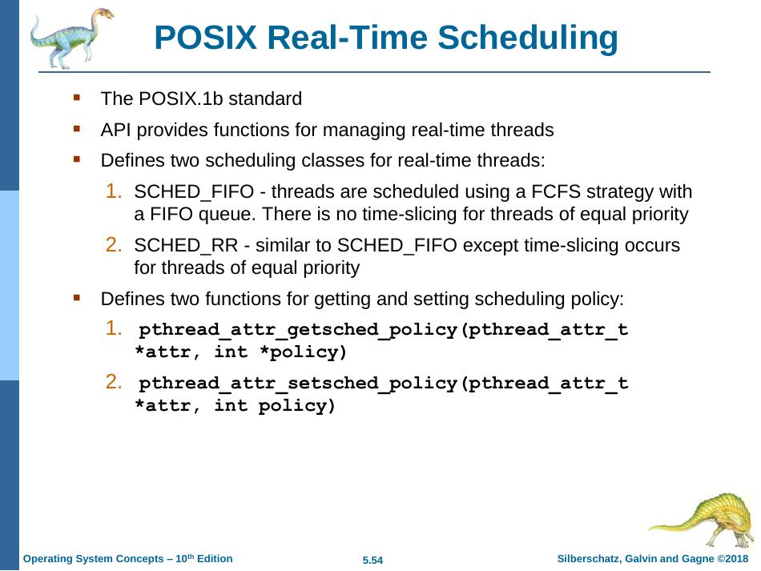

EDF memilih pekerjaan dengan deadline absolut terdekat dan dapat melakukan preemption. Untuk model satu CPU periodik ideal dengan deadline = periode, U ≤ 1 cukup untuk kelayakan EDF. Uji dengan timeline karena prioritas berubah pada setiap pelepasan pekerjaan.

**Perhatikan pada gambar:** ▪ The POSIX.1b standard; ▪ API provides functions for managing real-time threads

### Slide 055 — POSIX Real-Time Scheduling API

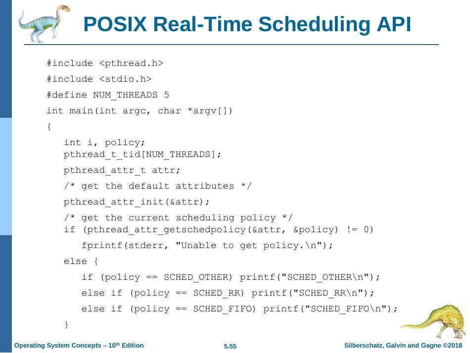

Aplikasi meminta kerja kernel lewat system call. CPU berpindah ke kernel mode untuk menjalankan layanan yang butuh hak istimewa, lalu kembali ke user mode; API adalah antarmuka pemrograman yang sering membungkus panggilan itu. Parameter dapat lewat register, blok memori, atau stack.

**Perhatikan pada gambar:** int main(int argc, char *argv[]); pthread_t_tid[NUM_THREADS];

### Slide 056 — POSIX Real-Time Scheduling API (Cont.)

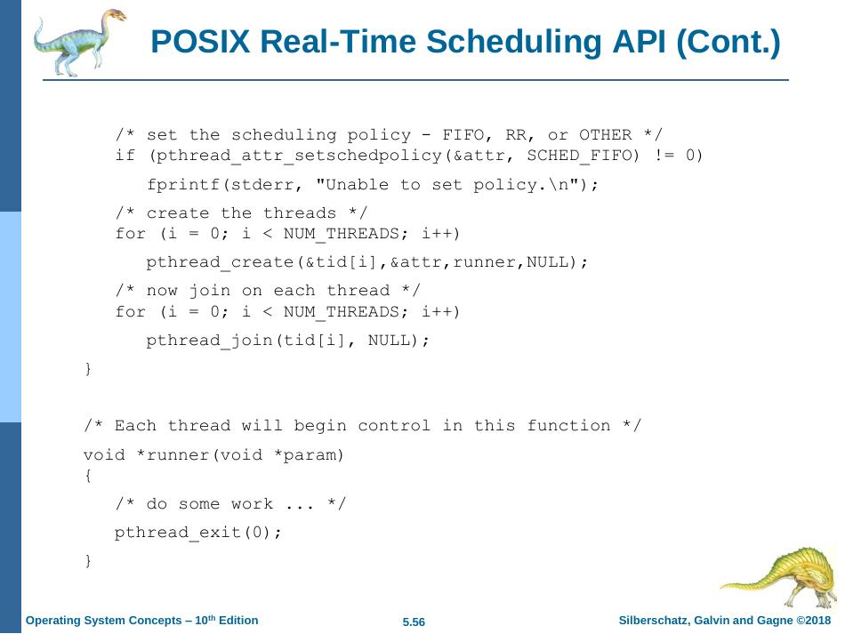

Aplikasi meminta kerja kernel lewat system call. CPU berpindah ke kernel mode untuk menjalankan layanan yang butuh hak istimewa, lalu kembali ke user mode; API adalah antarmuka pemrograman yang sering membungkus panggilan itu. Parameter dapat lewat register, blok memori, atau stack.

**Perhatikan pada gambar:** /* set the scheduling policy - FIFO, RR, or OTHER */; if (pthread_attr_setschedpolicy(&attr, SCHED_FIFO) != 0)

### Slide 057 — Operating System Examples

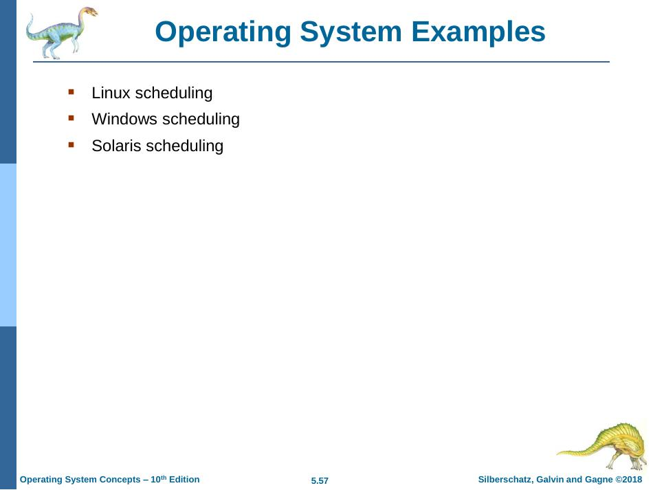

Slide ini memberi contoh tambahan untuk bagian tersebut. Perhatikan urutan pada gambar: identifikasi pelaku, sumber daya yang dipakai, lalu perubahan keadaan setelah setiap langkah. Hubungkan dengan slide sebelumnya sebelum menghafal istilahnya.

### Slide 058 — Linux Scheduling Through Version 2.5

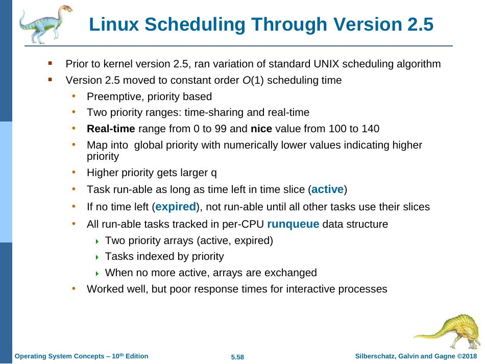

Slide ini memberi contoh tambahan untuk bagian tersebut. Perhatikan urutan pada gambar: identifikasi pelaku, sumber daya yang dipakai, lalu perubahan keadaan setelah setiap langkah. Hubungkan dengan slide sebelumnya sebelum menghafal istilahnya.

**Perhatikan pada gambar:** ▪ Prior to kernel version 2.5, ran variation of standard UNIX scheduling algorithm; ▪ Version 2.5 moved to constant order O(1) scheduling time

### Slide 059 — Linux Scheduling in Version 2.6.23 +

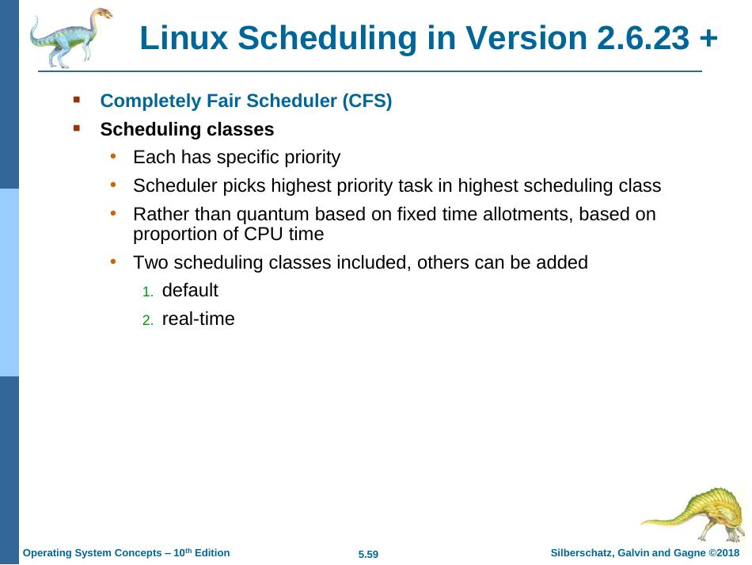

Slide ini memberi contoh tambahan untuk bagian tersebut. Perhatikan urutan pada gambar: identifikasi pelaku, sumber daya yang dipakai, lalu perubahan keadaan setelah setiap langkah. Hubungkan dengan slide sebelumnya sebelum menghafal istilahnya.

**Perhatikan pada gambar:** ▪ Completely Fair Scheduler (CFS); • Each has specific priority

### Slide 060 — Linux Scheduling in Version 2.6.23 + (Cont.)

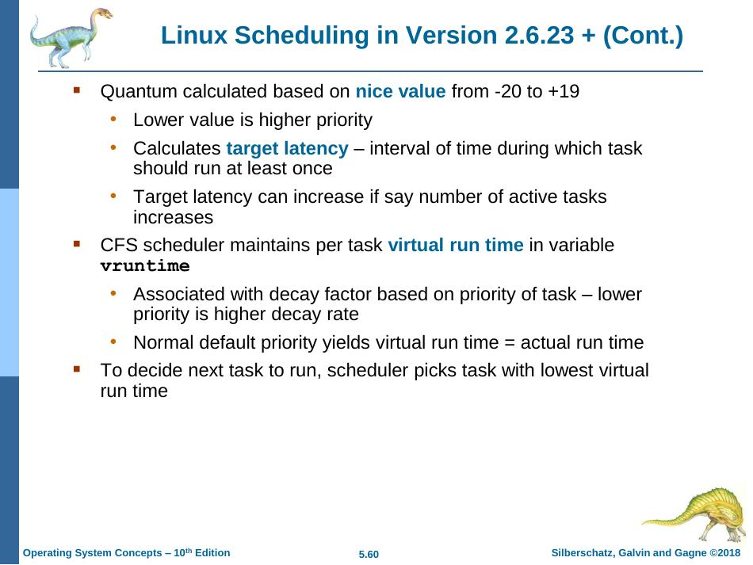

Slide ini memberi contoh tambahan untuk bagian tersebut. Perhatikan urutan pada gambar: identifikasi pelaku, sumber daya yang dipakai, lalu perubahan keadaan setelah setiap langkah. Hubungkan dengan slide sebelumnya sebelum menghafal istilahnya.

**Perhatikan pada gambar:** ▪ Quantum calculated based on nice value from -20 to +19; • Lower value is higher priority

### Slide 061 — CFS Performance

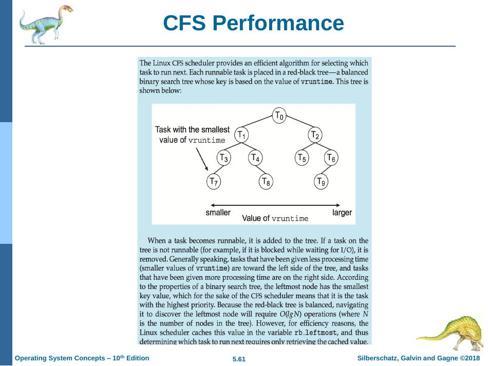

Pengukuran kinerja menunjukkan bagian yang benar-benar lambat. Tracing mencatat peristiwa saat sistem berjalan; debugging mencari penyebab galat. Data hasil ukur lebih kuat daripada menebak dari gejala.

### Slide 062 — Linux Scheduling (Cont.)

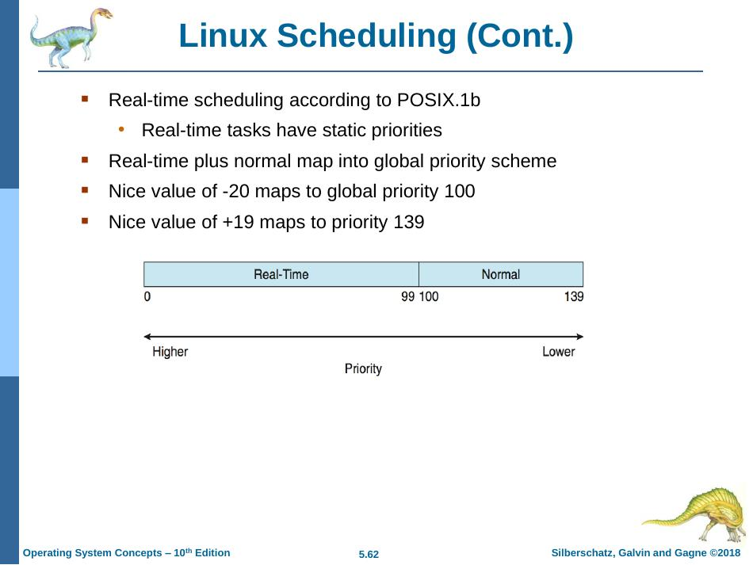

Slide ini memberi contoh tambahan untuk bagian tersebut. Perhatikan urutan pada gambar: identifikasi pelaku, sumber daya yang dipakai, lalu perubahan keadaan setelah setiap langkah. Hubungkan dengan slide sebelumnya sebelum menghafal istilahnya.

**Perhatikan pada gambar:** ▪ Real-time scheduling according to POSIX.1b; • Real-time tasks have static priorities

### Slide 063 — Linux Scheduling (Cont.)

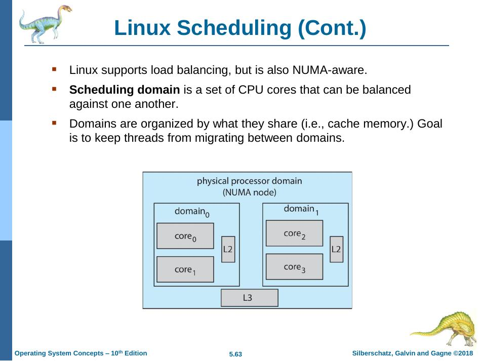

Slide ini memberi contoh tambahan untuk bagian tersebut. Perhatikan urutan pada gambar: identifikasi pelaku, sumber daya yang dipakai, lalu perubahan keadaan setelah setiap langkah. Hubungkan dengan slide sebelumnya sebelum menghafal istilahnya.

**Perhatikan pada gambar:** ▪ Linux supports load balancing, but is also NUMA-aware.; ▪ Scheduling domain is a set of CPU cores that can be balanced

### Slide 064 — Windows Scheduling

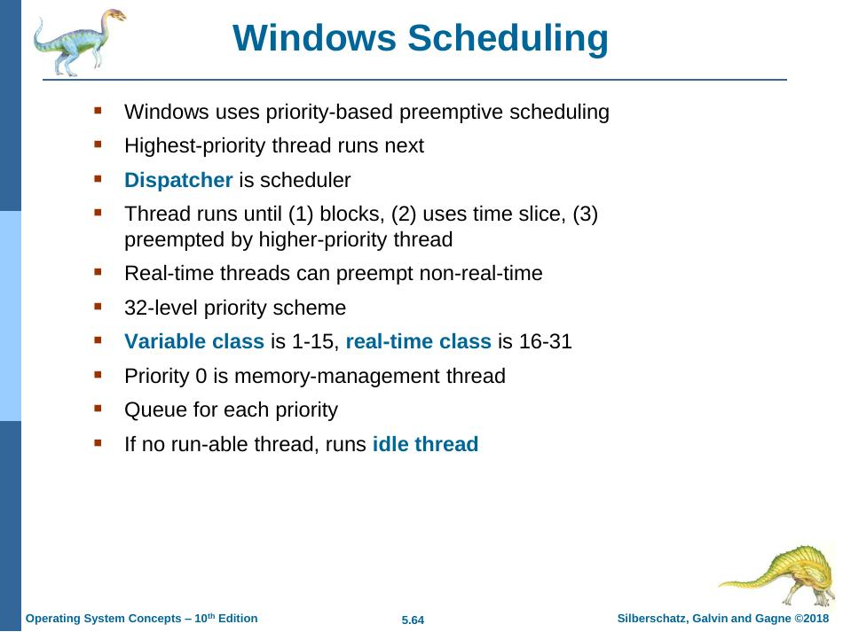

Slide ini memberi contoh tambahan untuk bagian tersebut. Perhatikan urutan pada gambar: identifikasi pelaku, sumber daya yang dipakai, lalu perubahan keadaan setelah setiap langkah. Hubungkan dengan slide sebelumnya sebelum menghafal istilahnya.

**Perhatikan pada gambar:** ▪ Windows uses priority-based preemptive scheduling; ▪ Highest-priority thread runs next

### Slide 065 — Windows Priority Classes

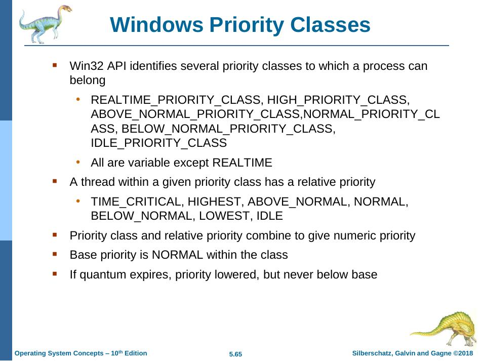

Prioritas menentukan siapa lebih dulu mendapat CPU; proses berprioritas rendah dapat kelaparan dan aging dapat menguranginya. Antrean bertingkat memisahkan kelas pekerjaan. Pada banyak CPU, affinity dan NUMA memengaruhi lokasi data serta biaya perpindahan.

**Perhatikan pada gambar:** ▪ Win32 API identifies several priority classes to which a process can; • REALTIME_PRIORITY_CLASS, HIGH_PRIORITY_CLASS,

### Slide 066 — Windows Priority Classes (Cont.)

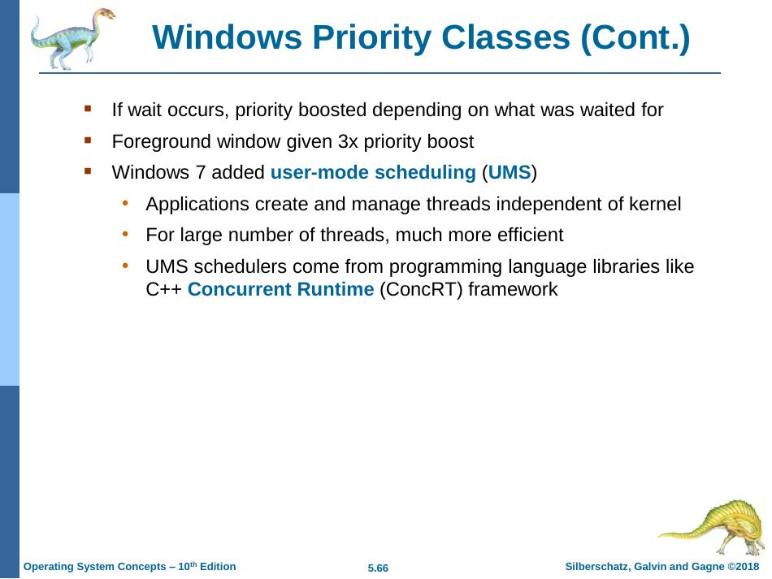

Prioritas menentukan siapa lebih dulu mendapat CPU; proses berprioritas rendah dapat kelaparan dan aging dapat menguranginya. Antrean bertingkat memisahkan kelas pekerjaan. Pada banyak CPU, affinity dan NUMA memengaruhi lokasi data serta biaya perpindahan.

**Perhatikan pada gambar:** ▪ If wait occurs, priority boosted depending on what was waited for; ▪ Foreground window given 3x priority boost

### Slide 067 — Windows Priorities

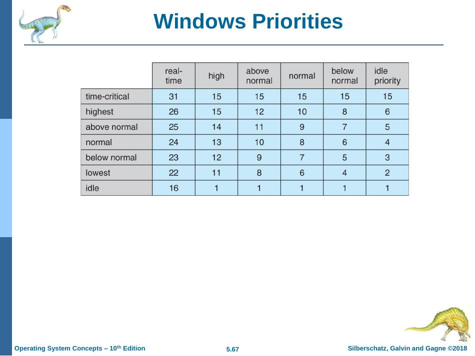

Slide ini memberi contoh tambahan untuk bagian tersebut. Perhatikan urutan pada gambar: identifikasi pelaku, sumber daya yang dipakai, lalu perubahan keadaan setelah setiap langkah. Hubungkan dengan slide sebelumnya sebelum menghafal istilahnya.

### Slide 068 — Solaris

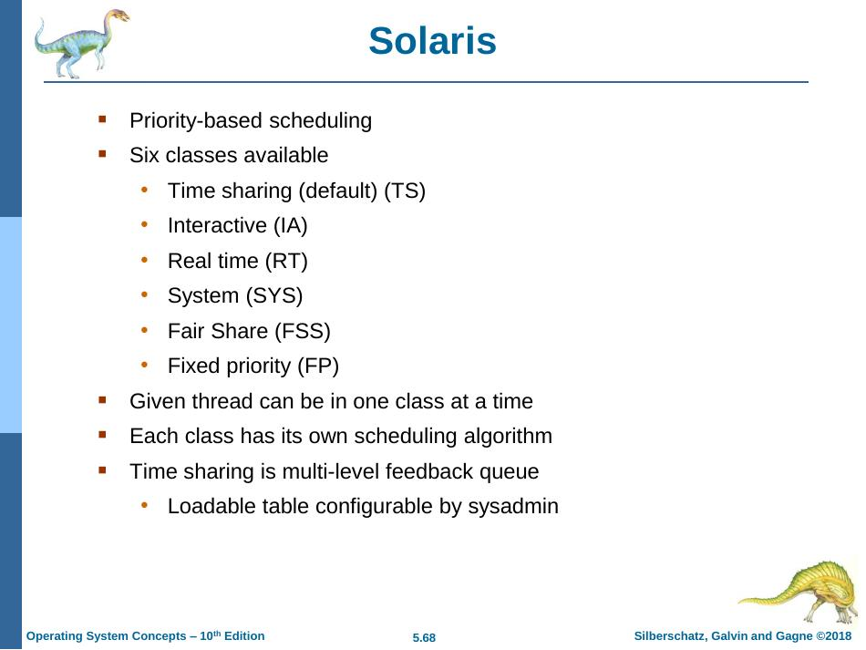

Slide ini memberi contoh tambahan untuk bagian tersebut. Perhatikan urutan pada gambar: identifikasi pelaku, sumber daya yang dipakai, lalu perubahan keadaan setelah setiap langkah. Hubungkan dengan slide sebelumnya sebelum menghafal istilahnya.

**Perhatikan pada gambar:** ▪ Priority-based scheduling; ▪ Six classes available

### Slide 069 — Solaris Dispatch Table

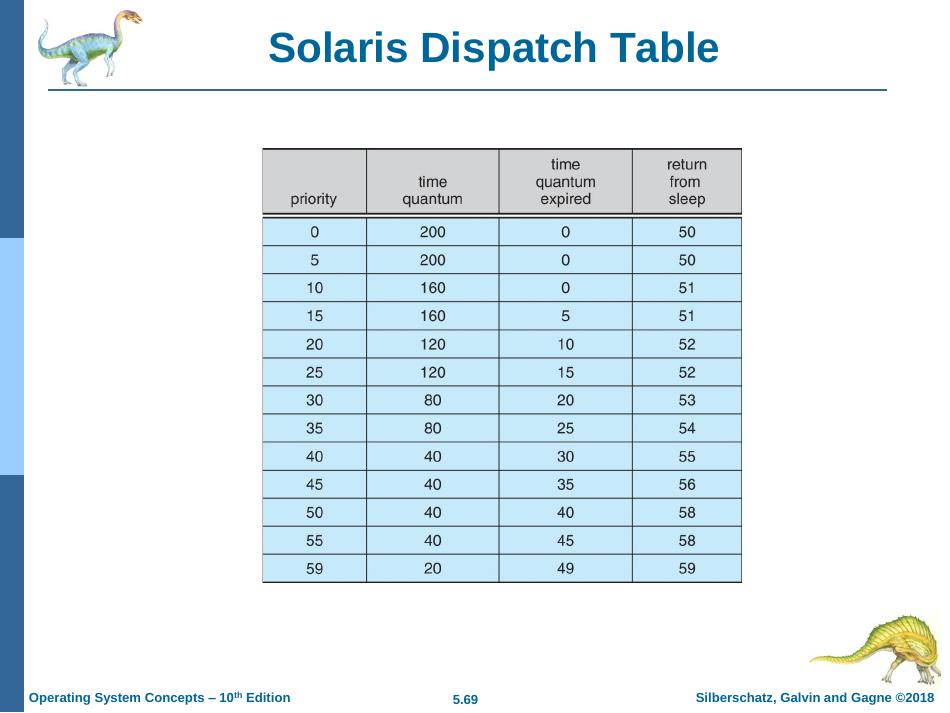

Slide ini memberi contoh tambahan untuk bagian tersebut. Perhatikan urutan pada gambar: identifikasi pelaku, sumber daya yang dipakai, lalu perubahan keadaan setelah setiap langkah. Hubungkan dengan slide sebelumnya sebelum menghafal istilahnya.

### Slide 070 — Solaris Scheduling

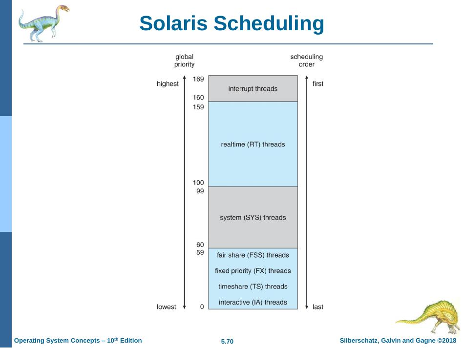

Slide ini memberi contoh tambahan untuk bagian tersebut. Perhatikan urutan pada gambar: identifikasi pelaku, sumber daya yang dipakai, lalu perubahan keadaan setelah setiap langkah. Hubungkan dengan slide sebelumnya sebelum menghafal istilahnya.

### Slide 071 — Solaris Scheduling (Cont.)

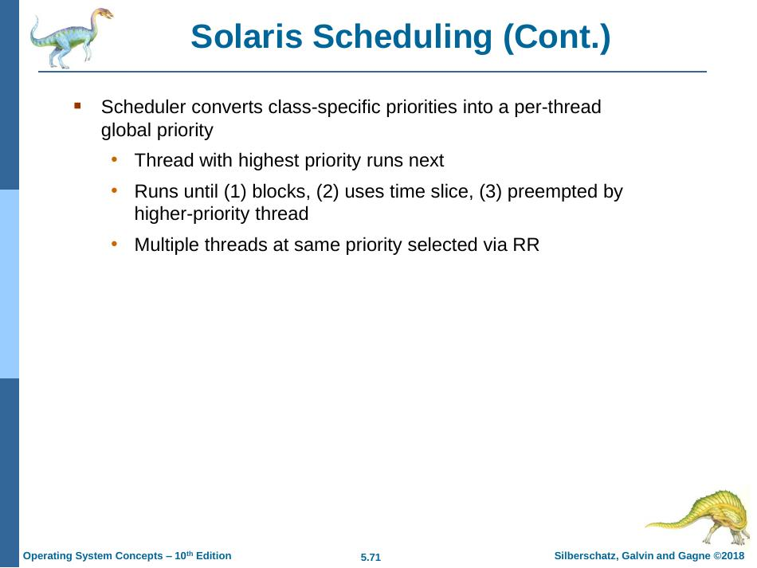

Slide ini memberi contoh tambahan untuk bagian tersebut. Perhatikan urutan pada gambar: identifikasi pelaku, sumber daya yang dipakai, lalu perubahan keadaan setelah setiap langkah. Hubungkan dengan slide sebelumnya sebelum menghafal istilahnya.

**Perhatikan pada gambar:** ▪ Scheduler converts class-specific priorities into a per-thread; • Thread with highest priority runs next

### Slide 072 — Algorithm Evaluation

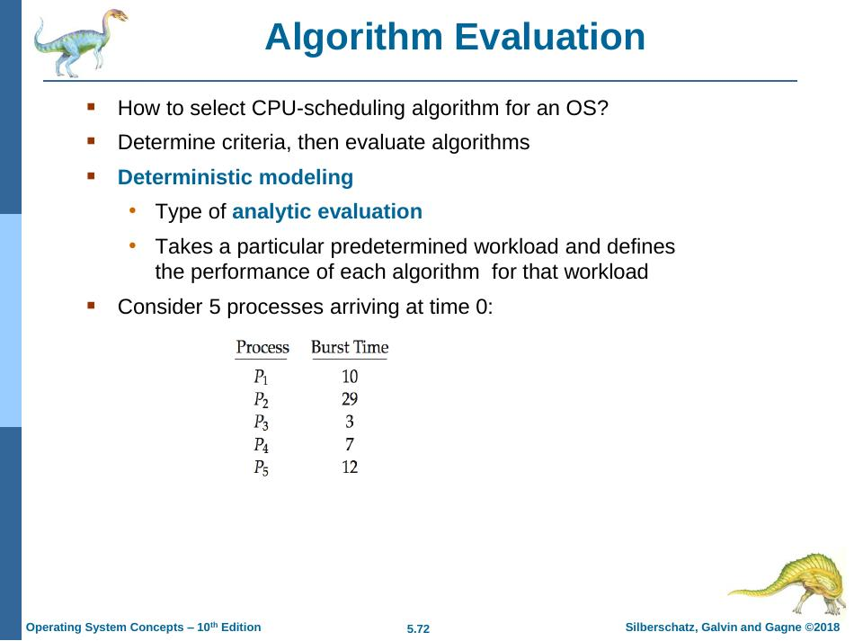

Slide ini memberi contoh tambahan untuk bagian tersebut. Perhatikan urutan pada gambar: identifikasi pelaku, sumber daya yang dipakai, lalu perubahan keadaan setelah setiap langkah. Hubungkan dengan slide sebelumnya sebelum menghafal istilahnya.

**Perhatikan pada gambar:** ▪ How to select CPU-scheduling algorithm for an OS?; ▪ Determine criteria, then evaluate algorithms

### Slide 073 — Deterministic Evaluation

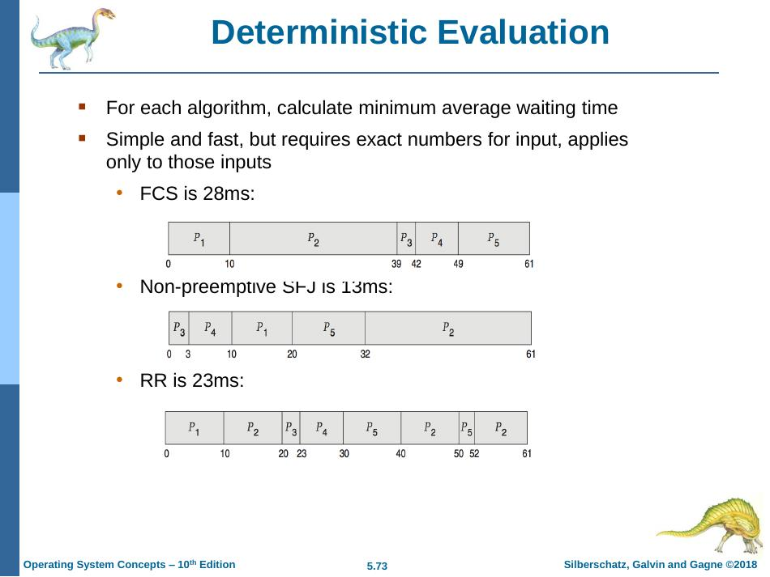

Slide ini memberi contoh tambahan untuk bagian tersebut. Perhatikan urutan pada gambar: identifikasi pelaku, sumber daya yang dipakai, lalu perubahan keadaan setelah setiap langkah. Hubungkan dengan slide sebelumnya sebelum menghafal istilahnya.

**Perhatikan pada gambar:** ▪ For each algorithm, calculate minimum average waiting time; ▪ Simple and fast, but requires exact numbers for input, applies

### Slide 074 — Queueing Models

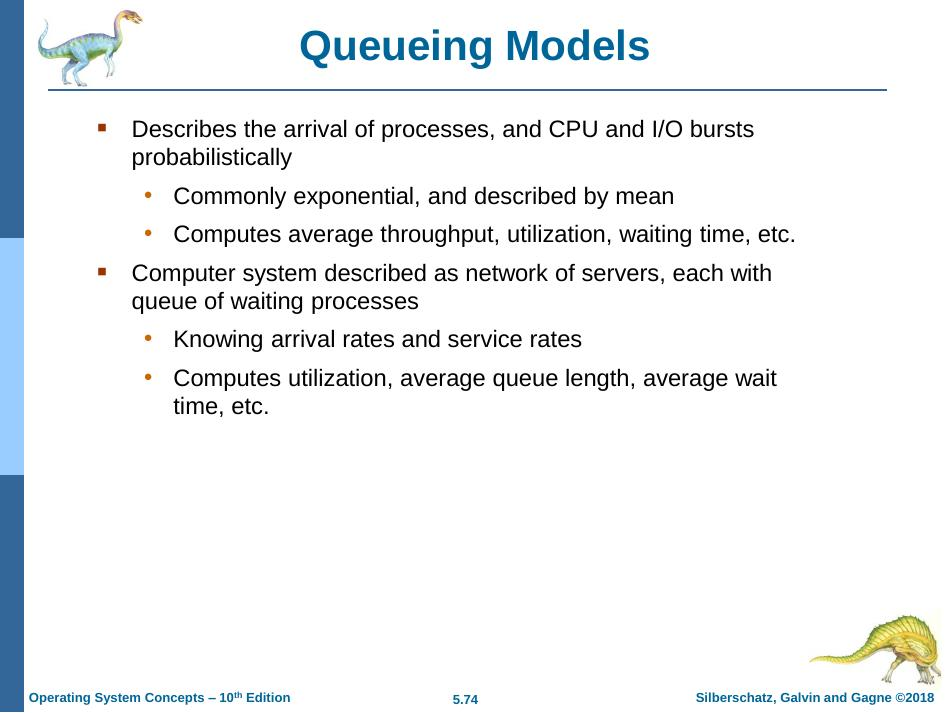

Slide ini memberi contoh tambahan untuk bagian tersebut. Perhatikan urutan pada gambar: identifikasi pelaku, sumber daya yang dipakai, lalu perubahan keadaan setelah setiap langkah. Hubungkan dengan slide sebelumnya sebelum menghafal istilahnya.

**Perhatikan pada gambar:** ▪ Describes the arrival of processes, and CPU and I/O bursts; • Commonly exponential, and described by mean

### Slide 075 — Little’s Formula

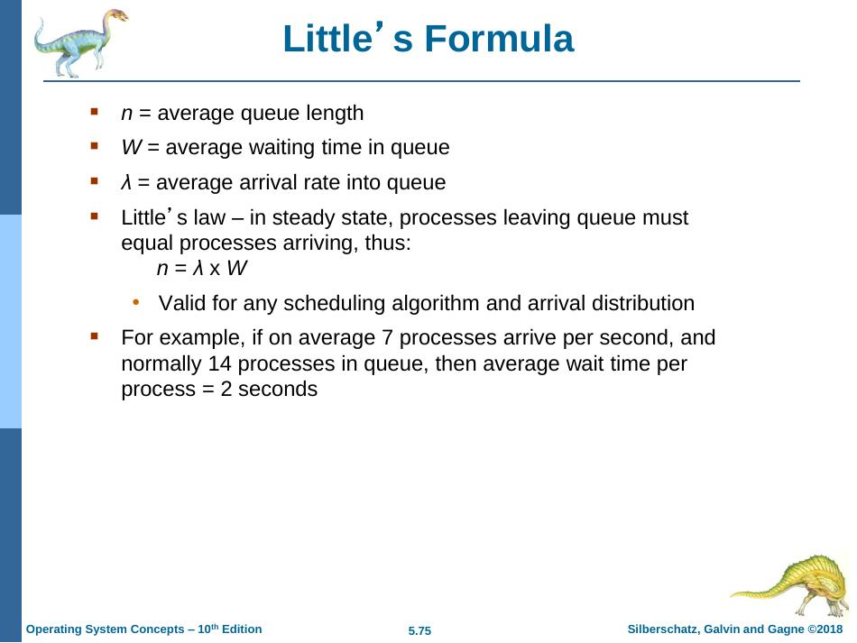

Slide ini memberi contoh tambahan untuk bagian tersebut. Perhatikan urutan pada gambar: identifikasi pelaku, sumber daya yang dipakai, lalu perubahan keadaan setelah setiap langkah. Hubungkan dengan slide sebelumnya sebelum menghafal istilahnya.

**Perhatikan pada gambar:** ▪ n = average queue length; ▪ W = average waiting time in queue

### Slide 076 — Simulations

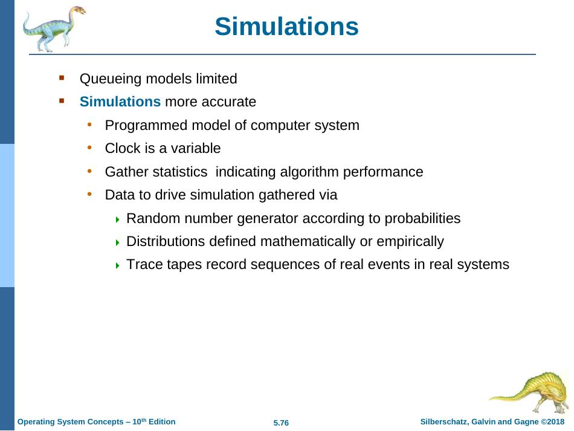

Slide ini memberi contoh tambahan untuk bagian tersebut. Perhatikan urutan pada gambar: identifikasi pelaku, sumber daya yang dipakai, lalu perubahan keadaan setelah setiap langkah. Hubungkan dengan slide sebelumnya sebelum menghafal istilahnya.

**Perhatikan pada gambar:** ▪ Queueing models limited; ▪ Simulations more accurate

### Slide 077 — Evaluation of CPU Schedulers by Simulation

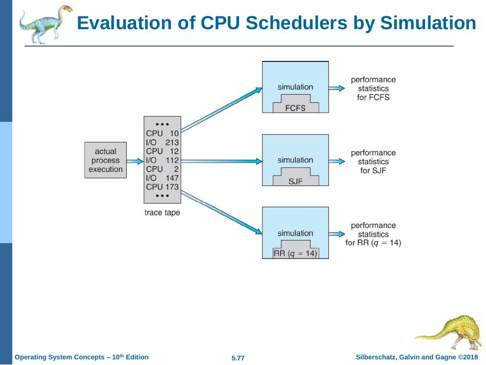

Penjadwal memilih proses ready untuk CPU; dispatcher benar-benar menyerahkan CPU. Preemptive dapat menghentikan proses yang sedang berjalan, sedangkan nonpreemptive menunggu proses melepas CPU. Bandingkan throughput, turnaround, waiting, response, serta overhead context switch.

### Slide 078 — Implementation

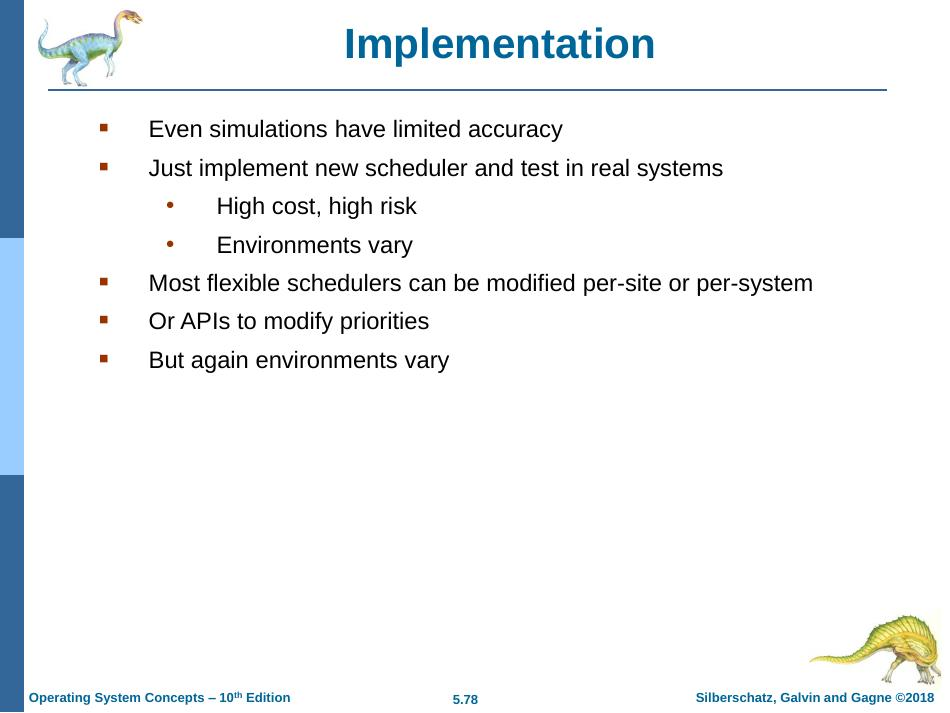

Mekanisme adalah cara sistem melakukan sesuatu; kebijakan menentukan pilihan mana yang diambil. Contohnya, mekanisme timer memberi kesempatan menjadwalkan ulang, sedangkan kebijakan penjadwal memilih proses berikutnya.

**Perhatikan pada gambar:** ▪ Even simulations have limited accuracy; ▪ Just implement new scheduler and test in real systems

### Slide 079 — End of Chapter 5

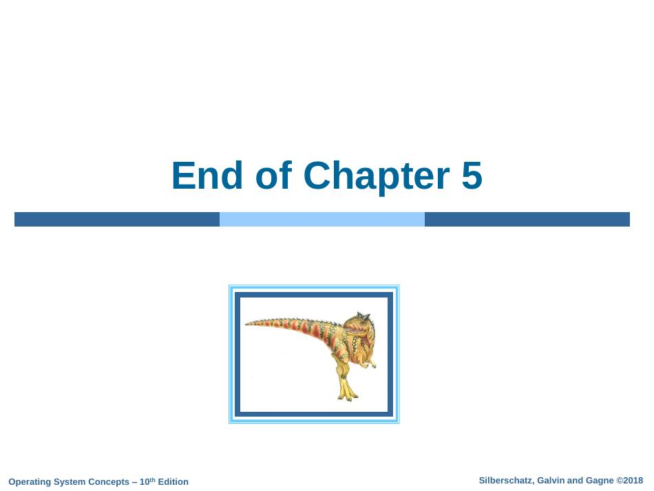

Slide ini memetakan posisi topik dalam bab. Pakai judul-judulnya sebagai daftar cek; utamakan hubungan sebab-akibat dan contoh, bukan hafalan urutan.

## Contoh soal dan pembahasan

### Contoh — RM vs EDF (latihan dari kisi-kisi)
**Soal.** Dua tugas periodik: P1 mempunyai waktu eksekusi 1 dan periode 3; P2 mempunyai waktu eksekusi 2 dan periode 5. Keduanya tiba pada t=0, deadline di akhir periode. Gambarkan sampai t=15.

**Pembahasan ringkas.** Utilisasi U=1/3+2/5=11/15≈0,733. Batas cukup RM untuk 2 tugas adalah 2(√2−1)≈0,828, jadi set tugas ini dijamin dapat dijadwalkan oleh RM. Karena U≤1, EDF juga layak pada asumsi model ideal. Pada t=0, RM memilih P1 (periode 3 lebih singkat); EDF juga memilih P1 (deadline 3 lebih dekat). Untuk mengisi timeline lengkap, pecah pada tiap waktu pelepasan 0,3,5,6,9,10,12,15 dan setiap penyelesaian; pada deadline sama, EDF meneruskan proses yang sedang berjalan sesuai aturan kisi-kisi.

**Catatan.** Batas RM adalah syarat cukup, bukan syarat perlu: U di atas batas tidak otomatis berarti deadline gagal.

## Rujukan

- Slide kuliah `K5 & K6.pdf` halaman 45–79 dari paket Sensei.

- *Operating System Concepts*, edisi ke-10, Silberschatz, Galvin, dan Gagne, sebagaimana tercantum pada slide.

- `Kisi kisi.pdf` dan kumpulan contoh UTS 2018, 2019, 2021, 2022 dalam paket Sensei. Soal yang diberi label "adaptasi" mengikuti jenis/topik soal terdahulu; angka dan redaksinya tidak diklaim sama dengan soal asli.
