# Pertemuan 7 — Sinkronisasi dan deadlock, slide demi slide
Gambar mengikuti halaman 1–149 dari `K7.pdf` dalam paket Sensei. Nomor slide di bawah adalah halaman PDF asli. Pembahasan menekankan alur konsep; contoh hitungan di akhir memakai konvensi kisi-kisi.

**Fokus UTS:** Race condition, critical section, semaphore, bounded buffer, dining philosophers, deadlock, RAG, dan Banker.

## Pembahasan setiap slide

### Slide 001 — Chapter 6: Synchronization

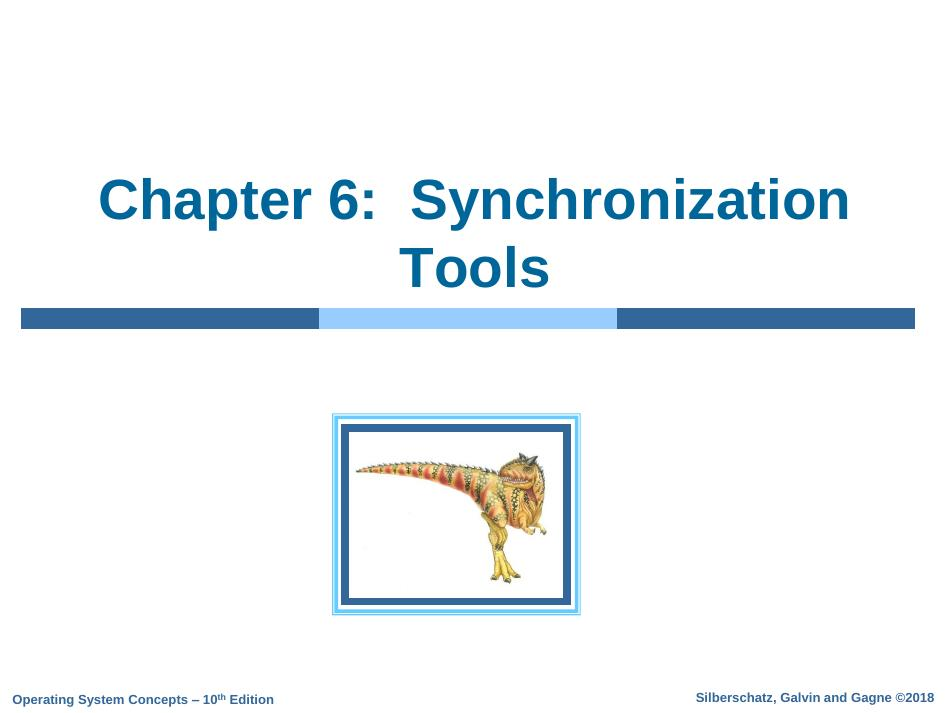

Slide ini memetakan posisi topik dalam bab. Pakai judul-judulnya sebagai daftar cek; utamakan hubungan sebab-akibat dan contoh, bukan hafalan urutan.

### Slide 002 — Outline

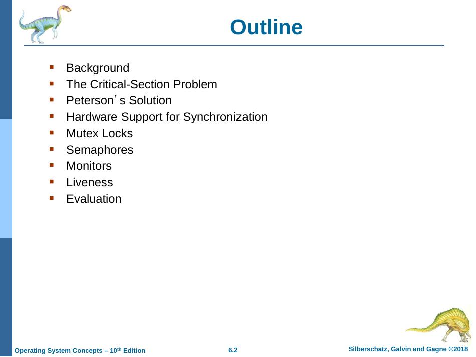

Slide ini memetakan posisi topik dalam bab. Pakai judul-judulnya sebagai daftar cek; utamakan hubungan sebab-akibat dan contoh, bukan hafalan urutan.

### Slide 003 — Objectives

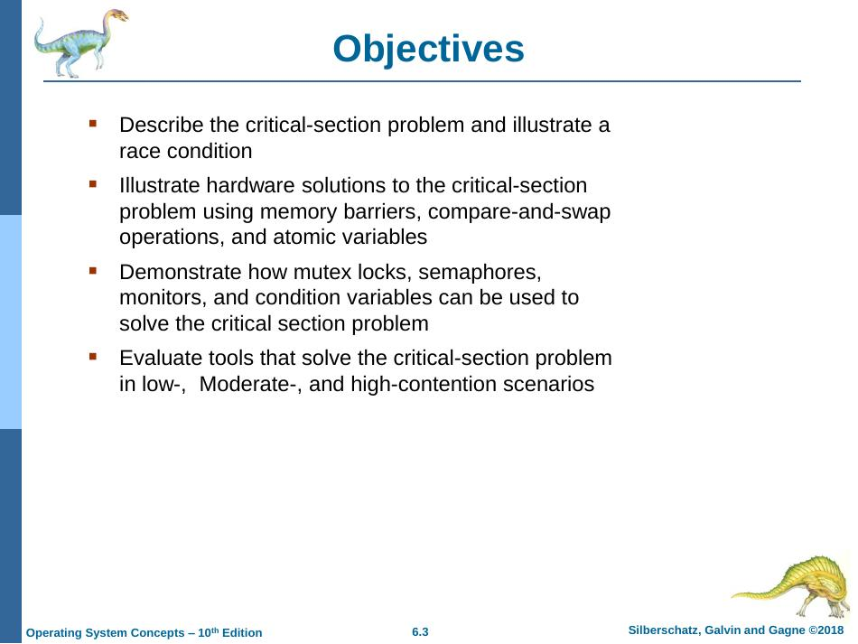

Slide ini memetakan posisi topik dalam bab. Pakai judul-judulnya sebagai daftar cek; utamakan hubungan sebab-akibat dan contoh, bukan hafalan urutan.

### Slide 004 — Background

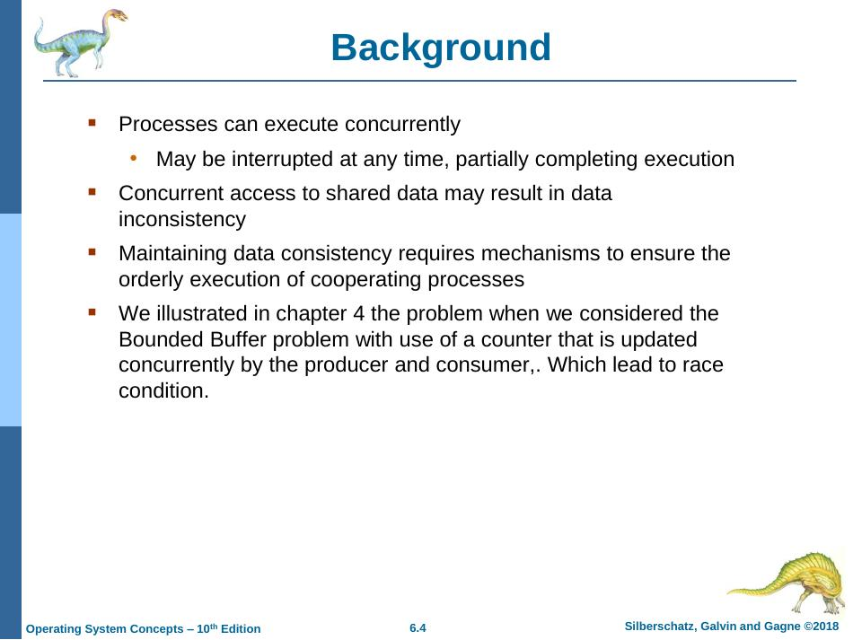

Slide ini memberi contoh tambahan untuk bagian tersebut. Perhatikan urutan pada gambar: identifikasi pelaku, sumber daya yang dipakai, lalu perubahan keadaan setelah setiap langkah. Hubungkan dengan slide sebelumnya sebelum menghafal istilahnya.

**Perhatikan pada gambar:** ▪ Processes can execute concurrently; • May be interrupted at any time, partially completing execution

### Slide 005 — Race Condition

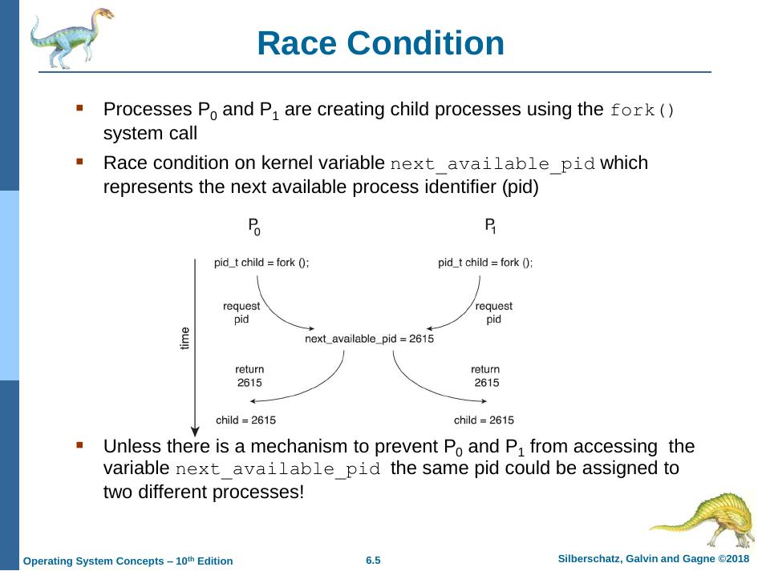

Race condition terjadi ketika hasil bergantung pada urutan operasi yang saling beririsan. Bila dua pekerja mengubah data bersama, lindungi bagian kritis atau gunakan operasi atomik; hasil yang tampak benar sekali belum membuktikan kode aman.

**Perhatikan pada gambar:** ▪ Processes P0 and P1 are creating child processes using the fork(); ▪ Race condition on kernel variable next_available_pid which

### Slide 006 — Critical Section Problem

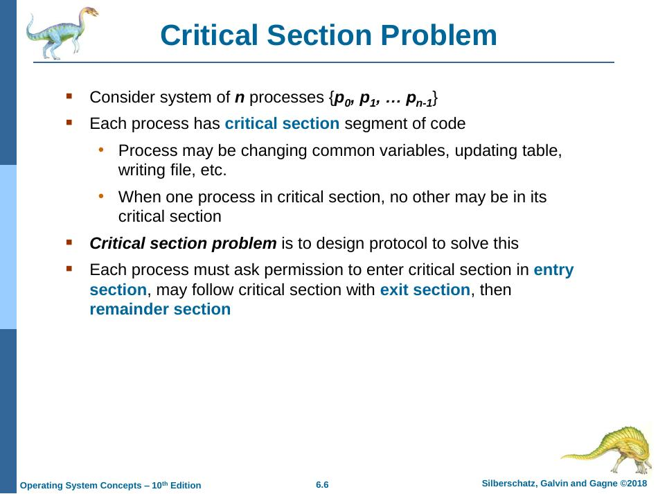

Critical section adalah bagian yang mengakses data bersama. Solusi yang benar memenuhi mutual exclusion, progress, dan bounded waiting. Operasi atomik membantu mengunci perubahan; memory barrier membatasi pengurutan ulang akses memori yang bisa merusak asumsi algoritma.

**Perhatikan pada gambar:** ▪ Consider system of n processes {p0, p1, … pn-1}; ▪ Each process has critical section segment of code

### Slide 007 — Critical Section

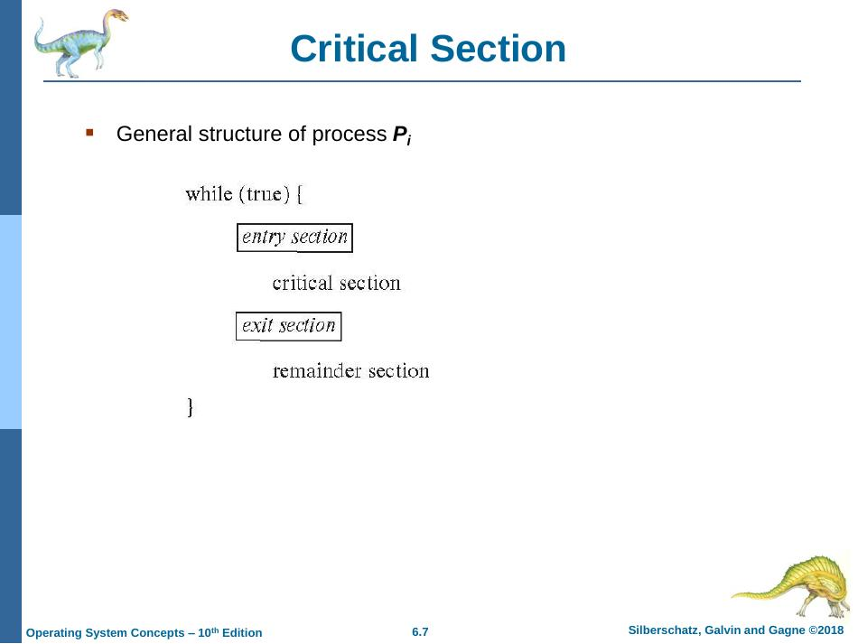

Critical section adalah bagian yang mengakses data bersama. Solusi yang benar memenuhi mutual exclusion, progress, dan bounded waiting. Operasi atomik membantu mengunci perubahan; memory barrier membatasi pengurutan ulang akses memori yang bisa merusak asumsi algoritma.

**Perhatikan pada gambar:** ▪ General structure of process Pi

### Slide 008 — Critical-Section Problem (Cont.)

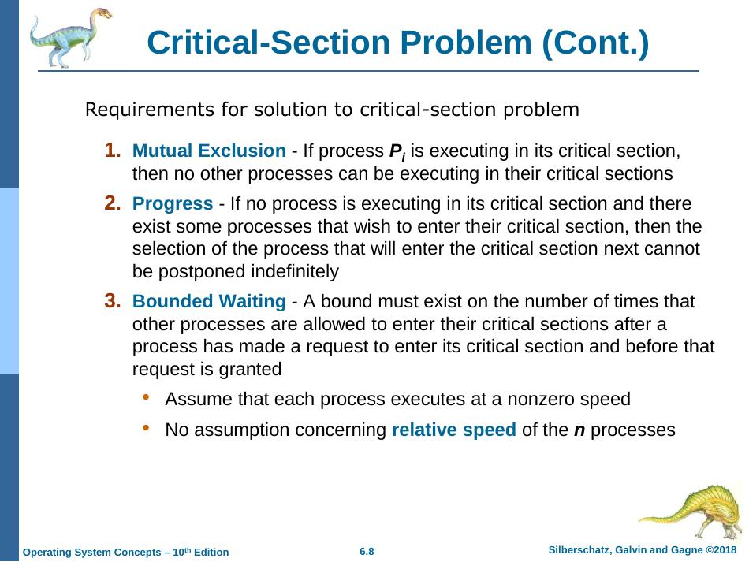

Critical section adalah bagian yang mengakses data bersama. Solusi yang benar memenuhi mutual exclusion, progress, dan bounded waiting. Operasi atomik membantu mengunci perubahan; memory barrier membatasi pengurutan ulang akses memori yang bisa merusak asumsi algoritma.

**Perhatikan pada gambar:** Requirements for solution to critical-section problem; 1. Mutual Exclusion - If process Pi is executing in its critical section,

### Slide 009 — Interrupt-based Solution

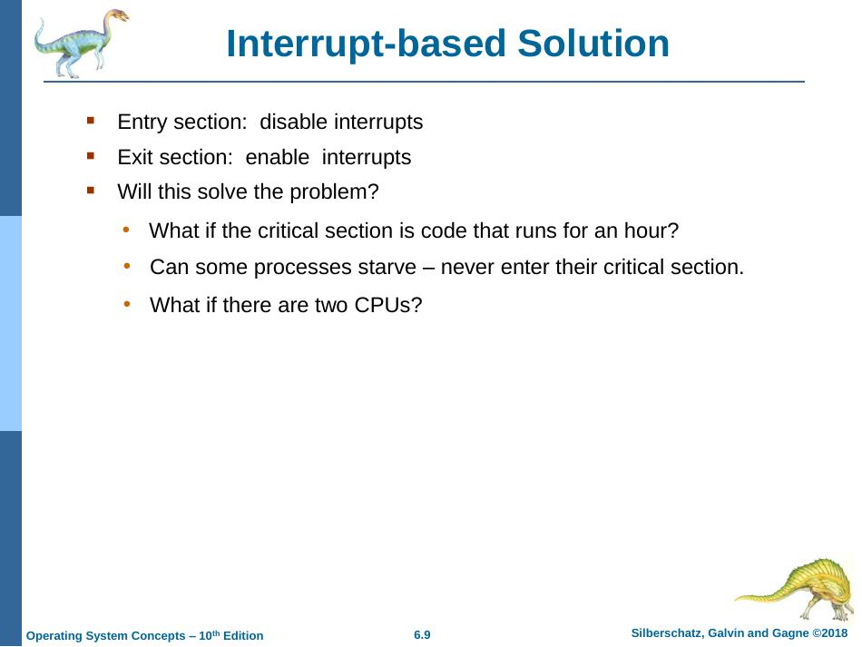

Round Robin memberi setiap proses jatah q. Jika belum selesai saat q habis, proses masuk belakang antrean. Quantum terlalu kecil memperbanyak context switch; terlalu besar membuat perilakunya mendekati FCFS.

**Perhatikan pada gambar:** ▪ Entry section: disable interrupts; ▪ Exit section: enable interrupts

### Slide 010 — Software Solution 1

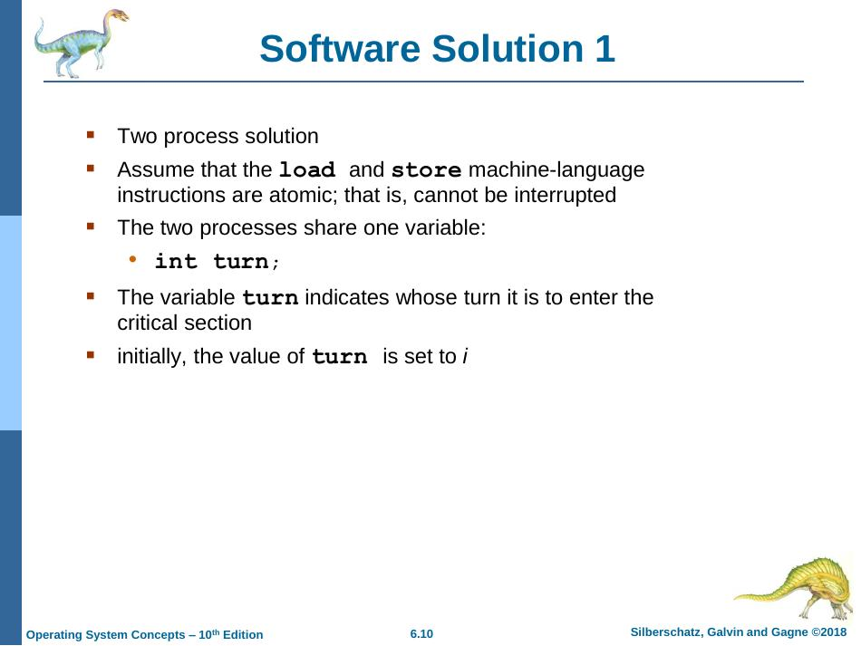

Slide ini memberi contoh tambahan untuk bagian tersebut. Perhatikan urutan pada gambar: identifikasi pelaku, sumber daya yang dipakai, lalu perubahan keadaan setelah setiap langkah. Hubungkan dengan slide sebelumnya sebelum menghafal istilahnya.

**Perhatikan pada gambar:** ▪ Assume that the load and store machine-language; instructions are atomic; that is, cannot be interrupted

### Slide 011 — Algorithm for Process Pi

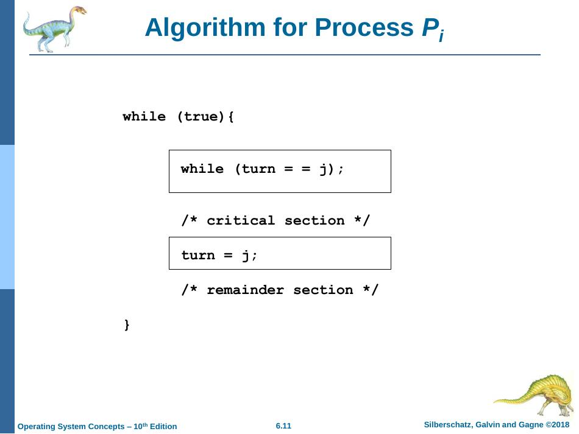

Slide ini memberi contoh tambahan untuk bagian tersebut. Perhatikan urutan pada gambar: identifikasi pelaku, sumber daya yang dipakai, lalu perubahan keadaan setelah setiap langkah. Hubungkan dengan slide sebelumnya sebelum menghafal istilahnya.

**Perhatikan pada gambar:** /* remainder section */

### Slide 012 — Correctness of the Software Solution

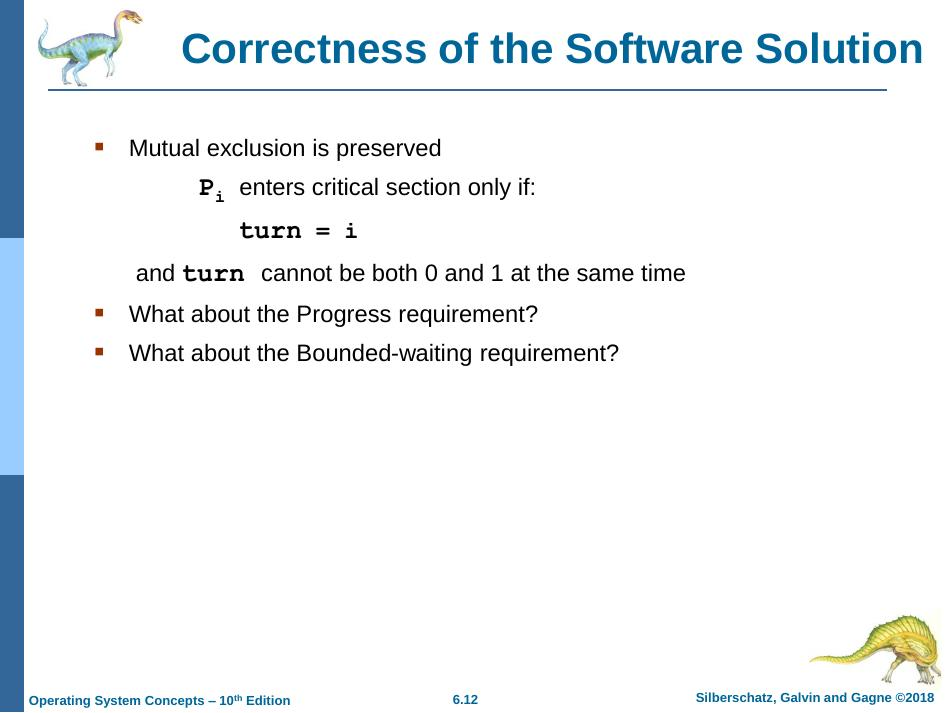

Round Robin memberi setiap proses jatah q. Jika belum selesai saat q habis, proses masuk belakang antrean. Quantum terlalu kecil memperbanyak context switch; terlalu besar membuat perilakunya mendekati FCFS.

**Perhatikan pada gambar:** ▪ Mutual exclusion is preserved; Pi enters critical section only if:

### Slide 013 — Peterson’s Solution

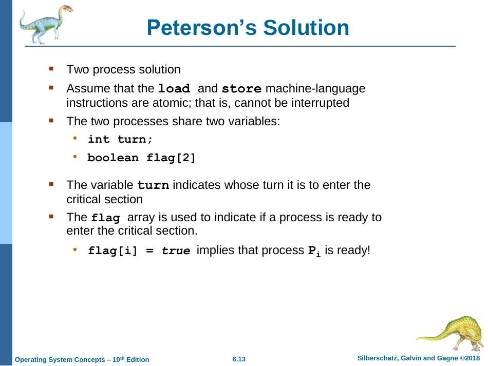

Critical section adalah bagian yang mengakses data bersama. Solusi yang benar memenuhi mutual exclusion, progress, dan bounded waiting. Operasi atomik membantu mengunci perubahan; memory barrier membatasi pengurutan ulang akses memori yang bisa merusak asumsi algoritma.

**Perhatikan pada gambar:** ▪ Assume that the load and store machine-language; instructions are atomic; that is, cannot be interrupted

### Slide 014 — Algorithm for Process Pi

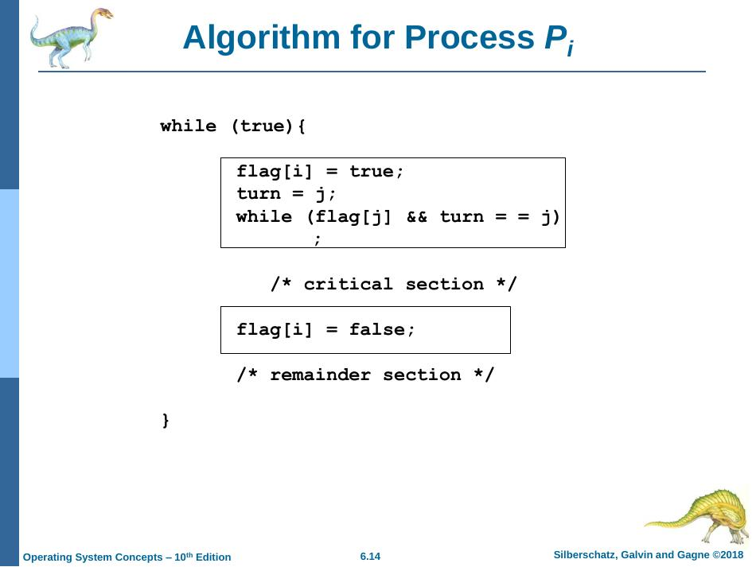

Slide ini memberi contoh tambahan untuk bagian tersebut. Perhatikan urutan pada gambar: identifikasi pelaku, sumber daya yang dipakai, lalu perubahan keadaan setelah setiap langkah. Hubungkan dengan slide sebelumnya sebelum menghafal istilahnya.

**Perhatikan pada gambar:** while (flag[j] && turn = = j); /* remainder section */

### Slide 015 — Correctness of Peterson’s Solution

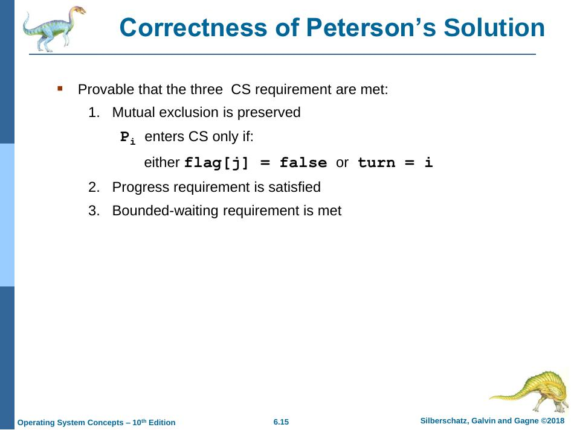

Round Robin memberi setiap proses jatah q. Jika belum selesai saat q habis, proses masuk belakang antrean. Quantum terlalu kecil memperbanyak context switch; terlalu besar membuat perilakunya mendekati FCFS.

**Perhatikan pada gambar:** ▪ Provable that the three CS requirement are met:; 1. Mutual exclusion is preserved

### Slide 016 — Peterson’s Solution and Modern Architecture

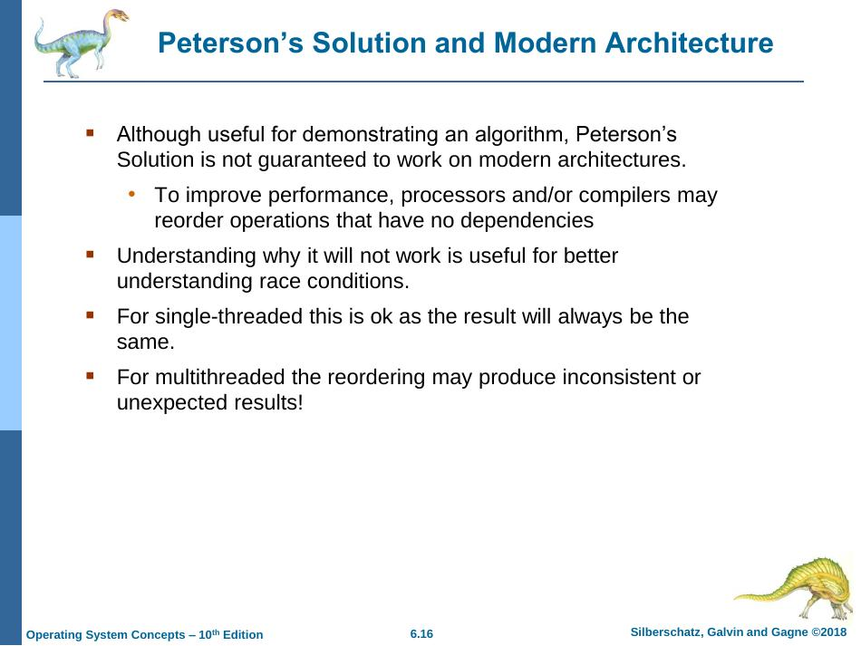

Critical section adalah bagian yang mengakses data bersama. Solusi yang benar memenuhi mutual exclusion, progress, dan bounded waiting. Operasi atomik membantu mengunci perubahan; memory barrier membatasi pengurutan ulang akses memori yang bisa merusak asumsi algoritma.

**Perhatikan pada gambar:** ▪ Although useful for demonstrating an algorithm, Peterson’s; Solution is not guaranteed to work on modern architectures.

### Slide 017 — Modern Architecture Example

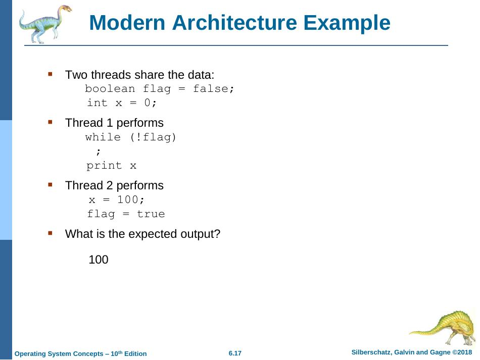

Slide ini memberi contoh tambahan untuk bagian tersebut. Perhatikan urutan pada gambar: identifikasi pelaku, sumber daya yang dipakai, lalu perubahan keadaan setelah setiap langkah. Hubungkan dengan slide sebelumnya sebelum menghafal istilahnya.

**Perhatikan pada gambar:** ▪ Two threads share the data:; ▪ What is the expected output?

### Slide 018 — Modern Architecture Example (Cont.)

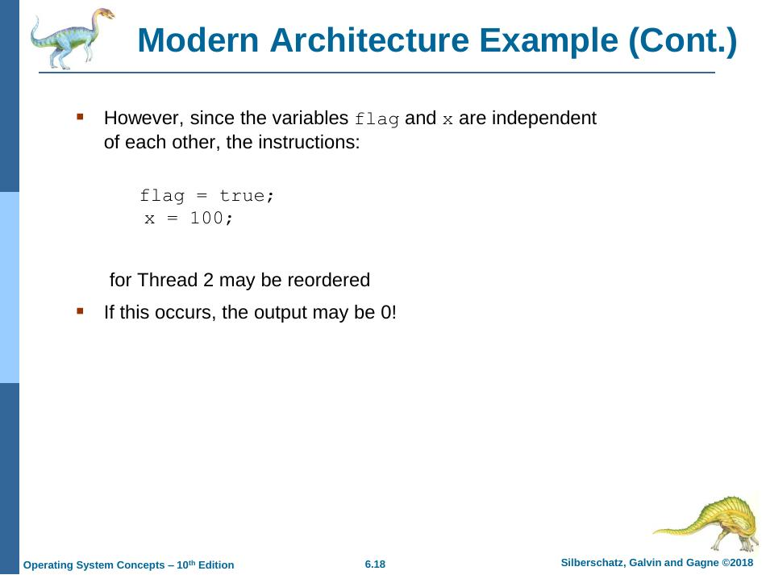

Slide ini memberi contoh tambahan untuk bagian tersebut. Perhatikan urutan pada gambar: identifikasi pelaku, sumber daya yang dipakai, lalu perubahan keadaan setelah setiap langkah. Hubungkan dengan slide sebelumnya sebelum menghafal istilahnya.

**Perhatikan pada gambar:** ▪ However, since the variables flag and x are independent; of each other, the instructions:

### Slide 019 — Peterson’s Solution Revisited

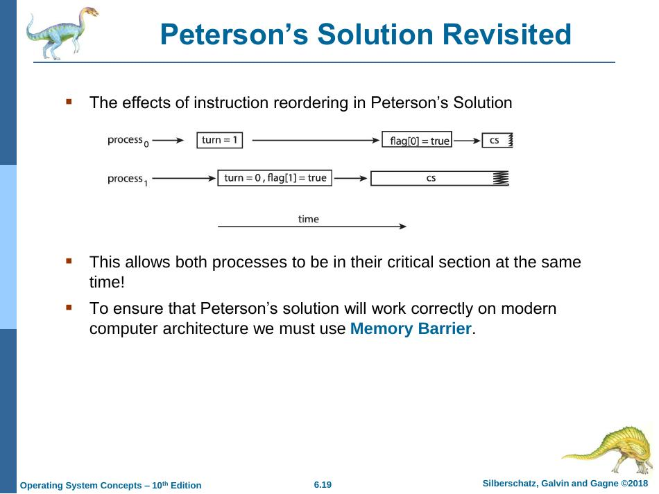

Critical section adalah bagian yang mengakses data bersama. Solusi yang benar memenuhi mutual exclusion, progress, dan bounded waiting. Operasi atomik membantu mengunci perubahan; memory barrier membatasi pengurutan ulang akses memori yang bisa merusak asumsi algoritma.

**Perhatikan pada gambar:** ▪ The effects of instruction reordering in Peterson’s Solution; ▪ This allows both processes to be in their critical section at the same

### Slide 020 — Memory Barrier

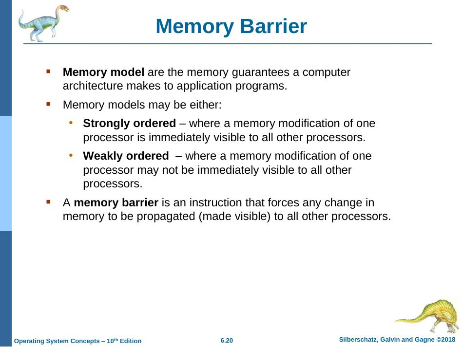

Round Robin memberi setiap proses jatah q. Jika belum selesai saat q habis, proses masuk belakang antrean. Quantum terlalu kecil memperbanyak context switch; terlalu besar membuat perilakunya mendekati FCFS.

**Perhatikan pada gambar:** ▪ Memory model are the memory guarantees a computer; architecture makes to application programs.

### Slide 021 — Memory Barrier Instructions

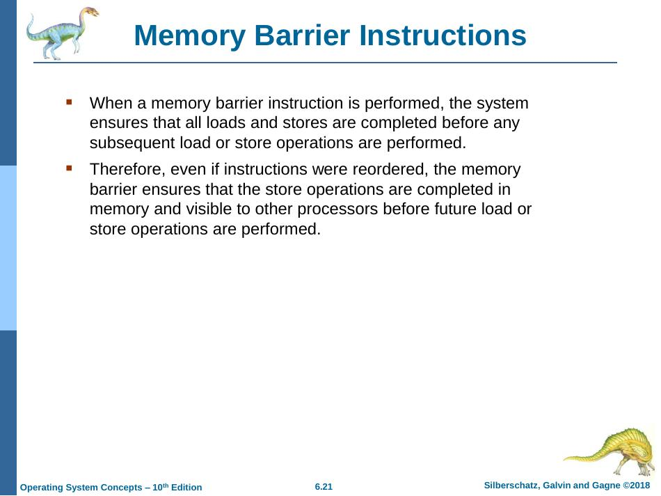

Round Robin memberi setiap proses jatah q. Jika belum selesai saat q habis, proses masuk belakang antrean. Quantum terlalu kecil memperbanyak context switch; terlalu besar membuat perilakunya mendekati FCFS.

**Perhatikan pada gambar:** ▪ When a memory barrier instruction is performed, the system; ensures that all loads and stores are completed before any

### Slide 022 — Memory Barrier Example

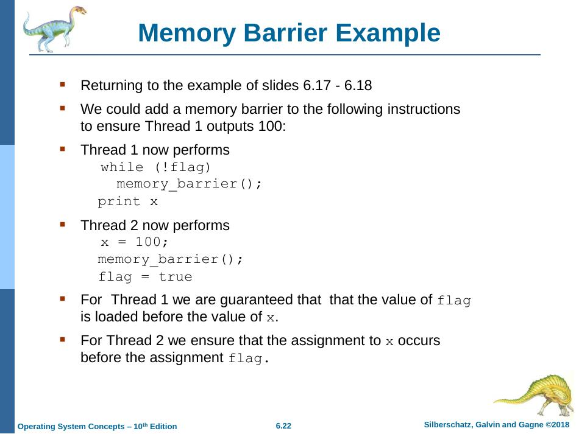

Round Robin memberi setiap proses jatah q. Jika belum selesai saat q habis, proses masuk belakang antrean. Quantum terlalu kecil memperbanyak context switch; terlalu besar membuat perilakunya mendekati FCFS.

**Perhatikan pada gambar:** ▪ Returning to the example of slides 6.17 - 6.18; ▪ We could add a memory barrier to the following instructions

### Slide 023 — Synchronization Hardware

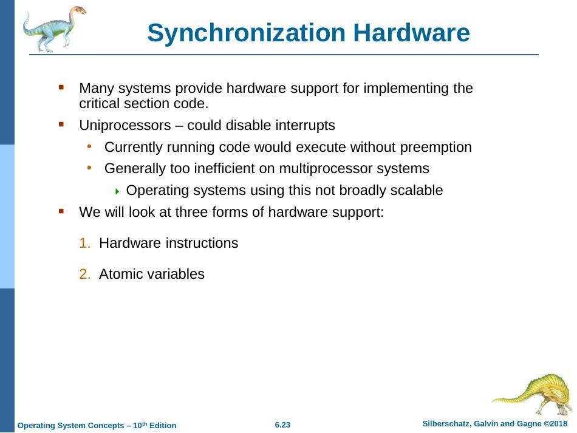

Slide ini memberi contoh tambahan untuk bagian tersebut. Perhatikan urutan pada gambar: identifikasi pelaku, sumber daya yang dipakai, lalu perubahan keadaan setelah setiap langkah. Hubungkan dengan slide sebelumnya sebelum menghafal istilahnya.

**Perhatikan pada gambar:** ▪ Many systems provide hardware support for implementing the; ▪ Uniprocessors – could disable interrupts

### Slide 024 — Hardware Instructions

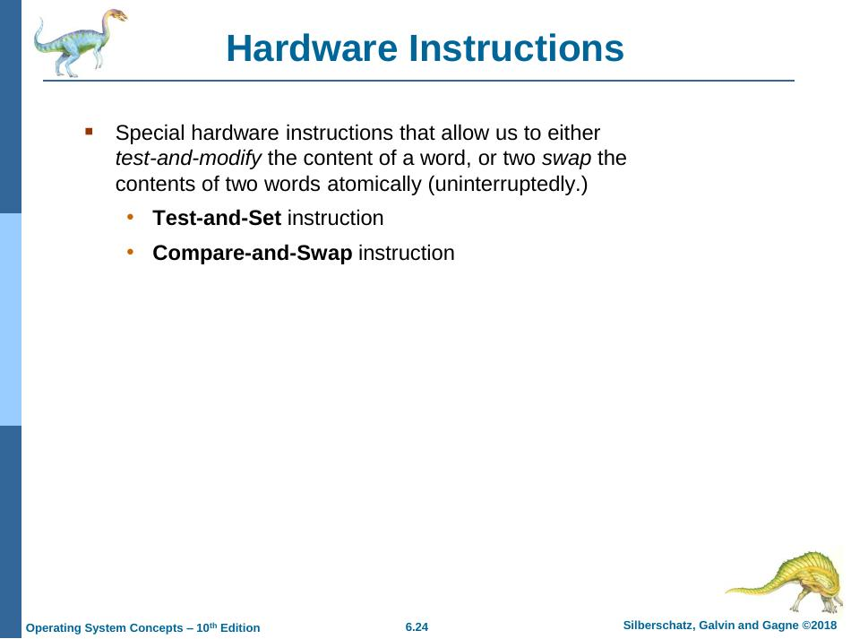

Slide ini memberi contoh tambahan untuk bagian tersebut. Perhatikan urutan pada gambar: identifikasi pelaku, sumber daya yang dipakai, lalu perubahan keadaan setelah setiap langkah. Hubungkan dengan slide sebelumnya sebelum menghafal istilahnya.

**Perhatikan pada gambar:** ▪ Special hardware instructions that allow us to either; test-and-modify the content of a word, or two swap the

### Slide 025 — The test_and_set Instruction

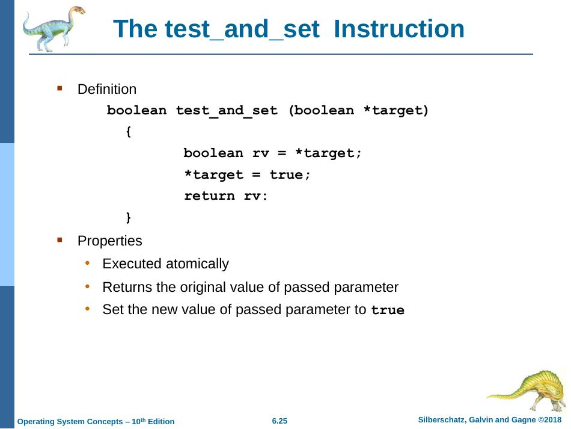

Critical section adalah bagian yang mengakses data bersama. Solusi yang benar memenuhi mutual exclusion, progress, dan bounded waiting. Operasi atomik membantu mengunci perubahan; memory barrier membatasi pengurutan ulang akses memori yang bisa merusak asumsi algoritma.

**Perhatikan pada gambar:** boolean test_and_set (boolean *target); • Returns the original value of passed parameter

### Slide 026 — Solution Using test_and_set()

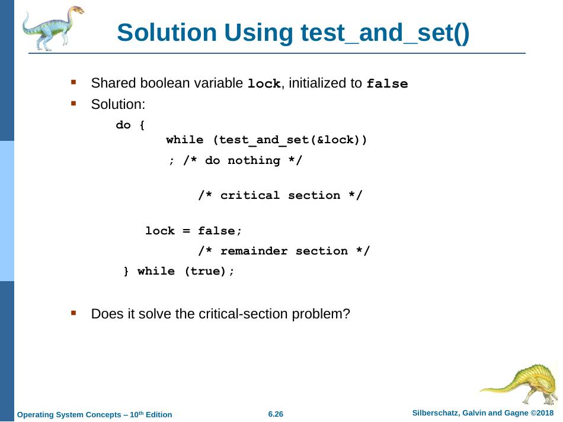

Critical section adalah bagian yang mengakses data bersama. Solusi yang benar memenuhi mutual exclusion, progress, dan bounded waiting. Operasi atomik membantu mengunci perubahan; memory barrier membatasi pengurutan ulang akses memori yang bisa merusak asumsi algoritma.

**Perhatikan pada gambar:** ▪ Shared boolean variable lock, initialized to false; while (test_and_set(&lock))

### Slide 027 — The compare_and_swap Instruction

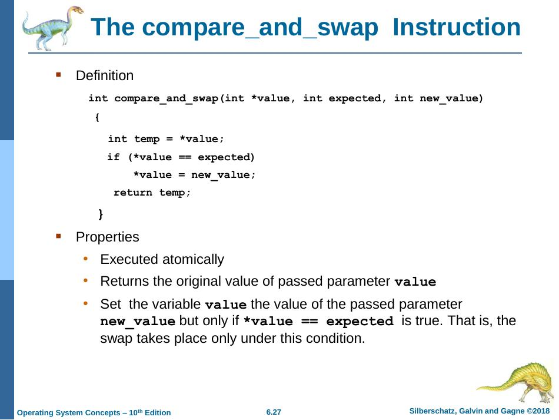

Critical section adalah bagian yang mengakses data bersama. Solusi yang benar memenuhi mutual exclusion, progress, dan bounded waiting. Operasi atomik membantu mengunci perubahan; memory barrier membatasi pengurutan ulang akses memori yang bisa merusak asumsi algoritma.

**Perhatikan pada gambar:** int compare_and_swap(int *value, int expected, int new_value); if (*value == expected)

### Slide 028 — Solution using compare_and_swap

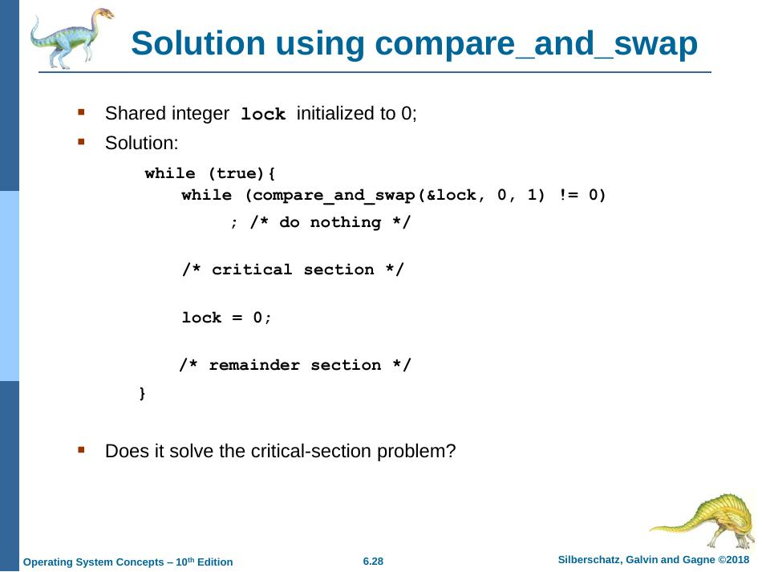

Critical section adalah bagian yang mengakses data bersama. Solusi yang benar memenuhi mutual exclusion, progress, dan bounded waiting. Operasi atomik membantu mengunci perubahan; memory barrier membatasi pengurutan ulang akses memori yang bisa merusak asumsi algoritma.

**Perhatikan pada gambar:** ▪ Shared integer lock initialized to 0;; while (compare_and_swap(&lock, 0, 1) != 0)

### Slide 029 — Bounded-waiting with compare-and-swap

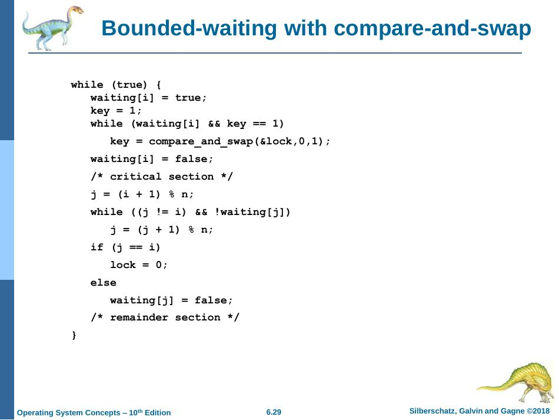

fork() membuat proses anak dengan alur eksekusi terpisah. exec() mengganti citra program pada proses yang memanggilnya. wait() membuat induk menunggu dan mengambil status anak; tanpa pengambilan status, anak yang selesai dapat menjadi zombie. Anak yang induknya lebih dulu selesai menjadi orphan.

**Perhatikan pada gambar:** while (waiting[i] && key == 1); key = compare_and_swap(&lock,0,1);

### Slide 030 — Atomic Variables

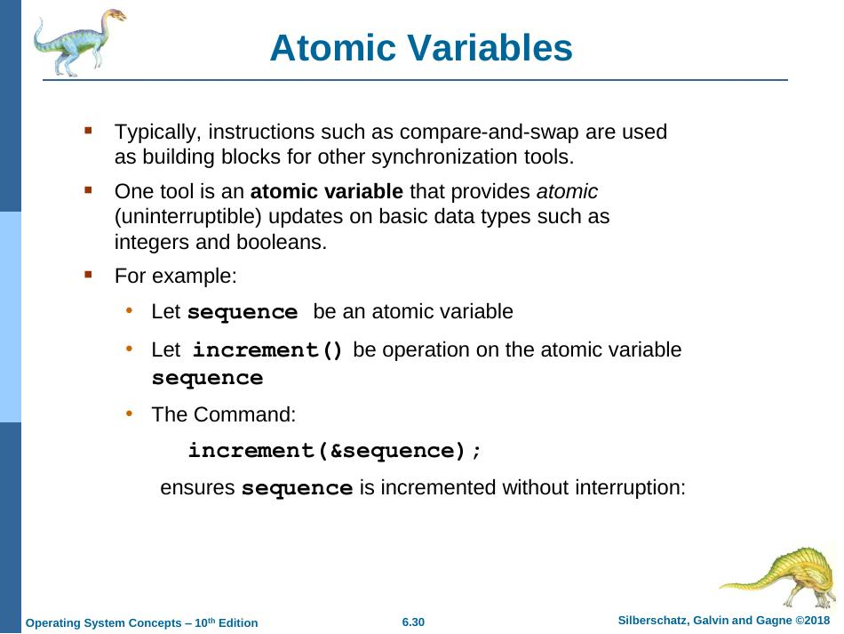

Critical section adalah bagian yang mengakses data bersama. Solusi yang benar memenuhi mutual exclusion, progress, dan bounded waiting. Operasi atomik membantu mengunci perubahan; memory barrier membatasi pengurutan ulang akses memori yang bisa merusak asumsi algoritma.

**Perhatikan pada gambar:** ▪ Typically, instructions such as compare-and-swap are used; as building blocks for other synchronization tools.

### Slide 031 — Atomic Variables

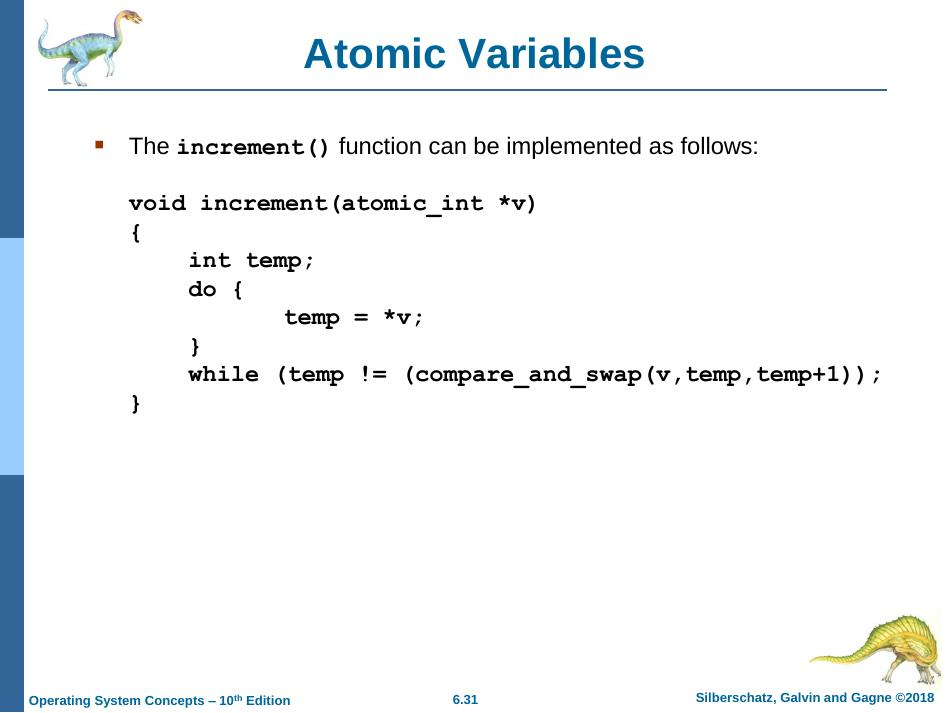

Critical section adalah bagian yang mengakses data bersama. Solusi yang benar memenuhi mutual exclusion, progress, dan bounded waiting. Operasi atomik membantu mengunci perubahan; memory barrier membatasi pengurutan ulang akses memori yang bisa merusak asumsi algoritma.

**Perhatikan pada gambar:** ▪ The increment() function can be implemented as follows:; void increment(atomic_int *v)

### Slide 032 — Mutex Locks

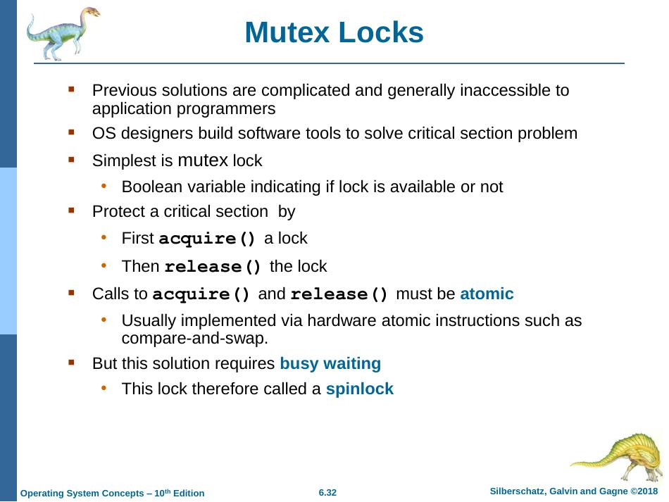

Mutex menjaga satu pemilik bagian kritis. Spinlock menunggu dengan berputar; semaphore menghitung izin melalui wait/P dan signal/V. Untuk kondisi tertentu, pekerja harus menunggu sampai syarat benar, bukan sekadar mengunci data. Perhatikan urutan pengambilan dan pelepasan agar tidak macet.

**Perhatikan pada gambar:** ▪ Previous solutions are complicated and generally inaccessible to; application programmers

### Slide 033 — Solution to CS Problem Using Mutex Locks

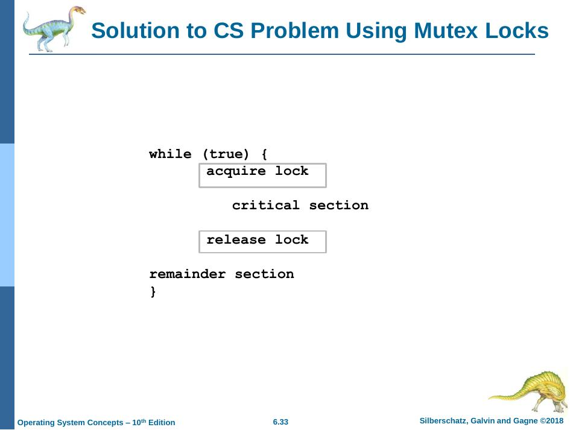

Mutex menjaga satu pemilik bagian kritis. Spinlock menunggu dengan berputar; semaphore menghitung izin melalui wait/P dan signal/V. Untuk kondisi tertentu, pekerja harus menunggu sampai syarat benar, bukan sekadar mengunci data. Perhatikan urutan pengambilan dan pelepasan agar tidak macet.

### Slide 034 — Semaphore

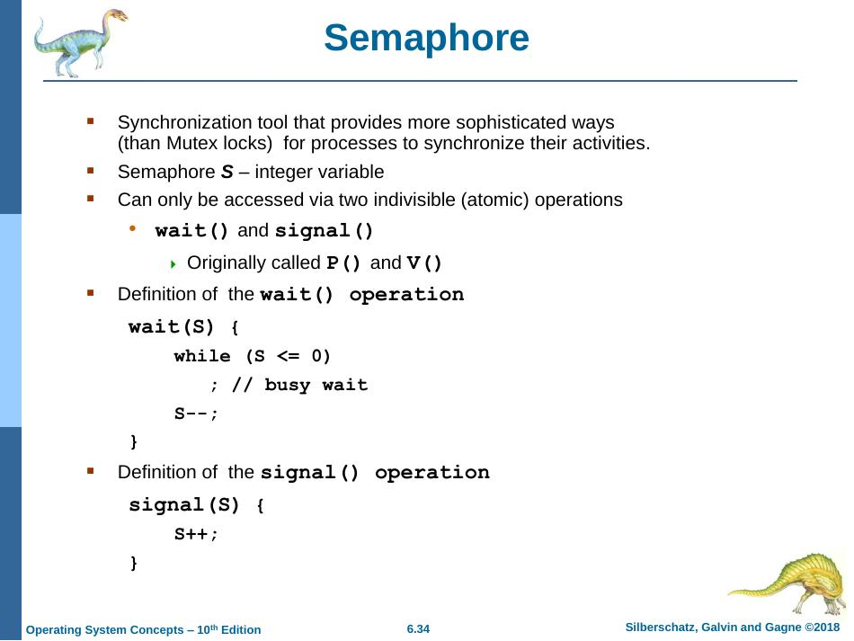

Mutex menjaga satu pemilik bagian kritis. Spinlock menunggu dengan berputar; semaphore menghitung izin melalui wait/P dan signal/V. Untuk kondisi tertentu, pekerja harus menunggu sampai syarat benar, bukan sekadar mengunci data. Perhatikan urutan pengambilan dan pelepasan agar tidak macet.

**Perhatikan pada gambar:** ▪ Synchronization tool that provides more sophisticated ways; (than Mutex locks) for processes to synchronize their activities.

### Slide 035 — Semaphore (Cont.)

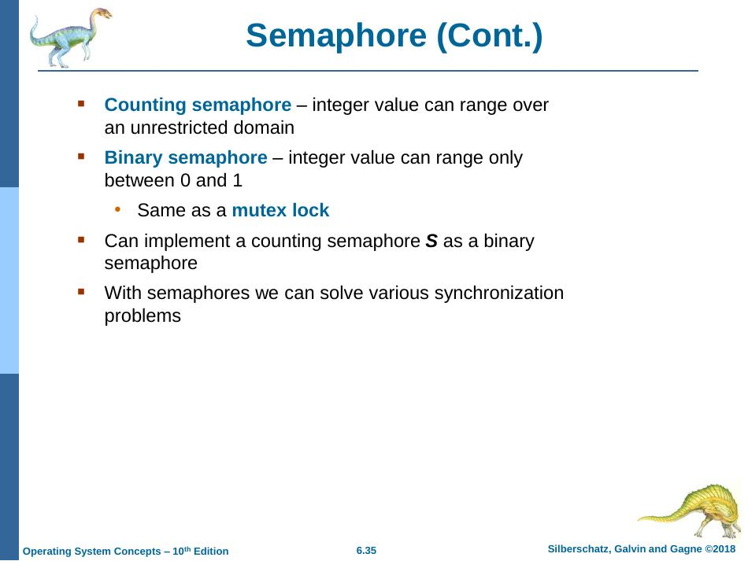

Mutex menjaga satu pemilik bagian kritis. Spinlock menunggu dengan berputar; semaphore menghitung izin melalui wait/P dan signal/V. Untuk kondisi tertentu, pekerja harus menunggu sampai syarat benar, bukan sekadar mengunci data. Perhatikan urutan pengambilan dan pelepasan agar tidak macet.

**Perhatikan pada gambar:** ▪ Counting semaphore – integer value can range over; ▪ Binary semaphore – integer value can range only

### Slide 036 — Semaphore Usage Example

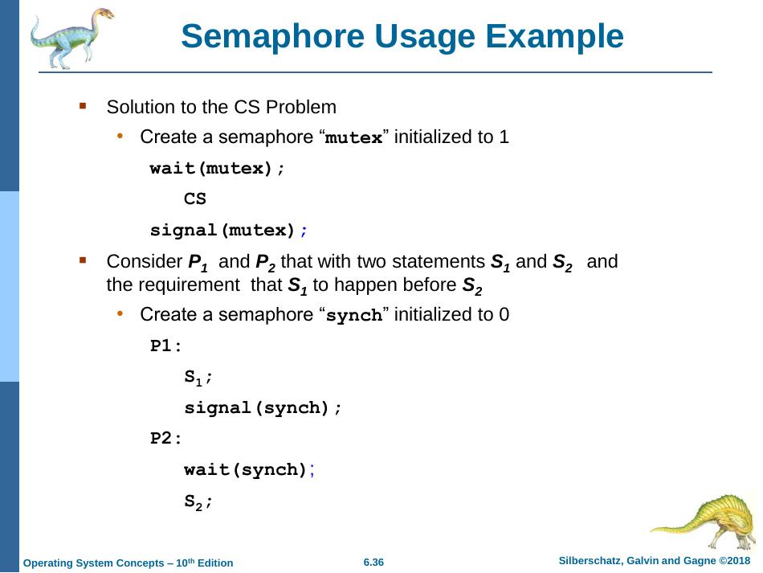

Mutex menjaga satu pemilik bagian kritis. Spinlock menunggu dengan berputar; semaphore menghitung izin melalui wait/P dan signal/V. Untuk kondisi tertentu, pekerja harus menunggu sampai syarat benar, bukan sekadar mengunci data. Perhatikan urutan pengambilan dan pelepasan agar tidak macet.

**Perhatikan pada gambar:** ▪ Solution to the CS Problem; • Create a semaphore “mutex” initialized to 1

### Slide 037 — Semaphore Implementation

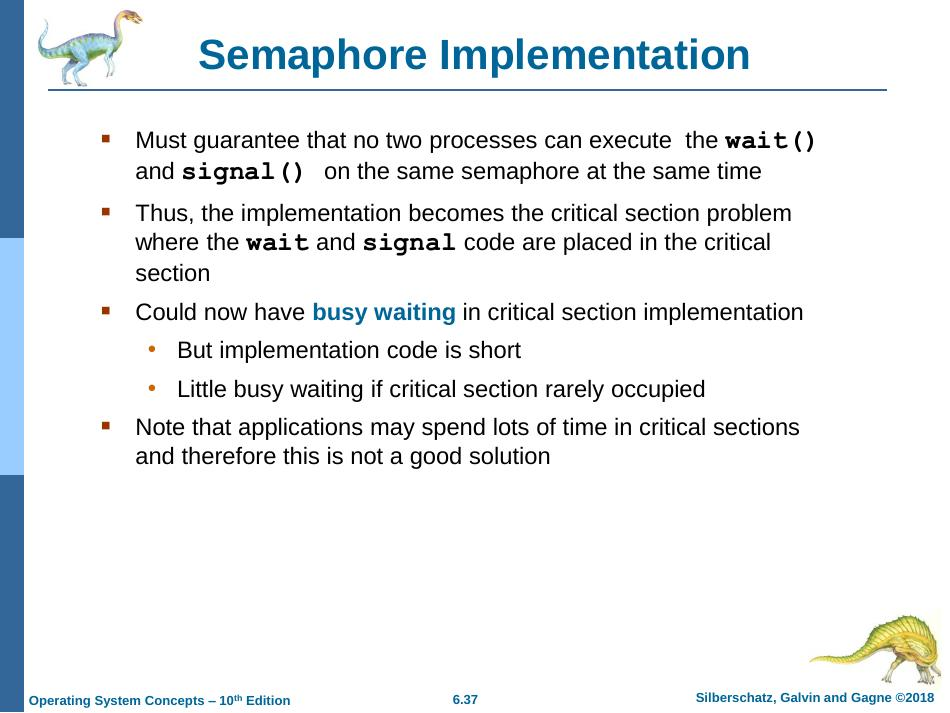

Mekanisme adalah cara sistem melakukan sesuatu; kebijakan menentukan pilihan mana yang diambil. Contohnya, mekanisme timer memberi kesempatan menjadwalkan ulang, sedangkan kebijakan penjadwal memilih proses berikutnya.

**Perhatikan pada gambar:** ▪ Must guarantee that no two processes can execute the wait(); and signal() on the same semaphore at the same time

### Slide 038 — Semaphore Implementation with no Busy waiting

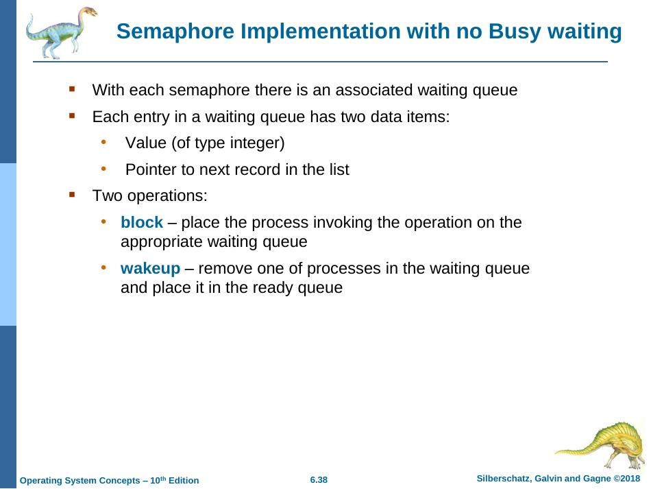

Mekanisme adalah cara sistem melakukan sesuatu; kebijakan menentukan pilihan mana yang diambil. Contohnya, mekanisme timer memberi kesempatan menjadwalkan ulang, sedangkan kebijakan penjadwal memilih proses berikutnya.

**Perhatikan pada gambar:** ▪ With each semaphore there is an associated waiting queue; ▪ Each entry in a waiting queue has two data items:

### Slide 039 — Implementation with no Busy waiting (Cont.)

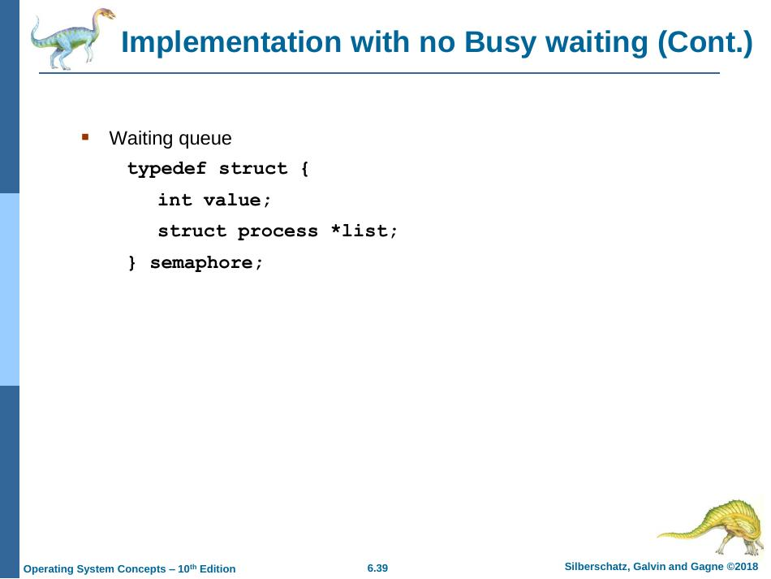

Mekanisme adalah cara sistem melakukan sesuatu; kebijakan menentukan pilihan mana yang diambil. Contohnya, mekanisme timer memberi kesempatan menjadwalkan ulang, sedangkan kebijakan penjadwal memilih proses berikutnya.

### Slide 040 — Implementation with no Busy waiting (Cont.)

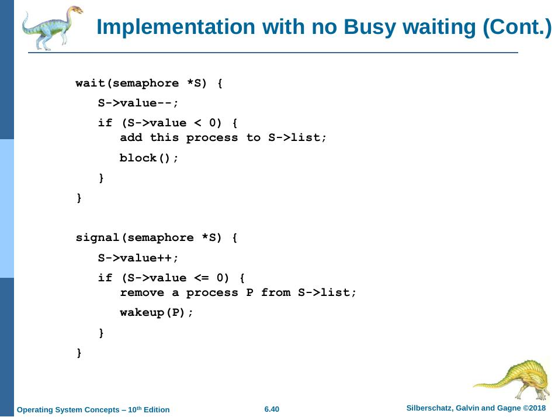

Mekanisme adalah cara sistem melakukan sesuatu; kebijakan menentukan pilihan mana yang diambil. Contohnya, mekanisme timer memberi kesempatan menjadwalkan ulang, sedangkan kebijakan penjadwal memilih proses berikutnya.

**Perhatikan pada gambar:** add this process to S->list;; remove a process P from S->list;

### Slide 041 — Problems with Semaphores

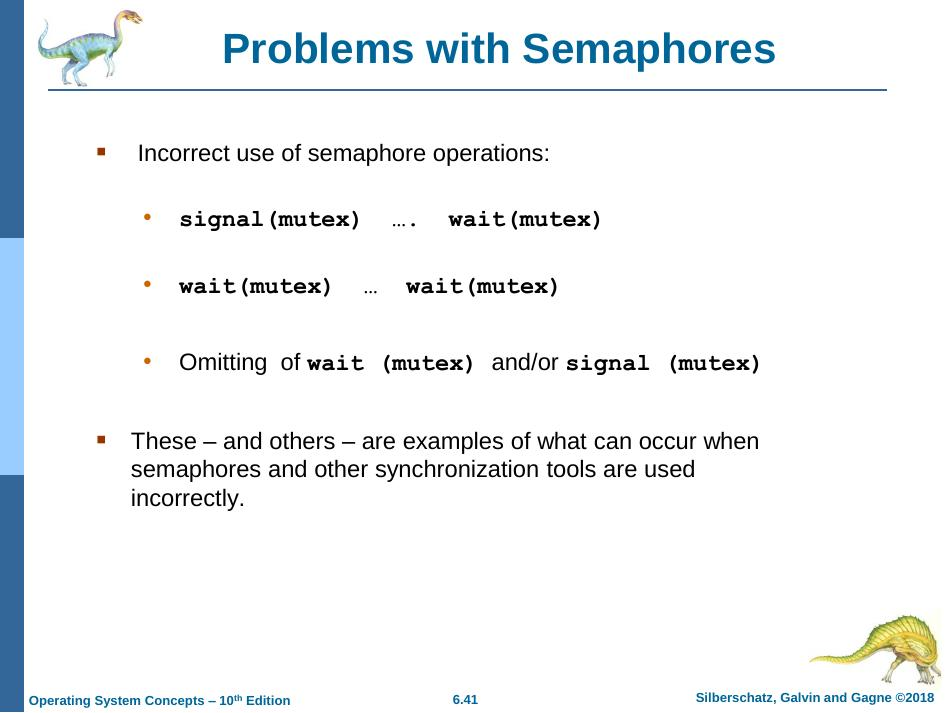

Mutex menjaga satu pemilik bagian kritis. Spinlock menunggu dengan berputar; semaphore menghitung izin melalui wait/P dan signal/V. Untuk kondisi tertentu, pekerja harus menunggu sampai syarat benar, bukan sekadar mengunci data. Perhatikan urutan pengambilan dan pelepasan agar tidak macet.

**Perhatikan pada gambar:** ▪ Incorrect use of semaphore operations:; • signal(mutex) …. wait(mutex)

### Slide 042 — Monitors

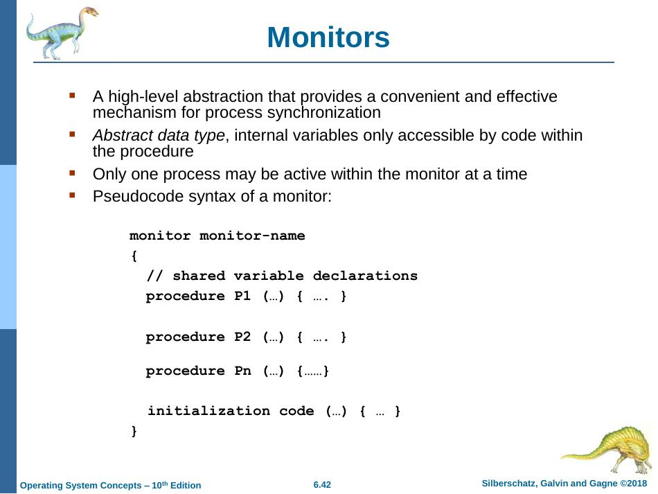

Mutex menjaga satu pemilik bagian kritis. Spinlock menunggu dengan berputar; semaphore menghitung izin melalui wait/P dan signal/V. Untuk kondisi tertentu, pekerja harus menunggu sampai syarat benar, bukan sekadar mengunci data. Perhatikan urutan pengambilan dan pelepasan agar tidak macet.

**Perhatikan pada gambar:** ▪ A high-level abstraction that provides a convenient and effective; mechanism for process synchronization

### Slide 043 — Schematic view of a Monitor

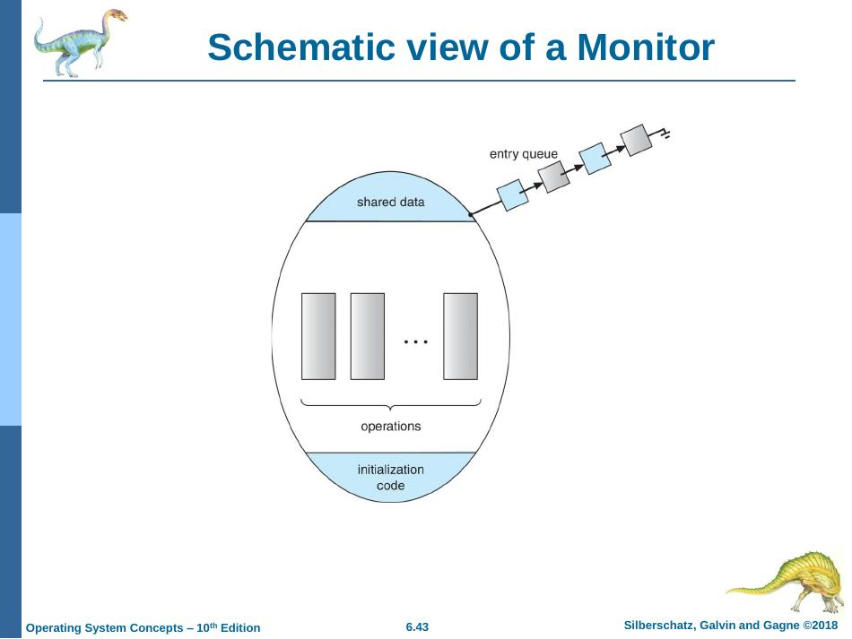

Mutex menjaga satu pemilik bagian kritis. Spinlock menunggu dengan berputar; semaphore menghitung izin melalui wait/P dan signal/V. Untuk kondisi tertentu, pekerja harus menunggu sampai syarat benar, bukan sekadar mengunci data. Perhatikan urutan pengambilan dan pelepasan agar tidak macet.

### Slide 044 — Monitor Implementation Using Semaphores

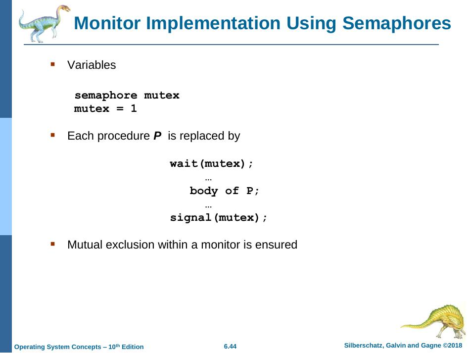

Mekanisme adalah cara sistem melakukan sesuatu; kebijakan menentukan pilihan mana yang diambil. Contohnya, mekanisme timer memberi kesempatan menjadwalkan ulang, sedangkan kebijakan penjadwal memilih proses berikutnya.

**Perhatikan pada gambar:** ▪ Each procedure P is replaced by; ▪ Mutual exclusion within a monitor is ensured

### Slide 045 — Condition Variables

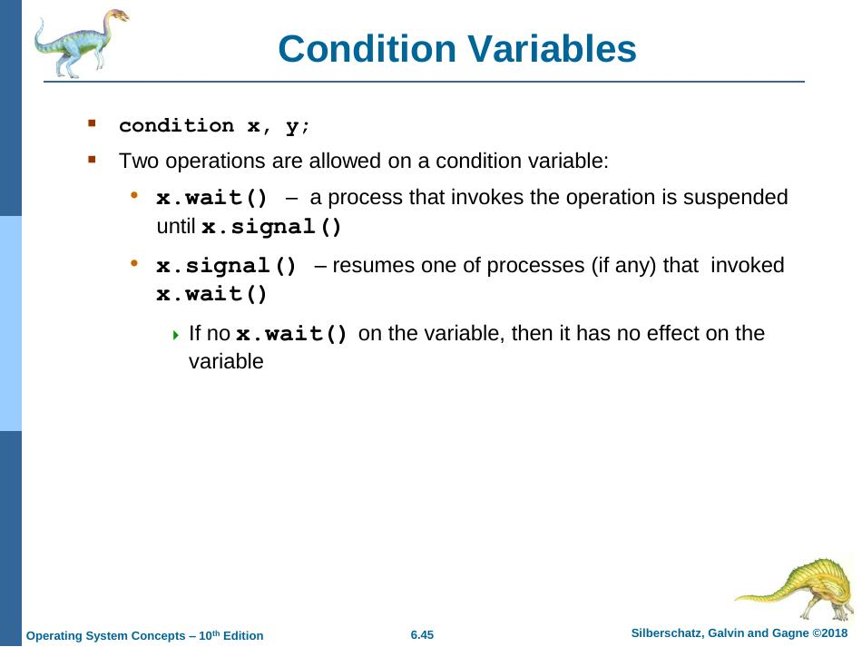

Mutex menjaga satu pemilik bagian kritis. Spinlock menunggu dengan berputar; semaphore menghitung izin melalui wait/P dan signal/V. Untuk kondisi tertentu, pekerja harus menunggu sampai syarat benar, bukan sekadar mengunci data. Perhatikan urutan pengambilan dan pelepasan agar tidak macet.

**Perhatikan pada gambar:** ▪ Two operations are allowed on a condition variable:; • x.wait() – a process that invokes the operation is suspended

### Slide 046 — Monitor with Condition Variables

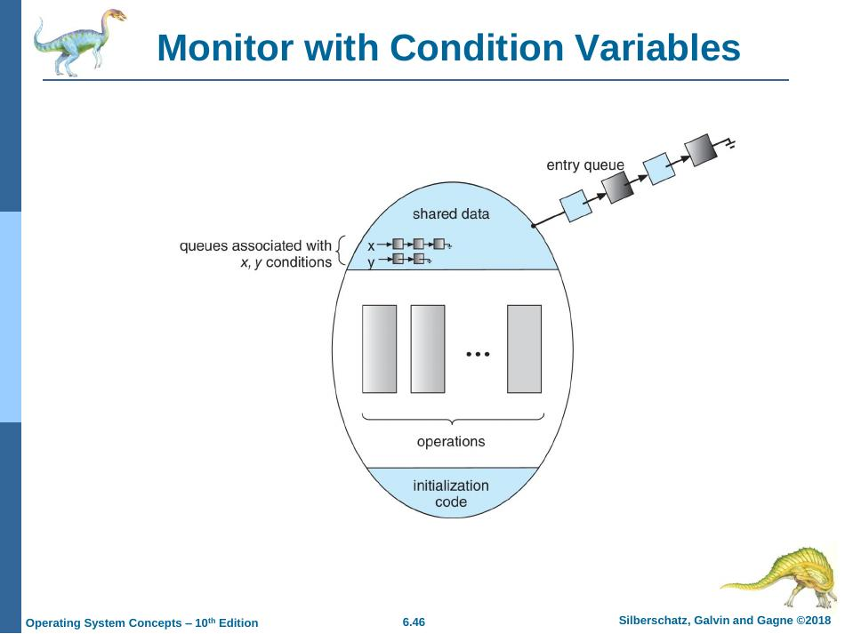

Mutex menjaga satu pemilik bagian kritis. Spinlock menunggu dengan berputar; semaphore menghitung izin melalui wait/P dan signal/V. Untuk kondisi tertentu, pekerja harus menunggu sampai syarat benar, bukan sekadar mengunci data. Perhatikan urutan pengambilan dan pelepasan agar tidak macet.

### Slide 047 — Usage of Condition Variable Example

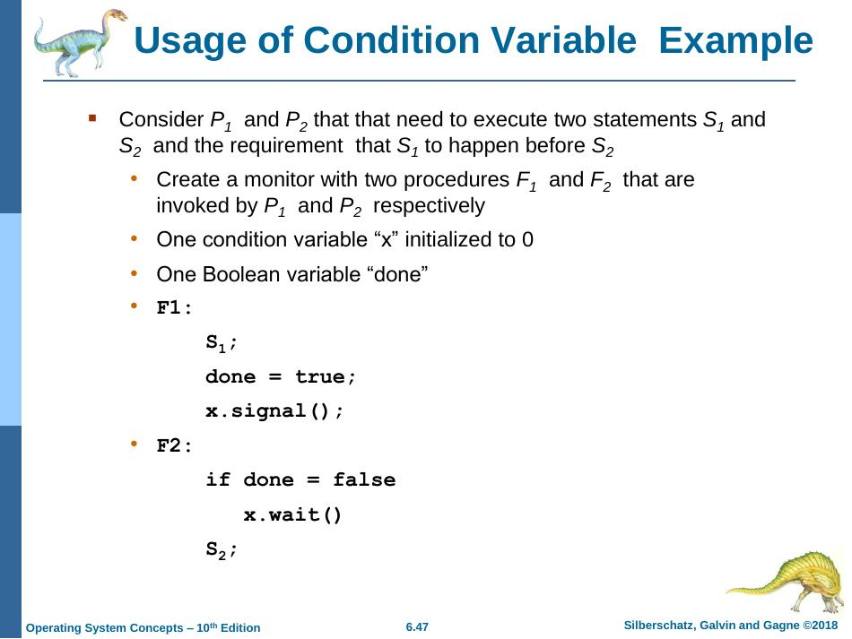

Mutex menjaga satu pemilik bagian kritis. Spinlock menunggu dengan berputar; semaphore menghitung izin melalui wait/P dan signal/V. Untuk kondisi tertentu, pekerja harus menunggu sampai syarat benar, bukan sekadar mengunci data. Perhatikan urutan pengambilan dan pelepasan agar tidak macet.

**Perhatikan pada gambar:** ▪ Consider P1 and P2 that that need to execute two statements S1 and; S2 and the requirement that S1 to happen before S2

### Slide 048 — Monitor Implementation Using Semaphores

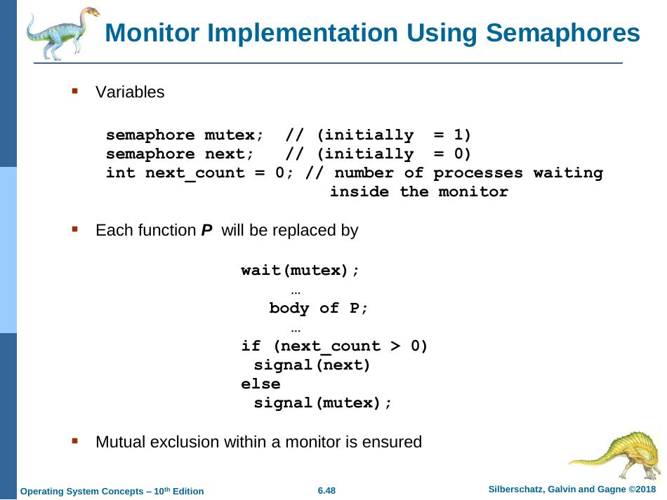

Mekanisme adalah cara sistem melakukan sesuatu; kebijakan menentukan pilihan mana yang diambil. Contohnya, mekanisme timer memberi kesempatan menjadwalkan ulang, sedangkan kebijakan penjadwal memilih proses berikutnya.

**Perhatikan pada gambar:** semaphore mutex; // (initially = 1); semaphore next; // (initially = 0)

### Slide 049 — Implementation – Condition Variables

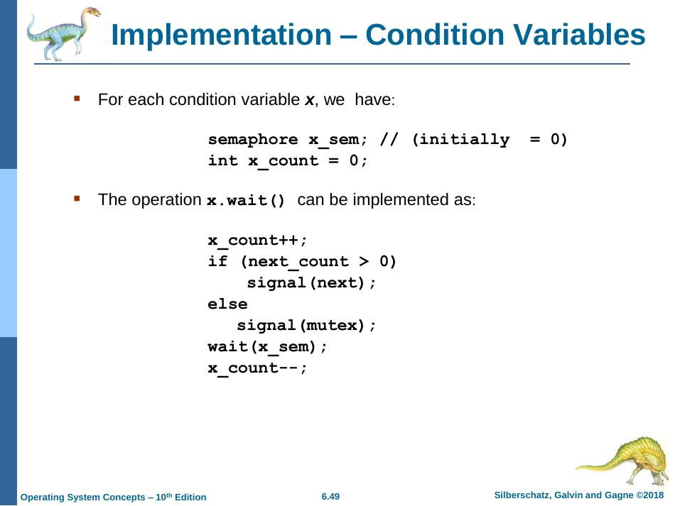

Mekanisme adalah cara sistem melakukan sesuatu; kebijakan menentukan pilihan mana yang diambil. Contohnya, mekanisme timer memberi kesempatan menjadwalkan ulang, sedangkan kebijakan penjadwal memilih proses berikutnya.

**Perhatikan pada gambar:** ▪ For each condition variable x, we have:; semaphore x_sem; // (initially = 0)

### Slide 050 — Implementation (Cont.)

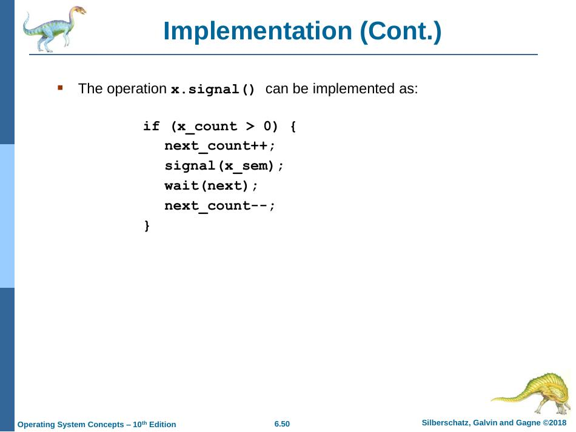

Mekanisme adalah cara sistem melakukan sesuatu; kebijakan menentukan pilihan mana yang diambil. Contohnya, mekanisme timer memberi kesempatan menjadwalkan ulang, sedangkan kebijakan penjadwal memilih proses berikutnya.

**Perhatikan pada gambar:** ▪ The operation x.signal() can be implemented as:

### Slide 051 — Resuming Processes within a Monitor

Mutex menjaga satu pemilik bagian kritis. Spinlock menunggu dengan berputar; semaphore menghitung izin melalui wait/P dan signal/V. Untuk kondisi tertentu, pekerja harus menunggu sampai syarat benar, bukan sekadar mengunci data. Perhatikan urutan pengambilan dan pelepasan agar tidak macet.

**Perhatikan pada gambar:** ▪ If several processes queued on condition variable x,; and x.signal() is executed, which process should

### Slide 052 — Single Resource allocation

Deadlock memerlukan mutual exclusion, hold-and-wait, no preemption, dan circular wait sekaligus. Pencegahan mematahkan salah satu syarat; avoidance memeriksa apakah alokasi masih menyisakan urutan penyelesaian aman. Pada Banker, hitung Need = Max − Allocation lalu cari proses dengan Need ≤ Available.

**Perhatikan pada gambar:** ▪ Allocate a single resource among competing processes using priority; numbers that specifies the maximum time a process plans to use the

### Slide 053 — Single Resource allocation

Deadlock memerlukan mutual exclusion, hold-and-wait, no preemption, dan circular wait sekaligus. Pencegahan mematahkan salah satu syarat; avoidance memeriksa apakah alokasi masih menyisakan urutan penyelesaian aman. Pada Banker, hitung Need = Max − Allocation lalu cari proses dengan Need ≤ Available.

**Perhatikan pada gambar:** ▪ Allocate a single resource among competing processes using priority; numbers that specifies the maximum time a process plans to use the

### Slide 054 — A Monitor to Allocate Single Resource

Mutex menjaga satu pemilik bagian kritis. Spinlock menunggu dengan berputar; semaphore menghitung izin melalui wait/P dan signal/V. Untuk kondisi tertentu, pekerja harus menunggu sampai syarat benar, bukan sekadar mengunci data. Perhatikan urutan pengambilan dan pelepasan agar tidak macet.

**Perhatikan pada gambar:** monitor ResourceAllocator; void acquire(int time) {

### Slide 055 — Single Resource Monitor (Cont.)

Mutex menjaga satu pemilik bagian kritis. Spinlock menunggu dengan berputar; semaphore menghitung izin melalui wait/P dan signal/V. Untuk kondisi tertentu, pekerja harus menunggu sampai syarat benar, bukan sekadar mengunci data. Perhatikan urutan pengambilan dan pelepasan agar tidak macet.

**Perhatikan pada gambar:** ▪ Incorrect use of monitor operations; • release() … acquire()

### Slide 056 — Liveness

Slide ini memberi contoh tambahan untuk bagian tersebut. Perhatikan urutan pada gambar: identifikasi pelaku, sumber daya yang dipakai, lalu perubahan keadaan setelah setiap langkah. Hubungkan dengan slide sebelumnya sebelum menghafal istilahnya.

**Perhatikan pada gambar:** ▪ Processes may have to wait indefinitely while trying to acquire a; synchronization tool such as a mutex lock or semaphore.

### Slide 057 — Liveness

Slide ini memberi contoh tambahan untuk bagian tersebut. Perhatikan urutan pada gambar: identifikasi pelaku, sumber daya yang dipakai, lalu perubahan keadaan setelah setiap langkah. Hubungkan dengan slide sebelumnya sebelum menghafal istilahnya.

**Perhatikan pada gambar:** ▪ Deadlock – two or more processes are waiting indefinitely for an; event that can be caused by only one of the waiting processes

### Slide 058 — Liveness

Slide ini memberi contoh tambahan untuk bagian tersebut. Perhatikan urutan pada gambar: identifikasi pelaku, sumber daya yang dipakai, lalu perubahan keadaan setelah setiap langkah. Hubungkan dengan slide sebelumnya sebelum menghafal istilahnya.

**Perhatikan pada gambar:** ▪ Other forms of deadlock:; ▪ Starvation – indefinite blocking

### Slide 059 — End of Chapter 6

Slide ini memetakan posisi topik dalam bab. Pakai judul-judulnya sebagai daftar cek; utamakan hubungan sebab-akibat dan contoh, bukan hafalan urutan.

### Slide 060 — Priority Inheritance Protocol

Prioritas menentukan siapa lebih dulu mendapat CPU; proses berprioritas rendah dapat kelaparan dan aging dapat menguranginya. Antrean bertingkat memisahkan kelas pekerjaan. Pada banyak CPU, affinity dan NUMA memengaruhi lokasi data serta biaya perpindahan.

**Perhatikan pada gambar:** ▪ Consider the scenario with three processes P1, P2, and P3.; • P1 has the highest priority, P2 the next highest, and P3 the

### Slide 061 — Usage of Condition Variable Example

Mutex menjaga satu pemilik bagian kritis. Spinlock menunggu dengan berputar; semaphore menghitung izin melalui wait/P dan signal/V. Untuk kondisi tertentu, pekerja harus menunggu sampai syarat benar, bukan sekadar mengunci data. Perhatikan urutan pengambilan dan pelepasan agar tidak macet.

**Perhatikan pada gambar:** ▪ Consider P1 and P2 that that need to execute two statements S1 and; S2 and the requirement that S1 to happen before S2

### Slide 062 — Chapter 7: Synchronization

Slide ini memetakan posisi topik dalam bab. Pakai judul-judulnya sebagai daftar cek; utamakan hubungan sebab-akibat dan contoh, bukan hafalan urutan.

### Slide 063 — Outline

Slide ini memetakan posisi topik dalam bab. Pakai judul-judulnya sebagai daftar cek; utamakan hubungan sebab-akibat dan contoh, bukan hafalan urutan.

### Slide 064 — Classical Problems of Synchronization

Slide ini memberi contoh tambahan untuk bagian tersebut. Perhatikan urutan pada gambar: identifikasi pelaku, sumber daya yang dipakai, lalu perubahan keadaan setelah setiap langkah. Hubungkan dengan slide sebelumnya sebelum menghafal istilahnya.

**Perhatikan pada gambar:** ▪ Classical problems used to test newly-proposed; synchronization schemes

### Slide 065 — Bounded-Buffer Problem

IPC memungkinkan proses bertukar data. Shared memory memakai area yang sama dan perlu sinkronisasi; message passing mengirim pesan melalui fasilitas sistem. Pipe lazim untuk aliran searah, socket untuk komunikasi antartitik, dan RPC membuat pemanggilan jauh tampak seperti fungsi lokal.

**Perhatikan pada gambar:** ▪ n buffers, each can hold one item; ▪ Semaphore mutex initialized to the value 1

### Slide 066 — Bounded Buffer Problem (Cont.)

IPC memungkinkan proses bertukar data. Shared memory memakai area yang sama dan perlu sinkronisasi; message passing mengirim pesan melalui fasilitas sistem. Pipe lazim untuk aliran searah, socket untuk komunikasi antartitik, dan RPC membuat pemanggilan jauh tampak seperti fungsi lokal.

**Perhatikan pada gambar:** ▪ The structure of the producer process; /* produce an item in next_produced */

### Slide 067 — Bounded Buffer Problem (Cont.)

IPC memungkinkan proses bertukar data. Shared memory memakai area yang sama dan perlu sinkronisasi; message passing mengirim pesan melalui fasilitas sistem. Pipe lazim untuk aliran searah, socket untuk komunikasi antartitik, dan RPC membuat pemanggilan jauh tampak seperti fungsi lokal.

**Perhatikan pada gambar:** ▪ The structure of the consumer process; /* remove an item from buffer to next_consumed */

### Slide 068 — Readers-Writers Problem

Pada bounded buffer, produsen menunggu ruang kosong dan konsumen menunggu isi; mutex melindungi indeks serta isi buffer. Dining philosophers menunjukkan bagaimana mengambil sumber daya dalam urutan buruk dapat membuat semua pihak menunggu.

**Perhatikan pada gambar:** ▪ A data set is shared among a number of concurrent processes; • Readers – only read the data set; they do not perform any

### Slide 069 — Readers-Writers Problem (Cont.)

Pada bounded buffer, produsen menunggu ruang kosong dan konsumen menunggu isi; mutex melindungi indeks serta isi buffer. Dining philosophers menunjukkan bagaimana mengambil sumber daya dalam urutan buruk dapat membuat semua pihak menunggu.

**Perhatikan pada gambar:** • Semaphore rw_mutex initialized to 1; • Semaphore mutex initialized to 1

### Slide 070 — Readers-Writers Problem (Cont.)

Pada bounded buffer, produsen menunggu ruang kosong dan konsumen menunggu isi; mutex melindungi indeks serta isi buffer. Dining philosophers menunjukkan bagaimana mengambil sumber daya dalam urutan buruk dapat membuat semua pihak menunggu.

**Perhatikan pada gambar:** ▪ The structure of a writer process; /* writing is performed */

### Slide 071 — Readers-Writers Problem (Cont.)

Pada bounded buffer, produsen menunggu ruang kosong dan konsumen menunggu isi; mutex melindungi indeks serta isi buffer. Dining philosophers menunjukkan bagaimana mengambil sumber daya dalam urutan buruk dapat membuat semua pihak menunggu.

**Perhatikan pada gambar:** ▪ The structure of a reader process; if (read_count == 1) /* first reader */

### Slide 072 — Readers-Writers Problem Variations

Pada bounded buffer, produsen menunggu ruang kosong dan konsumen menunggu isi; mutex melindungi indeks serta isi buffer. Dining philosophers menunjukkan bagaimana mengambil sumber daya dalam urutan buruk dapat membuat semua pihak menunggu.

**Perhatikan pada gambar:** ▪ The solution in previous slide can result in a situation where; a writer process never writes. It is referred to as the “First

### Slide 073 — Dining-Philosophers Problem

Pada bounded buffer, produsen menunggu ruang kosong dan konsumen menunggu isi; mutex melindungi indeks serta isi buffer. Dining philosophers menunjukkan bagaimana mengambil sumber daya dalam urutan buruk dapat membuat semua pihak menunggu.

**Perhatikan pada gambar:** ▪ N philosophers’ sit at a round table with a bowel of rice in the middle.; ▪ They spend their lives alternating thinking and eating.

### Slide 074 — Dining-Philosophers Problem Algorithm

Pada bounded buffer, produsen menunggu ruang kosong dan konsumen menunggu isi; mutex melindungi indeks serta isi buffer. Dining philosophers menunjukkan bagaimana mengambil sumber daya dalam urutan buruk dapat membuat semua pihak menunggu.

**Perhatikan pada gambar:** ▪ The structure of Philosopher i :; wait (chopStick[ (i + 1) % 5] );

### Slide 075 — Monitor Solution to Dining Philosophers

Mutex menjaga satu pemilik bagian kritis. Spinlock menunggu dengan berputar; semaphore menghitung izin melalui wait/P dan signal/V. Untuk kondisi tertentu, pekerja harus menunggu sampai syarat benar, bukan sekadar mengunci data. Perhatikan urutan pengambilan dan pelepasan agar tidak macet.

**Perhatikan pada gambar:** monitor DiningPhilosophers; enum { THINKING; HUNGRY, EATING) state [5] ;

### Slide 076 — Solution to Dining Philosophers (Cont.)

Pada bounded buffer, produsen menunggu ruang kosong dan konsumen menunggu isi; mutex melindungi indeks serta isi buffer. Dining philosophers menunjukkan bagaimana mengambil sumber daya dalam urutan buruk dapat membuat semua pihak menunggu.

**Perhatikan pada gambar:** if ((state[(i + 4) % 5] != EATING) &&; (state[i] == HUNGRY) &&

### Slide 077 — Solution to Dining Philosophers (Cont.)

Pada bounded buffer, produsen menunggu ruang kosong dan konsumen menunggu isi; mutex melindungi indeks serta isi buffer. Dining philosophers menunjukkan bagaimana mengambil sumber daya dalam urutan buruk dapat membuat semua pihak menunggu.

**Perhatikan pada gambar:** ▪ Each philosopher “i” invokes the operations pickup() and; putdown() in the following sequence:

### Slide 078 — Kernel Synchronization - Windows

Slide ini memberi contoh tambahan untuk bagian tersebut. Perhatikan urutan pada gambar: identifikasi pelaku, sumber daya yang dipakai, lalu perubahan keadaan setelah setiap langkah. Hubungkan dengan slide sebelumnya sebelum menghafal istilahnya.

**Perhatikan pada gambar:** ▪ Uses interrupt masks to protect access to global resources on; ▪ Uses spinlocks on multiprocessor systems

### Slide 079 — Kernel Synchronization - Windows

Slide ini memberi contoh tambahan untuk bagian tersebut. Perhatikan urutan pada gambar: identifikasi pelaku, sumber daya yang dipakai, lalu perubahan keadaan setelah setiap langkah. Hubungkan dengan slide sebelumnya sebelum menghafal istilahnya.

**Perhatikan pada gambar:** ▪ Mutex dispatcher object

### Slide 080 — Linux Synchronization

Slide ini memberi contoh tambahan untuk bagian tersebut. Perhatikan urutan pada gambar: identifikasi pelaku, sumber daya yang dipakai, lalu perubahan keadaan setelah setiap langkah. Hubungkan dengan slide sebelumnya sebelum menghafal istilahnya.

**Perhatikan pada gambar:** • Prior to kernel Version 2.6, disables interrupts to implement; short critical sections

### Slide 081 — Linux Synchronization

Slide ini memberi contoh tambahan untuk bagian tersebut. Perhatikan urutan pada gambar: identifikasi pelaku, sumber daya yang dipakai, lalu perubahan keadaan setelah setiap langkah. Hubungkan dengan slide sebelumnya sebelum menghafal istilahnya.

**Perhatikan pada gambar:** atomic_t is the type for atomic integer; ▪ Consider the variables

### Slide 082 — POSIX Synchronization

Slide ini memberi contoh tambahan untuk bagian tersebut. Perhatikan urutan pada gambar: identifikasi pelaku, sumber daya yang dipakai, lalu perubahan keadaan setelah setiap langkah. Hubungkan dengan slide sebelumnya sebelum menghafal istilahnya.

**Perhatikan pada gambar:** ▪ Widely used on UNIX, Linux, and macOS

### Slide 083 — POSIX Mutex Locks

Mutex menjaga satu pemilik bagian kritis. Spinlock menunggu dengan berputar; semaphore menghitung izin melalui wait/P dan signal/V. Untuk kondisi tertentu, pekerja harus menunggu sampai syarat benar, bukan sekadar mengunci data. Perhatikan urutan pengambilan dan pelepasan agar tidak macet.

**Perhatikan pada gambar:** ▪ Creating and initializing the lock; ▪ Acquiring and releasing the lock

### Slide 084 — POSIX Semaphores

Mutex menjaga satu pemilik bagian kritis. Spinlock menunggu dengan berputar; semaphore menghitung izin melalui wait/P dan signal/V. Untuk kondisi tertentu, pekerja harus menunggu sampai syarat benar, bukan sekadar mengunci data. Perhatikan urutan pengambilan dan pelepasan agar tidak macet.

**Perhatikan pada gambar:** ▪ POSIX provides two versions – named and unnamed.; ▪ Named semaphores can be used by unrelated processes, unnamed

### Slide 085 — POSIX Named Semaphores

Mutex menjaga satu pemilik bagian kritis. Spinlock menunggu dengan berputar; semaphore menghitung izin melalui wait/P dan signal/V. Untuk kondisi tertentu, pekerja harus menunggu sampai syarat benar, bukan sekadar mengunci data. Perhatikan urutan pengambilan dan pelepasan agar tidak macet.

**Perhatikan pada gambar:** ▪ Creating an initializing the semaphore:; ▪ Another process can access the semaphore by referring to its name SEM.

### Slide 086 — POSIX Unnamed Semaphores

Mutex menjaga satu pemilik bagian kritis. Spinlock menunggu dengan berputar; semaphore menghitung izin melalui wait/P dan signal/V. Untuk kondisi tertentu, pekerja harus menunggu sampai syarat benar, bukan sekadar mengunci data. Perhatikan urutan pengambilan dan pelepasan agar tidak macet.

**Perhatikan pada gambar:** ▪ Creating an initializing the semaphore:; ▪ Acquiring and releasing the semaphore:

### Slide 087 — POSIX Condition Variables

Mutex menjaga satu pemilik bagian kritis. Spinlock menunggu dengan berputar; semaphore menghitung izin melalui wait/P dan signal/V. Untuk kondisi tertentu, pekerja harus menunggu sampai syarat benar, bukan sekadar mengunci data. Perhatikan urutan pengambilan dan pelepasan agar tidak macet.

**Perhatikan pada gambar:** ▪ Since POSIX is typically used in C/C++ and these languages do not; provide a monitor, POSIX condition variables are associated with a

### Slide 088 — POSIX Condition Variables

Mutex menjaga satu pemilik bagian kritis. Spinlock menunggu dengan berputar; semaphore menghitung izin melalui wait/P dan signal/V. Untuk kondisi tertentu, pekerja harus menunggu sampai syarat benar, bukan sekadar mengunci data. Perhatikan urutan pengambilan dan pelepasan agar tidak macet.

**Perhatikan pada gambar:** ▪ Thread waiting for the condition a == b to become true:; ▪ Thread signaling another thread waiting on the condition variable:

### Slide 089 — Java Synchronization

Slide ini memberi contoh tambahan untuk bagian tersebut. Perhatikan urutan pada gambar: identifikasi pelaku, sumber daya yang dipakai, lalu perubahan keadaan setelah setiap langkah. Hubungkan dengan slide sebelumnya sebelum menghafal istilahnya.

**Perhatikan pada gambar:** ▪ Java provides rich set of synchronization features:

### Slide 090 — Java Monitors

Mutex menjaga satu pemilik bagian kritis. Spinlock menunggu dengan berputar; semaphore menghitung izin melalui wait/P dan signal/V. Untuk kondisi tertentu, pekerja harus menunggu sampai syarat benar, bukan sekadar mengunci data. Perhatikan urutan pengambilan dan pelepasan agar tidak macet.

**Perhatikan pada gambar:** ▪ Every Java object has associated with it a single lock.; ▪ If a method is declared as synchronized, a calling thread must own

### Slide 091 — Bounded Buffer – Java Synchronization

IPC memungkinkan proses bertukar data. Shared memory memakai area yang sama dan perlu sinkronisasi; message passing mengirim pesan melalui fasilitas sistem. Pipe lazim untuk aliran searah, socket untuk komunikasi antartitik, dan RPC membuat pemanggilan jauh tampak seperti fungsi lokal.

### Slide 092 — Java Synchronization

Slide ini memberi contoh tambahan untuk bagian tersebut. Perhatikan urutan pada gambar: identifikasi pelaku, sumber daya yang dipakai, lalu perubahan keadaan setelah setiap langkah. Hubungkan dengan slide sebelumnya sebelum menghafal istilahnya.

**Perhatikan pada gambar:** ▪ A thread that tries to acquire an unavailable lock is placed in the

### Slide 093 — Java Synchronization

Slide ini memberi contoh tambahan untuk bagian tersebut. Perhatikan urutan pada gambar: identifikasi pelaku, sumber daya yang dipakai, lalu perubahan keadaan setelah setiap langkah. Hubungkan dengan slide sebelumnya sebelum menghafal istilahnya.

**Perhatikan pada gambar:** ▪ Similarly, each object also has a wait set.; ▪ When a thread calls wait():

### Slide 094 — Java Synchronization

Slide ini memberi contoh tambahan untuk bagian tersebut. Perhatikan urutan pada gambar: identifikasi pelaku, sumber daya yang dipakai, lalu perubahan keadaan setelah setiap langkah. Hubungkan dengan slide sebelumnya sebelum menghafal istilahnya.

**Perhatikan pada gambar:** ▪ A thread typically calls wait() when it is waiting for a condition to; ▪ How does a thread get notified?

### Slide 095 — Bounded Buffer – Java Synchronization

IPC memungkinkan proses bertukar data. Shared memory memakai area yang sama dan perlu sinkronisasi; message passing mengirim pesan melalui fasilitas sistem. Pipe lazim untuk aliran searah, socket untuk komunikasi antartitik, dan RPC membuat pemanggilan jauh tampak seperti fungsi lokal.

### Slide 096 — Bounded Buffer – Java Synchronization

IPC memungkinkan proses bertukar data. Shared memory memakai area yang sama dan perlu sinkronisasi; message passing mengirim pesan melalui fasilitas sistem. Pipe lazim untuk aliran searah, socket untuk komunikasi antartitik, dan RPC membuat pemanggilan jauh tampak seperti fungsi lokal.

### Slide 097 — Java Reentrant Locks

Slide ini memberi contoh tambahan untuk bagian tersebut. Perhatikan urutan pada gambar: identifikasi pelaku, sumber daya yang dipakai, lalu perubahan keadaan setelah setiap langkah. Hubungkan dengan slide sebelumnya sebelum menghafal istilahnya.

**Perhatikan pada gambar:** ▪ Similar to mutex locks; ▪ The finally clause ensures the lock will be released in case an

### Slide 098 — Java Semaphores

Mutex menjaga satu pemilik bagian kritis. Spinlock menunggu dengan berputar; semaphore menghitung izin melalui wait/P dan signal/V. Untuk kondisi tertentu, pekerja harus menunggu sampai syarat benar, bukan sekadar mengunci data. Perhatikan urutan pengambilan dan pelepasan agar tidak macet.

### Slide 099 — Java Condition Variables

Mutex menjaga satu pemilik bagian kritis. Spinlock menunggu dengan berputar; semaphore menghitung izin melalui wait/P dan signal/V. Untuk kondisi tertentu, pekerja harus menunggu sampai syarat benar, bukan sekadar mengunci data. Perhatikan urutan pengambilan dan pelepasan agar tidak macet.

**Perhatikan pada gambar:** ▪ Condition variables are associated with an ReentrantLock.; ▪ Creating a condition variable using newCondition() method of

### Slide 100 — Java Condition Variables

Mutex menjaga satu pemilik bagian kritis. Spinlock menunggu dengan berputar; semaphore menghitung izin melalui wait/P dan signal/V. Untuk kondisi tertentu, pekerja harus menunggu sampai syarat benar, bukan sekadar mengunci data. Perhatikan urutan pengambilan dan pelepasan agar tidak macet.

**Perhatikan pada gambar:** ▪ Five threads numbered 0 .. 4; ▪ Shared variable turn indicating which thread’s turn it is.

### Slide 101 — Java Condition Variables

Mutex menjaga satu pemilik bagian kritis. Spinlock menunggu dengan berputar; semaphore menghitung izin melalui wait/P dan signal/V. Untuk kondisi tertentu, pekerja harus menunggu sampai syarat benar, bukan sekadar mengunci data. Perhatikan urutan pengambilan dan pelepasan agar tidak macet.

### Slide 102 — Alternative Approaches

Slide ini memberi contoh tambahan untuk bagian tersebut. Perhatikan urutan pada gambar: identifikasi pelaku, sumber daya yang dipakai, lalu perubahan keadaan setelah setiap langkah. Hubungkan dengan slide sebelumnya sebelum menghafal istilahnya.

**Perhatikan pada gambar:** ▪ Functional Programming Languages

### Slide 103 — Transactional Memory

Slide ini memberi contoh tambahan untuk bagian tersebut. Perhatikan urutan pada gambar: identifikasi pelaku, sumber daya yang dipakai, lalu perubahan keadaan setelah setiap langkah. Hubungkan dengan slide sebelumnya sebelum menghafal istilahnya.

**Perhatikan pada gambar:** ▪ Consider a function update() that must be called atomically.; One option is to use mutex locks:

### Slide 104 — OpenMP

Thread pool memakai pekerja yang sudah tersedia agar biaya membuat thread berulang berkurang. Pada fork-join, pekerjaan dibagi lalu hasilnya digabung. Ukur overhead dan ketergantungan tugas sebelum menyimpulkan lebih banyak thread pasti lebih cepat.

**Perhatikan pada gambar:** ▪ OpenMP is a set of compiler directives and API that support; ▪ The code contained within the #pragma omp critical

### Slide 105 — Functional Programming Languages

Slide ini memberi contoh tambahan untuk bagian tersebut. Perhatikan urutan pada gambar: identifikasi pelaku, sumber daya yang dipakai, lalu perubahan keadaan setelah setiap langkah. Hubungkan dengan slide sebelumnya sebelum menghafal istilahnya.

**Perhatikan pada gambar:** ▪ Functional programming languages offer a different paradigm; than procedural languages in that they do not maintain state.

### Slide 106 — End of Chapter 7

Slide ini memetakan posisi topik dalam bab. Pakai judul-judulnya sebagai daftar cek; utamakan hubungan sebab-akibat dan contoh, bukan hafalan urutan.

### Slide 107 — Chapter 8: Deadlocks

Slide ini memetakan posisi topik dalam bab. Pakai judul-judulnya sebagai daftar cek; utamakan hubungan sebab-akibat dan contoh, bukan hafalan urutan.

### Slide 108 — Outline

Slide ini memetakan posisi topik dalam bab. Pakai judul-judulnya sebagai daftar cek; utamakan hubungan sebab-akibat dan contoh, bukan hafalan urutan.

### Slide 109 — Chapter Objectives

Slide ini memetakan posisi topik dalam bab. Pakai judul-judulnya sebagai daftar cek; utamakan hubungan sebab-akibat dan contoh, bukan hafalan urutan.

### Slide 110 — System Model

Slide ini memberi contoh tambahan untuk bagian tersebut. Perhatikan urutan pada gambar: identifikasi pelaku, sumber daya yang dipakai, lalu perubahan keadaan setelah setiap langkah. Hubungkan dengan slide sebelumnya sebelum menghafal istilahnya.

**Perhatikan pada gambar:** ▪ System consists of resources; ▪ Resource types R1, R2, . . ., Rm

### Slide 111 — Deadlock with Semaphores

Mutex menjaga satu pemilik bagian kritis. Spinlock menunggu dengan berputar; semaphore menghitung izin melalui wait/P dan signal/V. Untuk kondisi tertentu, pekerja harus menunggu sampai syarat benar, bukan sekadar mengunci data. Perhatikan urutan pengambilan dan pelepasan agar tidak macet.

**Perhatikan pada gambar:** • A semaphore S1 initialized to 1; • A semaphore S2 initialized to 1

### Slide 112 — Deadlock Characterization

Deadlock memerlukan mutual exclusion, hold-and-wait, no preemption, dan circular wait sekaligus. Pencegahan mematahkan salah satu syarat; avoidance memeriksa apakah alokasi masih menyisakan urutan penyelesaian aman. Pada Banker, hitung Need = Max − Allocation lalu cari proses dengan Need ≤ Available.

**Perhatikan pada gambar:** Deadlock can arise if four conditions hold simultaneously.; ▪ Mutual exclusion: only one process at a time can use a

### Slide 113 — Resource-Allocation Graph

Deadlock memerlukan mutual exclusion, hold-and-wait, no preemption, dan circular wait sekaligus. Pencegahan mematahkan salah satu syarat; avoidance memeriksa apakah alokasi masih menyisakan urutan penyelesaian aman. Pada Banker, hitung Need = Max − Allocation lalu cari proses dengan Need ≤ Available.

**Perhatikan pada gambar:** A set of vertices V and a set of edges E.; ▪ V is partitioned into two types:

### Slide 114 — Resource Allocation Graph Example

Deadlock memerlukan mutual exclusion, hold-and-wait, no preemption, dan circular wait sekaligus. Pencegahan mematahkan salah satu syarat; avoidance memeriksa apakah alokasi masih menyisakan urutan penyelesaian aman. Pada Banker, hitung Need = Max − Allocation lalu cari proses dengan Need ≤ Available.

**Perhatikan pada gambar:** ▪ T1 holds one instance of R2 and is; waiting for an instance of R1

### Slide 115 — Resource Allocation Graph with a Deadlock

Deadlock memerlukan mutual exclusion, hold-and-wait, no preemption, dan circular wait sekaligus. Pencegahan mematahkan salah satu syarat; avoidance memeriksa apakah alokasi masih menyisakan urutan penyelesaian aman. Pada Banker, hitung Need = Max − Allocation lalu cari proses dengan Need ≤ Available.

### Slide 116 — Graph with a Cycle But no Deadlock

Deadlock memerlukan mutual exclusion, hold-and-wait, no preemption, dan circular wait sekaligus. Pencegahan mematahkan salah satu syarat; avoidance memeriksa apakah alokasi masih menyisakan urutan penyelesaian aman. Pada Banker, hitung Need = Max − Allocation lalu cari proses dengan Need ≤ Available.

### Slide 117 — Basic Facts

Slide ini memberi contoh tambahan untuk bagian tersebut. Perhatikan urutan pada gambar: identifikasi pelaku, sumber daya yang dipakai, lalu perubahan keadaan setelah setiap langkah. Hubungkan dengan slide sebelumnya sebelum menghafal istilahnya.

**Perhatikan pada gambar:** ▪ If graph contains no cycles  no deadlock; ▪ If graph contains a cycle 

### Slide 118 — Methods for Handling Deadlocks

Deadlock memerlukan mutual exclusion, hold-and-wait, no preemption, dan circular wait sekaligus. Pencegahan mematahkan salah satu syarat; avoidance memeriksa apakah alokasi masih menyisakan urutan penyelesaian aman. Pada Banker, hitung Need = Max − Allocation lalu cari proses dengan Need ≤ Available.

**Perhatikan pada gambar:** ▪ Ensure that the system will never enter a deadlock state:; ▪ Allow the system to enter a deadlock state and then recover

### Slide 119 — Deadlock Prevention

Deadlock memerlukan mutual exclusion, hold-and-wait, no preemption, dan circular wait sekaligus. Pencegahan mematahkan salah satu syarat; avoidance memeriksa apakah alokasi masih menyisakan urutan penyelesaian aman. Pada Banker, hitung Need = Max − Allocation lalu cari proses dengan Need ≤ Available.

**Perhatikan pada gambar:** Invalidate one of the four necessary conditions for deadlock:; ▪ Mutual Exclusion – not required for sharable resources (e.g.,

### Slide 120 — Deadlock Prevention (Cont.)

Deadlock memerlukan mutual exclusion, hold-and-wait, no preemption, dan circular wait sekaligus. Pencegahan mematahkan salah satu syarat; avoidance memeriksa apakah alokasi masih menyisakan urutan penyelesaian aman. Pada Banker, hitung Need = Max − Allocation lalu cari proses dengan Need ≤ Available.

**Perhatikan pada gambar:** • If a process that is holding some resources requests another; resource that cannot be immediately allocated to it, then all

### Slide 121 — Circular Wait

fork() membuat proses anak dengan alur eksekusi terpisah. exec() mengganti citra program pada proses yang memanggilnya. wait() membuat induk menunggu dan mengambil status anak; tanpa pengambilan status, anak yang selesai dapat menjadi zombie. Anak yang induknya lebih dulu selesai menjadi orphan.

**Perhatikan pada gambar:** ▪ Invalidating the circular wait condition is most common.; ▪ Simply assign each resource (i.e., mutex locks) a unique number.

### Slide 122 — Deadlock Avoidance

Deadlock memerlukan mutual exclusion, hold-and-wait, no preemption, dan circular wait sekaligus. Pencegahan mematahkan salah satu syarat; avoidance memeriksa apakah alokasi masih menyisakan urutan penyelesaian aman. Pada Banker, hitung Need = Max − Allocation lalu cari proses dengan Need ≤ Available.

**Perhatikan pada gambar:** Requires that the system has some additional a priori information; ▪ Simplest and most useful model requires that each process declare

### Slide 123 — Safe State

Deadlock memerlukan mutual exclusion, hold-and-wait, no preemption, dan circular wait sekaligus. Pencegahan mematahkan salah satu syarat; avoidance memeriksa apakah alokasi masih menyisakan urutan penyelesaian aman. Pada Banker, hitung Need = Max − Allocation lalu cari proses dengan Need ≤ Available.

**Perhatikan pada gambar:** ▪ When a process requests an available resource, system must; decide if immediate allocation leaves the system in a safe state

### Slide 124 — Basic Facts

Slide ini memberi contoh tambahan untuk bagian tersebut. Perhatikan urutan pada gambar: identifikasi pelaku, sumber daya yang dipakai, lalu perubahan keadaan setelah setiap langkah. Hubungkan dengan slide sebelumnya sebelum menghafal istilahnya.

**Perhatikan pada gambar:** ▪ If a system is in safe state  no deadlocks; ▪ If a system is in unsafe state  possibility of deadlock

### Slide 125 — Safe, Unsafe, Deadlock State

Deadlock memerlukan mutual exclusion, hold-and-wait, no preemption, dan circular wait sekaligus. Pencegahan mematahkan salah satu syarat; avoidance memeriksa apakah alokasi masih menyisakan urutan penyelesaian aman. Pada Banker, hitung Need = Max − Allocation lalu cari proses dengan Need ≤ Available.

### Slide 126 — Avoidance Algorithms

Deadlock memerlukan mutual exclusion, hold-and-wait, no preemption, dan circular wait sekaligus. Pencegahan mematahkan salah satu syarat; avoidance memeriksa apakah alokasi masih menyisakan urutan penyelesaian aman. Pada Banker, hitung Need = Max − Allocation lalu cari proses dengan Need ≤ Available.

**Perhatikan pada gambar:** ▪ Single instance of a resource type; • Use a resource-allocation graph

### Slide 127 — Resource-Allocation Graph Scheme

Deadlock memerlukan mutual exclusion, hold-and-wait, no preemption, dan circular wait sekaligus. Pencegahan mematahkan salah satu syarat; avoidance memeriksa apakah alokasi masih menyisakan urutan penyelesaian aman. Pada Banker, hitung Need = Max − Allocation lalu cari proses dengan Need ≤ Available.

**Perhatikan pada gambar:** ▪ Claim edge Pi → Rj indicated that process Pj may request resource Rj;; represented by a dashed line

### Slide 128 — Resource-Allocation Graph

Deadlock memerlukan mutual exclusion, hold-and-wait, no preemption, dan circular wait sekaligus. Pencegahan mematahkan salah satu syarat; avoidance memeriksa apakah alokasi masih menyisakan urutan penyelesaian aman. Pada Banker, hitung Need = Max − Allocation lalu cari proses dengan Need ≤ Available.

### Slide 129 — Unsafe State In Resource-Allocation Graph

Deadlock memerlukan mutual exclusion, hold-and-wait, no preemption, dan circular wait sekaligus. Pencegahan mematahkan salah satu syarat; avoidance memeriksa apakah alokasi masih menyisakan urutan penyelesaian aman. Pada Banker, hitung Need = Max − Allocation lalu cari proses dengan Need ≤ Available.

### Slide 130 — Resource-Allocation Graph Algorithm

Deadlock memerlukan mutual exclusion, hold-and-wait, no preemption, dan circular wait sekaligus. Pencegahan mematahkan salah satu syarat; avoidance memeriksa apakah alokasi masih menyisakan urutan penyelesaian aman. Pada Banker, hitung Need = Max − Allocation lalu cari proses dengan Need ≤ Available.

**Perhatikan pada gambar:** ▪ Suppose that process Pi requests a resource Rj; ▪ The request can be granted only if converting the request edge to an

### Slide 131 — Banker’s Algorithm

Deadlock memerlukan mutual exclusion, hold-and-wait, no preemption, dan circular wait sekaligus. Pencegahan mematahkan salah satu syarat; avoidance memeriksa apakah alokasi masih menyisakan urutan penyelesaian aman. Pada Banker, hitung Need = Max − Allocation lalu cari proses dengan Need ≤ Available.

**Perhatikan pada gambar:** ▪ Multiple instances of resources; ▪ Each process must a priori claim maximum use

### Slide 132 — Data Structures for the Banker’s Algorithm

Struktur monolitik menaruh banyak layanan di kernel sehingga komunikasi antarkomponen cepat tetapi batas kegagalannya luas. Struktur berlapis memisahkan tanggung jawab; microkernel memindahkan lebih banyak layanan ke luar kernel; modul dapat dimuat saat perlu. Bandingkan fleksibilitas, isolasi, dan biaya komunikasi.

**Perhatikan pada gambar:** Let n = number of processes, and m = number of resources types.; ▪ Available: Vector of length m. If available [j] = k, there are k

### Slide 133 — Safety Algorithm

Slide ini memberi contoh tambahan untuk bagian tersebut. Perhatikan urutan pada gambar: identifikasi pelaku, sumber daya yang dipakai, lalu perubahan keadaan setelah setiap langkah. Hubungkan dengan slide sebelumnya sebelum menghafal istilahnya.

**Perhatikan pada gambar:** 1. Let Work and Finish be vectors of length m and n, respectively.; Finish [i] = false for i = 0, 1, …, n- 1

### Slide 134 — Resource-Request Algorithm for Process Pi

Slide ini memberi contoh tambahan untuk bagian tersebut. Perhatikan urutan pada gambar: identifikasi pelaku, sumber daya yang dipakai, lalu perubahan keadaan setelah setiap langkah. Hubungkan dengan slide sebelumnya sebelum menghafal istilahnya.

**Perhatikan pada gambar:** Requesti = request vector for process Pi. If Requesti [j] = k then; process Pi wants k instances of resource type Rj

### Slide 135 — Example of Banker’s Algorithm

Deadlock memerlukan mutual exclusion, hold-and-wait, no preemption, dan circular wait sekaligus. Pencegahan mematahkan salah satu syarat; avoidance memeriksa apakah alokasi masih menyisakan urutan penyelesaian aman. Pada Banker, hitung Need = Max − Allocation lalu cari proses dengan Need ≤ Available.

**Perhatikan pada gambar:** ▪ 5 processes P0 through P4;; A (10 instances), B (5instances), and C (7 instances)

### Slide 136 — Example (Cont.)

Slide ini memberi contoh tambahan untuk bagian tersebut. Perhatikan urutan pada gambar: identifikasi pelaku, sumber daya yang dipakai, lalu perubahan keadaan setelah setiap langkah. Hubungkan dengan slide sebelumnya sebelum menghafal istilahnya.

**Perhatikan pada gambar:** ▪ The content of the matrix Need is defined to be Max – Allocation; ▪ The system is in a safe state since the sequence < P1, P3, P4, P2, P0>

### Slide 137 — Example: P1 Request (1,0,2)

Slide ini memberi contoh tambahan untuk bagian tersebut. Perhatikan urutan pada gambar: identifikasi pelaku, sumber daya yang dipakai, lalu perubahan keadaan setelah setiap langkah. Hubungkan dengan slide sebelumnya sebelum menghafal istilahnya.

**Perhatikan pada gambar:** ▪ Check that Request  Available (that is, (1,0,2)  (3,3,2)  true; Allocation Need Available

### Slide 138 — Deadlock Detection

Deadlock memerlukan mutual exclusion, hold-and-wait, no preemption, dan circular wait sekaligus. Pencegahan mematahkan salah satu syarat; avoidance memeriksa apakah alokasi masih menyisakan urutan penyelesaian aman. Pada Banker, hitung Need = Max − Allocation lalu cari proses dengan Need ≤ Available.

**Perhatikan pada gambar:** ▪ Allow system to enter deadlock state

### Slide 139 — Single Instance of Each Resource Type

Slide ini memberi contoh tambahan untuk bagian tersebut. Perhatikan urutan pada gambar: identifikasi pelaku, sumber daya yang dipakai, lalu perubahan keadaan setelah setiap langkah. Hubungkan dengan slide sebelumnya sebelum menghafal istilahnya.

**Perhatikan pada gambar:** ▪ Maintain wait-for graph; • Pi → Pj if Pi is waiting for Pj

### Slide 140 — Resource-Allocation Graph and Wait-for Graph

fork() membuat proses anak dengan alur eksekusi terpisah. exec() mengganti citra program pada proses yang memanggilnya. wait() membuat induk menunggu dan mengambil status anak; tanpa pengambilan status, anak yang selesai dapat menjadi zombie. Anak yang induknya lebih dulu selesai menjadi orphan.

**Perhatikan pada gambar:** Resource-Allocation Graph Corresponding wait-for graph

### Slide 141 — Several Instances of a Resource Type

Slide ini memberi contoh tambahan untuk bagian tersebut. Perhatikan urutan pada gambar: identifikasi pelaku, sumber daya yang dipakai, lalu perubahan keadaan setelah setiap langkah. Hubungkan dengan slide sebelumnya sebelum menghafal istilahnya.

**Perhatikan pada gambar:** ▪ Available: A vector of length m indicates the number of available; ▪ Allocation: An n x m matrix defines the number of resources of each

### Slide 142 — Detection Algorithm

Slide ini memberi contoh tambahan untuk bagian tersebut. Perhatikan urutan pada gambar: identifikasi pelaku, sumber daya yang dipakai, lalu perubahan keadaan setelah setiap langkah. Hubungkan dengan slide sebelumnya sebelum menghafal istilahnya.

**Perhatikan pada gambar:** 1. Let Work and Finish be vectors of length m and n, respectively; b) For i = 1,2, …, n, if Allocationi  0, then

### Slide 143 — Detection Algorithm (Cont.)

Slide ini memberi contoh tambahan untuk bagian tersebut. Perhatikan urutan pada gambar: identifikasi pelaku, sumber daya yang dipakai, lalu perubahan keadaan setelah setiap langkah. Hubungkan dengan slide sebelumnya sebelum menghafal istilahnya.

**Perhatikan pada gambar:** 3. Work = Work + Allocationi; 4. If Finish[i] == false, for some i, 1  i  n, then the system is in

### Slide 144 — Example of Detection Algorithm

Slide ini memberi contoh tambahan untuk bagian tersebut. Perhatikan urutan pada gambar: identifikasi pelaku, sumber daya yang dipakai, lalu perubahan keadaan setelah setiap langkah. Hubungkan dengan slide sebelumnya sebelum menghafal istilahnya.

**Perhatikan pada gambar:** ▪ Five processes P0 through P4; three resource types; A (7 instances), B (2 instances), and C (6 instances)

### Slide 145 — Example (Cont.)

Slide ini memberi contoh tambahan untuk bagian tersebut. Perhatikan urutan pada gambar: identifikasi pelaku, sumber daya yang dipakai, lalu perubahan keadaan setelah setiap langkah. Hubungkan dengan slide sebelumnya sebelum menghafal istilahnya.

**Perhatikan pada gambar:** ▪ P2 requests an additional instance of type C; • Can reclaim resources held by process P0, but insufficient

### Slide 146 — Detection-Algorithm Usage

Slide ini memberi contoh tambahan untuk bagian tersebut. Perhatikan urutan pada gambar: identifikasi pelaku, sumber daya yang dipakai, lalu perubahan keadaan setelah setiap langkah. Hubungkan dengan slide sebelumnya sebelum menghafal istilahnya.

**Perhatikan pada gambar:** ▪ When, and how often, to invoke depends on:; • How often a deadlock is likely to occur?

### Slide 147 — Recovery from Deadlock: Process Termination

fork() membuat proses anak dengan alur eksekusi terpisah. exec() mengganti citra program pada proses yang memanggilnya. wait() membuat induk menunggu dan mengambil status anak; tanpa pengambilan status, anak yang selesai dapat menjadi zombie. Anak yang induknya lebih dulu selesai menjadi orphan.

**Perhatikan pada gambar:** ▪ Abort all deadlocked processes; ▪ Abort one process at a time until the deadlock cycle is eliminated

### Slide 148 — Recovery from Deadlock: Resource Preemption

Deadlock memerlukan mutual exclusion, hold-and-wait, no preemption, dan circular wait sekaligus. Pencegahan mematahkan salah satu syarat; avoidance memeriksa apakah alokasi masih menyisakan urutan penyelesaian aman. Pada Banker, hitung Need = Max − Allocation lalu cari proses dengan Need ≤ Available.

**Perhatikan pada gambar:** ▪ Selecting a victim – minimize cost; ▪ Rollback – return to some safe state, restart process for that

### Slide 149 — End of Chapter 8

Slide ini memetakan posisi topik dalam bab. Pakai judul-judulnya sebagai daftar cek; utamakan hubungan sebab-akibat dan contoh, bukan hafalan urutan.

## Contoh soal dan pembahasan

### Contoh 1 — Nilai semaphore (latihan dari kisi-kisi)
**Soal.** Semaphore penghitung mulai 2. Setelah `wait`, `wait`, `signal`, berapa nilainya dan berapa izin tersedia?

**Pembahasan.** 2 → 1 → 0 → 1. Tersedia satu izin. `wait` saat nilai 0 akan menunggu; `signal` melepas satu izin atau membangunkan penunggu menurut implementasinya.

### Contoh 2 — Empat syarat deadlock (latihan dari kisi-kisi)
**Soal.** P1 memegang A menunggu B, P2 memegang B menunggu A, dan sumber daya tidak bisa direbut. Apa yang terjadi?

**Pembahasan.** Ada mutual exclusion, hold-and-wait, no preemption, serta circular wait P1→B→P2→A→P1. Keempatnya terpenuhi, sehingga deadlock. Menentukan urutan tetap untuk memperoleh A lalu B mematahkan circular wait.

### Contoh 3 — Pemeriksaan aman Banker (latihan dari kisi-kisi)
**Soal.** Satu jenis sumber daya: Available=1; P1 Allocation=1, Max=2; P2 Allocation=1, Max=3.

**Pembahasan.** Need P1=1, P2=2. P1 dapat selesai karena Need≤Available, lalu melepas 1 sehingga Available=2. P2 kemudian selesai dan melepas 1. Urutan aman P1→P2. Keadaan aman berarti ada urutan penyelesaian; proses belum tentu berjalan dalam urutan tersebut.

## Rujukan

- Slide kuliah `K7.pdf` halaman 1–149 dari paket Sensei.

- *Operating System Concepts*, edisi ke-10, Silberschatz, Galvin, dan Gagne, sebagaimana tercantum pada slide.

- `Kisi kisi.pdf` dan kumpulan contoh UTS 2018, 2019, 2021, 2022 dalam paket Sensei. Soal yang diberi label "adaptasi" mengikuti jenis/topik soal terdahulu; angka dan redaksinya tidak diklaim sama dengan soal asli.
